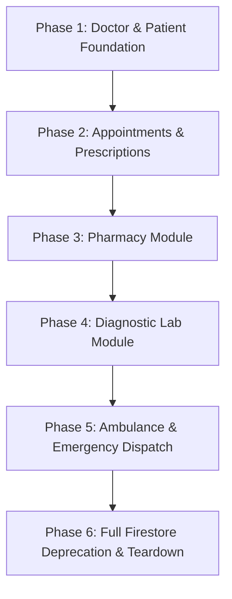

# DOCTORNECT PLATFORM — PHASE B: FIRESTORE INVENTORY & MIGRATION PLAN

**Target Architecture (Final, Non-Negotiable):**
- **Authentication:** Firebase Auth ONLY (JWT tokens bearer verified by Supabase)
- **Primary Database:** Supabase PostgreSQL ONLY (Cloud Firestore to be fully deprecated)
- **Temporary / Cache Store:** Redis (OTP mirror, sessions, cache, rate limits only; zero permanent data)
- **Object Storage:** AWS S3 (private bucket, presigned URLs for medical files, lab reports, photos)
- **Modules:** Doctor, Patient, Pharmacy, Lab, Ambulance
  *(Note: The Admin module is a separate external application and is NOT part of this codebase or migration. Shared integration dependencies are documented in Section 5).*

---

## 1. COMPREHENSIVE FIRESTORE COLLECTION INVENTORY

This section details every collection, subcollection, and ephemeral document path currently in use across the Flutter client, Cloud Functions, and administrative scripts.

---

### 1.1 Core Identity & User Account Collections

#### Collection: `users/{uid}`
- **Module:** Shared / Core Identity
- **Document ID:** Firebase Auth UID (`TEXT`, alphanumeric string)
- **Fields & Types:**
  - `role`: string (`'doctor' | 'patient' | 'medicalStore' | 'lab' | 'ambulance' | 'admin' | 'super_admin'`)
  - `profileId`: string (domain profile reference, e.g. `'d1'`, `'p123'`, `'ms_456'`)
  - `displayName`: string
  - `email`: string (lowercase)
  - `mobile` / `phone`: string (E.164 without prefix or 10-digit Indian mobile)
  - `profileCompleted`: boolean
  - `verified`: boolean
  - `verifiedAt`: timestamp / null
  - `deactivated`: boolean
  - `status`: string (`'approved' | 'pending' | 'rejected' | 'suspended'`)
  - `photoUrl`: string / null
  - `fcmToken`: string / null
  - `fcmTokenUpdatedAt`: timestamp / null
  - `createdAt`: timestamp
  - `updatedAt`: timestamp
- **Read / Write Locations:**
  - **Flutter (Dart):**
    - [user_repository.dart:65, 179, 338](file:///c:/Users/khije/Downloads/DoctorNect/doctor/frontend/lib/core/firebase/repositories/user_repository.dart#L65) (reads profile, writes draft profile, updates profile)
    - [onboarding_service.dart:130](file:///c:/Users/khije/Downloads/DoctorNect/doctor/frontend/lib/core/auth/onboarding_service.dart#L130) (sets initial role and profile ID)
    - [profile_completion_service.dart:40, 114](file:///c:/Users/khije/Downloads/DoctorNect/doctor/frontend/lib/core/auth/profile_completion_service.dart#L40) (updates `profileCompleted`)
    - [super_admin_verification_service.dart:100, 165](file:///c:/Users/khije/Downloads/DoctorNect/doctor/frontend/lib/core/admin/super_admin_verification_service.dart#L100) *(Separate Admin App integration — excluded from 5-module core client scope; see Section 5)*
    - [patient_notification_prefs_sync.dart:25](file:///c:/Users/khije/Downloads/DoctorNect/doctor/frontend/lib/core/notifications/patient_notification_prefs_sync.dart#L25) (syncs notification toggle preferences)
  - **Cloud Functions (JS):**
    - [index.js:1549, 1977, 2001](file:///c:/Users/khije/Downloads/DoctorNect/doctor/backend/functions/index.js#L1549) (reads user role for callable guards; claims sync trigger; dual-write sync trigger)
    - [registration_otp.js:2346, 3111](file:///c:/Users/khije/Downloads/DoctorNect/doctor/backend/functions/registration_otp.js#L2346) (creates user doc upon registration OTP verification)
    - [cross_role_sync.js:4520-4546](file:///c:/Users/khije/Downloads/DoctorNect/doctor/backend/functions/cross_role_sync.js#L4520) (reads Firestore user and transforms to Supabase row)
    - [delete_my_account.js:472, 900](file:///c:/Users/khije/Downloads/DoctorNect/doctor/backend/functions/delete_my_account.js#L472) (deletes user document upon account self-deletion)
  - **Scripts (JS):**
    - [audit_firestore_users.js:95](file:///c:/Users/khije/Downloads/DoctorNect/doctor/backend/scripts/audit_firestore_users.js#L95)
    - [backfill_supabase_custom_claims.js:85](file:///c:/Users/khije/Downloads/DoctorNect/doctor/backend/scripts/backfill_supabase_custom_claims.js#L85)
    - [migrate_firestore_to_supabase.js:199](file:///c:/Users/khije/Downloads/DoctorNect/doctor/backend/scripts/migrate_firestore_to_supabase.js#L199)
- **Triggers:**
  - `syncUserClaimsOnProfileWrite` (`onDocumentWritten('users/{uid}')` in [index.js:1977](file:///c:/Users/khije/Downloads/DoctorNect/doctor/backend/functions/index.js#L1977))
  - `syncUserToSupabase` (`onDocumentWritten('users/{uid}')` in [index.js:2001](file:///c:/Users/khije/Downloads/DoctorNect/doctor/backend/functions/index.js#L2001))
- **Security Rules:** [firestore.rules:170-220](file:///c:/Users/khije/Downloads/DoctorNect/doctor/backend/firestore.rules#L170-L220)
  - Read: Owner (`request.auth.uid == uid`) or Super Admin.
  - Create: Owner on signup (`request.auth.uid == uid`), cannot self-assign `verified: true` or `role: 'admin'`.
  - Update: Owner can edit profile fields; cannot modify `role`, `verified`, or `status`. Super Admin can edit all.
  - Delete: Account deletion callable or Super Admin only.
- **Equivalent PostgreSQL Table Design:**
  ```sql
  CREATE TABLE public.users (
      id TEXT PRIMARY KEY, -- Firebase UID
      firebase_uid TEXT UNIQUE,
      role VARCHAR(32) NOT NULL CHECK (role IN ('super_admin', 'superAdmin', 'admin', 'doctor', 'patient', 'medicalStore', 'lab', 'ambulance', 'nurse', 'receptionist', 'billing_staff', 'hospital_admin')),
      profile_id VARCHAR(64) NOT NULL,
      display_name VARCHAR(255) NOT NULL,
      email VARCHAR(255) NOT NULL UNIQUE,
      mobile VARCHAR(32),
      profile_completed BOOLEAN NOT NULL DEFAULT FALSE,
      verified BOOLEAN NOT NULL DEFAULT FALSE,
      verified_at TIMESTAMPTZ,
      deactivated BOOLEAN NOT NULL DEFAULT FALSE,
      status VARCHAR(32) DEFAULT 'approved',
      photo_url TEXT,
      photo_s3_key TEXT,
      photo_s3_bucket TEXT,
      photo_storage_provider VARCHAR(32) DEFAULT 's3',
      created_at TIMESTAMPTZ NOT NULL DEFAULT CURRENT_TIMESTAMP,
      updated_at TIMESTAMPTZ NOT NULL DEFAULT CURRENT_TIMESTAMP
  );
  CREATE INDEX idx_users_role ON public.users(role);
  CREATE INDEX idx_users_profile_id ON public.users(profile_id);
  CREATE INDEX idx_users_mobile ON public.users(mobile);
  -- RLS: Owner sees own or is_super_admin()
  ```

---

#### Collection: `profile_claims/{profileId}`
- **Module:** Core Onboarding Cache
- **Document ID:** `profileId` (e.g. `'d_123'`, `'p_456'`)
- **Fields & Types:**
  - `uid`: string (Firebase Auth UID)
  - `role`: string
  - `claimedAt`: timestamp
- **Read / Write Locations:**
  - **Flutter (Dart):**
    - [user_repository.dart:65, 179](file:///c:/Users/khije/Downloads/DoctorNect/doctor/frontend/lib/core/firebase/repositories/user_repository.dart#L65) (checks profile claiming race conditions during onboarding)
    - [onboarding_service.dart:207](file:///c:/Users/khije/Downloads/DoctorNect/doctor/frontend/lib/core/auth/onboarding_service.dart#L207)
  - **Scripts (JS):**
    - [backfill_profile_claims.js:77, 157](file:///c:/Users/khije/Downloads/DoctorNect/doctor/backend/scripts/backfill_profile_claims.js#L77)
- **Security Rules:** [firestore.rules:155-168](file:///c:/Users/khije/Downloads/DoctorNect/doctor/backend/firestore.rules#L155-L168)
  - Read: Authenticated.
  - Create: `request.resource.data.uid == request.auth.uid`.
- **Equivalent PostgreSQL Table Design:**
  - **Eliminated.** PostgreSQL enforces atomic uniqueness on `public.users(profile_id)` and foreign keys to `doctors.doctor_id` / `patients.patient_id` directly in SQL transactions. No auxiliary lock collection is needed.

---

### 1.2 Doctor Module Collections

#### Collection: `doctors/{doctorId}`
- **Module:** Doctor
- **Document ID:** `doctorId` (e.g. `'d1'`, `'doc_abc123'`)
- **Fields & Types:**
  - `ownerUid`: string (Firebase Auth UID)
  - `name` / `fullName`: string
  - `email`: string
  - `mobile` / `phone`: string
  - `specialization`: string
  - `superSpecialization`: string / null
  - `qualification` / `degrees`: string / array of strings
  - `experienceYears`: number (integer)
  - `consultationFee`: number (numeric/float)
  - `clinicName`: string / null
  - `primaryFacilityId`: string / null
  - `area`: string / null
  - `city`: string
  - `state`: string / null
  - `country`: string (default: `'India'`)
  - `pincode`: string / null
  - `addressLine1`: string / null
  - `addressLine2`: string / null
  - `stateCouncil`: string / null
  - `councilNumber`: string / null
  - `certifications`: array of strings
  - `pastWorkplaces`: array of strings
  - `memberships`: array of strings
  - `awards`: array of strings
  - `publications`: array of strings
  - `about`: string / null
  - `languages`: array of strings (e.g. `['English', 'Hindi']`)
  - `photoUrl`: string / null
  - `photoS3Key`: string / null
  - `photoS3Bucket`: string / null
  - `mapsLink`: string / null
  - `landmark`: string / null
  - `rating`: number (float, 0.00 to 5.00)
  - `reviewCount`: number (integer)
  - `profileCompleted`: boolean
  - `verified`: boolean (Stage 2 super admin council validation)
  - `verifiedAt`: timestamp / null
  - `deactivated`: boolean
  - `fcmToken`: string / null
  - `createdAt`: timestamp
  - `updatedAt`: timestamp
- **Read / Write Locations:**
  - **Flutter (Dart):**
    - [doctor_directory_repository.dart:56](file:///c:/Users/khije/Downloads/DoctorNect/doctor/frontend/lib/core/firebase/repositories/doctor_directory_repository.dart#L56) (queries verified doctors for patient booking feed)
    - [doctor_profile_detail_repository.dart:32, 110](file:///c:/Users/khije/Downloads/DoctorNect/doctor/frontend/lib/core/firebase/repositories/doctor_profile_detail_repository.dart#L32) (fetches full doctor profile and edits details)
    - [doctor_verification_repository.dart:62](file:///c:/Users/khije/Downloads/DoctorNect/doctor/frontend/lib/core/firebase/repositories/doctor_verification_repository.dart#L62) (watches verified status badge)
    - [doctor_profile_store.dart:50, 449](file:///c:/Users/khije/Downloads/DoctorNect/doctor/frontend/lib/features/doctor/profile/data/doctor_profile_store.dart#L50) (realtime doctor profile listener)
  - **Cloud Functions (JS):**
    - [index.js:1676, 1713, 2039](file:///c:/Users/khije/Downloads/DoctorNect/doctor/backend/functions/index.js#L1676) (aggregates ratings from reviews; mirrors to Supabase)
    - [cross_role_sync.js:1540-1620](file:///c:/Users/khije/Downloads/DoctorNect/doctor/backend/functions/cross_role_sync.js#L1540) (`buildDoctorSupabasePayload`)
    - [delete_my_account.js:545](file:///c:/Users/khije/Downloads/DoctorNect/doctor/backend/functions/delete_my_account.js#L545) (account deletion cleanup)
  - **Scripts (JS):**
    - [migrate_firestore_to_supabase.js:285](file:///c:/Users/khije/Downloads/DoctorNect/doctor/backend/scripts/migrate_firestore_to_supabase.js#L285)
- **Triggers:**
  - `syncDoctorToSupabase` (`onDocumentWritten('doctors/{doctorId}')` in [index.js:2039](file:///c:/Users/khije/Downloads/DoctorNect/doctor/backend/functions/index.js#L2039))
- **Security Rules:** [firestore.rules:230-310](file:///c:/Users/khije/Downloads/DoctorNect/doctor/backend/firestore.rules#L230-L310)
  - Read: Anyone authenticated if `verified == true`; doctor can read own unverified document (`ownerUid == request.auth.uid`); Super Admin reads all.
  - Write: Owner on registration (`verified == false`); updates cannot modify `verified`, `rating`, or `reviewCount`. Super Admin can approve/edit all.
- **Equivalent PostgreSQL Table Design:**
  ```sql
  CREATE TABLE public.doctors (
      doctor_id VARCHAR(64) PRIMARY KEY,
      owner_uid TEXT REFERENCES public.users(id) ON DELETE SET NULL,
      name VARCHAR(255) NOT NULL,
      email VARCHAR(255) NOT NULL,
      mobile VARCHAR(32) NOT NULL,
      specialization VARCHAR(128) NOT NULL,
      super_specialization TEXT,
      qualification VARCHAR(255) NOT NULL,
      experience_years INT NOT NULL DEFAULT 1,
      consultation_fee NUMERIC(10, 2) DEFAULT 0.00,
      clinic_name VARCHAR(255),
      primary_facility_id VARCHAR(64) REFERENCES facilities(facility_id) ON DELETE SET NULL,
      area VARCHAR(128),
      city VARCHAR(128),
      state VARCHAR(128),
      country VARCHAR(64) DEFAULT 'India',
      pincode VARCHAR(16),
      address_line1 TEXT,
      address_line2 TEXT,
      state_council VARCHAR(255),
      council_number VARCHAR(128),
      certifications TEXT[] DEFAULT ARRAY[]::TEXT[],
      past_workplaces TEXT[] DEFAULT ARRAY[]::TEXT[],
      memberships TEXT[] DEFAULT ARRAY[]::TEXT[],
      awards TEXT[] DEFAULT ARRAY[]::TEXT[],
      publications TEXT[] DEFAULT ARRAY[]::TEXT[],
      about TEXT,
      languages TEXT[] DEFAULT ARRAY['English', 'Hindi']::TEXT[],
      photo_url TEXT,
      photo_s3_key TEXT,
      photo_s3_bucket TEXT,
      photo_storage_provider VARCHAR(32) DEFAULT 's3',
      rating NUMERIC(3, 2) NOT NULL DEFAULT 0.00,
      review_count INT NOT NULL DEFAULT 0,
      profile_completed BOOLEAN NOT NULL DEFAULT FALSE,
      verified BOOLEAN NOT NULL DEFAULT FALSE,
      verified_at TIMESTAMPTZ,
      deactivated BOOLEAN NOT NULL DEFAULT FALSE,
      created_at TIMESTAMPTZ NOT NULL DEFAULT CURRENT_TIMESTAMP,
      updated_at TIMESTAMPTZ NOT NULL DEFAULT CURRENT_TIMESTAMP
  );
  CREATE INDEX idx_doctors_verified_city ON public.doctors(verified, city);
  CREATE INDEX idx_doctors_specialization ON public.doctors(specialization);
  CREATE INDEX idx_doctors_owner_uid ON public.doctors(owner_uid);
  ```

---

#### Collection: `doctor_availability/{doctorId}`
- **Module:** Doctor Schedule
- **Document ID:** `doctorId` (matches parent `doctors` primary key)
- **Fields & Types:**
  - `workingDays`: array of strings (e.g. `['Mon', 'Tue', 'Wed', 'Thu', 'Fri']`)
  - `morningStart`: string (`'09:00 AM'`)
  - `morningEnd`: string (`'01:00 PM'`)
  - `eveningEnabled`: boolean
  - `eveningStart`: string (`'04:00 PM'`)
  - `eveningEnd`: string (`'08:00 PM'`)
  - `slotDurationMins`: number (integer, default: 15)
  - `maxPatientsPerDay`: number (integer, default: 20)
  - `breakEnabled`: boolean
  - `breakStart`: string / null
  - `breakEnd`: string / null
  - `leaveStart`: timestamp / null
  - `leaveEnd`: timestamp / null
  - `updatedAt`: timestamp
- **Read / Write Locations:**
  - **Flutter (Dart):**
    - [doctor_availability_repository.dart:42, 95](file:///c:/Users/khije/Downloads/DoctorNect/doctor/frontend/lib/core/firebase/repositories/doctor_availability_repository.dart#L42) (reads schedule for slot generator; writes weekly routine)
  - **Cloud Functions (JS):**
    - [appointment_slots.js:120-210](file:///c:/Users/khije/Downloads/DoctorNect/doctor/backend/functions/appointment_slots.js#L120) (reads working hours to compute available slot labels)
    - [index.js:2046](file:///c:/Users/khije/Downloads/DoctorNect/doctor/backend/functions/index.js#L2046) (`syncDoctorAvailabilityToSupabase`)
- **Triggers:**
  - `syncDoctorAvailabilityToSupabase` (`onDocumentWritten('doctor_availability/{doctorId}')` in [index.js:2046](file:///c:/Users/khije/Downloads/DoctorNect/doctor/backend/functions/index.js#L2046))
- **Security Rules:** [firestore.rules:450-475](file:///c:/Users/khije/Downloads/DoctorNect/doctor/backend/firestore.rules#L450-L475)
  - Read: Authenticated.
  - Write: Owner doctor (`myDoctorId() == doctorId`).
- **Equivalent PostgreSQL Table Design:**
  ```sql
  CREATE TABLE public.doctor_availability (
      doctor_id VARCHAR(64) PRIMARY KEY REFERENCES public.doctors(doctor_id) ON DELETE CASCADE,
      working_days TEXT[] NOT NULL DEFAULT ARRAY['Mon', 'Tue', 'Wed', 'Thu', 'Fri']::TEXT[],
      morning_start VARCHAR(16) NOT NULL DEFAULT '09:00 AM',
      morning_end VARCHAR(16) NOT NULL DEFAULT '01:00 PM',
      evening_enabled BOOLEAN NOT NULL DEFAULT TRUE,
      evening_start VARCHAR(16) NOT NULL DEFAULT '04:00 PM',
      evening_end VARCHAR(16) NOT NULL DEFAULT '08:00 PM',
      slot_duration_mins INT NOT NULL DEFAULT 15,
      max_patients_per_day INT NOT NULL DEFAULT 20,
      break_enabled BOOLEAN NOT NULL DEFAULT FALSE,
      break_start VARCHAR(16) DEFAULT '01:00 PM',
      break_end VARCHAR(16) DEFAULT '02:00 PM',
      leave_start TIMESTAMPTZ,
      leave_end TIMESTAMPTZ,
      updated_at TIMESTAMPTZ NOT NULL DEFAULT CURRENT_TIMESTAMP
  );
  ```

---

#### Collection: `referrals/{referralId}`
- **Module:** Doctor (B2B Cross-Specialty Referrals)
- **Document ID:** `referralId` (e.g. `'ref_abc123'`)
- **Fields & Types:**
  - `fromDoctorId`: string (referring doctor)
  - `toDoctorId`: string (referred specialist)
  - `patientId`: string
  - `appointmentId`: string / null
  - `fromDoctorName`: string
  - `toDoctorName`: string
  - `toSpecialization`: string
  - `patientName`: string
  - `patientAge`: number (integer)
  - `reason`: string
  - `status`: string (`'sent' | 'accepted' | 'completed' | 'cancelled'`)
  - `createdAt`: timestamp
- **Read / Write Locations:**
  - **Flutter (Dart):**
    - [referral_repository.dart:21, 59, 102](file:///c:/Users/khije/Downloads/DoctorNect/doctor/frontend/lib/core/firebase/repositories/referral_repository.dart#L21) (reads incoming/outgoing referrals; writes new referral; accepts referral)
  - **Cloud Functions (JS):**
    - [index.js:507](file:///c:/Users/khije/Downloads/DoctorNect/doctor/backend/functions/index.js#L507) (`notifyDoctorOnReferralCreated` sends push notification to `toDoctorId`)
- **Triggers:**
  - `notifyDoctorOnReferralCreated` (`onDocumentCreated('referrals/{referralId}')` in [index.js:507](file:///c:/Users/khije/Downloads/DoctorNect/doctor/backend/functions/index.js#L507))
- **Security Rules:** [firestore.rules:490-520](file:///c:/Users/khije/Downloads/DoctorNect/doctor/backend/firestore.rules#L490-L520)
  - Read: `fromDoctorId == myDoctorId() || toDoctorId == myDoctorId() || patientId == myPatientId()`.
  - Create: Verified doctor (`fromDoctorId == myDoctorId() && isVerifiedDoctor()`).
  - Update: `fromDoctorId == myDoctorId() || toDoctorId == myDoctorId()`.
- **Equivalent PostgreSQL Table Design:**
  ```sql
  CREATE TABLE public.referrals (
      referral_id VARCHAR(64) PRIMARY KEY,
      from_doctor_id VARCHAR(64) NOT NULL REFERENCES public.doctors(doctor_id) ON DELETE RESTRICT,
      to_doctor_id VARCHAR(64) NOT NULL REFERENCES public.doctors(doctor_id) ON DELETE RESTRICT,
      patient_id VARCHAR(64) NOT NULL REFERENCES public.patients(patient_id) ON DELETE RESTRICT,
      appointment_id VARCHAR(64) REFERENCES public.appointments(appointment_id) ON DELETE SET NULL,
      from_doctor_name VARCHAR(255) NOT NULL,
      to_doctor_name VARCHAR(255) NOT NULL,
      to_specialization VARCHAR(128) NOT NULL,
      patient_name VARCHAR(255) NOT NULL,
      patient_age INT NOT NULL,
      reason TEXT,
      status VARCHAR(32) NOT NULL DEFAULT 'sent' CHECK (status IN ('sent', 'accepted', 'completed', 'cancelled')),
      created_at TIMESTAMPTZ NOT NULL DEFAULT CURRENT_TIMESTAMP
  );
  CREATE INDEX idx_referrals_from_doc ON public.referrals(from_doctor_id);
  CREATE INDEX idx_referrals_to_doc ON public.referrals(to_doctor_id);
  CREATE INDEX idx_referrals_patient ON public.referrals(patient_id);
  ```

---

#### Collection: `medical_directory/{entryId}`
- **Module:** Doctor (Personal Professional Rolodex)
- **Document ID:** `entryId`
- **Fields & Types:**
  - `doctorId`: string
  - `name`: string
  - `type`: string (`'Doctor' | 'Clinic' | 'Hospital' | 'Diagnostic' | 'Pharmacy'`)
  - `phone`: string
  - `createdAt`: timestamp
  - `updatedAt`: timestamp / null
- **Read / Write Locations:**
  - **Flutter (Dart):**
    - [medical_directory_repository.dart:22, 55, 80](file:///c:/Users/khije/Downloads/DoctorNect/doctor/frontend/lib/core/firebase/repositories/medical_directory_repository.dart#L22) (CRUD on personal contact directory)
- **Security Rules:** [firestore.rules:530-545](file:///c:/Users/khije/Downloads/DoctorNect/doctor/backend/firestore.rules#L530-L545)
  - Read / Write: Owner doctor only (`doctorId == myDoctorId()`).
- **Equivalent PostgreSQL Table Design:**
  ```sql
  CREATE TABLE public.medical_directory (
      entry_id VARCHAR(64) PRIMARY KEY,
      doctor_id VARCHAR(64) NOT NULL REFERENCES public.doctors(doctor_id) ON DELETE CASCADE,
      name VARCHAR(255) NOT NULL,
      type VARCHAR(64) NOT NULL,
      phone VARCHAR(32) NOT NULL,
      created_at TIMESTAMPTZ NOT NULL DEFAULT CURRENT_TIMESTAMP,
      updated_at TIMESTAMPTZ
  );
  CREATE INDEX idx_med_directory_doctor ON public.medical_directory(doctor_id);
  ```

---

### 1.3 Patient Module Collections

#### Collection: `patients/{patientId}`
- **Module:** Patient
- **Document ID:** `patientId` (e.g. `'p1'`, `'pat_xyz'`)
- **Fields & Types:**
  - `ownerUid`: string (Firebase Auth UID)
  - `name`: string
  - `email`: string / null
  - `mobile`: string
  - `age`: number (integer)
  - `gender`: string (`'Male' | 'Female' | 'Other'`)
  - `bloodGroup`: string / null (`'O+'`, `'B+'`, etc.)
  - `height`: string / null
  - `weight`: string / null
  - `address`: string / null
  - `photoUrl`: string / null
  - `photoS3Key`: string / null
  - `photoS3Bucket`: string / null
  - `shareRecordsWithDoctors`: boolean (clinical vault master consent toggle)
  - `primaryDoctorId`: string / null
  - `invitedDoctorId`: string / null
  - `careTeamDoctorIds`: array of strings
  - `profileCompleted`: boolean
  - `verified`: boolean (defaults to `true` on phone OTP verification)
  - `fcmToken`: string / null
  - `createdAt`: timestamp
  - `updatedAt`: timestamp
- **Read / Write Locations:**
  - **Flutter (Dart):**
    - [patient_profile_repository.dart:35, 120](file:///c:/Users/khije/Downloads/DoctorNect/doctor/frontend/lib/core/firebase/repositories/patient_profile_repository.dart#L35) (reads/edits profile; toggles `shareRecordsWithDoctors`)
  - **Cloud Functions (JS):**
    - [cross_role_sync.js:1789, 4200](file:///c:/Users/khije/Downloads/DoctorNect/doctor/backend/functions/cross_role_sync.js#L1789) (`ensurePatientExistsInPostgres`, `placeholderPatientPayload`)
    - [delete_my_account.js:538](file:///c:/Users/khije/Downloads/DoctorNect/doctor/backend/functions/delete_my_account.js#L538)
    - [s3_storage.js:499](file:///c:/Users/khije/Downloads/DoctorNect/doctor/backend/functions/s3_storage.js#L499) (resolves user S3 prefixes)
  - **Scripts (JS):**
    - [migrate_firestore_to_supabase.js:422](file:///c:/Users/khije/Downloads/DoctorNect/doctor/backend/scripts/migrate_firestore_to_supabase.js#L422)
- **Subcollections:**
  - `patients/{patientId}/doctor_links/{doctorId}`: Contains audit link metadata (`source: 'appointment' | 'referral'`, `grantedAt: timestamp`).
- **Security Rules:** [firestore.rules:320-370](file:///c:/Users/khije/Downloads/DoctorNect/doctor/backend/firestore.rules#L320-L370)
  - Read: Owner patient (`ownerUid == request.auth.uid`), authorized doctors via care team / appointment link, or Super Admin.
  - Write: Owner patient or Super Admin.
- **Equivalent PostgreSQL Table Design:**
  ```sql
  CREATE TABLE public.patients (
      patient_id VARCHAR(64) PRIMARY KEY,
      owner_uid TEXT REFERENCES public.users(id) ON DELETE SET NULL,
      name VARCHAR(255) NOT NULL,
      email VARCHAR(255),
      mobile VARCHAR(32) NOT NULL,
      age INT,
      gender VARCHAR(16) CHECK (gender IN ('Male', 'Female', 'Other')),
      blood_group VARCHAR(8),
      height VARCHAR(32),
      weight VARCHAR(32),
      address TEXT,
      photo_url TEXT,
      photo_s3_key TEXT,
      photo_s3_bucket TEXT,
      photo_storage_provider VARCHAR(32) DEFAULT 's3',
      share_records_with_doctors BOOLEAN NOT NULL DEFAULT TRUE,
      primary_doctor_id VARCHAR(64) REFERENCES public.doctors(doctor_id) ON DELETE SET NULL,
      invited_doctor_id VARCHAR(64) REFERENCES public.doctors(doctor_id) ON DELETE SET NULL,
      care_team_doctor_ids TEXT[] DEFAULT ARRAY[]::TEXT[],
      profile_completed BOOLEAN NOT NULL DEFAULT TRUE,
      verified BOOLEAN NOT NULL DEFAULT TRUE,
      created_at TIMESTAMPTZ NOT NULL DEFAULT CURRENT_TIMESTAMP,
      updated_at TIMESTAMPTZ NOT NULL DEFAULT CURRENT_TIMESTAMP
  );
  CREATE INDEX idx_patients_owner_uid ON public.patients(owner_uid);
  CREATE INDEX idx_patients_mobile ON public.patients(mobile);

  -- Subcollection replacement:
  CREATE TABLE public.patient_doctor_links (
      patient_id VARCHAR(64) NOT NULL REFERENCES public.patients(patient_id) ON DELETE CASCADE,
      doctor_id VARCHAR(64) NOT NULL REFERENCES public.doctors(doctor_id) ON DELETE CASCADE,
      source VARCHAR(32) NOT NULL CHECK (source IN ('appointment', 'referral', 'manual')),
      from_doctor_id VARCHAR(64) REFERENCES public.doctors(doctor_id) ON DELETE SET NULL,
      referral_id VARCHAR(64),
      created_at TIMESTAMPTZ NOT NULL DEFAULT CURRENT_TIMESTAMP,
      PRIMARY KEY (patient_id, doctor_id)
  );
  ```

---

#### Collection: `family_members/{memberId}`
- **Module:** Patient Dependents
- **Document ID:** `memberId` (e.g. `'fam_123'`)
- **Fields & Types:**
  - `patientId`: string (FK to `patients`)
  - `name`: string
  - `relation`: string (`'spouse' | 'child' | 'parent' | 'sibling' | 'grandparent' | 'other'`)
  - `age`: number (integer)
  - `gender`: string (`'Male' | 'Female' | 'Other'`)
  - `bloodGroup`: string / null
  - `insuranceCovered`: boolean
  - `dateOfBirth`: string (YYYY-MM-DD) / null
  - `allergies`: array of strings
  - `conditions`: array of strings
  - `createdAt`: timestamp
  - `updatedAt`: timestamp
- **Read / Write Locations:**
  - **Flutter (Dart):**
    - [family_member_repository.dart:30, 65, 95](file:///c:/Users/khije/Downloads/DoctorNect/doctor/frontend/lib/core/firebase/repositories/family_member_repository.dart#L30) (CRUD on dependent family members)
  - **Cloud Functions (JS):**
    - [delete_my_account.js:462](file:///c:/Users/khije/Downloads/DoctorNect/doctor/backend/functions/delete_my_account.js#L462) (cascades on patient deletion)
- **Security Rules:** [firestore.rules:440-455](file:///c:/Users/khije/Downloads/DoctorNect/doctor/backend/firestore.rules#L440-L455)
  - Read / Write: Owner patient (`patientId == myPatientId()`).
- **Equivalent PostgreSQL Table Design:**
  ```sql
  CREATE TABLE public.family_members (
      member_id VARCHAR(64) PRIMARY KEY,
      patient_id VARCHAR(64) NOT NULL REFERENCES public.patients(patient_id) ON DELETE CASCADE,
      name VARCHAR(255) NOT NULL,
      relation VARCHAR(32) NOT NULL CHECK (relation IN ('spouse', 'child', 'parent', 'sibling', 'grandparent', 'other')),
      age INT NOT NULL,
      gender VARCHAR(16) NOT NULL,
      blood_group VARCHAR(8),
      insurance_covered BOOLEAN NOT NULL DEFAULT FALSE,
      date_of_birth DATE,
      photo_initial VARCHAR(8),
      allergies TEXT[] DEFAULT ARRAY[]::TEXT[],
      conditions TEXT[] DEFAULT ARRAY[]::TEXT[],
      created_at TIMESTAMPTZ NOT NULL DEFAULT CURRENT_TIMESTAMP,
      updated_at TIMESTAMPTZ NOT NULL DEFAULT CURRENT_TIMESTAMP
  );
  CREATE INDEX idx_family_members_patient ON public.family_members(patient_id);
  ```

---

#### Collection: `health_records/{recordId}`
- **Module:** Patient Clinical Vault (AWS S3 Presigned URLs)
- **Document ID:** `recordId` (e.g. `'rec_abc123'`)
- **Fields & Types:**
  - `patientId`: string
  - `title`: string
  - `type`: string (`'prescription' | 'labReport' | 'dischargeSummary' | 'vaccination' | 'invoice' | 'other'`)
  - `date`: timestamp
  - `source`: string (`'selfUploaded' | 'doctorPrescribed' | 'labGenerated'`)
  - `fileName`: string
  - `doctorName`: string / null
  - `labName`: string / null
  - `isImage`: boolean
  - `notes`: string / null
  - `sharedWithDoctors`: boolean
  - `fileStorage`: string (`'cloudUploaded' | 'localOnly' | 'none'`)
  - `storageUrl`: string / null (legacy download URL)
  - `s3Key`: string (e.g. `'health_records/p1/rec_abc123.pdf'`)
  - `s3Bucket`: string
  - `storageProvider`: string (`'s3'`)
  - `createdAt`: timestamp
  - `updatedAt`: timestamp
- **Read / Write Locations:**
  - **Flutter (Dart):**
    - [patient_profile_repository.dart:180, 240](file:///c:/Users/khije/Downloads/DoctorNect/doctor/frontend/lib/core/firebase/repositories/patient_profile_repository.dart#L180) (lists records, requests S3 upload presigned URL, saves metadata)
  - **Cloud Functions (JS):**
    - [s3_storage.js:140-280, 655](file:///c:/Users/khije/Downloads/DoctorNect/doctor/backend/functions/s3_storage.js#L140) (`generatePresignedUploadUrl`, `generatePresignedDownloadUrl` with Redis 300s cache)
    - [delete_my_account.js:440](file:///c:/Users/khije/Downloads/DoctorNect/doctor/backend/functions/delete_my_account.js#L440) (deletes S3 file versions on account deletion)
  - **Scripts (JS):**
    - [migrate_firestore_to_supabase.js:1054](file:///c:/Users/khije/Downloads/DoctorNect/doctor/backend/scripts/migrate_firestore_to_supabase.js#L1054)
- **Security Rules:** [firestore.rules:410-438](file:///c:/Users/khije/Downloads/DoctorNect/doctor/backend/firestore.rules#L410-L438)
  - Read: Owner patient (`patientId == myPatientId()`) or verified authorized doctor if `sharedWithDoctors == true`.
  - Write: Owner patient, prescribing doctor, or reporting lab.
- **Equivalent PostgreSQL Table Design:**
  ```sql
  CREATE TABLE public.health_records (
      record_id VARCHAR(64) PRIMARY KEY,
      patient_id VARCHAR(64) NOT NULL REFERENCES public.patients(patient_id) ON DELETE CASCADE,
      facility_id VARCHAR(64) REFERENCES facilities(facility_id) ON DELETE SET NULL,
      title VARCHAR(255) NOT NULL,
      type VARCHAR(32) NOT NULL CHECK (type IN ('prescription', 'labReport', 'dischargeSummary', 'vaccination', 'invoice', 'other')),
      date TIMESTAMPTZ NOT NULL,
      source VARCHAR(32) NOT NULL CHECK (source IN ('selfUploaded', 'doctorPrescribed', 'labGenerated')),
      file_name VARCHAR(255) NOT NULL,
      doctor_name VARCHAR(255),
      lab_name VARCHAR(255),
      is_image BOOLEAN NOT NULL DEFAULT FALSE,
      notes TEXT,
      shared_with_doctors BOOLEAN NOT NULL DEFAULT FALSE,
      file_storage VARCHAR(32) NOT NULL DEFAULT 'cloudUploaded' CHECK (file_storage IN ('none', 'localOnly', 'cloudUploaded')),
      storage_url TEXT,
      s3_key TEXT,
      s3_bucket TEXT,
      storage_provider VARCHAR(32) DEFAULT 's3',
      created_at TIMESTAMPTZ NOT NULL DEFAULT CURRENT_TIMESTAMP,
      updated_at TIMESTAMPTZ NOT NULL DEFAULT CURRENT_TIMESTAMP
  );
  CREATE INDEX idx_health_records_patient ON public.health_records(patient_id, date DESC);
  ```

---

### 1.4 Clinical Workflow Collections (Doctor <-> Patient)

#### Collection: `appointments/{appointmentId}`
- **Module:** Cross-Module (Doctor & Patient)
- **Document ID:** `appointmentId` (e.g. `'apt_1792348234'`)
- **Fields & Types:**
  - `doctorId`: string (FK to `doctors`)
  - `patientId`: string (FK to `patients`)
  - `doctorName`: string
  - `specialization`: string
  - `patientName`: string
  - `patientAge`: number (integer)
  - `patientGender`: string (`'Male' | 'Female' | 'Other'`)
  - `dateTime`: timestamp (scheduled appointment date and time)
  - `slotLabel`: string (`'10:15 AM'`)
  - `tokenNumber`: number (integer token queue number)
  - `visitType`: string (`'newVisit' | 'followUp' | 'returning'`)
  - `patientStatus`: string (`'pending' | 'confirmed' | 'completed' | 'cancelled'`)
  - `doctorStatus`: string (`'pendingRequest' | 'confirmed' | 'inProgress' | 'completed' | 'cancelled' | 'noShow' | 'waiting'`)
  - `clinicName`: string / null
  - `clinicAddress`: string / null
  - `mapsUrl`: string / null
  - `cancellationReason`: string / null
  - `diagnosis`: string / null
  - `hasPrescription`: boolean
  - `hasReport`: boolean
  - `hasReview`: boolean
  - `reviewRating`: number / null
  - `clinicalNotes`: string / null
  - `contactNumber`: string / null
  - `source`: string (`'app' | 'walkin' | 'referral'`)
  - `bookedByName`: string / null
  - `patientRelation`: string / null
  - `wasRescheduled`: boolean
  - `chiefComplaints`: array of strings
  - `symptoms`: array of strings
  - `observations`: array of strings
  - `labReports`: array of strings
  - `createdAt`: timestamp
  - `updatedAt`: timestamp
- **Read / Write Locations:**
  - **Flutter (Dart):**
    - [appointment_repository.dart:35, 90, 105, 160](file:///c:/Users/khije/Downloads/DoctorNect/doctor/frontend/lib/core/firebase/repositories/appointment_repository.dart#L35) (daily slot streams, booking, doctor status transitions, cancellations)
  - **Cloud Functions (JS):**
    - [appointment_slots.js:63, 500-750](file:///c:/Users/khije/Downloads/DoctorNect/doctor/backend/functions/appointment_slots.js#L63) (atomic slot booking callable `bookAppointment`, `rescheduleAppointment`)
    - [index.js:454, 555, 2008](file:///c:/Users/khije/Downloads/DoctorNect/doctor/backend/functions/index.js#L454) (FCM triggers on appointment created & updated; Supabase sync trigger)
    - [cross_role_sync.js:600-1100](file:///c:/Users/khije/Downloads/DoctorNect/doctor/backend/functions/cross_role_sync.js#L600) (`syncFirestoreAppointmentToSupabase`)
  - **Scripts (JS):**
    - [migrate_firestore_to_supabase.js:867](file:///c:/Users/khije/Downloads/DoctorNect/doctor/backend/scripts/migrate_firestore_to_supabase.js#L867)
- **Triggers:**
  - `notifyDoctorOnAppointmentCreated` (`onDocumentCreated('appointments/{appointmentId}')` in [index.js:454](file:///c:/Users/khije/Downloads/DoctorNect/doctor/backend/functions/index.js#L454))
  - `notifyPatientOnAppointmentStatusChanged` (`onDocumentUpdated('appointments/{appointmentId}')` in [index.js:555](file:///c:/Users/khije/Downloads/DoctorNect/doctor/backend/functions/index.js#L555))
  - `syncAppointmentToSupabase` (`onDocumentWritten('appointments/{appointmentId}')` in [index.js:2008](file:///c:/Users/khije/Downloads/DoctorNect/doctor/backend/functions/index.js#L2008))
- **Security Rules:** [firestore.rules:340-410](file:///c:/Users/khije/Downloads/DoctorNect/doctor/backend/firestore.rules#L340-L410)
  - Read: Patient (`patientId == myPatientId()`) or Doctor (`doctorId == myDoctorId()`) or Super Admin.
  - Create: Patient booking own, doctor walk-in, or Super Admin.
  - Update: Doctor updates consultation clinical fields; patient can cancel only.
- **Equivalent PostgreSQL Table Design:**
  ```sql
  CREATE TABLE public.appointments (
      appointment_id VARCHAR(64) PRIMARY KEY,
      doctor_id VARCHAR(64) NOT NULL REFERENCES public.doctors(doctor_id) ON DELETE RESTRICT,
      patient_id VARCHAR(64) NOT NULL REFERENCES public.patients(patient_id) ON DELETE RESTRICT,
      facility_id VARCHAR(64) REFERENCES facilities(facility_id) ON DELETE SET NULL,
      encounter_type VARCHAR(32) NOT NULL DEFAULT 'opd' CHECK (encounter_type IN ('opd', 'ipd', 'emergency', 'teleconsult')),
      doctor_name VARCHAR(255) NOT NULL,
      specialization VARCHAR(128) NOT NULL,
      patient_name VARCHAR(255) NOT NULL,
      patient_age INT NOT NULL,
      patient_gender VARCHAR(16) NOT NULL,
      date_time TIMESTAMPTZ NOT NULL,
      slot_label VARCHAR(32) NOT NULL,
      token_number INT NOT NULL DEFAULT 0,
      visit_type VARCHAR(32) NOT NULL CHECK (visit_type IN ('newVisit', 'followUp', 'returning')),
      patient_status VARCHAR(32) NOT NULL CHECK (patient_status IN ('pending', 'confirmed', 'completed', 'cancelled')),
      doctor_status VARCHAR(32) NOT NULL CHECK (doctor_status IN ('pendingRequest', 'confirmed', 'inProgress', 'completed', 'cancelled', 'noShow', 'waiting')),
      clinic_name VARCHAR(255),
      clinic_address TEXT,
      maps_url TEXT,
      cancellation_reason TEXT,
      diagnosis TEXT,
      has_prescription BOOLEAN NOT NULL DEFAULT FALSE,
      has_report BOOLEAN NOT NULL DEFAULT FALSE,
      has_review BOOLEAN NOT NULL DEFAULT FALSE,
      clinical_notes TEXT,
      contact_number VARCHAR(32),
      source VARCHAR(32) DEFAULT 'app' CHECK (source IN ('app', 'walkin', 'referral')),
      chief_complaints TEXT[] DEFAULT ARRAY[]::TEXT[],
      symptoms TEXT[] DEFAULT ARRAY[]::TEXT[],
      observations TEXT[] DEFAULT ARRAY[]::TEXT[],
      lab_reports TEXT[] DEFAULT ARRAY[]::TEXT[],
      created_at TIMESTAMPTZ NOT NULL DEFAULT CURRENT_TIMESTAMP,
      updated_at TIMESTAMPTZ NOT NULL DEFAULT CURRENT_TIMESTAMP
  );
  CREATE INDEX idx_appointments_doctor_date ON public.appointments(doctor_id, date_time);
  CREATE INDEX idx_appointments_patient_date ON public.appointments(patient_id, date_time);
  ```

---

#### Collection: `prescriptions/{prescriptionId}`
- **Module:** Cross-Module (Doctor -> Patient -> Pharmacy)
- **Document ID:** `prescriptionId` (e.g. `'rx_001'`)
- **Fields & Types:**
  - `doctorId`: string
  - `patientId`: string
  - `appointmentId`: string / null
  - `doctorName`: string
  - `doctorSpecialization`: string / null
  - `doctorQualifications`: string / null
  - `doctorRegNumber`: string / null
  - `clinicName`: string / null
  - `clinicAddress`: string / null
  - `patientName`: string
  - `patientAge`: number (integer)
  - `patientGender`: string / null
  - `prescriptionDate`: timestamp
  - `primaryDiagnosis`: string / null
  - `chiefComplaint`: string / null
  - `symptoms`: string / null
  - `bloodPressure`: string / null (`'120/80'`)
  - `temperature`: string / null
  - `pulse`: string / null
  - `spo2`: string / null
  - `weightKg`: string / null
  - `medicines`: array of maps (medicine line items: name, dosage, form, frequency, duration, instructions, isSos, substituteAllowed)
  - `investigations`: array of maps (tests ordered: name, type, groupName, notes)
  - `dietAdvice`: string / null
  - `generalAdvice`: string / null
  - `nextVisit`: timestamp / null
  - `createdAt`: timestamp
  - `updatedAt`: timestamp
- **Read / Write Locations:**
  - **Flutter (Dart):**
    - [prescription_repository.dart:37, 64, 84, 126](file:///c:/Users/khije/Downloads/DoctorNect/doctor/frontend/lib/core/firebase/repositories/prescription_repository.dart#L37) (doctor issues e-prescription; patient views rx history)
  - **Cloud Functions (JS):**
    - [cross_role_sync.js:1865-2050](file:///c:/Users/khije/Downloads/DoctorNect/doctor/backend/functions/cross_role_sync.js#L1865) (normalizes nested medicine and investigation maps into normalized SQL tables)
    - [index.js:2015](file:///c:/Users/khije/Downloads/DoctorNect/doctor/backend/functions/index.js#L2015) (`syncPrescriptionToSupabase`)
  - **Scripts (JS):**
    - [migrate_firestore_to_supabase.js:965](file:///c:/Users/khije/Downloads/DoctorNect/doctor/backend/scripts/migrate_firestore_to_supabase.js#L965)
- **Triggers:**
  - `syncPrescriptionToSupabase` (`onDocumentWritten('prescriptions/{prescriptionId}')` in [index.js:2015](file:///c:/Users/khije/Downloads/DoctorNect/doctor/backend/functions/index.js#L2015))
- **Security Rules:** [firestore.rules:380-410](file:///c:/Users/khije/Downloads/DoctorNect/doctor/backend/firestore.rules#L380-L410)
  - Read: Patient (`patientId == myPatientId()`), Doctor (`doctorId == myDoctorId()`), or pharmacy with active delivery link.
  - Write: Prescribing doctor only (`doctorId == myDoctorId() && isVerifiedDoctor()`).
- **Equivalent PostgreSQL Table Design:**
  - Decomposed into 3 normalized tables:
    1. `public.prescriptions` (header & clinical exam vitals)
    2. `public.prescription_medicines` (line item drugs)
    3. `public.prescription_investigations` (ordered lab tests)

---

#### Collection: `reviews/{reviewId}` and `review_public/{reviewId}`
- **Module:** Cross-Module (Patient -> Doctor Feedback)
- **Document ID:** Formatted as `{patientId}_{doctorId}`
- **Fields & Types (`reviews`):**
  - `patientId`: string
  - `doctorId`: string
  - `appointmentId`: string / null
  - `patientName`: string
  - `rating`: number (integer, 1 to 5)
  - `comment`: string
  - `doctorReply`: string / null
  - `helpfulCount`: number (integer)
  - `createdAt`: timestamp
  - `updatedAt`: timestamp
- **Subcollections:**
  - `reviews/{reviewId}/votes/{voterId}`: Upvote tracking (`votedAt: timestamp`).
- **Read / Write Locations:**
  - **Flutter (Dart):**
    - [review_repository.dart:27, 69, 120, 253, 325, 370](file:///c:/Users/khije/Downloads/DoctorNect/doctor/frontend/lib/core/firebase/repositories/review_repository.dart#L27) (reads anonymized public reviews; patient submits rating; doctor replies; upvotes)
  - **Cloud Functions (JS):**
    - [review_public_sync.js:28, 36](file:///c:/Users/khije/Downloads/DoctorNect/doctor/backend/functions/review_public_sync.js#L28) (anonymizes reviewer name to `maskedName` e.g. `'R**** K.'`)
    - [index.js:1676, 1713, 1721](file:///c:/Users/khije/Downloads/DoctorNect/doctor/backend/functions/index.js#L1676) (recalculates doctor rating & review count)
- **Triggers:**
  - `aggregateDoctorRatingOnReviewWrite` (`onDocumentWritten('reviews/{reviewId}')` in [index.js:1676](file:///c:/Users/khije/Downloads/DoctorNect/doctor/backend/functions/index.js#L1676))
  - `syncReviewHelpfulCount` (`onDocumentWritten('reviews/{reviewId}/votes/{voterId}')` in [index.js:1721](file:///c:/Users/khije/Downloads/DoctorNect/doctor/backend/functions/index.js#L1721))
- **Equivalent PostgreSQL Table Design:**
  - `public.reviews`, `public.review_public`, and `public.review_votes`.

---

### 1.5 Pharmacy Module Collections

#### Collection: `medical_stores/{storeId}`
- **Module:** Pharmacy
- **Document ID:** `storeId` (e.g. `'ms1'`, `'store_abc'`)
- **Fields & Types:**
  - `ownerUid`: string (Firebase Auth UID)
  - `storeName`: string
  - `ownerName`: string
  - `drugLicenseNumber`: string
  - `phone`: string
  - `email`: string
  - `gstNumber`: string / null
  - `city`: string
  - `state`: string / null
  - `country`: string (default: `'India'`)
  - `pincode`: string / null
  - `addressLine1`: string / null
  - `addressLine2`: string / null
  - `profileCompleted`: boolean
  - `verified`: boolean
  - `deactivated`: boolean
  - `createdAt`: timestamp
  - `updatedAt`: timestamp
- **Read / Write Locations:**
  - **Flutter (Dart):**
    - [medical_store_repository.dart:30, 75](file:///c:/Users/khije/Downloads/DoctorNect/doctor/frontend/lib/core/firebase/repositories/medical_store_repository.dart#L30)
    - [pharmacy_firestore_repository.dart:20, 273](file:///c:/Users/khije/Downloads/DoctorNect/doctor/frontend/lib/core/firebase/repositories/pharmacy_firestore_repository.dart#L20)
  - **Cloud Functions (JS):**
    - [cross_role_sync.js:1657, 4220](file:///c:/Users/khije/Downloads/DoctorNect/doctor/backend/functions/cross_role_sync.js#L1657) (`buildMedicalStoreSupabasePayload`, `ensureMedicalStoreExistsInPostgres`)
    - [index.js:2060](file:///c:/Users/khije/Downloads/DoctorNect/doctor/backend/functions/index.js#L2060) (`syncMedicalStoreToSupabase`)
    - [delete_my_account.js:554](file:///c:/Users/khije/Downloads/DoctorNect/doctor/backend/functions/delete_my_account.js#L554)
  - **Scripts (JS):**
    - [migrate_firestore_to_supabase.js:618](file:///c:/Users/khije/Downloads/DoctorNect/doctor/backend/scripts/migrate_firestore_to_supabase.js#L618)
- **Triggers:**
  - `syncMedicalStoreToSupabase` (`onDocumentWritten('medical_stores/{storeId}')` in [index.js:2060](file:///c:/Users/khije/Downloads/DoctorNect/doctor/backend/functions/index.js#L2060))
- **Equivalent PostgreSQL Table Design:**
  ```sql
  CREATE TABLE public.medical_stores (
      store_id VARCHAR(64) PRIMARY KEY,
      owner_uid TEXT REFERENCES public.users(id) ON DELETE SET NULL,
      store_name VARCHAR(255) NOT NULL,
      owner_name VARCHAR(255) NOT NULL,
      drug_license_number VARCHAR(128) NOT NULL,
      phone VARCHAR(32) NOT NULL,
      email VARCHAR(255) NOT NULL,
      gst_number VARCHAR(64),
      address_line1 TEXT,
      address_line2 TEXT,
      city VARCHAR(128),
      state VARCHAR(128),
      country VARCHAR(64) DEFAULT 'India',
      pincode VARCHAR(16),
      profile_completed BOOLEAN NOT NULL DEFAULT FALSE,
      verified BOOLEAN NOT NULL DEFAULT FALSE,
      verified_at TIMESTAMPTZ,
      deactivated BOOLEAN NOT NULL DEFAULT FALSE,
      created_at TIMESTAMPTZ NOT NULL DEFAULT CURRENT_TIMESTAMP,
      updated_at TIMESTAMPTZ NOT NULL DEFAULT CURRENT_TIMESTAMP
  );
  ```

---

#### Collection: `pharmacy_connections/{connectionId}`
- **Module:** Pharmacy <-> Doctor B2B Network
- **Document ID:** Formatted as `{doctorId}_{storeId}`
- **Fields & Types:**
  - `doctorId`: string
  - `medicalStoreId`: string
  - `doctorName`: string
  - `storeName`: string
  - `status`: string (`'pending' | 'active' | 'rejected' | 'removed'`)
  - `requestedBy`: string (`'doctor' | 'store'`)
  - `requestedAt`: timestamp
  - `respondedAt`: timestamp / null
  - `updatedAt`: timestamp
- **Read / Write Locations:**
  - **Flutter (Dart):**
    - [pharmacy_firestore_repository.dart:273, 288](file:///c:/Users/khije/Downloads/DoctorNect/doctor/frontend/lib/core/firebase/repositories/pharmacy_firestore_repository.dart#L273) (doctor and pharmacy connection lists)
  - **Cloud Functions (JS):**
    - [index.js:763, 2067](file:///c:/Users/khije/Downloads/DoctorNect/doctor/backend/functions/index.js#L763) (push notification on connection request/status; Supabase sync trigger)
- **Triggers:**
  - `notifyDoctorOnPharmacyConnectionChanged` (`onDocumentWritten('pharmacy_connections/{connectionId}')` in [index.js:763](file:///c:/Users/khije/Downloads/DoctorNect/doctor/backend/functions/index.js#L763))
  - `syncPharmacyConnectionToSupabase` (`onDocumentWritten('pharmacy_connections/{connectionId}')` in [index.js:2067](file:///c:/Users/khije/Downloads/DoctorNect/doctor/backend/functions/index.js#L2067))
- **Equivalent PostgreSQL Table Design:** `public.pharmacy_connections`.

---

#### Collection: `pharmacy_deliveries/{deliveryId}`
- **Module:** Pharmacy Order Fulfillment
- **Document ID:** `deliveryId` (e.g. `'deliv_123'`)
- **Fields & Types:**
  - `prescriptionId`: string
  - `doctorId`: string
  - `storeId`: string
  - `patientId`: string
  - `doctorName`: string
  - `storeName`: string
  - `patientName`: string
  - `status`: string (`'sent' | 'viewed' | 'partiallyDispensed' | 'dispensed'`)
  - `medicines`: array of maps (line item drug availability & substitutes)
  - `dispensingNotes`: string / null
  - `sentAt`: timestamp
  - `viewedAt`: timestamp / null
  - `dispensedAt`: timestamp / null
  - `updatedAt`: timestamp
- **Read / Write Locations:**
  - **Flutter (Dart):**
    - [pharmacy_firestore_repository.dart:39, 72, 134, 154, 174, 194, 213](file:///c:/Users/khije/Downloads/DoctorNect/doctor/frontend/lib/core/firebase/repositories/pharmacy_firestore_repository.dart#L39) (pharmacy order queue streams; marks viewed, marks dispensed, adds substitute notes)
  - **Cloud Functions (JS):**
    - [index.js:787, 812, 838, 2074](file:///c:/Users/khije/Downloads/DoctorNect/doctor/backend/functions/index.js#L787) (notifies patient when rx is sent to pharmacy; notifies doctor/patient on dispense update)
- **Triggers:**
  - `notifyPatientOnPharmacyDeliveryCreated` (`onDocumentCreated('pharmacy_deliveries/{deliveryId}')` in [index.js:787](file:///c:/Users/khije/Downloads/DoctorNect/doctor/backend/functions/index.js#L787))
  - `notifyDoctorOnPharmacyDeliveryUpdated` (`onDocumentUpdated('pharmacy_deliveries/{deliveryId}')` in [index.js:812](file:///c:/Users/khije/Downloads/DoctorNect/doctor/backend/functions/index.js#L812))
  - `notifyPatientOnPharmacyDeliveryUpdated` (`onDocumentUpdated('pharmacy_deliveries/{deliveryId}')` in [index.js:838](file:///c:/Users/khije/Downloads/DoctorNect/doctor/backend/functions/index.js#L838))
  - `syncPharmacyDeliveryToSupabase` (`onDocumentWritten('pharmacy_deliveries/{deliveryId}')` in [index.js:2074](file:///c:/Users/khije/Downloads/DoctorNect/doctor/backend/functions/index.js#L2074))
- **Equivalent PostgreSQL Table Design:** `public.pharmacy_deliveries` and `public.pharmacy_delivery_medicines`.

---

### 1.6 Diagnostic Laboratory Module Collections

#### Collection: `labs/{labId}`
- **Module:** Lab
- **Document ID:** `labId` (e.g. `'lab1'`, `'lab_thyro'`)
- **Fields & Types:**
  - `ownerUid`: string (Firebase Auth UID)
  - `labName`: string
  - `licenseNumber`: string
  - `phone`: string
  - `email`: string
  - `gstNumber`: string / null
  - `rating`: number (float, 0.00 to 5.00)
  - `area`: string / null
  - `city`: string
  - `state`: string / null
  - `country`: string (default: `'India'`)
  - `pincode`: string / null
  - `addressLine1`: string / null
  - `addressLine2`: string / null
  - `profileCompleted`: boolean
  - `verified`: boolean
  - `deactivated`: boolean
  - `createdAt`: timestamp
  - `updatedAt`: timestamp
- **Read / Write Locations:**
  - **Flutter (Dart):**
    - [lab_repository.dart:35, 90](file:///c:/Users/khije/Downloads/DoctorNect/doctor/frontend/lib/core/firebase/repositories/lab_repository.dart#L35)
  - **Cloud Functions (JS):**
    - [cross_role_sync.js:1723, 4250](file:///c:/Users/khije/Downloads/DoctorNect/doctor/backend/functions/cross_role_sync.js#L1723) (`buildLabSupabasePayload`, `ensureLabExistsInPostgres`)
    - [index.js:2081](file:///c:/Users/khije/Downloads/DoctorNect/doctor/backend/functions/index.js#L2081) (`syncLabToSupabase`)
    - [delete_my_account.js:560](file:///c:/Users/khije/Downloads/DoctorNect/doctor/backend/functions/delete_my_account.js#L560)
  - **Scripts (JS):**
    - [migrate_firestore_to_supabase.js:673](file:///c:/Users/khije/Downloads/DoctorNect/doctor/backend/scripts/migrate_firestore_to_supabase.js#L673)
- **Triggers:**
  - `syncLabToSupabase` (`onDocumentWritten('labs/{labId}')` in [index.js:2081](file:///c:/Users/khije/Downloads/DoctorNect/doctor/backend/functions/index.js#L2081))
- **Equivalent PostgreSQL Table Design:** `public.labs`.

---

#### Collection: `lab_catalog/{testId}`
- **Module:** Lab Test Master Catalog
- **Document ID:** `testId` (e.g. `'cbc'`, `'lipid_profile'`)
- **Fields & Types:**
  - `name`: string
  - `parameters`: array of strings
  - `fastingRequired`: boolean
  - `sampleType`: string (`'blood' | 'urine' | 'swab' | 'stool' | 'other'`)
  - `reportHours`: number (integer, default: 24)
  - `popular`: boolean
  - `category`: string / null
- **Read / Write Locations:**
  - **Flutter (Dart):**
    - [lab_catalog_repository.dart:30, 85](file:///c:/Users/khije/Downloads/DoctorNect/doctor/frontend/lib/core/firebase/repositories/lab_catalog_repository.dart#L30) (test catalog search & parameters)
  - **Cloud Functions (JS):**
    - [index.js:2088](file:///c:/Users/khije/Downloads/DoctorNect/doctor/backend/functions/index.js#L2088) (`syncLabCatalogTestToSupabase`)
- **Triggers:**
  - `syncLabCatalogTestToSupabase` (`onDocumentWritten('lab_catalog/{testId}')` in [index.js:2088](file:///c:/Users/khije/Downloads/DoctorNect/doctor/backend/functions/index.js#L2088))
- **Equivalent PostgreSQL Table Design:** `public.lab_catalog_tests`.

---

#### Collection: `lab_bookings/{bookingId}`
- **Module:** Lab (Patient-Initiated Bookings)
- **Document ID:** `bookingId`
- **Fields & Types:**
  - `patientId`: string
  - `labId`: string / null
  - `patientName`: string
  - `patientAge`: number
  - `patientGender`: string / null
  - `contactNumber`: string
  - `testId`: string
  - `testName`: string
  - `testNames`: array of strings
  - `testIds`: array of strings
  - `bookingForSelf`: boolean
  - `familyMemberId`: string / null
  - `collectionType`: string (`'homeCollection' | 'labVisit' | 'walkIn'`)
  - `partnerLab`: string / null
  - `address`: string / null
  - `dateTime`: timestamp
  - `slotLabel`: string
  - `status`: string (`'confirmed' | 'sampleCollected' | 'inAnalysis' | 'completed' | 'cancelled'`)
  - `reportFileName`: string / null
  - `reportStorageUrl`: string / null
  - `reportS3Key`: string / null
  - `reportS3Bucket`: string / null
  - `reportStorageProvider`: string (`'s3'`)
  - `reportSubmittedAt`: timestamp / null
  - `createdAt`: timestamp
  - `updatedAt`: timestamp
- **Read / Write Locations:**
  - **Flutter (Dart):**
    - [lab_booking_repository.dart:45, 120, 344, 362](file:///c:/Users/khije/Downloads/DoctorNect/doctor/frontend/lib/core/firebase/repositories/lab_booking_repository.dart#L45) (patient books tests; lab manages queue; uploads report)
  - **Cloud Functions (JS):**
    - [index.js:602, 660, 2095](file:///c:/Users/khije/Downloads/DoctorNect/doctor/backend/functions/index.js#L602) (notifies patient on booking status change; notifies patient when report is ready)
    - [s3_storage.js:364, 544](file:///c:/Users/khije/Downloads/DoctorNect/doctor/backend/functions/s3_storage.js#L364)
- **Triggers:**
  - `notifyPatientOnLabBookingUpdate` (`onDocumentUpdated('lab_bookings/{bookingId}')` in [index.js:602](file:///c:/Users/khije/Downloads/DoctorNect/doctor/backend/functions/index.js#L602))
  - `notifyPatientOnLabReportReady` (`onDocumentUpdated('lab_bookings/{bookingId}')` in [index.js:660](file:///c:/Users/khije/Downloads/DoctorNect/doctor/backend/functions/index.js#L660))
  - `syncLabBookingToSupabase` (`onDocumentWritten('lab_bookings/{bookingId}')` in [index.js:2095](file:///c:/Users/khije/Downloads/DoctorNect/doctor/backend/functions/index.js#L2095))
- **Equivalent PostgreSQL Table Design:** `public.lab_bookings`.

---

#### Collection: `lab_orders/{orderId}`
- **Module:** Lab (Doctor-Initiated Clinical Investigations)
- **Document ID:** `orderId`
- **Fields & Types:**
  - `doctorId`: string
  - `patientId`: string
  - `labId`: string / null
  - `appointmentId`: string / null
  - `doctorName`: string
  - `patientName`: string
  - `patientAge`: number
  - `labName`: string / null
  - `testIds`: array of strings
  - `testNames`: array of strings
  - `indication`: string / null
  - `urgency`: string (`'Routine' | 'Urgent' | 'STAT'`)
  - `fastingRequired`: boolean
  - `homeCollection`: boolean
  - `status`: string (`'ordered' | 'received' | 'inProgress' | 'completed' | 'cancelled'`)
  - `reportFileName`: string / null
  - `reportS3Key`: string / null
  - `reportS3Bucket`: string / null
  - `reportSubmittedAt`: timestamp / null
  - `createdAt`: timestamp
  - `updatedAt`: timestamp
- **Read / Write Locations:**
  - **Flutter (Dart):**
    - [lab_order_repository.dart:30, 95, 188, 206](file:///c:/Users/khije/Downloads/DoctorNect/doctor/frontend/lib/core/firebase/repositories/lab_order_repository.dart#L30) (doctor creates order; lab receives order; attaches report)
  - **Cloud Functions (JS):**
    - [index.js:717, 2102](file:///c:/Users/khije/Downloads/DoctorNect/doctor/backend/functions/index.js#L717) (notifies patient on lab order created; Supabase sync trigger)
    - [s3_storage.js:348, 551](file:///c:/Users/khije/Downloads/DoctorNect/doctor/backend/functions/s3_storage.js#L348)
- **Triggers:**
  - `notifyPatientOnLabOrderCreated` (`onDocumentCreated('lab_orders/{orderId}')` in [index.js:717](file:///c:/Users/khije/Downloads/DoctorNect/doctor/backend/functions/index.js#L717))
  - `syncLabOrderToSupabase` (`onDocumentWritten('lab_orders/{orderId}')` in [index.js:2102](file:///c:/Users/khije/Downloads/DoctorNect/doctor/backend/functions/index.js#L2102))
- **Equivalent PostgreSQL Table Design:** `public.lab_orders`.

---

#### Collection: `lab_connections/{connectionId}`
- **Module:** Lab <-> Doctor B2B Network
- **Document ID:** Formatted as `{doctorId}_{labId}`
- **Fields & Types:** `doctorId`, `labId`, `doctorName`, `labName`, `status` (`'pending' | 'active' | 'rejected' | 'removed'`), `requestedBy`, `requestedAt`, `respondedAt`, `updatedAt`.
- **Triggers:**
  - `notifyDoctorOnLabConnectionChanged` (`onDocumentWritten('lab_connections/{connectionId}')` in [index.js:739](file:///c:/Users/khije/Downloads/DoctorNect/doctor/backend/functions/index.js#L739))
  - `syncLabConnectionToSupabase` (`onDocumentWritten('lab_connections/{connectionId}')` in [index.js:2109](file:///c:/Users/khije/Downloads/DoctorNect/doctor/backend/functions/index.js#L2109))
- **Equivalent PostgreSQL Table Design:** `public.lab_connections`.

---

### 1.7 Ambulance Module Collections

#### Collection: `ambulances/{driverId}`
- **Module:** Ambulance Service & Driver Profile
- **Document ID:** `driverId` / `ambulanceId` (e.g. `'amb1'`, `'amb_driver_9'`)
- **Fields & Types:**
  - `authUid`: string (Firebase Auth UID)
  - `serviceName`: string
  - `ownerName`: string / null
  - `driverName`: string
  - `phone`: string
  - `vehicleNumber`: string (e.g. `'MH-12-AB-1234'`)
  - `ambulanceType`: string (`'bls' | 'als' | 'icu' | 'patientTransport'`)
  - `username`: string (unique lowercase login handle)
  - `city`: string
  - `baseAddress`: string / null
  - `hasOxygen`: boolean
  - `hasVentilator`: boolean
  - `hasStretcher`: boolean
  - `is24x7`: boolean
  - `ratePerKm`: number / null
  - `isAvailable`: boolean (online/offline driver toggle)
  - `profileCompleted`: boolean
  - `verified`: boolean
  - `serviceAreas`: array of strings
  - `createdAt`: timestamp
  - `updatedAt`: timestamp
- **Subcollections:**
  - `ambulances/{driverId}/private/settings`: Holds driver hashed credentials and device tokens:
    - `pinHash`: string (bcrypt / pbkdf2 hash of 6-digit PIN)
    - `fcmToken`: string / null
    - `fcmTokenUpdatedAt`: timestamp / null
    - `updatedAt`: timestamp
- **Read / Write Locations:**
  - **Flutter (Dart):**
    - [ambulance_repository.dart:30, 85, 149, 168, 214](file:///c:/Users/khije/Downloads/DoctorNect/doctor/frontend/lib/core/firebase/repositories/ambulance_repository.dart#L30) (driver profile, online availability switch, PIN verification)
    - [ambulance_profile_screen.dart:1083](file:///c:/Users/khije/Downloads/DoctorNect/doctor/frontend/lib/features/ambulance/ambulance_profile_screen.dart#L1083) (realtime driver status stream)
  - **Cloud Functions (JS):**
    - [registration_otp.js:2518, 2604](file:///c:/Users/khije/Downloads/DoctorNect/doctor/backend/functions/registration_otp.js#L2518) (`completeAmbulanceMobileOtpLogin`, PIN hash checks)
    - [cross_role_sync.js:2800-3050, 3703](file:///c:/Users/khije/Downloads/DoctorNect/doctor/backend/functions/cross_role_sync.js#L2800) (`buildAmbulanceSupabasePayload`, private settings sync)
    - [index.js:2116, 2123](file:///c:/Users/khije/Downloads/DoctorNect/doctor/backend/functions/index.js#L2116) (`syncAmbulanceToSupabase`, `syncAmbulancePrivateSettingsToSupabase`)
  - **Scripts (JS):**
    - [migrate_firestore_to_supabase.js:725](file:///c:/Users/khije/Downloads/DoctorNect/doctor/backend/scripts/migrate_firestore_to_supabase.js#L725)
- **Triggers:**
  - `syncAmbulanceToSupabase` (`onDocumentWritten('ambulances/{ambulanceId}')` in [index.js:2116](file:///c:/Users/khije/Downloads/DoctorNect/doctor/backend/functions/index.js#L2116))
  - `syncAmbulancePrivateSettingsToSupabase` (`onDocumentWritten('ambulance_private_settings/{ambulanceId}')` in [index.js:2123](file:///c:/Users/khije/Downloads/DoctorNect/doctor/backend/functions/index.js#L2123))
- **Security Rules:** [firestore.rules:650-710](file:///c:/Users/khije/Downloads/DoctorNect/doctor/backend/firestore.rules#L650-L710)
  - Read: Public can read verified ambulances for discovery; driver reads own.
  - Private settings: Driver only (`authUid == request.auth.uid`), completely inaccessible to public/patients.
- **Equivalent PostgreSQL Table Design:**
  - `public.ambulances` and `public.ambulance_private_settings` (enforced with strict RLS and restricted table grants).

---

#### Collection: `ambulance_broadcasts/{broadcastId}`
- **Module:** Ambulance (Emergency SOS Dispatch Feed)
- **Document ID:** `broadcastId` (e.g. `'bc_emergency_01'`)
- **Fields & Types:**
  - `patientId`: string
  - `patientName`: string
  - `pickupLocation`: string
  - `dropLocation`: string
  - `contactPhone`: string
  - `notes`: string / null
  - `status`: string (`'pending' | 'accepted' | 'completed' | 'cancelled'`)
  - `acceptedDriverId`: string / null
  - `acceptedDriverName`: string / null
  - `acceptedDriverPhone`: string / null
  - `acceptedVehicleNumber`: string / null
  - `acceptedAt`: timestamp / null
  - `rating`: number / null
  - `review`: string / null
  - `createdAt`: timestamp
  - `updatedAt`: timestamp
- **Read / Write Locations:**
  - **Flutter (Dart):**
    - [ambulance_booking_screen.dart:2029](file:///c:/Users/khije/Downloads/DoctorNect/doctor/frontend/lib/features/ambulance/ambulance_booking_screen.dart#L2029) (patient live emergency booking stream)
    - [ambulance_booking_sync.dart:36, 68](file:///c:/Users/khije/Downloads/DoctorNect/doctor/frontend/lib/features/ambulance/data/ambulance_booking_sync.dart#L36) (driver broadcast radar & acceptance)
  - **Cloud Functions (JS):**
    - [index.js:356, 404, 2130](file:///c:/Users/khije/Downloads/DoctorNect/doctor/backend/functions/index.js#L356) (`markAmbulanceSiblingRequestsTakenOnAccept`, `markAmbulanceSiblingRequestsOnBroadcastCancelled`)
    - [cross_role_sync.js:3100-3250](file:///c:/Users/khije/Downloads/DoctorNect/doctor/backend/functions/cross_role_sync.js#L3100)
- **Triggers:**
  - `markAmbulanceSiblingRequestsTakenOnAccept` (`onDocumentUpdated('ambulance_broadcasts/{broadcastId}')` in [index.js:356](file:///c:/Users/khije/Downloads/DoctorNect/doctor/backend/functions/index.js#L356))
  - `markAmbulanceSiblingRequestsOnBroadcastCancelled` (`onDocumentUpdated('ambulance_broadcasts/{broadcastId}')` in [index.js:404](file:///c:/Users/khije/Downloads/DoctorNect/doctor/backend/functions/index.js#L404))
  - `syncAmbulanceBroadcastToSupabase` (`onDocumentWritten('ambulance_broadcasts/{broadcastId}')` in [index.js:2130](file:///c:/Users/khije/Downloads/DoctorNect/doctor/backend/functions/index.js#L2130))
- **Equivalent PostgreSQL Table Design:** `public.ambulance_broadcasts`.

---

#### Collection: `ambulance_requests/{requestId}`
- **Module:** Ambulance (Per-Driver Dispatched Alert)
- **Document ID:** `requestId`
- **Fields & Types:** `broadcastId`, `driverId`, `patientId`, `patientName`, `pickupLocation`, `dropLocation`, `contactPhone`, `status` (`'pending' | 'taken' | 'accepted' | 'cancelled'`), `acceptedDriverId`, `createdAt`, `updatedAt`.
- **Triggers:**
  - `notifyAmbulanceDriverOnNewRequest` (`onDocumentCreated('ambulance_requests/{requestId}')` in [index.js:317](file:///c:/Users/khije/Downloads/DoctorNect/doctor/backend/functions/index.js#L317))
  - `syncAmbulanceRequestToSupabase` (`onDocumentWritten('ambulance_requests/{requestId}')` in [index.js:2137](file:///c:/Users/khije/Downloads/DoctorNect/doctor/backend/functions/index.js#L2137))
- **Equivalent PostgreSQL Table Design:** `public.ambulance_requests`.

---

#### Collection: `ambulance_invites/{inviteId}`
- **Module:** Ambulance (Doctor Inviting Preferred Driver)
- **Document ID:** `inviteId`
- **Fields & Types:** `token`, `doctorId`, `ambulanceId`, `serviceName`, `driverName`, `phone`, `status` (`'pending' | 'completed' | 'cancelled'`), `username`, `createdAt`, `completedAt`.
- **Triggers:**
  - `syncAmbulanceInviteToSupabase` (`onDocumentWritten('ambulance_invites/{inviteId}')` in [index.js:2144](file:///c:/Users/khije/Downloads/DoctorNect/doctor/backend/functions/index.js#L2144))
- **Equivalent PostgreSQL Table Design:** `public.ambulance_invites`.

---

### 1.8 Support, Notifications, Promotions & Infrastructure

#### Collection: `support_tickets/{ticketId}` and `messages/{messageId}`
- **Module:** Support & Help Desk
- **Fields (`support_tickets`):** `patientId`, `doctorId`, `issueType`, `message`, `screenshotName`, `status` (`'open' | 'in_progress' | 'resolved' | 'closed'`), `createdAt`, `updatedAt`.
- **Subcollection (`support_tickets/{ticketId}/messages/{messageId}`):** `senderId`, `senderName`, `senderRole`, `text`, `createdAt`.
- **Read / Write Locations:**
  - [support_tickets_history_screen.dart:23, 25](file:///c:/Users/khije/Downloads/DoctorNect/doctor/frontend/lib/features/patient/profile/support/support_tickets_history_screen.dart#L23)
  - [support_ticket_chat_screen.dart:73, 94, 279, 283](file:///c:/Users/khije/Downloads/DoctorNect/doctor/frontend/lib/features/patient/profile/support/support_ticket_chat_screen.dart#L73)
- **Equivalent PostgreSQL Table Design:** `public.support_tickets` and `public.support_ticket_messages`.

---

#### Collection: `in_app_notifications/{notificationId}`
- **Module:** Notification Feed
- **Fields:** `recipientUid` (TEXT Firebase UID), `title`, `body`, `isRead`, `type`, `target`, `targetId`, `doctorTrigger`, `patientTrigger`, `dedupeKey`, `createdAt`.
- **Read / Write Locations:**
  - [in_app_notification_repository.dart:25](file:///c:/Users/khije/Downloads/DoctorNect/doctor/frontend/lib/core/firebase/repositories/in_app_notification_repository.dart#L25) (stream of unread notifications)
  - [in_app_notifications.js:12-60](file:///c:/Users/khije/Downloads/DoctorNect/doctor/backend/functions/in_app_notifications.js#L12) (helpers for building notifications)
- **Equivalent PostgreSQL Table Design:** `public.in_app_notifications`.

---

#### Collection: `promotedAds/{adId}`
- **Module:** Advertising & Razorpay Payments
- **Fields:** `providerType`, `providerId`, `title`, `description`, `imageUrl`, `ctaLabel`, `durationHours`, `amountPaid`, `targetCity`, `razorpayOrderId`, `razorpayPaymentId`, `paymentStatus`, `status`, `startTime`, `endTime`, `createdAt`, `updatedAt`.
- **Triggers:**
  - Expired via scheduled job (`backend/functions/promoted_ads.js:448`).
- **Equivalent PostgreSQL Table Design:** `public.promoted_ads`.

---

#### Ephemeral Security & System Collections:
- `otp_challenges`, `otp_verification_sessions`, `otp_rate_limits`, `abuse_rate_limits`: Ephemeral records for OTP and abuse rate-limiting.
  - **Target Replacement:** Managed in Redis with TTLs (60s to 600s), with PostgreSQL audit mirrors where required. Completely excluded from client access.
- `mail/{mailId}`: Transactional email queue processed by `processMailQueueMsg91` trigger in [index.js:1824](file:///c:/Users/khije/Downloads/DoctorNect/doctor/backend/functions/index.js#L1824).
  - **Target Replacement:** `public.mail_queue` in PostgreSQL with Supabase Database Webhook or pg_net worker.

---

## 2. FIRESTORE-DEPENDENT FEATURES & SUPABASE REPLACEMENTS

### 2.1 Complete Mapping of Realtime Listeners (Flutter `.snapshots()`)
There are **32 distinct realtime listeners** in the core 5 domain modules (Doctor, Patient, Pharmacy, Lab, Ambulance), plus **2 listeners** utilized exclusively by the separate Admin App integration. Below is the complete mapping to Supabase Realtime:

| # | File & Line | Firestore Collection / Query | Supabase Realtime Architecture Equivalent |
|---|-------------|------------------------------|-------------------------------------------|
| 1 | [super_admin_verification_service.dart:100](file:///c:/Users/khije/Downloads/DoctorNect/doctor/frontend/lib/core/admin/super_admin_verification_service.dart#L100) *(Separate Admin App)* | `users.snapshots()` | `client.from('users').stream(primaryKey: ['id'])` filtered by `verified = false` |
| 2 | [appointment_repository.dart:90](file:///c:/Users/khije/Downloads/DoctorNect/doctor/frontend/lib/core/firebase/repositories/appointment_repository.dart#L90) | `appointments.where(doctorId).snapshots()` | `client.from('appointments').stream(primaryKey: ['appointment_id']).eq('doctor_id', myDocId)` |
| 3 | [appointment_repository.dart:105](file:///c:/Users/khije/Downloads/DoctorNect/doctor/frontend/lib/core/firebase/repositories/appointment_repository.dart#L105) | `appointments.where(patientId).snapshots()` | `client.from('appointments').stream(primaryKey: ['appointment_id']).eq('patient_id', myPatId)` |
| 4 | [doctor_directory_repository.dart:56](file:///c:/Users/khije/Downloads/DoctorNect/doctor/frontend/lib/core/firebase/repositories/doctor_directory_repository.dart#L56) | `doctors.where(verified=true).snapshots()` | Static fetch with pagination + `client.channel('public:doctors').onPostgresChanges(...)` |
| 5 | [doctor_verification_repository.dart:62](file:///c:/Users/khije/Downloads/DoctorNect/doctor/frontend/lib/core/firebase/repositories/doctor_verification_repository.dart#L62) | `doctors/{id}.snapshots()` | `client.from('doctors').stream(primaryKey: ['doctor_id']).eq('doctor_id', id)` |
| 6 | [in_app_notification_repository.dart:25](file:///c:/Users/khije/Downloads/DoctorNect/doctor/frontend/lib/core/firebase/repositories/in_app_notification_repository.dart#L25) | `in_app_notifications.where(recipientUid).snapshots()` | `client.from('in_app_notifications').stream(primaryKey: ['notification_id']).eq('recipient_uid', uid)` |
| 7 | [lab_booking_repository.dart:344](file:///c:/Users/khije/Downloads/DoctorNect/doctor/frontend/lib/core/firebase/repositories/lab_booking_repository.dart#L344) | `lab_bookings.where(patientId).snapshots()` | `client.from('lab_bookings').stream(primaryKey: ['booking_id']).eq('patient_id', id)` |
| 8 | [lab_booking_repository.dart:362](file:///c:/Users/khije/Downloads/DoctorNect/doctor/frontend/lib/core/firebase/repositories/lab_booking_repository.dart#L362) | `lab_bookings.where(labId).snapshots()` | `client.from('lab_bookings').stream(primaryKey: ['booking_id']).eq('lab_id', id)` |
| 9 | [lab_connection_repository.dart:45](file:///c:/Users/khije/Downloads/DoctorNect/doctor/frontend/lib/core/firebase/repositories/lab_connection_repository.dart#L45) | `lab_connections.where(doctorId).snapshots()` | `client.from('lab_connections').stream(primaryKey: ['connection_id']).eq('doctor_id', id)` |
| 10| [lab_connection_repository.dart:57](file:///c:/Users/khije/Downloads/DoctorNect/doctor/frontend/lib/core/firebase/repositories/lab_connection_repository.dart#L57) | `lab_connections.where(labId).snapshots()` | `client.from('lab_connections').stream(primaryKey: ['connection_id']).eq('lab_id', id)` |
| 11| [lab_order_repository.dart:188](file:///c:/Users/khije/Downloads/DoctorNect/doctor/frontend/lib/core/firebase/repositories/lab_order_repository.dart#L188) | `lab_orders.where(doctorId).snapshots()` | `client.from('lab_orders').stream(primaryKey: ['order_id']).eq('doctor_id', id)` |
| 12| [lab_order_repository.dart:206](file:///c:/Users/khije/Downloads/DoctorNect/doctor/frontend/lib/core/firebase/repositories/lab_order_repository.dart#L206) | `lab_orders.where(labId).snapshots()` | `client.from('lab_orders').stream(primaryKey: ['order_id']).eq('lab_id', id)` |
| 13| [pharmacy_firestore_repository.dart:197](file:///c:/Users/khije/Downloads/DoctorNect/doctor/frontend/lib/core/firebase/repositories/pharmacy_firestore_repository.dart#L197) | `pharmacy_deliveries.where(storeId, status).snapshots()` | `client.from('pharmacy_deliveries').stream(primaryKey: ['delivery_id']).eq('store_id', id)` |
| 14| [pharmacy_firestore_repository.dart:217](file:///c:/Users/khije/Downloads/DoctorNect/doctor/frontend/lib/core/firebase/repositories/pharmacy_firestore_repository.dart#L217) | `pharmacy_deliveries.where(patientId).snapshots()` | `client.from('pharmacy_deliveries').stream(primaryKey: ['delivery_id']).eq('patient_id', id)` |
| 15| [pharmacy_firestore_repository.dart:277](file:///c:/Users/khije/Downloads/DoctorNect/doctor/frontend/lib/core/firebase/repositories/pharmacy_firestore_repository.dart#L277) | `pharmacy_connections.where(doctorId).snapshots()` | `client.from('pharmacy_connections').stream(primaryKey: ['connection_id']).eq('doctor_id', id)` |
| 16| [pharmacy_firestore_repository.dart:292](file:///c:/Users/khije/Downloads/DoctorNect/doctor/frontend/lib/core/firebase/repositories/pharmacy_firestore_repository.dart#L292) | `pharmacy_connections.where(storeId).snapshots()` | `client.from('pharmacy_connections').stream(primaryKey: ['connection_id']).eq('store_id', id)` |
| 17| [firestore_snapshot_builder.dart:56](file:///c:/Users/khije/Downloads/DoctorNect/doctor/frontend/lib/core/firebase/widgets/firestore_snapshot_builder.dart#L56) | Generic `widget.query.snapshots()` | Generic `SupabaseStreamBuilder` widget listening to table stream |
| 18| [patient_notification_prefs_sync.dart:25](file:///c:/Users/khije/Downloads/DoctorNect/doctor/frontend/lib/core/notifications/patient_notification_prefs_sync.dart#L25) | `users/{uid}.snapshots()` | `client.from('users').stream(primaryKey: ['id']).eq('id', uid)` |
| 19| [banner_config_service.dart:23](file:///c:/Users/khije/Downloads/DoctorNect/doctor/frontend/lib/core/services/banner_config_service.dart#L23) | `system_config/promoted_ads.snapshots()` | `client.from('system_config').stream(primaryKey: ['config_key']).eq('config_key', 'promoted_ads')` |
| 20| [promoted_ads_service.dart:361, 382](file:///c:/Users/khije/Downloads/DoctorNect/doctor/frontend/lib/core/services/promoted_ads_service.dart#L361) | `promotedAds.where(status=active).snapshots()` | `client.from('promoted_ads').stream(primaryKey: ['ad_id']).eq('status', 'active')` |
| 21| [promoted_ad_review_screen.dart:27](file:///c:/Users/khije/Downloads/DoctorNect/doctor/frontend/lib/features/admin/promoted_ad_review_screen.dart#L27) *(Separate Admin App)* | `promotedAds.where(status=pending).snapshots()` | `client.from('promoted_ads').stream(primaryKey: ['ad_id']).eq('status', 'pending_approval')` |
| 22| [ambulance_booking_screen.dart:2029](file:///c:/Users/khije/Downloads/DoctorNect/doctor/frontend/lib/features/ambulance/ambulance_booking_screen.dart#L2029) | `ambulance_broadcasts/{id}.snapshots()` | `client.from('ambulance_broadcasts').stream(primaryKey: ['broadcast_id']).eq('broadcast_id', id)` |
| 23| [ambulance_profile_screen.dart:1083](file:///c:/Users/khije/Downloads/DoctorNect/doctor/frontend/lib/features/ambulance/ambulance_profile_screen.dart#L1083) | `ambulances/{id}.snapshots()` | `client.from('ambulances').stream(primaryKey: ['ambulance_id']).eq('ambulance_id', id)` |
| 24| [ambulance_booking_sync.dart:36](file:///c:/Users/khije/Downloads/DoctorNect/doctor/frontend/lib/features/ambulance/data/ambulance_booking_sync.dart#L36) | `ambulance_broadcasts.where(patientId).snapshots()` | `client.from('ambulance_broadcasts').stream(primaryKey: ['broadcast_id']).eq('patient_id', id)` |
| 25| [ambulance_booking_sync.dart:68](file:///c:/Users/khije/Downloads/DoctorNect/doctor/frontend/lib/features/ambulance/data/ambulance_booking_sync.dart#L68) | `ambulance_requests.where(driverId).snapshots()` | `client.from('ambulance_requests').stream(primaryKey: ['request_id']).eq('driver_id', id)` |
| 26| [ambulance_booking_sync.dart:91](file:///c:/Users/khije/Downloads/DoctorNect/doctor/frontend/lib/features/ambulance/data/ambulance_booking_sync.dart#L91) | `ambulances/{id}.snapshots()` | `client.from('ambulances').stream(primaryKey: ['ambulance_id']).eq('ambulance_id', id)` |
| 27| [doctor_profile_store.dart:50](file:///c:/Users/khije/Downloads/DoctorNect/doctor/frontend/lib/features/doctor/profile/data/doctor_profile_store.dart#L50) | `doctors/{id}.snapshots()` | `client.from('doctors').stream(primaryKey: ['doctor_id']).eq('doctor_id', id)` |
| 28| [patient_profile_mock.dart:144](file:///c:/Users/khije/Downloads/DoctorNect/doctor/frontend/lib/features/patient/profile/data/patient_profile_mock.dart#L144) | `patients/{id}.snapshots()` | `client.from('patients').stream(primaryKey: ['patient_id']).eq('patient_id', id)` |
| 29| [support_tickets_history_screen.dart:25](file:///c:/Users/khije/Downloads/DoctorNect/doctor/frontend/lib/features/patient/profile/support/support_tickets_history_screen.dart#L25) | `support_tickets.where(patientId).snapshots()` | `client.from('support_tickets').stream(primaryKey: ['ticket_id']).eq('patient_id', id)` |
| 30| [support_ticket_chat_screen.dart:283](file:///c:/Users/khije/Downloads/DoctorNect/doctor/frontend/lib/features/patient/profile/support/support_ticket_chat_screen.dart#L283) | `support_tickets/{id}/messages.snapshots()` | `client.from('support_ticket_messages').stream(primaryKey: ['message_id']).eq('ticket_id', id).order('created_at')` |
| 31| [complete_profile_prompt.dart:230](file:///c:/Users/khije/Downloads/DoctorNect/doctor/frontend/lib/widgets/complete_profile_prompt.dart#L230) | `users/{uid}.snapshots()` | `client.from('users').stream(primaryKey: ['id']).eq('id', uid)` |
| 32| [verification_status_banner.dart:88](file:///c:/Users/khije/Downloads/DoctorNect/doctor/frontend/lib/widgets/verification_status_banner.dart#L88) | `doctors/{id}.snapshots()` | `client.from('doctors').stream(primaryKey: ['doctor_id']).eq('doctor_id', id)` |
| 33| [verification_submission_card.dart:116](file:///c:/Users/khije/Downloads/DoctorNect/doctor/frontend/lib/widgets/verification_submission_card.dart#L116) | `doctors/{id}.snapshots()` | `client.from('doctors').stream(primaryKey: ['doctor_id']).eq('doctor_id', id)` |

---

### 2.2 Cloud Function Triggers & Supabase Replacement Strategy
There are **38 Cloud Function triggers** on Firestore in [index.js](file:///c:/Users/khije/Downloads/DoctorNect/doctor/backend/functions/index.js).

#### Category A: Notification & External Integrations (14 Triggers)
- Triggers:
  - `notifyAmbulanceDriverOnNewRequest` (1)
  - `notifyDoctorOnAppointmentCreated` (4)
  - `notifyDoctorOnReferralCreated` (5)
  - `notifyPatientOnAppointmentStatusChanged` (6)
  - `notifyPatientOnLabBookingUpdate` (7)
  - `notifyPatientOnLabReportReady` (8)
  - `notifyPatientOnLabOrderCreated` (9)
  - `notifyDoctorOnLabConnectionChanged` (10)
  - `notifyDoctorOnPharmacyConnectionChanged` (11)
  - `notifyPatientOnPharmacyDeliveryCreated` (12)
  - `notifyDoctorOnPharmacyDeliveryUpdated` (13)
  - `notifyPatientOnPharmacyDeliveryUpdated` (14)
  - `processMailQueueMsg91` (18)
  - `syncUserClaimsOnProfileWrite` (19)
- **Target Replacement:**
  - Configured via **Supabase Database Webhooks** (Dashboard -> Database -> Webhooks) or `pg_net` asynchronous HTTP triggers.
  - When an `INSERT` or `UPDATE` happens in PostgreSQL on `appointments`, `lab_bookings`, `pharmacy_deliveries`, etc., Supabase calls the existing HTTPS Cloud Function webhook endpoints passing the changed record payload, which dispatches the FCM push notifications and updates in-app notification rows.

#### Category B: Database Aggregations & Sibling State (4 Triggers)
- Triggers:
  - `markAmbulanceSiblingRequestsTakenOnAccept` (2)
  - `markAmbulanceSiblingRequestsOnBroadcastCancelled` (3)
  - `aggregateDoctorRatingOnReviewWrite` (15)
  - `syncReviewHelpfulCount` (17)
- **Target Replacement:**
  - Migrated into **PostgreSQL `BEFORE/AFTER UPDATE/INSERT` stored triggers**.
  - Example: When a review is inserted into `public.reviews`, a PostgreSQL trigger automatically updates `public.doctors.rating` and `review_count` in the same transaction! This removes cloud latency and guarantees transactional consistency.

#### Category C: Temporary Dual-Write Sync Triggers (19 Triggers)
- Triggers 20 through 38: `sync<Entity>ToSupabase`.
- **Target Replacement:**
  - These exist solely to bridge writes from Firestore into PostgreSQL during the staged migration window.
  - **Once the Flutter client cuts over to writing to Supabase directly, all 19 of these sync triggers are permanently deleted.**

---

## 3. PRODUCTION DATA MIGRATION SPECIFICATION

Existing production data stored in Cloud Firestore must be extracted, validated, and loaded into Supabase PostgreSQL.

### 3.1 Foreign Key Dependency Graph & Load Order
To prevent foreign key constraint violations during migration, data must be loaded in the following strict topological order:
```
1. system_config
   │
2. users (id = Firebase UID)
   │     [Note: private.admin_users is an external Admin App dependency; see Section 5]
   │
3. doctors (FK -> users)
   ├───> doctor_availability
   ├───> doctor_blocked_dates
   ├───> doctor_education
   └───> facilities / doctor_facilities
   │
4. patients (FK -> users, doctors)
   ├───> family_members
   ├───> patient_care_team
   ├───> patient_doctor_links
   └───> health_records (S3 keys)
   │
5. medical_stores (FK -> users)
   │
6. labs (FK -> users)
   └───> lab_catalog_tests
   │
7. ambulances (FK -> users)
   └───> ambulance_private_settings
   │
8. Cross-Module Transactional Records:
   ├───> appointments (FK -> doctors, patients)
   ├───> prescriptions (FK -> doctors, patients, appointments)
   │     ├───> prescription_medicines
   │     └───> prescription_investigations
   ├───> pharmacy_connections (FK -> doctors, medical_stores)
   ├───> pharmacy_deliveries (FK -> prescriptions, doctors, medical_stores, patients)
   │     └───> pharmacy_delivery_medicines
   ├───> lab_connections (FK -> doctors, labs)
   ├───> lab_bookings (FK -> patients, labs)
   ├───> lab_orders (FK -> doctors, patients, labs, appointments)
   ├───> ambulance_broadcasts (FK -> patients, ambulances)
   ├───> ambulance_requests (FK -> ambulance_broadcasts, ambulances)
   └───> ambulance_invites (FK -> doctors, ambulances)
   │
9. User Interaction & Engagement:
   ├───> referrals (FK -> doctors, patients)
   ├───> medical_directory (FK -> doctors)
   ├───> reviews (FK -> doctors, patients)
   │     ├───> review_public
   │     └───> review_votes
   ├───> support_tickets (FK -> patients, doctors)
   │     └───> support_ticket_messages
   ├───> in_app_notifications (FK -> users)
   └───> promoted_ads (FK -> provider_id)
```

### 3.2 Data Sanitization & Edge Case Handling
Based on audit findings from `migrate_firestore_to_supabase.js`:
1. **Missing or Invalid Foreign Keys (Orphans):**
   - Appointments referencing deleted doctors or patients: The migration script assigns an active tombstone record or drops orphaned drafts.
2. **Missing Contact Numbers on Patients:**
   - In Firestore, some patient records created via Google Sign-In lack phone numbers. The migration generates deterministic synthetic placeholders (`${uid}@signup.doctornect.app`) without violating unique constraints.
3. **Timestamps Conversion:**
   - Firestore `Timestamp` objects (seconds + nanoseconds) are converted to ISO 8601 strings and parsed directly into PostgreSQL `TIMESTAMPTZ`.
4. **Nested JSON vs Normalized Tables:**
   - Decompose `prescriptions.medicines` arrays into `prescription_medicines` rows.
   - Decompose `prescriptions.investigations` arrays into `prescription_investigations` rows.
   - Decompose `pharmacy_deliveries.medicines` into `pharmacy_delivery_medicines` rows.

---

## 4. PHASE-BY-PHASE CUTOVER SEQUENCE

The migration from Cloud Firestore to Supabase PostgreSQL is sequenced into 5 distinct module phases:



---

### PHASE 1: Doctor & Patient Foundation (Identity, Discovery & Vault)
- **Scope:**
  - `users`, `doctors`, `doctor_availability`, `doctor_blocked_dates`, `patients`, `family_members`, `health_records`.
- **Pre-requisite:**
  - Supabase Third-Party Auth enabled.
  - Consolidated schema applied to PostgreSQL (`20261020000001_consolidated_firebase_schema_and_rls.sql`).
  - Backfill script run to assign `{ role: 'authenticated', user_role: '<role>' }` in Firebase Auth.
- **Migration Steps:**
  1. Run backfill: `node backend/scripts/backfill_users_to_supabase.js --apply --project medibond-45fad`.
  2. Run doctor/patient migration: `node backend/scripts/migrate_firestore_to_supabase.js --live --role=doctor` and `--role=patient`.
  3. Switch Flutter client flag: `--dart-define=USE_SUPABASE_AUTH=true`.
  4. Verify doctor discovery screen and patient profile loads from Supabase.
  5. S3 medical file presigned upload/download verified against Supabase `health_records`.

---

### PHASE 2: Clinical Workflows (Appointments & Prescriptions)
- **Scope:**
  - `appointments`, `prescriptions`, `prescription_medicines`, `prescription_investigations`, `referrals`, `reviews`.
- **Pre-requisite:** Phase 1 complete.
- **Cross-Module Flow 1: Appointment Lifecycle:**
  1. Patient queries available slots computed from `doctor_availability` and active `appointments`.
  2. Patient invokes Supabase RPC `book_appointment_atomic()`:
     - Locks the slot.
     - Automatically generates incremented `token_number`.
     - Inserts row with `patient_status = 'pending'`, `doctor_status = 'pendingRequest'`.
  3. Doctor’s app (listening via Supabase Realtime `appointments` channel) receives immediate push/event.
  4. Doctor updates `doctor_status = 'confirmed'`.
  5. Patient receives real-time UI update and notification.
- **Cross-Module Flow 2: Prescription Generation:**
  1. During appointment consultation, Doctor enters diagnosis, vitals, drug regimen, and investigations.
  2. Doctor submits prescription:
     - Inserts row into `prescriptions`.
     - Inserts drug rows into `prescription_medicines`.
     - Inserts test rows into `prescription_investigations`.
     - Updates `appointments.has_prescription = true`.
  3. Patient receives instant notification and access in their clinical vault.

---

### PHASE 3: Pharmacy Module (Medical Stores & Deliveries)
- **Scope:**
  - `medical_stores`, `pharmacy_connections`, `pharmacy_deliveries`, `pharmacy_delivery_medicines`.
- **Pre-requisite:** Phase 2 complete.
- **Cross-Module Flow 3: Prescription Routing to Connected Pharmacy:**
  1. Doctor or Patient chooses a verified, connected pharmacy (`medical_stores`).
  2. Creates a row in `pharmacy_deliveries` linked to `prescription_id` and `store_id`.
  3. Connected Pharmacy receives real-time alert via Supabase Realtime channel `pharmacy_deliveries`.
  4. Store reviews prescription, marks medicine availability / substitutes, and updates status to `'partiallyDispensed'` or `'dispensed'`.
  5. Prescribing doctor and patient receive status notifications.

---

### PHASE 4: Diagnostic Laboratory Module (Labs, Orders & Bookings)
- **Scope:**
  - `labs`, `lab_catalog_tests`, `lab_bookings`, `lab_orders`, `lab_connections`.
- **Pre-requisite:** Phase 2 complete.
- **Cross-Module Flow 4: Lab Investigation & S3 Report Delivery:**
  - **Doctor Path (Lab Orders):**
    1. Doctor prescribes lab investigation in appointment -> Creates `lab_orders` row.
    2. Assigned Lab sees order in its queue via Realtime channel.
    3. Lab collects sample, processes results, uploads PDF report to private AWS S3 bucket (`s3://<bucket>/lab_reports/...`).
    4. Lab updates `lab_orders.report_s3_key` and marks `status = 'completed'`.
    5. Patient vault auto-ingests `health_records` entry; Doctor receives review notification.
  - **Patient Path (Direct Lab Booking):**
    1. Patient browses `lab_catalog_tests` and selects partner lab -> Inserts `lab_bookings` row.
    2. Lab performs home collection or in-lab visit.
    3. Lab attaches S3 report key -> Patient receives report download link via presigned S3 URL.

---

### PHASE 5: Ambulance & Emergency Dispatch Module
- **Scope:**
  - `ambulances`, `ambulance_private_settings`, `ambulance_broadcasts`, `ambulance_requests`, `ambulance_invites`.
- **Pre-requisite:** Phase 1 complete.
- **Cross-Module Flow 5: Emergency SOS Dispatch:**
  1. Patient in distress taps SOS -> Inserts row into `ambulance_broadcasts` with `status = 'pending'`, pickup/drop GPS coordinates.
  2. Supabase Realtime broadcasts event to all online ambulance drivers in the target city (`ambulances.is_available = true`).
  3. Nearby drivers receive high-priority alert on `ambulance_requests`.
  4. First driver to tap "Accept" executes atomic update:
     ```sql
     UPDATE ambulance_broadcasts
     SET status = 'accepted', accepted_driver_id = my_driver_id, accepted_at = NOW()
     WHERE broadcast_id = target_id AND status = 'pending';
     ```
  5. A database trigger automatically marks sibling requests for other drivers as `'taken'`.
  6. Patient screen live-tracks driver contact and vehicle number.
  7. Upon delivery to hospital emergency, driver marks `status = 'completed'`.

---

### PHASE 6: Full Cloud Firestore Deprecation & Teardown
Once all 5 modules are operating exclusively on Supabase PostgreSQL:
1. **Remove Dual-Write Triggers:** Delete all 19 `sync<Entity>ToSupabase` functions in `backend/functions/index.js`.
2. **Lock Firestore Rules:** Deploy `firestore.rules` with `read, write: if false;` to reject any lingering legacy client writes.
3. **Delete Firestore Cloud Functions:** Run `firebase functions:delete` for all legacy Firestore triggers.
4. **Remove Flutter Firebase Firestore Dependencies:**
   - Remove `cloud_firestore` from `frontend/pubspec.yaml`.
   - Remove `frontend/lib/core/firebase/repositories/` legacy code.
5. **Project Complete:** Production backend consists strictly of Firebase Auth + Supabase PostgreSQL + AWS S3 + Redis.

---

## 5. ADMIN APP DEPENDENCIES (SHARED INTEGRATION POINTS)

> [!IMPORTANT]
> **Scope Boundary:** The Admin module is a completely separate application and is **NOT** part of this codebase or this migration. No Admin features, screens, or administrative workflows are built, migrated, or refactored within this project scope.
> This section documents every shared integration point, data dependency, and security bypass that the external Admin application relies upon in this backend.

---

### 5.1 Firestore Collections, Fields & Cloud Functions Read/Written by Admin App

The separate Admin application currently interacts with this backend across the following Firestore collections and Cloud Functions:

#### 1. Collections & Fields Read/Written:
- **`users/{uid}`:**
  - **Read by Admin:** Used to display pending onboarding queues (`verified == false`), identity audits, and role verification lists.
    - Fields: `id`, `displayName`, `email`, `mobile`, `role`, `verified`, `status`, `profileId`, `createdAt`, `photoUrl`.
    - Code Reference: [super_admin_verification_service.dart:100, 165](file:///c:/Users/khije/Downloads/DoctorNect/doctor/frontend/lib/core/admin/super_admin_verification_service.dart#L100).
  - **Written by Admin:** Used when an admin approves, rejects, or suspends an account.
    - Fields: `verified: true`, `verifiedAt: timestamp`, `status: 'active' | 'approved' | 'rejected' | 'suspended'`, `updatedAt: timestamp`.
    - Code Reference: [registration_otp.js:756-760](file:///c:/Users/khije/Downloads/DoctorNect/doctor/backend/functions/registration_otp.js#L756).
- **`doctors/{doctorId}`:**
  - **Read by Admin:** Council registration verification, medical license validation, and qualification reviews.
    - Fields: `name`, `email`, `mobile`, `specialization`, `councilNumber`, `stateCouncil`, `qualification`, `experienceYears`, `verified`, `deactivated`.
  - **Written by Admin:** Approving or deactivating doctor listings.
    - Fields: `verified: true`, `verifiedAt: timestamp`, `status: 'active'`, `updatedAt: timestamp`.
    - Code Reference: [registration_otp.js:755](file:///c:/Users/khije/Downloads/DoctorNect/doctor/backend/functions/registration_otp.js#L755), [firestore.rules:250-290](file:///c:/Users/khije/Downloads/DoctorNect/doctor/backend/firestore.rules#L250-L290).
- **`patients/{patientId}`:**
  - **Written by Admin:** Marking KYC or identity verification complete: `verified: true`, `verifiedAt: timestamp`, `status: 'active'`.
    - Code Reference: [registration_otp.js:755, 767](file:///c:/Users/khije/Downloads/DoctorNect/doctor/backend/functions/registration_otp.js#L755).
- **`medical_stores/{storeId}`:**
  - **Written by Admin:** Pharmacy drug license review and verification: `verified: true`, `verifiedAt: timestamp`, `status: 'active'`.
    - Code Reference: [registration_otp.js:755](file:///c:/Users/khije/Downloads/DoctorNect/doctor/backend/functions/registration_otp.js#L755).
- **`labs/{labId}`:**
  - **Written by Admin:** Diagnostic lab accreditation review: `verified: true`, `verifiedAt: timestamp`, `status: 'active'`.
    - Code Reference: [registration_otp.js:755](file:///c:/Users/khije/Downloads/DoctorNect/doctor/backend/functions/registration_otp.js#L755).
- **`ambulances/{ambulanceId}`:**
  - **Written by Admin:** Emergency transport vehicle permit & driver verification: `verified: true`, `verifiedAt: timestamp`, `status: 'active'`.
    - Code Reference: [registration_otp.js:755](file:///c:/Users/khije/Downloads/DoctorNect/doctor/backend/functions/registration_otp.js#L755).
- **`promotedAds/{adId}`:**
  - **Read by Admin:** Moderation queue for sponsored doctor/store banners.
    - Fields: `providerId`, `providerType`, `title`, `description`, `imageUrl`, `status`, `targetCity`, `paymentStatus`.
  - **Written by Admin:** Ad approval or rejection.
    - Fields: `status: 'active' | 'rejected'`, `rejectedReason: string`, `startTime: timestamp`, `endTime: timestamp`.
    - Code Reference: [promoted_ads.js:875-920](file:///c:/Users/khije/Downloads/DoctorNect/doctor/backend/functions/promoted_ads.js#L875), [promoted_ad_review_screen.dart:27](file:///c:/Users/khije/Downloads/DoctorNect/doctor/frontend/lib/features/admin/promoted_ad_review_screen.dart#L27).
- **`support_tickets/{ticketId}` and `messages/{messageId}`:**
  - **Read & Written by Admin:** Helpdesk support queue and customer responses.
    - Code Reference: [firestore.rules:1050-1090](file:///c:/Users/khije/Downloads/DoctorNect/doctor/backend/firestore.rules#L1050-L1090).

#### 2. Cloud Functions Relied Upon:
- **`approveUserAccount`** ([index.js:1264](file:///c:/Users/khije/Downloads/DoctorNect/doctor/backend/functions/index.js#L1264), [registration_otp.js:685](file:///c:/Users/khije/Downloads/DoctorNect/doctor/backend/functions/registration_otp.js#L685)):
  - Validates caller authority via `ACCOUNT_APPROVAL_ADMIN_EMAILS` with `email_verified == true`.
  - Sets `verified = true`, `status = 'active'` on the domain role document (`doctors`, `patients`, `labs`, `medical_stores`, `ambulances`) and mirrors to `users/{ownerUid}`.
- **`approvePatientAccount`** ([index.js:1274](file:///c:/Users/khije/Downloads/DoctorNect/doctor/backend/functions/index.js#L1274), [registration_otp.js:766](file:///c:/Users/khije/Downloads/DoctorNect/doctor/backend/functions/registration_otp.js#L766)):
  - Backward-compatible alias for approving patient records.
- **`sendMsg91EmailCallable`** ([index.js:1892](file:///c:/Users/khije/Downloads/DoctorNect/doctor/backend/functions/index.js#L1892)):
  - Allows verified admins to send transactional notification emails via MSG91 templates. Caller email must be in `ACCOUNT_APPROVAL_ADMIN_EMAILS` or `BACKFILL_ADMIN_EMAILS` with `email_verified == true`.
- **`getPromotedAdAuditTrailCallable`** ([index.js:1850](file:///c:/Users/khije/Downloads/DoctorNect/doctor/backend/functions/index.js#L1850), [promoted_ads.js:875](file:///c:/Users/khije/Downloads/DoctorNect/doctor/backend/functions/promoted_ads.js#L875)):
  - Provides audit log retrieval for promotional banner approvals/rejections.
- **`getS3DownloadUrl` / `getS3DownloadUrls`** ([index.js:1925](file:///c:/Users/khije/Downloads/DoctorNect/doctor/backend/functions/index.js#L1925), [s3_storage.js:285, 472](file:///c:/Users/khije/Downloads/DoctorNect/doctor/backend/functions/s3_storage.js#L285)):
  - Admin bypass allows generating presigned S3 URLs to inspect uploaded medical licenses, council certificates, lab reports, and ad banners.
- **`deleteS3Object`** ([index.js:1930](file:///c:/Users/khije/Downloads/DoctorNect/doctor/backend/functions/index.js#L1930), [s3_storage.js:571](file:///c:/Users/khije/Downloads/DoctorNect/doctor/backend/functions/s3_storage.js#L571)):
  - Admin bypass allows deleting fraudulent or non-compliant uploads.

---

### 5.2 Admin User Identification & Security Bypasses

#### 1. Identification Mechanism:
- **Primary Mechanism (Claim-Based):**
  - Evaluated on decoded Firebase ID token custom claims:
    - Claim: `user_role == 'admin'` OR `app_role == 'admin'` OR `role == 'admin'` (or `'super_admin'` / `'superAdmin'`).
    - Mandatory Requirement: `auth.token.email_verified === true`.
- **Documented Bootstrap Fallback:**
  - Evaluated against environment variable: `ACCOUNT_APPROVAL_ADMIN_EMAILS` ([.env.example:82](file:///c:/Users/khije/Downloads/DoctorNect/doctor/.env.example#L82), [functions/.env.example:58](file:///c:/Users/khije/Downloads/DoctorNect/doctor/backend/functions/.env.example#L58)).
  - Case-insensitive exact match with mandatory `email_verified === true`. Never matches email substrings.

#### 2. Every RLS Policy & Storage Rule with an Admin Bypass:
- **AWS S3 Storage:**
  - [s3_storage.js:90-105](file:///c:/Users/khije/Downloads/DoctorNect/doctor/backend/functions/s3_storage.js#L90): `isSuperAdmin(auth, userDoc)` prioritizes the custom claim `user_role == 'admin'` with `email_verified == true`, and falls back to `SUPER_ADMIN_EMAILS` only as a bootstrap fallback.
  - Bypasses read restriction in `authorizeRead` ([s3_storage.js:472](file:///c:/Users/khije/Downloads/DoctorNect/doctor/backend/functions/s3_storage.js#L472)).
  - Bypasses delete restriction in `authorizeDelete` ([s3_storage.js:571](file:///c:/Users/khije/Downloads/DoctorNect/doctor/backend/functions/s3_storage.js#L571)).
- **PostgreSQL Row-Level Security (RLS):**
  - Security Definer Function: `private.is_super_admin()` ([20261020000001_consolidated_firebase_schema_and_rls.sql:1212](file:///c:/Users/khije/Downloads/DoctorNect/doctor/backend/supabase/migrations/20261020000001_consolidated_firebase_schema_and_rls.sql#L1212)) checks `auth.jwt() ->> 'user_role' IN ('admin', 'super_admin')` or membership in `private.admin_users`.
  - Every protected domain table includes an admin bypass policy:
    - `public.users`: SELECT/INSERT/UPDATE/DELETE lines 1546, 1552, 1557, 1562, 1574
    - `public.doctors`: SELECT/INSERT/UPDATE/DELETE lines 1586, 1594, 1600, 1602, 1613
    - `public.doctor_availability` / `doctor_blocked_dates` / `doctor_education`: lines 1621-1646
    - `public.patients`: SELECT/INSERT/UPDATE/DELETE lines 1658, 1664, 1669, 1674
    - `public.family_members` / `patient_care_team` / `patient_doctor_links`: lines 1684, 1691, 1705, 1715, 1722, 1736
    - `public.medical_stores`: SELECT/INSERT/UPDATE/DELETE lines 1749, 1758, 1767, 1775, 1780
    - `public.labs` / `lab_catalog_tests`: SELECT/INSERT/UPDATE/DELETE lines 1797, 1805, 1813, 1817, 1822
    - `public.ambulances` / `ambulance_private_settings`: SELECT/INSERT/UPDATE/DELETE lines 1839, 1845, 1856, 1864, 1872
    - `public.appointments`: SELECT/INSERT/UPDATE lines 1883, 1895, 1907, 1912
    - `public.prescriptions`: SELECT/INSERT/UPDATE lines 1923, 1933, 1944, 1949
    - `public.health_records`: SELECT/INSERT/UPDATE lines 1957, 1968, 1979, 1983
    - `public.pharmacy_deliveries` / `pharmacy_connections`: lines 1993, 2004, 2013, 2024
    - `public.lab_bookings` / `lab_orders` / `lab_connections`: lines 2035, 2046, 2058, 2069
    - `public.ambulance_broadcasts` / `ambulance_requests`: lines 2080, 2091, 2101, 2112
    - `public.support_tickets` / `support_ticket_messages`: lines 2123, 2135, 2146
    - `public.promoted_ads`: lines 2157, 2168, 2179
- **Cloud Firestore Security Rules:**
  - `isSuperAdmin()` in [firestore.rules:131](file:///c:/Users/khije/Downloads/DoctorNect/doctor/backend/firestore.rules#L131) and `isAccountAdmin()` in [firestore.rules:122](file:///c:/Users/khije/Downloads/DoctorNect/doctor/backend/firestore.rules#L122).

---

### 5.3 Firestore Deprecation Impact on Admin App & Required Supabase Contracts

When Cloud Firestore is decommissioned, the separate Admin app will break if it continues reading or writing directly to Firestore.

#### What Will Break:
1. **Unverified Verification Feeds:** Any direct Firestore query on `users.where('verified', '==', false)` or `doctors.where('verified', '==', false)` will return empty results because newly registered providers will write directly to Supabase PostgreSQL.
2. **Account Approval Function (`approveUserAccount`):** Currently executes Firestore batch writes (`batch.set(roleRef, ...)` in [registration_otp.js:754-760](file:///c:/Users/khije/Downloads/DoctorNect/doctor/backend/functions/registration_otp.js#L754)). Once clients query Supabase, Firestore approvals will have zero effect on the live app!
3. **Ad Moderation Updates:** Modifying `promotedAds/{adId}` in Firestore will not activate advertisements in Supabase.

#### What Supabase Endpoints / Tables / RLS the Admin App Needs Instead:
1. **Direct PostgREST Queries (using Firebase Admin JWT):**
   - The separate Admin app should pass its Firebase Auth ID token carrying custom claim `user_role: 'admin'`.
   - Read unverified doctors:
     ```javascript
     const { data } = await supabase.from('doctors').select('*').eq('verified', false);
     ```
   - Read unverified users:
     ```javascript
     const { data } = await supabase.from('users').select('*').eq('verified', false);
     ```
   *(Allowed automatically by the `OR private.is_super_admin()` RLS policy).*
2. **Account Approval Contract:**
   - Direct SQL update:
     ```sql
     UPDATE public.users 
     SET verified = TRUE, verified_at = CURRENT_TIMESTAMP, status = 'active', updated_at = CURRENT_TIMESTAMP 
     WHERE id = :target_uid;

     UPDATE public.doctors 
     SET verified = TRUE, verified_at = CURRENT_TIMESTAMP, updated_at = CURRENT_TIMESTAMP 
     WHERE doctor_id = :target_profile_id;
     ```
   - Or via an atomic Supabase Stored Procedure `admin_approve_account(target_uid TEXT, target_role TEXT, target_profile_id TEXT)`.
3. **S3 Document Viewing:**
   - Admin app calls `getS3DownloadUrl` with `objectKey` (e.g. `doctors/{doctorId}/council_cert.pdf`) using its verified Admin Firebase token. S3 Cloud Function verifies claim `user_role == 'admin'` and returns a 600-second presigned URL.

---

### 5.4 Admin Code Inventory in This Codebase (Pending User Approval to Delete)

The following files and blocks exist in this repository purely for the Admin module. They are excluded from this migration and listed here for your explicit approval before deletion:

| Component | File Path & Lines | Purpose / Description | Action Recommended |
|---|---|---|---|
| **Admin Verification Screen** | [`frontend/lib/features/admin/super_admin_verification_screen.dart:1-187`](file:///c:/Users/khije/Downloads/DoctorNect/doctor/frontend/lib/features/admin/super_admin_verification_screen.dart) | Doctor council verification & unverified user listing UI | **Delete** (belongs to separate Admin app) |
| **Admin Ad Review Screen** | [`frontend/lib/features/admin/promoted_ad_review_screen.dart:1-198`](file:///c:/Users/khije/Downloads/DoctorNect/doctor/frontend/lib/features/admin/promoted_ad_review_screen.dart) | Ad approval and rejection review UI | **Delete** (belongs to separate Admin app) |
| **Admin Verification Service** | [`frontend/lib/core/admin/super_admin_verification_service.dart:1-192`](file:///c:/Users/khije/Downloads/DoctorNect/doctor/frontend/lib/core/admin/super_admin_verification_service.dart) | Firestore streams for `users` and `doctors` verification queues | **Delete** (belongs to separate Admin app) |
| **Admin Navigation Test** | [`frontend/test/super_admin_promoted_ad_review_navigation_test.dart:1-55`](file:///c:/Users/khije/Downloads/DoctorNect/doctor/frontend/test/super_admin_promoted_ad_review_navigation_test.dart) | Widget test for admin review screen navigation | **Delete** (belongs to separate Admin app) |
| **Dashboard Shell Admin Route** | [`frontend/lib/features/dashboard/dashboard_shell.dart:26-28`](file:///c:/Users/khije/Downloads/DoctorNect/doctor/frontend/lib/features/dashboard/dashboard_shell.dart#L26) | `if (userType == UserType.superAdmin) return const SuperAdminVerificationScreen();` | **Remove Branch** (client app does not route admin) |
| **Ad Audit Trail Callable** | [`backend/functions/promoted_ads.js:875-920`](file:///c:/Users/khije/Downloads/DoctorNect/doctor/backend/functions/promoted_ads.js#L875) | Admin-only audit trail query for ad decisions | **Retain or Migrate to Supabase RPC** |
| **Admin Users Table** | [`private.admin_users`](file:///c:/Users/khije/Downloads/DoctorNect/doctor/backend/supabase/migrations/20261020000001_consolidated_firebase_schema_and_rls.sql#L130) | Dedicated admin table in Supabase `private` schema | **Retain** as backend dependency table for Admin app |

---
*Migration Plan updated under Gravitas architectural review protocol.*

