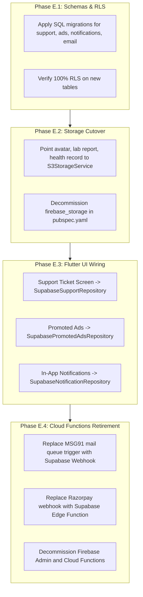

# Phase E Plan: Complete Decommissioning of Remaining Firestore & Firebase Services

**Project**: DoctorNect Pre-Launch Architecture Hardening  
**Scope**: Final elimination of all remaining Firestore collections, Firebase Cloud Functions triggers, and Firebase Storage usage after Phase C (Doctor, Patient, Appointments, Prescriptions, Reviews) and Phase D (Pharmacy, Lab, Ambulance).  
**Premise**: Synthetic test data only (no live users). Supabase is the sole operational database; AWS S3 is the sole object store; Redis / Supabase is the rate-limiting and cache layer.

---

## 1. Fresh Inventory Scan & Module Ownership Matrix

The fresh scan across `frontend/lib` and `backend/functions` identified the following active Firestore collections, triggers, callables, and Firebase Storage references:

| Category | Item Name | File / Trigger Location | Current Role / Purpose | Owner Module | Target Store / Service |
| :--- | :--- | :--- | :--- | :--- | :--- |
| **Collections** | `support_tickets` | `frontend/lib/features/patient/profile/support/help_support_screen.dart`, `support_tickets_history_screen.dart`, `support_ticket_chat_screen.dart` | Patient issue tickets, category, status, priority | Support / Patient | Supabase `public.support_tickets` |
| | `messages` *(subcollection)* | `frontend/lib/features/patient/profile/support/support_ticket_chat_screen.dart` | Threaded customer support messages & attachments | Support / Patient | Supabase `public.support_ticket_messages` |
| | `in_app_notifications` | `backend/functions/scripts/diagnose-lab-inapp-recipient.js`, in-app notification displays | User in-app notifications, read/unread status | Shared / Notification | Supabase `public.in_app_notifications` |
| | `promotedAds` | `frontend/lib/features/admin/promoted_ad_review_screen.dart`, `backend/functions/promoted_ads.js` | Clinic/Doctor promoted banners, review status | Marketing / Admin | Supabase `public.promoted_ads` + S3 `ad-banners/` |
| | `razorpayPayments` | `backend/functions/promoted_ads.js` | Successful Razorpay payment records for ad purchases | Billing / Monetization | Supabase `public.razorpay_payments` |
| | `razorpayWebhookEvents` | `backend/functions/promoted_ads.js` | Idempotency log of processed Razorpay webhooks | Billing / Monetization | Supabase `public.razorpay_webhook_events` |
| | `razorpayWebhookRejections` | `backend/functions/promoted_ads.js` | Rejected/invalid webhook attempts for audit | Billing / Security | Supabase `public.razorpay_webhook_rejections` |
| | `otp_challenges` | `backend/functions/registration_otp.js`, `delete_my_account.js` | Active 6-digit registration & reset OTP challenges | Auth / Security | Redis / Supabase `auth_otp_challenges` |
| | `otp_rate_limits` | `backend/functions/registration_otp.js` | IP and phone rate limits (max 3 per 10m) | Auth / Security | Redis / Supabase `auth_rate_limits` |
| | `otp_verification_sessions` | `backend/functions/registration_otp.js` | Short-lived tokens issued after OTP verify | Auth / Security | Redis / JWT session tokens |
| | `abuse_rate_limits` | `backend/functions/abuse_rate_limit.js`, `delete_my_account.js` | Account-level and IP-level operation throttling | Security | Redis / Supabase `abuse_rate_limits` |
| | `mail_queue` | `backend/functions/index.js` (`processMailQueueMsg91`) | Outbound email queue processed by MSG91 | Shared / Email | Supabase `public.mail_queue` + Webhook / Edge Function |
| | `security_events` | `backend/functions/security_logger.js` | Audit trail for security events, failed auth | Security / Compliance | Supabase `public.security_audit_events` |
| | `profile_claims` | `frontend/lib/core/auth/onboarding_service.dart`, `user_repository.dart` | Custom claim mirror for role-based access | Auth / Identity | Supabase `auth.users.raw_app_meta_data` |
| | `super_admins` | `backend/functions/scripts/create_super_admin.js` | UID list of super administrator accounts | Admin / Auth | Supabase `public.super_admins` (RLS admin-only) |
| **Triggers** | `processMailQueueMsg91` | `onDocumentCreated('mail_queue/{mailId}')` | MSG91 transactional email dispatcher | Email Service | Supabase Database Webhook -> MSG91 Edge Function |
| | `syncUserClaimsOnProfileWrite`| `onDocumentWritten('profile_claims/{uid}')` | Propagates role custom claims to Firebase Auth | Auth Service | Supabase Auth Hooks (`custom_access_token_hook`) |
| **Storage** | `ProfilePhotoUploader` | `frontend/lib/core/storage/profile_photo_uploader.dart` | Profile avatar upload | Patient / Doctor | AWS S3 `avatars/` via `S3StorageService` |
| | `PatientPhotoLocalStore` | `frontend/lib/features/patient/profile/data/patient_photo_local_store.dart`| Patient profile image caching | Patient | Local file cache + S3 presigned URLs |
| | `LabReportFileStore` | `frontend/lib/core/firebase/lab_report_file_store.dart` | Lab PDF/image test reports | Lab Service | AWS S3 `lab-reports/` (private, encrypted) |
| | `HealthRecordFileStore` | `frontend/lib/features/patient/records/data/health_record_file_store.dart`| Clinical records & attachments | Patient / Doctor | AWS S3 `health-records/` (private, encrypted) |
| | `PromotedAdsService` | `frontend/lib/core/services/promoted_ads_service.dart` | Banner image uploads for promoted ads | Marketing / Admin | AWS S3 `ad-banners/` (public-read/CloudFront) |

---

## 2. Module Specifications & Migration Architecture

### Module 1: Support Tickets & Messages

#### PostgreSQL Schema
```sql
CREATE TYPE support_ticket_status AS ENUM ('open', 'in_progress', 'resolved', 'closed');
CREATE TYPE support_ticket_priority AS ENUM ('low', 'medium', 'high', 'urgent');

CREATE TABLE public.support_tickets (
    id UUID PRIMARY KEY DEFAULT gen_random_uuid(),
    user_id UUID NOT NULL REFERENCES auth.users(id) ON DELETE CASCADE,
    subject TEXT NOT NULL CHECK (char_length(trim(subject)) >= 3),
    category TEXT NOT NULL CHECK (char_length(trim(category)) >= 2),
    status support_ticket_status NOT NULL DEFAULT 'open',
    priority support_ticket_priority NOT NULL DEFAULT 'medium',
    metadata JSONB NOT NULL DEFAULT '{}'::jsonb,
    created_at TIMESTAMPTZ NOT NULL DEFAULT now(),
    updated_at TIMESTAMPTZ NOT NULL DEFAULT now(),
    closed_at TIMESTAMPTZ
);

CREATE TABLE public.support_ticket_messages (
    id UUID PRIMARY KEY DEFAULT gen_random_uuid(),
    ticket_id UUID NOT NULL REFERENCES public.support_tickets(id) ON DELETE CASCADE,
    sender_id UUID NOT NULL REFERENCES auth.users(id) ON DELETE CASCADE,
    sender_role TEXT NOT NULL CHECK (sender_role IN ('patient', 'doctor', 'lab', 'pharmacy', 'ambulance', 'admin')),
    message TEXT NOT NULL CHECK (char_length(trim(message)) > 0),
    attachment_s3_key TEXT,
    created_at TIMESTAMPTZ NOT NULL DEFAULT now()
);

CREATE INDEX idx_support_tickets_user_id ON public.support_tickets(user_id, status);
CREATE INDEX idx_support_ticket_messages_ticket ON public.support_ticket_messages(ticket_id, created_at ASC);
```

#### RLS Policies
```sql
ALTER TABLE public.support_tickets ENABLE ROW LEVEL SECURITY;
ALTER TABLE public.support_ticket_messages ENABLE ROW LEVEL SECURITY;

-- Users can read and insert their own tickets
CREATE POLICY support_tickets_owner_select ON public.support_tickets
    FOR SELECT TO authenticated
    USING (user_id = auth.uid() OR public.is_super_admin(auth.uid()));

CREATE POLICY support_tickets_owner_insert ON public.support_tickets
    FOR INSERT TO authenticated
    WITH CHECK (user_id = auth.uid());

-- Admins can update status/priority
CREATE POLICY support_tickets_admin_update ON public.support_tickets
    FOR UPDATE TO authenticated
    USING (public.is_super_admin(auth.uid()))
    WITH CHECK (public.is_super_admin(auth.uid()));

-- Messages: participants & admins can read and post
CREATE POLICY support_messages_select ON public.support_ticket_messages
    FOR SELECT TO authenticated
    USING (
        EXISTS (
            SELECT 1 FROM public.support_tickets t
            WHERE t.id = support_ticket_messages.ticket_id
            AND (t.user_id = auth.uid() OR public.is_super_admin(auth.uid()))
        )
    );

CREATE POLICY support_messages_insert ON public.support_ticket_messages
    FOR INSERT TO authenticated
    WITH CHECK (
        sender_id = auth.uid() AND
        EXISTS (
            SELECT 1 FROM public.support_tickets t
            WHERE t.id = support_ticket_messages.ticket_id
            AND (t.user_id = auth.uid() OR public.is_super_admin(auth.uid()))
        )
    );
```

---

### Module 2: In-App Notifications Feed

#### PostgreSQL Schema
```sql
CREATE TABLE public.in_app_notifications (
    id UUID PRIMARY KEY DEFAULT gen_random_uuid(),
    user_id UUID NOT NULL REFERENCES auth.users(id) ON DELETE CASCADE,
    title TEXT NOT NULL,
    body TEXT NOT NULL,
    type TEXT NOT NULL, -- 'appointment', 'prescription', 'delivery', 'lab_report', 'ambulance', 'system'
    action_url TEXT,
    payload JSONB NOT NULL DEFAULT '{}'::jsonb,
    is_read BOOLEAN NOT NULL DEFAULT false,
    read_at TIMESTAMPTZ,
    created_at TIMESTAMPTZ NOT NULL DEFAULT now()
);

CREATE INDEX idx_in_app_notifications_user ON public.in_app_notifications(user_id, is_read, created_at DESC);

ALTER TABLE public.in_app_notifications ENABLE ROW LEVEL SECURITY;

CREATE POLICY in_app_notifications_owner ON public.in_app_notifications
    FOR ALL TO authenticated
    USING (user_id = auth.uid())
    WITH CHECK (user_id = auth.uid());
```

---

### Module 3: Promoted Advertisements & Razorpay Monetization

#### PostgreSQL Schema
```sql
CREATE TYPE ad_status AS ENUM ('draft', 'pending_review', 'approved', 'rejected', 'active', 'expired', 'paused');

CREATE TABLE public.promoted_ads (
    id UUID PRIMARY KEY DEFAULT gen_random_uuid(),
    advertiser_id UUID NOT NULL REFERENCES auth.users(id) ON DELETE CASCADE,
    title TEXT NOT NULL,
    description TEXT,
    target_url TEXT NOT NULL,
    banner_s3_key TEXT NOT NULL,
    status ad_status NOT NULL DEFAULT 'draft',
    tier TEXT NOT NULL DEFAULT 'standard',
    start_date DATE NOT NULL,
    end_date DATE NOT NULL CHECK (end_date >= start_date),
    impressions INT NOT NULL DEFAULT 0,
    clicks INT NOT NULL DEFAULT 0,
    rejection_reason TEXT,
    created_at TIMESTAMPTZ NOT NULL DEFAULT now(),
    updated_at TIMESTAMPTZ NOT NULL DEFAULT now()
);

CREATE TABLE public.razorpay_orders (
    id TEXT PRIMARY KEY, -- razorpay order_id (e.g. order_EKfWjp82aTFCbA)
    user_id UUID NOT NULL REFERENCES auth.users(id) ON DELETE CASCADE,
    ad_id UUID REFERENCES public.promoted_ads(id) ON DELETE SET NULL,
    amount_paise BIGINT NOT NULL CHECK (amount_paise > 0),
    currency TEXT NOT NULL DEFAULT 'INR',
    receipt TEXT NOT NULL,
    status TEXT NOT NULL DEFAULT 'created',
    created_at TIMESTAMPTZ NOT NULL DEFAULT now()
);

CREATE TABLE public.razorpay_payments (
    id TEXT PRIMARY KEY, -- razorpay payment_id (e.g. pay_29QQoUBcxNqdf0)
    order_id TEXT NOT NULL REFERENCES public.razorpay_orders(id),
    signature TEXT NOT NULL,
    amount_paise BIGINT NOT NULL,
    status TEXT NOT NULL,
    method TEXT,
    error_code TEXT,
    error_description TEXT,
    created_at TIMESTAMPTZ NOT NULL DEFAULT now()
);

CREATE TABLE public.razorpay_webhook_events (
    event_id TEXT PRIMARY KEY,
    event_type TEXT NOT NULL,
    payload JSONB NOT NULL,
    processed_at TIMESTAMPTZ NOT NULL DEFAULT now()
);
```

#### S3 Banner Storage
- Bucket: `s3://${AWS_S3_BUCKET_NAME}/ad-banners/${ad_id}/${filename}`
- Presigned upload via `getS3UploadUrl` with MIME restriction (`image/jpeg`, `image/png`, `image/webp`).

---

### Module 4: Authentication, Registration OTP & Abuse Rate-Limiting

#### Migration Strategy
- **OTP Challenges & Sessions**: Currently stored in Firestore collections `otp_challenges` and `otp_verification_sessions` with 10-minute expirations.
- **Target**:
  1. Primary: Supabase Auth built-in Phone OTP provider (via Twilio / MSG91 SMS gateway integration) for native, auditable OTPs.
  2. Backup / Legacy API parity: Redis (Upstash / ElastiCache) using `SET key value EX 600` for 10-minute auto-expiry and atomic rate counter increments `INCR key; EXPIRE key 600`.
  3. Zero Postgres bloat: Ephemeral tokens never write to persistent relational tables.

---

### Module 5: Transactional Email Queue (`mail_queue`)

#### Architecture
- **Table**: `public.mail_queue` (`id UUID PRIMARY KEY`, `to_email TEXT`, `subject TEXT`, `template_id TEXT`, `template_variables JSONB`, `status TEXT`, `error TEXT`, `created_at TIMESTAMPTZ`).
- **Trigger**: Database Webhook or pg_net HTTP call to Edge Function `send-msg91-email` on row insert.
- Edge Function handles MSG91 REST invocation with static secret and updates `status = 'sent'`.

---

### Module 6: Super Admins & Custom Claims

#### Architecture
- **Table**: `public.super_admins` (`user_id UUID PRIMARY KEY REFERENCES auth.users(id)`).
- Function: `public.is_super_admin(lookup_uid UUID) RETURNS BOOLEAN` runs with `SECURITY DEFINER` and `SET search_path = public, pg_temp`.
- Custom Claims: Supabase Auth Hook `custom_access_token_hook` injects `app_metadata.roles` (`admin`, `doctor`, `patient`, `lab`, `pharmacy`, `ambulance`) directly into every minted JWT, eliminating the need for `profile_claims` Firestore collection and background write triggers.

---

### Module 7: Firebase Storage Sunsetting

All 5 Flutter stores will migrate from `firebase_storage` to `S3StorageService`:
1. `ProfilePhotoUploader` -> `S3StorageService.getUploadUrl(folder: 'avatars', ...)`
2. `LabReportFileStore` -> `S3StorageService.getUploadUrl(folder: 'lab-reports', ...)`
3. `HealthRecordFileStore` -> `S3StorageService.getUploadUrl(folder: 'health-records', ...)`
4. `PromotedAdsService` -> `S3StorageService.getUploadUrl(folder: 'ad-banners', ...)`
5. Deprecate and remove `firebase_storage` package from `frontend/pubspec.yaml`.

---

## 3. Migration Roadmap & Execution Phases



---

## 4. Verification & Hardening Plan

1. **SQL Proof**: Run RLS unit tests verifying cross-tenant isolation on `support_tickets`, `in_app_notifications`, and `promoted_ads`.
2. **Payment Idempotency**: Prove duplicate Razorpay webhook events produce `200 OK` with zero duplicate credit rows.
3. **Storage Security**: Prove non-admin, non-owner cannot read private S3 keys for lab reports or support ticket attachments.
