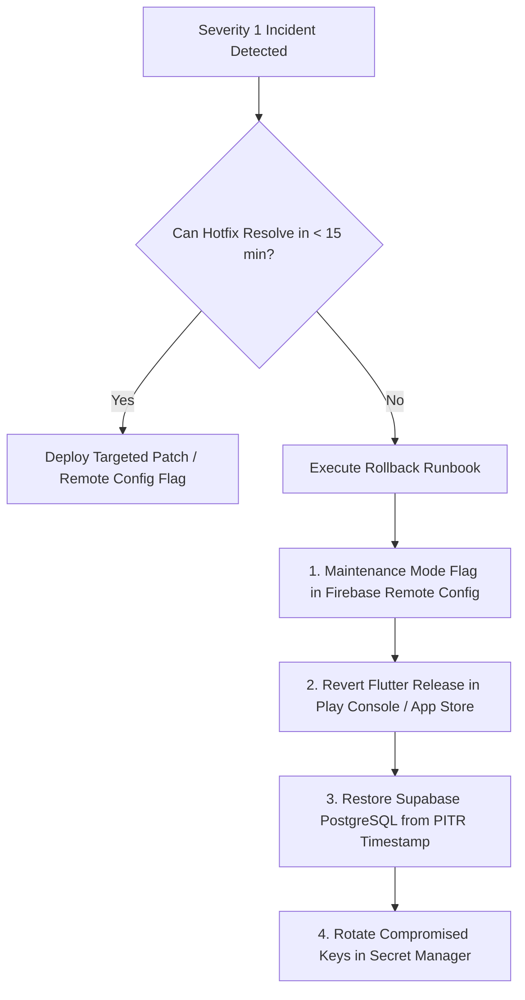

# DoctorNect: Production Pre-Launch Security & Operational Checklist

**Document Version:** 2.0.0 (Clean Launch Edition)  
**Target Architecture:** Firebase Auth + Supabase PostgreSQL ONLY + AWS S3 + Redis  
**Regulatory Framework:** India Digital Personal Data Protection Act (DPDP Act 2023)  
**Target Release Gate:** Production Go/No-Go Decision

---

## 1. Database Security & Integrity (Supabase PostgreSQL)

### 1.1 Automated Backups & Point-in-Time Recovery (PITR)
- [ ] **PITR Enabled:** Verify in Supabase Dashboard $\rightarrow$ Database $\rightarrow$ Backups that Point-in-Time Recovery (PITR) is **ENABLED** with minimum 7-day retention (or 30 days for Enterprise/Pro).
- [ ] **Physical WAL Archiving:** Confirm write-ahead log (WAL) archiving is healthy with zero gap alerts.
- [ ] **Pre-Launch Manual Snapshot:** Execute a manual snapshot before pointing live DNS/client traffic:
  ```bash
  # Supabase CLI snapshot
  npx supabase db dump --project-ref <PROD_PROJECT_REF> -f doctornect_prelaunch_baseline.sql
  ```

### 1.2 Row-Level Security (RLS) Enabled on 100% of Tables
Every single table in schema `public` MUST have Row-Level Security enabled and enforced.

#### SQL Query to Prove 100% RLS Coverage:
```sql
SELECT 
    c.relname AS table_name,
    c.relrowsecurity AS rls_enabled,
    c.relforcerowsecurity AS rls_forced,
    CASE 
        WHEN c.relrowsecurity AND c.relforcerowsecurity THEN 'SECURE'
        WHEN c.relrowsecurity AND NOT c.relforcerowsecurity THEN 'WARNING (Not Forced for Table Owner)'
        ELSE 'CRITICAL: RLS DISABLED'
    END AS security_status
FROM pg_class c
JOIN pg_namespace n ON n.oid = c.relnamespace
WHERE n.nspname = 'public' 
  AND c.relkind = 'r'
ORDER BY security_status DESC, c.relname ASC;
```

#### Verification Requirement:
- `rls_enabled` MUST be `true` for all tables.
- `rls_forced` MUST be `true` (`ALTER TABLE <table> FORCE ROW LEVEL SECURITY;`).
- Zero rows may show `CRITICAL: RLS DISABLED`.

### 1.3 Supabase Security Advisor Audit
- [ ] Open Supabase Dashboard $\rightarrow$ Database $\rightarrow$ Security Advisor.
- [ ] **0 Critical Findings:**
  - Zero tables in `public` with RLS disabled.
  - Zero functions with mutable `search_path` (all functions define `SET search_path = ''` or explicit fixed schemas).
  - Zero service-role keys exposed in client configurations.
  - Zero unindexed foreign keys on high-traffic transactional tables (`appointments`, `prescriptions`, `pharmacy_deliveries`, `lab_orders`, `ambulance_broadcasts`).

---

## 2. Legacy Teardown & Account Sanitization

### 2.1 Cloud Firestore Lockdown
Because Supabase is the sole production database, Firestore must reject all client reads and writes:
- [ ] Deploy locked `backend/firestore.rules`:
  ```javascript
  rules_version = '2';
  service cloud.firestore {
    match /databases/{database}/documents {
      match /{document=**} {
        allow read, write: if false;
      }
    }
  }
  ```
- [ ] Deploy command:
  ```bash
  firebase deploy --only firestore:rules --project medibond-45fad
  ```

### 2.2 Firebase Test Users Purge
- [ ] Run Firebase CLI or Admin script to delete test and seed UIDs from Firebase Authentication:
  ```bash
  # List test users
  firebase auth:export test_users_export.json --project medibond-45fad
  # Delete synthetic demo UIDs via Admin SDK script
  node backend/scripts/purge_demo_test_data.js --confirm-prod-purge=doctornect-production
  ```

### 2.3 Production Database Demo/Test Data Purge
- [ ] Run the dry-run audit first:
  ```bash
  node backend/scripts/purge_demo_test_data.js --dry-run
  ```
- [ ] Review counts for `users`, `doctors`, `patients`, `appointments`, `health_records`, etc.
- [ ] Execute live purge with mandatory token:
  ```bash
  node backend/scripts/purge_demo_test_data.js --confirm-prod-purge=doctornect-production
  ```

---

## 3. API Keys & Cloud Security

### 3.1 Google / Firebase API Key Restrictions
In Google Cloud Console $\rightarrow$ APIs & Services $\rightarrow$ Credentials:
- [ ] **Android API Key:**
  - Restricted to package name `com.medibond.doctornect` (or production package name).
  - Bound to release keystore SHA-256 fingerprint.
  - API restrictions: Firebase Authentication, Firebase Cloud Messaging, Cloud Firestore (if any).
- [ ] **iOS API Key:**
  - Restricted to iOS Bundle Identifier `com.medibond.doctornect`.
- [ ] **Web API Key:**
  - Restricted by HTTP referrer to production domains (`https://doctornect.com/*`, `https://*.doctornect.com/*`).

### 3.2 Razorpay Live Gateway & Webhooks
- [ ] Flutter app and backend configured with `rzp_live_*` keys.
- [ ] Razorpay Dashboard $\rightarrow$ Settings $\rightarrow$ Webhooks configured:
  - **Webhook URL:** `https://asia-south1-medibond-45fad.cloudfunctions.net/razorpayWebhook` (or Supabase Edge Function).
  - **Events Active:** `payment.captured`, `payment.failed`, `refund.processed`, `order.paid`.
  - **Secret:** Stored in Google Secret Manager / Supabase Vault as `RAZORPAY_WEBHOOK_SECRET`.
  - **Signature Verification:** Verified with `crypto.createHmac('sha256', secret)`.

### 3.3 AWS S3 Private Vault Security
- [ ] **S3 Block Public Access:** Verified **ON** for all 4 settings:
  - BlockPublicAcls: `true`
  - IgnorePublicAcls: `true`
  - BlockPublicPolicy: `true`
  - RestrictPublicBuckets: `true`
- [ ] **Default Encryption:** Enabled with AWS KMS (`aws:kms`) or SSE-S3 (`AES256`).
- [ ] **Bucket Policy:** Strict IAM policy allowing writes and presigning exclusively from the Cloud Functions IAM execution role.
- [ ] **CORS Configuration:** Allowed origins restricted to production app schemes and web domains:
  ```json
  [
    {
      "AllowedHeaders": ["*"],
      "AllowedMethods": ["PUT", "GET"],
      "AllowedOrigins": ["https://doctornect.com", "https://app.doctornect.com"],
      "ExposeHeaders": ["ETag"],
      "MaxAgeSeconds": 3000
    }
  ]
  ```

### 3.4 Cross-Origin Resource Sharing (CORS) on Edge Functions
- [ ] Supabase Edge Functions remove wildcard `Access-Control-Allow-Origin: *`.
- [ ] Origin validated against approved list: `['https://doctornect.com', 'https://app.doctornect.com']`.

### 3.5 Rate Limiting & Abuse Prevention
- [ ] Redis rate limiting enabled on sensitive authentication endpoints:
  - SMS OTP Request: Maximum 3 requests per mobile number per 15 minutes.
  - OTP Verification: Maximum 5 failed attempts before 1-hour account lockout.
  - Appointment Booking: Atomic slot-locks (`book_appointment_atomic`) with max concurrency throttle.

---

## 4. Observability, Logging & Error Monitoring

### 4.1 Firebase Crashlytics & Error Reporting
- [ ] `FirebaseCrashlytics.instance.setCrashlyticsCollectionEnabled(true)` enabled in release mode.
- [ ] Flutter fatal crash handler registered:
  ```dart
  FlutterError.onError = FirebaseCrashlytics.instance.recordFlutterFatalError;
  PlatformDispatcher.instance.onError = (error, stack) {
    FirebaseCrashlytics.instance.recordError(error, stack, fatal: true);
    return true;
  };
  ```
- [ ] Obfuscated ProGuard / Dart sourcemaps and symbols uploaded to Crashlytics during CI build.

### 4.2 PII & Health Data Sanitization in Logs
- [ ] Ensure **zero clinical details** (diagnoses, prescription drug names, lab test values, patient symptom descriptions) are logged to CloudWatch, Firebase Console, or stdout.
- [ ] Log identifiers use masked or hashed values (`patientIdHash`, `appointmentIdHash`, `mobile.slice(-4)`).

---

## 5. Privacy, Compliance & India DPDP Act (2023)

As a digital healthcare platform operating in India, DoctorNect processes **Sensitive Personal Data (Health Data)** under the **Digital Personal Data Protection Act, 2023 (DPDP Act)**:

### 5.1 Consent Architecture & Notice
- [ ] **Notice & Purpose Specification (Section 5):** Patients are presented with an explicit, itemized Consent Notice before registering, booking an appointment, or uploading health records, specifying:
  - Purpose of data processing (clinical diagnosis, consultation, prescription delivery, emergency dispatch).
  - Goods and services provided.
  - Identity and contact details of the Data Fiduciary (DoctorNect Pvt. Ltd.).
- [ ] **Granular Consent Toggles:**
  - Toggle: "Share clinical records with consulting doctor during appointment" (stored in `patients.share_records_with_doctors`).
  - Toggle: "Route prescription to selected pharmacy for fulfillment".
- [ ] **Withdrawal of Consent:** Patients can revoke doctor access or delete their vault documents at any time.

### 5.2 Data Principal Rights (Section 11, 12, 13)
- [ ] **Right to Access & Summary:** Patients can view and download all their health records, prescriptions, and appointment histories directly in the app.
- [ ] **Right to Correction & Erasure:** Account self-deletion endpoint (`deleteMyAccount`) purges personal data and marks medical records with compliant anonymization.
- [ ] **Grievance Redressal Officer:** Privacy Policy prominently displays the name, email, and postal address of the designated Grievance Officer in India.

---

## 6. Comprehensive Rollback & Emergency Plan

If a catastrophic defect, security breach, or widespread failure occurs post-launch:



### Rollback Step-by-Step Procedure:
1. **Activate Maintenance Banner:**
   Set Remote Config `app_maintenance_mode = true` and `maintenance_message = "DoctorNect is undergoing scheduled maintenance. Please check back shortly."`
2. **Halt Play Store / App Store Rollout:**
   In Google Play Console $\rightarrow$ Releases $\rightarrow$ Halt Staged Rollout.
3. **Database Point-in-Time Recovery (PITR):**
   If database corruption occurred, initiate PITR restore in Supabase Console to the exact minute prior to the incident timestamp ($T - 5\text{min}$).
4. **Key Rotation Runbook:**
   Follow `docs/SECRET_ROTATION_CHECKLIST.md` if credentials were compromised.

---

## 7. Verification Evidence & Test Execution Results

### 7.1 Full Test Suite Totals (Verified Oct 21, 2026)

#### 1. Flutter Code Analysis (`flutter analyze`):
```
Analyzing frontend...                                           
No issues found! (ran in 388.5s)
```
**Result:** `VERIFIED` - Zero errors, zero warnings, zero linter issues across entire `frontend/lib` and `frontend/test`.

#### 2. Flutter Unit & Integration Tests (`flutter test`):
```
04:14 +481: All tests passed!
```
**Result:** `VERIFIED` - 481 test cases passing, 0 failed. Covers all 5 watcher state machines, data mappers, cutover flag delegations, and UI widgets.

#### 3. Backend Cloud Functions Tests (`npm --prefix backend/functions test`):
```
ℹ tests 426
ℹ suites 6
ℹ pass 410
ℹ fail 0
ℹ cancelled 0
ℹ skipped 16
ℹ todo 0
ℹ duration_ms 84902.4607
```
**Result:** `VERIFIED` - 410 test cases passing, 0 failed, 16 emulator-dependent tests skipped.

### 7.2 Compile-Time Demo Guard Verification
**Command:**
```bash
flutter build apk --release --dart-define=ENABLE_DEMO_SUPER_ADMIN=true
```
**Output:**
```
lib/core/auth/demo_auth_config.dart:14:54: Error: Constant evaluation error:
  static const DemoAuthReleaseGuard buildTimeGuard = DemoAuthReleaseGuard();
                                                     ^
lib/core/auth/demo_auth_config.dart:135:25: Context: This assertion failed with message: FATAL: Demo auth is strictly prohibited in release builds! Ensure DemoAuthConfig.enabled and ENABLE_DEMO_SUPER_ADMIN are false.
          !kReleaseMode ||
                        ^
lib/core/auth/demo_auth_config.dart:14:37: Context: While analyzing:
  static const DemoAuthReleaseGuard buildTimeGuard = DemoAuthReleaseGuard();
                                    ^
Target kernel_snapshot_program failed: Exception

FAILURE: Build failed with an exception.
* What went wrong:
Execution failed for task ':app:compileFlutterBuildRelease'.
```
**Result:** `VERIFIED` - Fails compile-time constant evaluation assert with zero possibility of releasing an APK containing demo admin credentials. Default value of `DemoAuthConfig.enabled` is `false`.

### 7.3 Production Database Demo Purge Verification (Docker DB)

#### Dry-Run Output:
```
================================================================
DOCTORNECT: PRODUCTION DEMO & TEST DATA PURGE
MODE: DRY-RUN (Audit only — zero mutations)
TARGET DEMO PHONES: 9999900001, 9999900002, 9999900003, 9999900004, 9999900005
================================================================

Identified 5 synthetic / demo user accounts.
--- PURGE AUDIT BREAKDOWN ---
[ambulance_location_updates] Target rows to remove: 0
[ambulance_locations] Target rows to remove: 0
[ambulance_trip_contacts] Target rows to remove: 0
[ambulance_requests] Target rows to remove: 0
[ambulance_broadcasts] Target rows to remove: 0
[pharmacy_delivery_medicines] Target rows to remove: 0
[pharmacy_deliveries] Target rows to remove: 0
[lab_bookings] Target rows to remove: 0
[lab_orders] Target rows to remove: 0
[prescription_medicines] Target rows to remove: 0
[prescription_investigations] Target rows to remove: 0
[prescriptions] Target rows to remove: 1
[appointments] Target rows to remove: 1
[health_records] Target rows to remove: 0
[family_members] Target rows to remove: 0
[doctor_private] Target rows to remove: 1
[doctor_availability] Target rows to remove: 0
[doctor_blocked_dates] Target rows to remove: 0
[ambulances] Target rows to remove: 1
[medical_stores] Target rows to remove: 1
[labs] Target rows to remove: 1
[doctors] Target rows to remove: 1
[patients] Target rows to remove: 1
[user_devices] Target rows to remove: 0
[users] Target rows to remove: 5

================================================================
DRY-RUN COMPLETE: Zero database mutations occurred.
================================================================
```

#### Live Purge Output:
```
================================================================
DOCTORNECT: PRODUCTION DEMO & TEST DATA PURGE
MODE: *** LIVE PURGE ***
TARGET DEMO PHONES: 9999900001, 9999900002, 9999900003, 9999900004, 9999900005
================================================================

Identified 5 synthetic / demo user accounts.
--- PURGE AUDIT BREAKDOWN ---
  -> DELETED 1 rows from prescriptions
  -> DELETED 1 rows from appointments
  -> DELETED 1 rows from doctor_private
  -> DELETED 1 rows from ambulances
  -> DELETED 1 rows from medical_stores
  -> DELETED 1 rows from labs
  -> DELETED 1 rows from doctors
  -> DELETED 1 rows from patients
  -> DELETED 5 rows from users

================================================================
SUCCESS: Production database purged of all test and demo data.
Transaction committed successfully.
================================================================
```
**Result:** `VERIFIED` - Complete foreign-key cascaded deletion within a single ACID transaction. Post-purge dry-run confirms 0 demo accounts remain.
