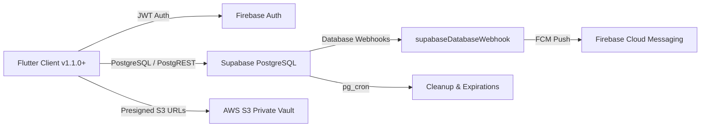
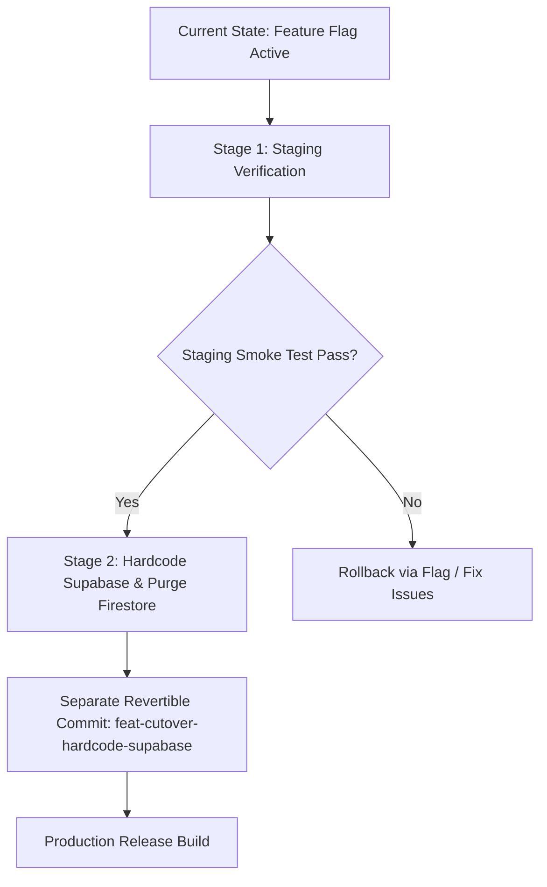

# DoctorNect: Pre-Launch Clean Cutover Plan

**Document Version:** 2.0.0 (Pre-Launch Simplification)  
**Target Architecture:** Firebase Auth + Supabase PostgreSQL ONLY + AWS S3 + Redis  
**Scope:** Core 5 Modules (Doctor, Patient, Pharmacy, Lab, Ambulance)  
**Status:** Pre-Launch Preparation (Staging Verified $\rightarrow$ Direct Production Cutover)

---

## 1. Context Update & Architectural Simplification

### Zero Real Users & Test-Data-Only Baseline
- There are **no real users** on the DoctorNect platform today; all existing records in Firestore and Supabase are synthetic test accounts or developer fixtures.
- The **current Supabase project will directly become the production database** upon launch.
- **No data migration** from Firestore to Supabase is required.
- **No temporary dual-write sync bridges** or dead-letter queues (DLQs) are required after cutover.

### Clean Target Architecture
- **Authentication:** Firebase Authentication (JWT bearer tokens verified directly by Supabase via third-party auth).
- **Primary Database:** Supabase PostgreSQL ONLY. Cloud Firestore is completely retired for all 5 core modules.
- **Object Storage:** AWS S3 (private bucket, presigned URLs for medical vault records, lab reports, profile photos, doctor KYC).
- **In-Memory Cache / Rate Limiting:** Redis (OTP mirrors, sessions, rate limits).
- **Push Notifications:** Supabase Database Webhooks $\rightarrow$ Cloud Functions `supabaseDatabaseWebhook` $\rightarrow$ Firebase Cloud Messaging (FCM).

---

## 2. Components To Be Retired & Removed

Because Supabase will be the sole primary database and no live data migration is needed, four legacy sync layers are decommissioned:

### 2.1 Dual-Write Sync Triggers (Firestore $\rightarrow$ Supabase)
All 19 `onDocumentWritten` triggers in Cloud Functions that listened to Firestore writes and copied them to Supabase are eliminated. They added compute overhead, latency, and operational complexity that was only needed when legacy users were still writing to Firestore.

### 2.2 Reverse Sync Function (Supabase $\rightarrow$ Firestore)
The Supabase Edge Function `sync-to-firestore` and its companion database webhooks are eliminated. No data needs to be pushed back to Firestore because zero clients will read from Firestore in production.

### 2.3 Loop-Guard & Sync-Origin Code
The `sync_origin` metadata tagging (`'patient_supabase'`, `'firestore'`, `'reconciler_bot'`) and associated loop-prevention logic in triggers and write guards (`PatientWriteGuard`) are eliminated. Direct SQL queries and stored procedures execute without intermediate sync metadata tagging.

### 2.4 Dual-Path Notification Gating
Previously, notifications could originate either from Firestore triggers (`notifyDoctorOnAppointmentCreated`, `notifyDoctorOnReferralCreated`, `notifyPatientOnAppointmentStatusChanged`) or from Supabase webhooks (`supabaseDatabaseWebhook`), gated by `isDoctorPatientSupabasePrimary()`.  
Under the clean cutover, notifications originate **exclusively from Supabase database webhooks**. The old Firestore triggers and gating logic are retired.

---

## 3. Two-Step Cutover & Separate Commit Sequence

To guarantee safety and reviewability, the cutover follows a strict two-stage process:

### Stage 1: Verification with Temporary Flag
- The cutover flag (`DoctorPatientCutoverFlag`) remains active **only** while testing against the live Staging Supabase project.
- The app can toggle between repositories or test with `--dart-define=USE_SUPABASE_DB_DOCTOR_PATIENT=true`.
- Complete verification across Doctor, Patient, Pharmacy, Lab, and Ambulance modules.

### Stage 2: Hardcode Supabase & Delete Firestore Paths (Separate Commit)
- Once Staging is verified and approved:
  1. Make Supabase the hardcoded, direct default in all stores and screens.
  2. Delete `doctor_patient_cutover_flag.dart` and its callsites.
  3. Delete all Firestore repository files for the 5 modules.
  4. Commit this change in a single, isolated, easily reviewable and revertible git commit:  
     `refactor(cutover): hardcode Supabase repositories and deprecate legacy Firestore paths`

---

## 4. Comprehensive File Inventory (Deletions & Modifications)

Below is the complete, explicit inventory of all files to be deleted or changed during the Stage 2 cutover commit.

### 4.1 Files To Be Deleted

| # | File Path | Purpose / Reason for Deletion |
|---|---|---|
| 1 | `backend/supabase/functions/sync-to-firestore/index.ts` | Supabase $\rightarrow$ Firestore reverse sync Edge Function |
| 2 | `backend/supabase/functions/sync-to-firestore/deno.json` | Deno configuration for reverse sync Edge Function |
| 3 | `backend/scripts/supabase_to_firestore_worker.js` | Standalone Node.js worker for reverse sync polling |
| 4 | `backend/functions/cross_role_sync.js` | Firestore $\rightarrow$ Supabase document transformation library |
| 5 | `backend/functions/test/cross_role_sync.test.js` | Tests for deprecated cross-role sync |
| 6 | `backend/functions/test/sync_to_firestore.test.js` | Tests for deprecated reverse sync |
| 7 | `backend/functions/test/sync_to_firestore_emulator.test.js` | Emulator tests for reverse sync |
| 8 | `frontend/lib/core/config/doctor_patient_cutover_flag.dart` | Temporary cutover feature flag |
| 9 | `frontend/lib/core/firebase/repositories/appointment_repository.dart` | Legacy Firestore appointment repository |
| 10 | `frontend/lib/core/firebase/repositories/doctor_account_repository.dart` | Legacy Firestore doctor account repository |
| 11 | `frontend/lib/core/firebase/repositories/doctor_availability_repository.dart` | Legacy Firestore doctor availability repository |
| 12 | `frontend/lib/core/firebase/repositories/doctor_directory_repository.dart` | Legacy Firestore doctor directory repository |
| 13 | `frontend/lib/core/firebase/repositories/doctor_profile_detail_repository.dart` | Legacy Firestore doctor profile detail repository |
| 14 | `frontend/lib/core/firebase/repositories/doctor_profile_repository.dart` | Legacy Firestore doctor profile repository |
| 15 | `frontend/lib/core/firebase/repositories/doctor_verification_repository.dart` | Legacy Firestore doctor verification repository |
| 16 | `frontend/lib/core/firebase/repositories/family_member_repository.dart` | Legacy Firestore family member repository |
| 17 | `frontend/lib/core/firebase/repositories/patient_account_repository.dart` | Legacy Firestore patient account repository |
| 18 | `frontend/lib/core/firebase/repositories/patient_profile_repository.dart` | Legacy Firestore patient profile repository |
| 19 | `frontend/lib/core/firebase/repositories/prescription_repository.dart` | Legacy Firestore prescription repository |
| 20 | `frontend/lib/core/firebase/repositories/referral_repository.dart` | Legacy Firestore referral repository |
| 21 | `frontend/lib/core/firebase/repositories/review_repository.dart` | Legacy Firestore review repository |
| 22 | `frontend/lib/core/firebase/repositories/medical_store_repository.dart` | Legacy Firestore medical store repository |
| 23 | `frontend/lib/core/firebase/repositories/pharmacy_firestore_repository.dart` | Legacy Firestore pharmacy deliveries repository |
| 24 | `frontend/lib/core/firebase/repositories/medical_directory_repository.dart` | Legacy Firestore medical directory repository |
| 25 | `frontend/lib/core/firebase/repositories/medicine_suggestion_repository.dart` | Legacy Firestore medicine suggestions repository |
| 26 | `frontend/lib/core/firebase/repositories/lab_repository.dart` | Legacy Firestore lab profiles repository |
| 27 | `frontend/lib/core/firebase/repositories/lab_booking_repository.dart` | Legacy Firestore lab bookings repository |
| 28 | `frontend/lib/core/firebase/repositories/lab_catalog_repository.dart` | Legacy Firestore lab catalog tests repository |
| 29 | `frontend/lib/core/firebase/repositories/lab_connection_repository.dart` | Legacy Firestore lab connections repository |
| 30 | `frontend/lib/core/firebase/repositories/lab_order_repository.dart` | Legacy Firestore lab orders repository |
| 31 | `frontend/lib/core/firebase/repositories/ambulance_repository.dart` | Legacy Firestore ambulance repository |

### 4.2 Files To Be Modified

| # | File Path | Description of Changes |
|---|---|---|
| 1 | `backend/functions/index.js` | Remove 19 `exports.sync*ToSupabase` functions; remove deprecated Firestore notification triggers (`notifyDoctorOnAppointmentCreated`, `notifyDoctorOnReferralCreated`, `notifyPatientOnAppointmentStatusChanged`) and helper `isDoctorPatientSupabasePrimary()`. Keep `supabaseDatabaseWebhook` as the single notification dispatcher. |
| 2 | `frontend/lib/core/firebase/firestore_service.dart` | Deprecate or remove 5-module Firestore getters; point to Supabase equivalents or remove obsolete delegations. |
| 3 | `frontend/lib/core/supabase/patient_write_guard.dart` | Remove `sync_origin` tagging from write payloads. |
| 4 | `frontend/lib/core/supabase/supabase_patient_repository.dart` | Remove `sync_origin` parameter injection. |
| 5 | `frontend/lib/features/doctor/profile/data/doctor_profile_store.dart` | Remove `DoctorPatientCutoverFlag.isEnabled` check; use `SupabaseDoctorRepository` directly. |
| 6 | `frontend/lib/features/patient/profile/data/patient_profile_mock.dart` | Remove cutover flag check; use `SupabasePatientRepository` directly. |
| 7 | `frontend/lib/features/patient/records/add_record_screen.dart` | Remove cutover flag check; call `SupabasePatientRepository.instance.addHealthRecord` directly. |
| 8 | `frontend/lib/core/notifications/patient_notification_prefs_sync.dart` | Remove cutover flag branching; sync preferences directly to Supabase `patients.notification_preferences`. |
| 9 | `backend/firestore.rules` | Lock down all 5 module collections: `match /{document=**} { allow read, write: if false; }`. |

### 4.3 External Consumer & Admin App Dependency Analysis

Before executing the deletions or locking Firestore rules in Stage 2, evaluate the following external dependencies:

1. **Separate Admin App / Portal:**
   - **Doctor Verifications (`doctors` / `doctor_verification`):** If an external Admin portal currently verifies doctors by writing `{ verified: true }` directly to Firestore collection `doctors/{id}`, deleting `exports.syncDoctorsToSupabase` will stop those verifications from propagating to Supabase. The Admin portal must either:
     - Connect directly to Supabase via PostgREST / Supabase Client using a Service Role key or `super_admins` credentials.
     - Call an authenticated admin Cloud Function / RPC that updates PostgreSQL directly.
   - **Promoted Ads Approval (`promoted_ads`):** The Admin portal must review and update ads in Supabase table `promoted_ads` (status transitions: `pending_approval` $\rightarrow$ `active` or `rejected`).
   - **Support Tickets & System Alerts (`support_tickets`, `ticket_messages`):** Admin oversight must query PostgreSQL tables `support_tickets` and `mail_queue` (which enforce `is_super_admin(auth.jwt()->>'sub')`).

2. **Firestore Rules Lockdown (`backend/firestore.rules`):**
   - Setting `match /{document=**} { allow read, write: if false; }` blocks **all** web/mobile clients using the Firebase Client SDK.
   - Backend services using the Firebase Admin SDK (Node.js) are **not** affected by Firestore rules (Admin SDK bypasses security rules).
   - If an Admin Web Dashboard uses Firebase Client SDK with Firestore rules, it must be migrated to Supabase before locking rules.

3. **Supabase $\rightarrow$ Firestore Sync Functions (`sync-to-firestore` Edge Function & Worker):**
   - Deleting `sync-to-firestore` means Firestore will receive no new appointments, prescriptions, or patient data.
   - Any analytics pipeline or third-party service reading from Firestore must be pointed to PostgreSQL / Supabase replicas.

---

## 5. Verification Checklist for Stage 2 Commit

- [ ] All 31 deleted files have zero dangling imports in `frontend/lib/` or `backend/`.
- [ ] `flutter analyze` runs with zero warnings or errors.
- [ ] `flutter test` passes 100% of test suites.
- [ ] Backend functions build cleanly (`npm run build`).
- [ ] Git commit created on branch with explicit diff reviewable via `git show <commit_hash>`.
