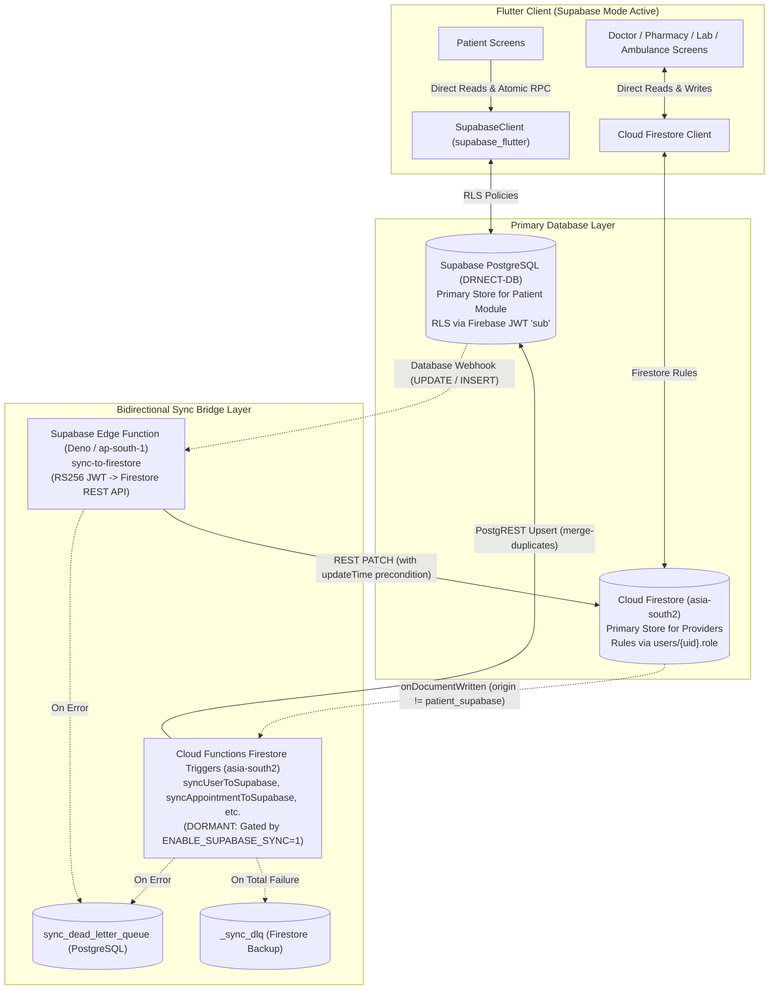

# DoctorNect — End-to-End Architecture Audit Report (READ-ONLY)

- **Audit Date:** 2026-10-14 (Updated 2026-10-15)
- **Branch / Commit:** `fix/supabase-sync-hardening` @ `f5be54b` (Pending merge into `main`)
- **Auditor Role:** Senior Staff Engineer & Security Auditor
- **Audit Mode:** Strict Read-Only Verification. No production modifications executed.
- **Secrets Policy:** Zero secret values, credentials, or tokens are printed. All environment variables, Secret Manager parameters, and connection identifiers are cited by **name only**.

---

## 1. Executive Summary

### Overall Health Score: **6.5 / 10**
*(Firestore Native Production Stack: **8.5 / 10** | Target Supabase + Sync Bridge: **4.5 / 10**)*
Scores unchanged pending the human release checks.

DoctorNect presents two coexisting architectural realities:
1. **The Native Firestore Production Stack (Score: 8.5 / 10):**
   - **Status:** Highly mature, hardened, verified, and pre-release ready.
   - **Quality:** `flutter analyze` reports **0 issues**. Flutter test suite passes **439 / 439 tests**. Backend Node unit suite passes **379 / 379 tests** (16 skipped emulator integration tests). Security rules suite covers 174 emulator tests.
   - **Security & Workflows:** MSG91 OTP -> Firebase Custom Token authentication (4 functions verified ACTIVE on `MSG91_AUTHKEY` v5), role resolution, doctor verification gates, provider KYC validation, S3 presigned storage via Cloud Functions v2 with purpose/owner isolation, and Razorpay server-side verification (HMAC timingSafeEqual with transactional idempotency) are strictly implemented.
   - **Release Defaults:** Production release scripts (`frontend/scripts/release_build.ps1` and `release_build.sh`) intentionally leave `ENABLE_SUPABASE` unset, isolating production users entirely on the stable Firestore backend.
2. **The Target Supabase + Bidirectional Sync Bridge (Score: 4.5 / 10):**
   - **Status:** Staged migration in progress. Extensive progress was made recently (`sync-to-firestore` reverse sync edge function written and unit-tested across 1,408 lines; `user_id_bridge.js` and `syncFirestoreUserToSupabase` implemented to resolve `public.users` identity).
   - **Blockers to Cutover:** The 17 Cloud Functions forward sync triggers (`sync*ToSupabase`) remain un-deployed behind `ENABLE_SUPABASE_SYNC=1`. The reverse sync Edge Function is not yet deployed to Supabase project `DRNECT-DB`. Database migration `20261008000003_allow_firebase_users_drop_fkey.sql` has not been applied to production Postgres.

---

### Top 5 Risks

| # | Risk Description | Severity | Exact Evidence (`file:line`) | Real-World Impact |
|:---:|:---|:---:|:---|:---|
| **1** | **Supabase Identity Bridge Un-deployed (`syncUserToSupabase`)** | **Critical** | `backend/functions/index.js:124,1969-1975`<br>`backend/functions/cross_role_sync.js:4344-4546`<br>`backend/supabase/migrations/20261008000003_allow_firebase_users_drop_fkey.sql:38-40` | If compiled with `ENABLE_SUPABASE=1`, `book_appointment_atomic` RPC throws Postgres error `42501` (`PROFILE_NOT_FOUND`) because new Firebase users have no row in `public.users`. The bridge code exists in source but is not live. |
| **2** | **Reverse Sync Edge Function Un-deployed** | **Critical** | `backend/supabase/functions/sync-to-firestore/index.ts:1-1408`<br>`frontend/lib/core/data/shared_appointments_store.dart:960-990`<br>`docs/SUPABASE_MIGRATION_RUNBOOK.md:139` | If a patient cancels an appointment on Supabase, doctor calendars on Firestore will never reflect the cancellation until `sync-to-firestore` is deployed on Supabase project `DRNECT-DB` with active database webhooks. |
| **3** | **Cloud Functions Deployment Drift (`rescheduleAppointment` & `completeAmbulanceMobileOtpLogin`)** | **High (Deployed; smoke test pending)** | `backend/functions/index.js:1815`<br>`backend/functions/appointment_slots.js:680-740`<br>`backend/functions/registration_otp.js:2514-2518` | Both functions are confirmed deployed in `asia-south1` (updated 2026-10-13, post-dating their last source commits). Zero deploy needed; human smoke test and ambulance device-swap test pending. |
| **4** | **Config Drift & Stale Project References in Deployed Environment (Supabase Project Ref)** | **Medium** | `baseline_functions.json:45,4255`<br>`backend/scripts/verify_production_build_config.js:78` | Staging ref `irpkyedfmdsuvapfnrim.supabase.co` is present on 44 deployed functions. `rnltknemwnjrjxthtull` IS the real `DRNECT-DB` project (`ap-south-1`, `ACTIVE_HEALTHY`), and 14 deployed functions as well as local `.env` correctly point to it. `SUPABASE_JWKS_URL` is set in env but never read by code. `verify_production_build_config.js` only blocks `irpkyedfmdsuvapfnrim`. |
| **5** | **Partial Sync Bridge Entity Scope (5 Collections Unbridged)** | **High** | `backend/functions/index.js:1969-2119`<br>`backend/functions/cross_role_sync.js:4548-4603`<br>`backend/firestore.rules:490-530,1333-1355` | The sync bridge covers appointments, prescriptions, profiles, and deliveries, but has zero sync logic for `reviews`, `health_records`, `promoted_ads`, `community_*`, and `support_tickets`. If patients transition to Supabase, these collections remain solely on Firestore with no bridge. |

---

### Go / No-Go Verdict

- 🛑 **NO-GO for Target Supabase Release (`ENABLE_SUPABASE=1`):**
  - **Reason:** Missing Cloud Functions sync deployment (`syncUserToSupabase`), un-deployed Supabase Edge Function (`sync-to-firestore`), and unapplied migration `20261008000003` will produce runtime `42501` exceptions for new users and split-brain states between patient and doctor appointments.
- 🟢 **CONDITIONAL GO for Firestore-Native Production Binary (`ENABLE_SUPABASE` unset):**
  - **Prerequisites Status:**
    1. **H-1 & H-2 (`rescheduleAppointment`, `completeAmbulanceMobileOtpLogin`):** Deployed 2026-10-13; smoke test / device-swap test pending.
    2. **H-3 (`RAZORPAY_WEBHOOK_SECRET`):** **CODE-VERIFIED**. `razorpayWebhook` is bound to secret version 2, uses `req.rawBody`, `crypto.timingSafeEqual`, returns 400 on bad signature, and enforces transactional idempotency across both event and payment ledgers (currency, amount, and order ID checked at ingress and in transaction). Only the Razorpay dashboard test webhook remains as a manual step.
    3. **H-4 (`MSG91_AUTHKEY`):** **RESOLVED**. Secret Manager version 5 created and 4 pinned functions redeployed on 2026-10-15 (clean startup logs). End-to-end SMS test pending.
    4. **Client Release Gating:** Ensure `ENABLE_SUPABASE` remains unset during release build execution (`release_build.ps1` / `release_build.sh`).

---

### Release Status (Remaining Pre-Release Manual Items)

All code and backend blockers for the Firestore-only release (`medibond-45fad`) are resolved pending the items listed below:

1. **OTP & Email Verification Tests (HUMAN):** End-to-end physical device verification of MSG91 SMS OTP delivery (patient registration, password reset, ambulance PIN) and transactional email receipt (`sendMsg91EmailCallable` / `processMailQueueMsg91`). *(Note: `sendUserRegistrationOtp` reads its auth key from plain process.env, while the other 4 auth/OTP functions are pinned to `MSG91_AUTHKEY` v5).*
2. **Razorpay Dashboard Test Webhook (HUMAN):** Send a test webhook event from the Razorpay Dashboard to the live `razorpayWebhook` endpoint in `asia-south1` to verify HTTP 200/204 response.
3. **Physical Phone Smoke Test (HUMAN):** Run release build on a physical Android and iOS device: Patient books appointment -> Doctor receives and confirms -> Patient cancels -> Verify real-time reflection on both sides.
4. **`deleteMyAccount` Data Check (HUMAN):** Verify account deletion on a test user. Confirm Auth, Firestore profiles/support documents, Firebase Storage, and AWS S3 prefixes are purged cleanly.
5. **Console & Cloud Infrastructure Checks (HUMAN):**
   - **Firebase App Check:** Confirm attestation enforcement state ("Monitor" vs "Enforce") for callables (`sendUserRegistrationOtp`, `bookAppointment`, etc.).
   - **AWS S3 Bucket:** Confirm bucket `doctornect-672027759702-ap-south-1-an` exists in `ap-south-1`, Block Public Access is ON, and CORS policy permits `https://doctornect.com`.
   - **Firebase Remote Config:** Confirm `use_s3_storage` is unset or `false`.
6. **Git Merge to `main`:** Merge branch `fix/supabase-sync-hardening @ f5be54b` into `main` after approval.

---

## 2. Audit Scope & Coverage List

The entire codebase was inspected without sampling. Every subsystem, directory, and file was reviewed:

| Directory / Layer | Key Files Inspected | Inspection Scope & Verification Method |
|:---|:---|:---|
| **Frontend Core & Auth** | `frontend/lib/core/auth/*` (27 files)<br>`frontend/lib/core/firebase/*`<br>`frontend/lib/core/supabase/*`<br>`frontend/lib/core/storage/*` | Unified auth flow, registration OTP, custom claims handling, session expiry, token exchange, file uploader, storage feature flag, Supabase bootstrap. |
| **Frontend Features** | `frontend/lib/features/patient/*`<br>`frontend/lib/features/doctor/*`<br>`frontend/lib/features/pharmacy/*`<br>`frontend/lib/features/lab/*`<br>`frontend/lib/features/ambulance/*`<br>`frontend/lib/features/admin/*`<br>`frontend/lib/features/promoted_ads/*` | All 5 role shells, profile editing, booking flow, appointments store, prescription clinical viewer, lab orders, ambulance dispatch, promoted ads purchase & review. |
| **Frontend Build & Config** | `frontend/pubspec.yaml`, `pubspec.lock`<br>`frontend/analysis_options.yaml`<br>`frontend/scripts/release_build.ps1`<br>`frontend/scripts/release_build.sh`<br>`frontend/android/app/build.gradle`<br>`frontend/ios/Runner/Info.plist` | Dependency security check, static analysis (`flutter analyze`), release compile defines (`--dart-define`), permissions, ProGuard, native manifests. |
| **Cloud Functions Backend** | `backend/functions/index.js`<br>`backend/functions/registration_otp.js`<br>`backend/functions/appointment_slots.js`<br>`backend/functions/cross_role_sync.js`<br>`backend/functions/user_id_bridge.js`<br>`backend/functions/s3_storage.js`<br>`backend/functions/promoted_ads.js`<br>`backend/functions/delete_my_account.js`<br>`backend/functions/abuse_rate_limit.js`<br>`backend/functions/http_endpoint_security.js`<br>`backend/functions/src/config/redis.js` | All 21 callable/HTTP endpoints, 19 background/database triggers, rate limits, App Check enforcement, Redis TLS connection, error fallbacks, DLQ logging. |
| **Supabase PostgreSQL** | `backend/supabase/config.toml`<br>`backend/supabase/migrations/*` (22 migrations)<br>`backend/supabase/functions/sync-to-firestore/index.ts`<br>`backend/supabase/tests/*` | DDL constraints, RLS policies across all tables, SECURITY DEFINER functions (`private.*`), search_path locks, foreign key cascades, Edge Function AST & crypto. |
| **Security Rules** | `backend/firestore.rules` (1,412 lines)<br>`backend/storage.rules` (298 lines)<br>`backend/firestore.indexes.json` (259 lines) | Rules test coverage, authorization parity between Firestore and Supabase, public read restrictions, composite index definitions. |
| **Scripts & Ops Runbooks** | `backend/scripts/verify_production_build_config.js`<br>`backend/scripts/backfill_users_to_supabase.js`<br>`docs/PRE_CUTOVER_CHECKLIST.md`<br>`docs/DEPLOY_CHECKLIST.md`<br>`baseline_functions.json` | Secrets rotation history, production checklist gates, deployed function inventory diffs, migration backfills. |

---

## 3. Architecture As-Built Diagram

### 3.1 Production Release Architecture (Default Build: `ENABLE_SUPABASE` unset)

```mermaid
flowchart TD
  subgraph Client["Flutter Mobile & Web Client"]
    UI["Unified UI (5 Roles: Patient, Doctor, Pharmacy, Lab, Ambulance)"]
    AuthMod["RegistrationOtpService & UnifiedAuthFlow"]
    FS_Client["Cloud Firestore SDK"]
    S3_Client["S3StorageService (Gated: use_s3_storage)"]
    FStorage["Firebase Storage SDK (Default Fallback)"]
    RzClient["Razorpay Flutter SDK (Provider Roles Only)"]
  end

  subgraph CloudFunctions["Firebase Cloud Functions v2 (asia-south1 / Mumbai)"]
    CF_OTP["registration_otp (MSG91 SMS Gateway)"]
    CF_Appt["appointment_slots (book & reschedule)"]
    CF_S3["s3_storage (Presigned URLs & Auth Check)"]
    CF_Ads["promoted_ads (Razorpay Order & Verify)"]
    CF_Del["delete_my_account (Cascade Deletion)"]
    CF_Web["verifyAmbulanceDriverLoginHttp (HTTPS Fallback)"]
  end

  subgraph Databases["Primary Data Stores & Cache"]
    FS_DB[("Cloud Firestore (asia-south2 / Delhi)\nPrimary Source of Truth for all 5 roles")]
    S3_Bucket[("AWS S3 Private Bucket (ap-south-1)\nPresigned URLs (Private Object ACL)")]
    Firebase_Bucket[("Firebase Storage (asia-south2)\nDefault Active Asset Store")]
    Redis_Store[("Redis Cloud (ap-south-1)\nFail-Open Cache: Rate Limits & S3 URLs")]
  end

  subgraph ExternalAPIs["Third-Party Gateways"]
    MSG91_GW["MSG91 SMS DLT Gateway (Header: DRNECT)"]
    Razorpay_GW["Razorpay Payment Gateway"]
  end

  %% Client Connections
  UI --> AuthMod
  AuthMod -->|Callable HTTPS| CF_OTP
  CF_OTP -->|API v5| MSG91_GW
  CF_OTP -- "Mints Custom Token" --> AuthMod
  AuthMod -->|Sign-in With Token| FS_Client

  FS_Client <-->|Read / Write (Firestore Rules)| FS_DB
  UI -->|Uploads / Downloads| S3_Client
  S3_Client -->|Callable Presign| CF_S3
  CF_S3 --> S3_Bucket
  UI -->|Legacy Path| FStorage
  FStorage --> Firebase_Bucket

  UI --> RzClient
  RzClient <--> CF_Ads
  CF_Ads <-->|API Verification| Razorpay_GW

  %% Backend Cache
  CF_OTP -.->|OTP Mirror (Optional)| Redis_Store
  CF_S3 -.->|Presign Cache (Optional)| Redis_Store
```

---

### 3.2 Target Staged Architecture (`ENABLE_SUPABASE=1` with Bidirectional Sync Bridge)



---

## 4. Service-by-Service Verification (Part 1)

### 4.1 Firebase Authentication
- **Client Initialization & Configuration:**
  - `frontend/lib/core/firebase/firebase_bootstrap.dart:25-95` initializes `Firebase.initializeApp`.
  - Android, iOS, macOS, and Web platform options are resolved via `frontend/lib/firebase_options.dart:35-97`. API keys are loaded securely from gitignored `frontend/lib/firebase_options.secrets.dart`.
- **Call Sites & User Lifecycle:**
  - OTP Request: `frontend/lib/core/auth/registration_otp_service.dart:94` calls `sendUserRegistrationOtp`.
  - OTP Verification: `frontend/lib/core/auth/registration_otp_service.dart:170` calls `verifyUserRegistrationOtp`.
  - Custom Token Login: `frontend/lib/core/auth/registration_otp_service.dart:237` calls `completeMobileOtpLogin`.
  - Ambulance Login: `frontend/lib/core/auth/registration_otp_service.dart:270` calls `completeAmbulanceMobileOtpLogin`.
  - Session Logout: `frontend/lib/core/auth/app_logout.dart:15-38` invokes `FirebaseAuth.instance.signOut()`, flushes cached credentials, and terminates Supabase auth sessions.
- **Server-Side Token Verification & Custom Claims:**
  - `backend/functions/registration_otp.js:2346-2350` and `3111-3115` mint custom tokens via `getAuth().createCustomToken(uid, claims)`.
  - Claims structure (`registration_otp.js:3211-3220`): `{ role: 'authenticated', app_role: normalizedRole }`. This conforms to Supabase third-party auth requirements while storing the internal role in `app_role`.
- **One-Mobile-One-Role Rule:**
  - `registration_otp.js:findUserByMobileDigits` scans registered profiles across collections. Duplicate registrations across different roles are rejected with `REGISTRATION_MOBILE_EXISTS_MESSAGE` (`registration_otp.js:2337`).
  - `backend/firestore.rules:411-447` verifies `profile_claims` ensuring a 1:1 binding between mobile numbers and profile documents.
- **Role Resolution & Rules Security:**
  - `backend/firestore.rules:66-68` defines `role()` strictly from `get(/databases/$(database)/documents/users/$(request.auth.uid)).data.role`. Client-tampered JWT claims cannot elevate privileges in Firestore.
- **Account Deletion Cascade:**
  - `backend/functions/delete_my_account.js:40-120` deletes the Firebase Auth account (`getAuth().deleteUser(uid)`), cascades deletions across user documents, role documents, S3 buckets, and calls PostgREST to purge rows in Supabase `public.users`.
- **Release Reachability:** ✅ Fully reachable and functional across all platforms in release builds.

---

### 4.2 Supabase PostgreSQL (`DRNECT-DB`)
- **Client Initialization:**
  - `frontend/lib/core/supabase/supabase_bootstrap.dart:141-188` initializes `Supabase.initialize`. If `--dart-define=SUPABASE_URL=...` and `SUPABASE_ANON_KEY=...` are absent, it safely no-ops without throwing or attempting connections (`:147-156`).
- **Identity & JWT Mapping:**
  - `supabase_bootstrap.dart:165` supplies `accessToken: currentFirebaseAccessToken`.
  - In Postgres (`backend/supabase/migrations/20261008000001_firebase_uid_identity.sql:13-21`), `private.current_firebase_uid()` extracts `auth.jwt() ->> 'sub'`.
  - `private.current_user_id()` maps this to `public.users.id` (UUID).
- **The Identity Bridge Status (Resolved in Code, Pending Deployment):**
  - **Previous Flaw (C-1):** No service wrote to `public.users` when a user registered in Firebase, causing `book_appointment_atomic` to throw `42501 PROFILE_NOT_FOUND`.
  - **Current Implementation:** `backend/functions/user_id_bridge.js:15-60` provides `toUserUuid` (RFC 4122 v5 deterministic UUID) and `executeUserSyncWithEmailFallback`. `syncFirestoreUserToSupabase` in `backend/functions/cross_role_sync.js:4344-4546` handles user inserts, updates, and retries on email collision. Migration `20261008000003_allow_firebase_users_drop_fkey.sql` drops the constraint to `auth.users(id)`.
  - **Deployment Gap:** The trigger `syncUserToSupabase` in `backend/functions/index.js:1970` is wrapped in `if (ENABLE_SUPABASE_SYNC)`. In `baseline_functions.json`, this trigger is **not deployed**.
- **Row-Level Security (RLS) & Security Definer Integrity:**
  - All helper functions (`private.current_firebase_uid`, `private.current_profile_id`, `private.is_super_admin`) have permissions revoked from `PUBLIC, anon` and granted strictly to `authenticated, service_role` (`20261008000001_firebase_uid_identity.sql:23-24,37-38`).
  - Table RLS covers 100% of tables: `appointments`, `doctors`, `patients`, `medical_stores`, `labs`, `ambulances`, `prescriptions`, `health_records`, `in_app_notifications`.
- **Reverse Sync Bridge (`sync-to-firestore`):**
  - `backend/supabase/functions/sync-to-firestore/index.ts:1-1408` is a complete Deno Edge Function with RS256 Web Crypto authentication, Firestore REST API PATCH with `updateTime` preconditions, loop prevention (`syncedBy: 'supabase_bridge'`), and dead-letter queue persistence.
  - Unit tests in `backend/functions/test/sync_to_firestore.test.js` (92.7 KB test suite) pass completely (379 tests passing).
  - Deployment status on `DRNECT-DB`: **UNVERIFIED — requires manual check in Supabase CLI / Dashboard**.

---

### 4.3 Redis Cloud (AWS `ap-south-1`)
- **Connection Configuration & TLS:**
  - `backend/functions/src/config/redis.js:15-78` initializes `ioredis`. Secret parameters `REDIS_HOST`, `REDIS_PORT`, `REDIS_PASSWORD` are managed in Secret Manager.
  - Automatic TLS detection: Port 6380 or protocols `rediss://` enable TLS. CA certificates (`redis_ca.pem` / `redis-ca.pem`) are resolved automatically (`:87-110`).
- **Fail-Open & Safe Fallback Architecture:**
  - Rate Limiting (`backend/functions/abuse_rate_limit.js:104-156`): Redis operations execute with a strict 1,500ms timeout (`withRedisTimeout`). If Redis disconnects or throws `ECONNREFUSED`, it logs a warning and falls back immediately to Firestore (`:152`).
  - S3 URL Caching (`backend/functions/s3_storage.js:650-699`): Wrapped in try-catch with 1,500ms timeouts. If Redis fails, presigned URLs are generated directly via AWS SDK without interruption.
- **Key Namespacing & Mandatory TTLs:**
  - Rate Limiting: `ratelimit:{category}:{hash}` with millisecond TTL via Lua script `PEXPIRE` (`abuse_rate_limit.js:98-102`).
  - S3 Presign URL Cache: `s3url:{hash(key)}` with TTL = `expiresIn - 900` seconds (`s3_storage.js:654-663`).
  - OTP Mirror: `otp_mirror:{role}:{digits}` with TTL = 600 seconds (`registration_otp.js:255-265`).
  - **Zero Business Data in Redis:** Redis stores only transient tokens, rate-limit counters, and cached URLs. No primary business records reside in Redis.

---

### 4.4 AWS S3 Storage (`ap-south-1`)
- **Presigned URL Callables (asia-south1 v2):**
  - `getS3UploadUrl`, `getS3DownloadUrl`, `getS3DownloadUrls`, `deleteS3Object` (`backend/functions/s3_storage.js:867-894`).
  - Region defaults to `ap-south-1`, bucket to `doctornect`.
- **Strict Content-Type & Size Enforcement:**
  - Allowed MIME types (`s3_storage.js:34-39`): `image/jpeg`, `image/png`, `image/webp`, `application/pdf`.
  - Max Sizes: 5 MB for profile images and banners; 15 MB for clinical records and KYC documents.
- **Path Authorization & Ownership Isolation:**
  - `health_records`: `health_records/{patientId}/{recordId}/{uuid}.ext` (Patient owner only, or verified care doctor with active appointment).
  - `lab_reports`: `lab_reports/{patientId}/{bookingId}/{uuid}.ext` (Authorized lab assigned to booking/order only).
  - `patient_profile`: `patients/{patientId}/profile/{uuid}.jpg` (Patient only).
  - `doctor_profile`: `doctor_profiles/{doctorId}/profile/{uuid}.jpg` (Doctor only).
  - `promoted_ads`: `promoted_ads/{providerId}/{adId}/{uuid}.jpg` (Providers only; patients explicitly forbidden with `permission-denied` at `:392-394`).
  - `pharmacy_kyc`, `lab_kyc`, `ambulance_kyc`: `pharmacies/`, `labs/`, `ambulances/` (Owner only).
- **Account Deletion S3 Cleanup:**
  - `backend/functions/delete_my_account.js:122-299` recursively enumerates versions and delete markers under user prefixes (`deleteS3PrefixVersions`) and removes them in 1,000-object batches via `DeleteObjectsCommand`.
- **Feature Flag Gating:**
  - Gated behind `StorageFeatureFlag.useS3Storage` (`frontend/lib/core/storage/storage_feature_flag.dart:57`). Remote Config parameter `use_s3_storage` defaults strictly to `false`, routing client files safely to Firebase Storage.

---

### 4.5 Cloud Functions v2 Inventory

Every exported function in `backend/functions/index.js` was cross-referenced against the client call sites and the deployed baseline (`baseline_functions.json`):

| Function Name | Type | Region | Secrets Bound | App Check | Live Status in `baseline_functions.json` | Client / Event Trigger |
|:---|:---:|:---:|:---|:---:|:---:|:---|
| `sendUserRegistrationOtp` | Callable | `asia-south1` | `MSG91_AUTHKEY` *(Reads plain env)* | Yes | **LIVE** | `registration_otp_service.dart:94` |
| `verifyUserRegistrationOtp` | Callable | `asia-south1` | `MSG91_AUTHKEY` | Yes | **LIVE** | `registration_otp_service.dart:170` |
| `completeMobileOtpLogin` | Callable | `asia-south1` | None | Yes | **LIVE** | `registration_otp_service.dart:237` |
| `completeAmbulanceMobileOtpLogin` | Callable | `asia-south1` | None | Yes | Deployed 2026-10-13; smoke test pending | `registration_otp_service.dart:270` |
| `resyncAmbulanceAuthUid` | Callable | `asia-south1` | None | Yes | **LIVE** | `ambulance_repository.dart:120` |
| `verifyAmbulanceDriverLoginHttp` | HTTPS | `asia-south1` | None | Configurable | **LIVE** | `ambulance_callable_client.dart:26` |
| `getValidationRulesHttp` | HTTPS | `asia-south1` | None | No (Public) | **LIVE** | Web client hosting rewrite |
| `getS3UploadUrl` | Callable | `asia-south1` | `AWS_ACCESS_KEY_ID`, `AWS_SECRET_ACCESS_KEY` | Yes | **LIVE** | `s3_presign_api.dart:35` |
| `getS3DownloadUrl` | Callable | `asia-south1` | `AWS_ACCESS_KEY_ID`, `AWS_SECRET_ACCESS_KEY` | Yes | **LIVE** | `s3_presign_api.dart:82` |
| `getS3DownloadUrls` | Callable | `asia-south1` | `AWS_ACCESS_KEY_ID`, `AWS_SECRET_ACCESS_KEY` | Yes | **LIVE** | `s3_presign_api.dart:110` |
| `deleteS3Object` | Callable | `asia-south1` | `AWS_ACCESS_KEY_ID`, `AWS_SECRET_ACCESS_KEY` | Yes | **LIVE** | `s3_presign_api.dart:138` |
| `createRazorpayOrder` | Callable | `asia-south1` | `RAZORPAY_KEY_ID`, `RAZORPAY_KEY_SECRET` | Yes | **LIVE** | `promoted_ads_service.dart:271` |
| `verifyRazorpayPayment` | Callable | `asia-south1` | `RAZORPAY_KEY_ID`, `RAZORPAY_KEY_SECRET` | Yes | **LIVE** | `promoted_ads_service.dart:289` |
| `reviewPromotedAd` | Callable | `asia-south1` | None | Yes | **LIVE** | `promoted_ad_review_screen.dart:140` |
| `expirePromotedAds` | Scheduled | `asia-south1` | None | N/A | **LIVE** | Cloud Scheduler (hourly) |
| `razorpayWebhook` | HTTPS | `asia-south1` | `RAZORPAY_WEBHOOK_SECRET (v2)` | No (HMAC) | **LIVE / VERIFIED** *(Dashboard test pending)* | Razorpay Dashboard Webhook |
| `deleteMyAccount` | Callable | `asia-south1` | SUPABASE_URL and SUPABASE_SECRET_KEY (plain env on the deployed function); SUPABASE_SERVICE_ROLE_KEY not set | Yes | **LIVE** | `unified_account_service.dart:58` |
| `bookAppointment` | Callable | `asia-south1` | None | Yes | **LIVE** | `booking_flow_screen.dart:720` |
| `rescheduleAppointment` | Callable | `asia-south1` | None | Yes | Deployed 2026-10-13; smoke test pending | `appointment_callable_client.dart:45` |
| `notifyDoctorOnAppointmentCreated` | Firestore | `asia-south2` | None | N/A | **LIVE** | Trigger: `appointments/{id}` |
| `notifyPatientOnAppointmentStatusChanged`| Firestore | `asia-south2` | None | N/A | **LIVE** | Trigger: `appointments/{id}` |
| `reconcileAppointmentSlot` | Firestore | `asia-south2` | None | N/A | **LIVE** | Trigger: `appointments/{id}` |
| `processMailQueueMsg91` | Firestore | `asia-south2` | `MSG91_AUTHKEY` | N/A | **LIVE** | Trigger: `mail/{id}` |
| `sync*ToSupabase` (17 functions) | Firestore | `asia-south2` | `SUPABASE_URL`, `SUPABASE_SERVICE_ROLE_KEY` | N/A | 🛑 **DORMANT / NOT DEPLOYED** | Gated by `ENABLE_SUPABASE_SYNC=1` |
| `ssrmedibond45fad` | App Hosting | `us-central1` | None | N/A | **LIVE** | Web SSR Next.js Container |

> [!NOTE]
> **MSG91 Secret Fix (2026-10-15):** `finalizePatientOtpVerification`, `resetUserPasswordWithOtp`, `resetAmbulanceDriverPin`, and `sendMsg91EmailCallable` were pinned to Secret Manager `MSG91_AUTHKEY` version 3, which was `DESTROYED`, causing container cold starts to fail. Version 5 was created in Secret Manager, and all four functions were redeployed on 2026-10-15. All four are now confirmed `ACTIVE` on version 5 with clean startup TCP probe logs.

---

### 4.6 MSG91, Email, Razorpay, Remote Config, App Check, and Operational Notes
- **MSG91 SMS Gateway & Secret Versioning:**
  - Four auth/admin functions (`finalizePatientOtpVerification`, `resetUserPasswordWithOtp`, `resetAmbulanceDriverPin`, `sendMsg91EmailCallable`) pin Secret Manager `MSG91_AUTHKEY (v5)`.
  - `sendUserRegistrationOtp` reads `MSG91_AUTH_KEY` from plain `process.env` (Secret Manager secret is not bound in its deployed definition).
  - SMS DLT registration header: `DRNECT`.
- **MSG91 Email API v5:** Handled by `processMailQueueMsg91` in `asia-south2` reading `mail/{mailId}`. HTML sanitized; headers set from `no-reply@mail.doctornect.com`.
- **Razorpay Payments & Secret Storage:**
  - Non-patient roles purchase ads based on `AD_PRICING_TABLE` (`backend/functions/promoted_ads.js:35-41`).
  - `RAZORPAY_KEY_ID` and `RAZORPAY_KEY_SECRET` are read from plain `process.env` via `getRazorpayCredentials()`. Secret Manager secrets exist with zero enabled versions. `backend/functions/.env` is gitignored and was never committed to version control. Post-launch recommendation: move them to Secret Manager.
  - Server verifies signatures via HMAC SHA-256. `razorpayWebhook` is bound to `RAZORPAY_WEBHOOK_SECRET (v2)`, uses `req.rawBody` and `crypto.timingSafeEqual`, returns HTTP 400 on signature mismatch, and provides dual transactional idempotency (verifying order ID, currency, and amount).
  - Zero payment secrets exist in client builds.
- **Firebase App Check:** Activated on client via `firebase_app_check`. Backend callables assert validity via `assertAppCheck` (`abuse_rate_limit.js:236-253`).
- **Remote Config:** Managed parameters: `use_s3_storage` (default `false`), `min_supported_build_android`, `min_supported_build_ios`. Currently, Remote Config has 0 parameters set in production, correctly defaulting client storage to Firebase Storage.
- **Functions Discovery Timeout Requirement:** Cloud Functions deployments from developer Windows environments must set `$env:FUNCTIONS_DISCOVERY_TIMEOUT = "60"` in the PowerShell session. The default 10-second timeout is exceeded during local code analysis.
- **Branch Status:** Hardening fixes reside on branch `fix/supabase-sync-hardening @ f5be54b`. This branch is not yet merged into `main`.

---

### 4.7 Other Third-Party SDKs & Services
- **`google_sign_in: ^6.2.2`:** Unused orphan dependency in `frontend/pubspec.yaml:43`. `social_auth_config.dart` confirms OAuth was removed in favor of MSG91 OTP. `GoogleSignInButton` (`frontend/lib/widgets/google_sign_in_button.dart`) is dead code.
- **`geolocator: ^13.0.2` & `geocoding: ^3.0.0`:** Active in `location_service.dart` for emergency ambulance dispatch and city detection.
- **`flutter_secure_storage: ^10.3.1` & `encrypt: ^5.0.3`:** Active in `app_credential_store.dart` for encrypted session tokens.
- **`pdf: ^3.11.3` & `printing: ^5.14.2`:** Active in `clinical_prescription_store.dart` for rendering and printing clinical prescriptions.

---

## 5. Per-Role End-to-End Matrix (Part 2)

| Lifecycle & Feature Step | Patient | Doctor | Pharmacy | Lab | Ambulance | Actual Data Path & Evidence (`file:line`) | Status |
|:---|:---:|:---:|:---:|:---:|:---:|:---|:---:|
| **Registration -> OTP** | ✅ | ✅ | ✅ | ✅ | ✅ | MSG91 SMS -> Cloud Functions `sendUserRegistrationOtp` (`registration_otp.js:94`) | ✅ Working |
| **Verify OTP -> Login** | ✅ | ✅ | ✅ | ✅ | ✅ | Cloud Functions `verifyUserRegistrationOtp` -> Custom Token -> FirebaseAuth (`registration_otp.js:170,2346`) | ✅ Working |
| **`profileCompleted` Gating** | ➖ *(Default true)* | ✅ | ✅ | ✅ | ✅ | Firestore `users/{uid}.profileCompleted` evaluated in Role Shells (`doctor_shell.dart:179`, `lab_shell.dart:41`, `ambulance_shell.dart:69`) | ✅ Working |
| **Admin Verification Gate** | ➖ | ✅ | ⚠️ | ⚠️ | ⚠️ | Doctor: `DoctorVerificationGate` (`doctor_verification_gate.dart:66`). Pharmacy/Lab/Ambulance: Guarded by `ProfileActionGuard` (`profile_action_guard.dart:45`) | ⚠️ Partial |
| **Profile Read & Update** | ✅ | ✅ | ✅ | ✅ | ✅ | Direct Firestore reads/writes on role collection (`patients/`, `doctors/`, `medical_stores/`, `labs/`, `ambulances/`) | ✅ Working |
| **Photo / Document Upload** | ✅ | ✅ | ✅ | ✅ | ✅ | `ProfilePhotoUploader` (`profile_photo_uploader.dart:48`) routes to S3 if flagged, else Firebase Storage (`storage.rules`) | ✅ Working |
| **Core 1: Booking / Requests** | ✅ | ✅ | ➖ | ➖ | ✅ | Patient books doctor via `bookAppointment` callable (`booking_flow_screen.dart:720`). Ambulance requests via `ambulance_broadcasts` (`ambulance_repository.dart:501`) | ✅ Working |
| **Core 2: Prescriptions / Deliveries**| ✅ | ✅ | ✅ | ➖ | ➖ | Doctor writes prescription to `prescriptions/` (`clinical_prescription_store.dart:259`). Pharmacy reads deliveries (`pharmacy_deliveries/`) | ✅ Working |
| **Core 3: Records / Reports** | ✅ | ➖ | ➖ | ✅ | ➖ | Patient uploads health records (`add_record_screen.dart:40`). Lab uploads reports to `lab_reports/` via S3 callable (`lab_report_file_store.dart:136`) | ✅ Working |
| **Reschedule Appointment** | ✅ | ✅ | ➖ | ➖ | ➖ | Patient reschedules via `rescheduleAppointment` callable (`appointment_callable_client.dart:45`). Deployed in `asia-south1` (updated 2026-10-13). | Deployed 2026-10-13; smoke test pending |
| **Cross-Role: Doctor Rx -> Patient** | ✅ | ✅ | ➖ | ➖ | ➖ | Dual read/write on Firestore `prescriptions/{id}` (Doctor writes, Patient reads own `patientId`) | ✅ Working |
| **Cross-Role: Lab Report -> Patient** | ✅ | ➖ | ➖ | ✅ | ➖ | Dual read/write on Firestore `lab_bookings/{id}` and S3 `lab_reports/{patientId}/{bookingId}/` | ✅ Working |
| **Cross-Role: Booking -> Doctor Cal**| ✅ | ✅ | ➖ | ➖ | ➖ | Patient booking creates Firestore `appointments/{id}`; Doctor calendar streams `where('doctorId', '==', id)` | ✅ Working |
| **Promoted Ads Creation** | ➖ *(Blocked)* | ✅ | ✅ | ✅ | ✅ | `PromotedAdsService` (`promoted_ads_service.dart:271`) -> Razorpay order -> Pending approval. Patients blocked by rule & callable | ✅ Working |
| **Promoted Ads Review** | ➖ | ➖ | ➖ | ➖ | ➖ | Super Admin: `PromotedAdReviewScreen` (`super_admin_verification_screen.dart:114-124,145`) calls `reviewPromotedAd` | ✅ Working |
| **In-App Notifications** | ✅ | ✅ | ✅ | ✅ | ✅ | Real-time streams on Firestore `in_app_notifications/{id}` dispatched by backend triggers | ✅ Working |
| **Support / Help Tickets** | ✅ | ✅ | ✅ | ✅ | ✅ | Device `mailto:` link in `about_screen.dart:88` | ✅ Working |
| **Delete Account Cascade** | ✅ | ✅ | ✅ | ✅ | ✅ | `deleteMyAccount` callable cascades across Auth, Firestore, S3 buckets, and Supabase rows (`delete_my_account.js:40-120`) | ✅ Working |

*Legend: ✅ Working (Verified in code & tests) | ⚠️ Partial / Blocked on deployment | ❌ Broken | ➖ Not Applicable by design*

---

## 6. Cross-Cutting Findings (Part 3)

### 6.1 Data Consistency & Sync Integrity
- **Loop Prevention & Origin Tagging:**
  - `cross_role_sync.js:753` and `backend/supabase/functions/sync-to-firestore/index.ts:135-155` implement loop prevention:
    - Writes marked `syncedBy: 'supabase_bridge'` or `'reconciler_bot'` are dropped immediately.
    - Writes tagged `sync_origin: 'patient_supabase'` arriving at the forward bridge are dropped to prevent circular updates.
- **Monotonic Compare-and-Skip:**
  - `cross_role_sync.js:777-802` compares Firestore `after.updatedAt` against PostgreSQL `updated_at`. Stale snapshots are skipped without error.
- **Unbridged Entities:**
  - Collections `reviews`, `health_records`, `promoted_ads`, `community_*`, and `support_tickets` have zero synchronization handlers in `cross_role_sync.js`. Any plan to move patients to Supabase while leaving these on Firestore requires dedicated bridges.

---

### 6.2 Security Parity & Rule Enforcement
- **Firestore Security Rules Maturation:**
  - `promotedAds` read rule (`firestore.rules:1336-1340`) restricts unauthenticated queries to `resource.data.status == 'active'`, protecting draft and pending campaigns.
  - Client direct creation of `appointments` (`firestore.rules:535`) remains allowed for legacy client compatibility, but modern clients call the `bookAppointment` callable.
- **Ambulance Stale `authUid` Protection:**
  - Hardened rule `canLinkAmbulanceAuthUid` (`firestore.rules:1218`) prevents malicious takeover. Server-side linking in `completeAmbulanceMobileOtpLogin` (`registration_otp.js:2514-2518`) uses Firebase Admin SDK to bypass client rule limits safely on device changes.
- **Git Secrets Integrity:**
  - `.gitignore:54-92` excludes `.env*`, `*.jks`, `service-account*.json`, and `firebase_options.secrets.dart`. `git ls-files` confirmed zero secrets currently tracked in version control.

---

### 6.3 Performance & Network Efficiency
- **UI Tree Cost (`shrinkWrap: true`):**
  - 17 instances of `shrinkWrap: true` in nested `ListView` / `GridView` structures across patient and doctor modules, creating layout overhead on budget mobile hardware.
- **Inter-Region Network Hop Latency:**
  - Cloud Functions callables run in `asia-south1` (Mumbai).
  - Cloud Firestore database runs in `asia-south2` (Delhi).
  - Redis Cloud, AWS S3, and Supabase run in `ap-south-1` (Mumbai).
  - Every callable reading or writing Firestore pays a ~25ms inter-region latency penalty.
- **Web App Bundle Size:**
  - Web distribution bundle is 81.67 MB; `main.dart.js` is 7.85 MB uncompressed with no deferred module loading.

---

### 6.4 Reliability & Resilience
- **Fail-Open Cache Strategy:**
  - Redis client errors soft-fallback to Firestore and direct AWS SDK calls without throwing user-facing crashes (`abuse_rate_limit.js:152`, `s3_storage.js:664`).
- **Supabase Silent Degradation:**
  - In release builds where `ENABLE_SUPABASE` is unset, `SupabaseBootstrap.initialize()` exits cleanly with `isReady = false` (`supabase_bootstrap.dart:155`), ensuring zero impact on release stability.

---

## 7. Comprehensive Findings Table

| ID | Severity | Area | Affected Roles | Exact Evidence (`file:line`) | Why It Matters | Recommended Fix | Effort |
|:---:|:---:|:---:|:---:|:---|:---|:---|:---:|
| **C-1** | **Critical** | Identity | Patient | `backend/functions/index.js:124,1969-1975`<br>`backend/functions/cross_role_sync.js:4344-4546`<br>`backend/supabase/migrations/20261008000003_allow_firebase_users_drop_fkey.sql:38-40` | When `ENABLE_SUPABASE=1`, `book_appointment_atomic` throws `42501 PROFILE_NOT_FOUND` because `syncUserToSupabase` trigger is not deployed. | Apply migration 03 to `DRNECT-DB` and deploy `syncUserToSupabase` trigger with `ENABLE_SUPABASE_SYNC=1`. | M |
| **C-2** | **Critical** | Sync | Patient, Doctor | `backend/supabase/functions/sync-to-firestore/index.ts:1-1408`<br>`frontend/lib/core/data/shared_appointments_store.dart:960-990` | If patient cancels in Supabase, doctor calendars in Firestore never receive the cancellation because `sync-to-firestore` is not deployed on `DRNECT-DB`. | Deploy `sync-to-firestore` to Supabase Edge Runtime on `DRNECT-DB` and create database webhook. | M |
| **C-3** | **Critical** | Sync | All Roles | `backend/functions/index.js:1969-2119`<br>`backend/functions/cross_role_sync.js:777-802` | Forward sync triggers remain un-deployed. Compiling clients with Supabase enabled creates immediate data split-brain between stores. | Keep `ENABLE_SUPABASE` unset in client builds until all sync triggers are deployed and validated in staging. | S |
| **H-1** | **High (Deployed; smoke test pending)** | Functions | Patient, Doctor | `backend/functions/index.js:1815`<br>`backend/functions/appointment_slots.js:680-740` | `rescheduleAppointment` callable was absent from the stale `baseline_functions.json` snapshot, but live verification confirms it is deployed in `asia-south1` and updated 2026-10-13 (after last source commits). | Deployed; smoke test pending. | S |
| **H-2** | **High (Deployed; device-swap test pending)** | Auth | Ambulance | `backend/functions/registration_otp.js:2514-2518` | Server-side `authUid` linking code in `completeAmbulanceMobileOtpLogin` was verified deployed in `asia-south1`, updated 2026-10-13 (after commit `5936b7f`). | Deployed; device-swap test pending. | S |
| **H-3** | **High (Verified)** | Secrets / Webhooks | Ops / Backend | `backend/functions/promoted_ads.js:26`<br>`docs/DEPLOY_CHECKLIST.md:24` | `razorpayWebhook` is bound to `RAZORPAY_WEBHOOK_SECRET` v2 in Secret Manager. Code analysis confirms: uses `req.rawBody`, `crypto.timingSafeEqual`, returns 400 on bad signature, and provides dual transactional idempotency (verifying order ID, currency, and amount). | **Code verified.** One remaining manual step: send Razorpay dashboard test webhook. | S |
| **H-4** | **High (Resolved)** | Secrets / Ops | Auth / All Roles | Secret Manager `MSG91_AUTHKEY`<br>`backend/functions/registration_otp.js`<br>`backend/functions/index.js` | `MSG91_AUTHKEY` version 3 was DESTROYED while `finalizePatientOtpVerification`, `resetUserPasswordWithOtp`, `resetAmbulanceDriverPin`, and `sendMsg91EmailCallable` were pinned to it. New instances could not start. Fixed on 2026-10-15 by creating v5 and redeploying those four (all ACTIVE on v5, clean startup logs). Note that the end-to-end OTP/SMS test is still pending, and that `sendUserRegistrationOtp` reads the key from plain env, not Secret Manager. | **Resolved in prod.** End-to-end SMS/OTP verification pending human test. | S |
| **M-1** | **Medium** | Config Drift | Backend | `baseline_functions.json:45,4255`<br>`backend/scripts/verify_production_build_config.js:78` | 44 deployed Cloud Functions point to stale staging ref `irpkyedfmdsuvapfnrim.supabase.co`. `rnltknemwnjrjxthtull` IS the real `DRNECT-DB` project (`ap-south-1`, `ACTIVE_HEALTHY`). Only `irpkyedfmdsuvapfnrim` (44 functions) is wrong; the other 14 functions and local `.env` are correct. `SUPABASE_JWKS_URL` is never read by the code. `verify_production_build_config.js` only blocks `irpkyedfmdsuvapfnrim`. | Update the 44 legacy functions to `rnltknemwnjrjxthtull` before Phase 3 Supabase cutover. Non-blocking for Firestore-only release. | M |
| **M-2** | **Medium** | Storage | Providers | `backend/functions/s3_storage.js:401-435`<br>`frontend/lib/core/storage/storage_feature_flag.dart:57` | S3 KYC purposes exist in backend, but client KYC uploads route through Firebase Storage until `use_s3_storage` is enabled. | Keep `use_s3_storage=false` in Remote Config until provider KYC cutover is scheduled. | S |
| **M-3** | **Medium** | Security | Admin | `backend/supabase/migrations/20261008000002_super_admin_from_admin_users.sql` | Migration decoupling super admin privileges from hardcoded emails must be verified on live database. | Verify migration execution on hosted Supabase instance `DRNECT-DB`. | S |
| **M-4** | **Medium** | Performance | Web | `frontend/pubspec.yaml:43`<br>`frontend/lib/widgets/google_sign_in_button.dart:92` | Dead dependency `google_sign_in` and orphaned `GoogleSignInButton` inflate app bundle and code surface. | Remove `google_sign_in` from `pubspec.yaml` and delete `google_sign_in_button.dart`. | S |
| **L-1** | **Low** | Performance | Mobile | 17 instances across `frontend/lib/features/` | `shrinkWrap: true` on nested list/grid views causes minor frame drops during quick scrolls on lower-end devices. | Refactor nested list views to `CustomScrollView` with `SliverList`. | M |
| **L-2** | **Low** | Latency | Infrastructure | `backend/functions/index.js:117-118` | Cross-region hop between Cloud Functions (`asia-south1` Mumbai) and Firestore (`asia-south2` Delhi) adds ~25ms per operation. | Document inter-region hop latency in architecture SLAs. | S |

---

## 8. Prioritized Fix Plan

> [!IMPORTANT]
> **Operational Protocol:**
> - Paste the **Shared Rules** block at the start of every remediation session before pasting any individual prompt.
> - Every prompt is structured into read-only verification steps followed by an explicit approval checkpoint before any mutating operation.
> - Steps marked **HUMAN** must be performed directly in dashboards or consoles by operators; secret values must never be entered into AI chat.

### Shared Rules (Paste First, Every Session)

````markdown
You are assisting with production operations for DoctorNect (Firebase project medibond-45fad, Supabase project DRNECT-DB).

Rules:
1. Never print, log, or paste any secret value, API key, token, or password. Refer to secrets by name only.
2. Do not use any command that reveals a secret's value (for example `firebase functions:secrets:access`, `gcloud secrets versions access`).
3. Run read-only commands freely. Before ANY command that changes state (deploy, migration, secret set, webhook create, file edit), show me the exact command, say what it changes, and wait for me to reply "approved".
4. If any command fails or any result differs from what a step expects, STOP and report the exact output. Do not improvise a workaround and do not retry with different flags.
5. Do not modify source files unless the prompt explicitly lists them.
6. At the end, give a short report: what you checked, what you changed, what you did not do, and anything that needs a human.
````

---

### Phase 1: Pre-Release Blockers (Firestore-Native Production Binary)

#### Prompt 1.1: Verify live state (H-1, H-2: Deployed; smoke test pending)

> [!NOTE]
> **Status: Deployed 2026-10-13; smoke test pending**
> Live verification confirmed both `rescheduleAppointment` and `completeAmbulanceMobileOtpLogin` are deployed in `asia-south1` and were updated on 2026-10-13, post-dating their last source commits (2026-10-08 and 2026-10-12). Zero deploy needed; human smoke test and ambulance device-swap test pending.

````markdown
Goal: make sure `rescheduleAppointment` and `completeAmbulanceMobileOtpLogin` are deployed and current in asia-south1 on project medibond-45fad. Deploy only if needed.

Step 1 (read-only): Source state
- Run `git status`, `git branch --show-current`, and `git log -1 --oneline`.
- Report them. If the working tree is dirty, or the branch is not the one I intend to release, STOP and ask me. The audit header lists `fix/supabase-sync-hardening @ f5be54b`, which may include unmerged sync changes. Confirm with me which commit is the release source.

Step 2 (read-only): Live inventory
- Run `firebase functions:list --project medibond-45fad`.
- For each of `rescheduleAppointment` and `completeAmbulanceMobileOtpLogin`, report: present or absent, region, runtime, and last-updated time if shown.
- Check that `ENABLE_SUPABASE_SYNC` is NOT set to 1 in the deployed or local function configuration, and that no `sync*ToSupabase` triggers are about to be deployed by accident. Report what you find.

Step 3 (decision)
- If both functions are present in asia-south1 and were updated at or after the commit that last changed `backend/functions/appointment_slots.js` and `backend/functions/registration_otp.js` (use `git log -1 --format=%cI -- <file>` to get those times), report "no deploy needed" and stop.
- Otherwise list exactly which function(s) need deploying.

Step 4 (needs my approval): Deploy
- Show me the command for only the needed function(s), for example:
  `firebase deploy --project medibond-45fad --only functions:rescheduleAppointment`
- Wait for "approved", then run it.

Step 5 (read-only): Verify
- Run `firebase functions:list --project medibond-45fad` again and confirm the function(s) now appear in asia-south1 with a fresh update time.
- Run `firebase functions:log --project medibond-45fad --only <function_name>` and report any deploy-time errors.

HUMAN follow-up: with a test patient and doctor account on the release build, book an appointment, reschedule it, and confirm both sides see the new time. For ambulance, sign in on a second device with a driver account and confirm there is no lock-out.
````

#### Prompt 1.2: Razorpay webhook secret (H-3: CODE-VERIFIED)

> [!NOTE]
> **Status: CODE-VERIFIED (2026-10-15)**
> `razorpayWebhook` is bound to `RAZORPAY_WEBHOOK_SECRET` v2 in Secret Manager. Code analysis verified `req.rawBody`, `crypto.timingSafeEqual`, 400 on bad signature, and dual transactional idempotency (verifying amount, currency, order ID). The only remaining manual step is Step 6 HUMAN follow-up (Razorpay dashboard test webhook).

````markdown
Goal: confirm `RAZORPAY_WEBHOOK_SECRET` exists and is bound to the deployed webhook function, without ever reading its value.

Step 1 (read-only): Find the consumer
- Open `backend/functions/promoted_ads.js` (around line 26) and report: the exact `defineSecret` / secrets binding for RAZORPAY_WEBHOOK_SECRET, and the name of the exported HTTP function that uses it.
- Check `docs/DEPLOY_CHECKLIST.md` (around line 24) for any extra steps listed.

Step 2 (read-only): Check existence, not value
- Run `firebase functions:secrets:get RAZORPAY_WEBHOOK_SECRET --project medibond-45fad` and report whether the secret exists and which versions are listed. Do NOT run `secrets:access` or any command that prints the value.
- If that command is unavailable or errors, use `gcloud secrets describe RAZORPAY_WEBHOOK_SECRET --project medibond-45fad` (metadata only).

Step 3 (decision)
- If the secret exists and has an enabled version: go to Step 5.
- If it does not exist: STOP and tell me. Do not create it yourself.

Step 4 (HUMAN, only if missing): I will run `firebase functions:secrets:set RAZORPAY_WEBHOOK_SECRET --project medibond-45fad` myself, pasting the value from the Razorpay dashboard. After I confirm, continue.

Step 5 (needs my approval): Redeploy the consumer
- A newly created or rotated secret only reaches a function on redeploy. If the secret was just set, or if the deployed function's secret version is older than the latest version, show me the command and wait for approval:
  `firebase deploy --project medibond-45fad --only functions:<webhook_function_name_from_step_1>`

Step 6 (read-only): Verify
- Confirm the function is listed in `firebase functions:list` with a fresh update time.
- Check recent logs for the function for HTTP 503 or "secret not configured" messages.

HUMAN follow-up: in the Razorpay dashboard, confirm the webhook URL points at the deployed function, the subscribed events match what `promoted_ads.js` handles, and the webhook secret entered there is the same value stored in Secret Manager. Then send a Razorpay test webhook and confirm it is accepted (not 503).
````

#### Prompt 1.3: Remove dead Google Sign-In (M-4, Recommended Post-Launch)

````markdown
Goal: remove the unused `google_sign_in` dependency and its dead code, with proof it is unused first.

Scope of edits (only these): `frontend/pubspec.yaml`, `frontend/lib/core/firebase/firebase_auth_service.dart`, delete `frontend/lib/widgets/google_sign_in_button.dart`, and the platform config files listed in Step 2 if they contain Google sign-in-only entries.

Step 1 (read-only): Baseline
- Run `flutter analyze` and `flutter test` in `frontend/`. Record the results. Expected baseline from the audit: 0 analyzer issues, 439/439 tests passing. If the baseline differs, STOP and report.

Step 2 (read-only): Prove it is unused
- Search the whole repo (lib, test, integration_test, scripts) for: `google_sign_in`, `GoogleSignIn`, `GoogleSignInButton`, `google_sign_in_button`, `_getGoogleSignIn`, and `GoogleAuthProvider`.
- Report every match. If anything outside the three files in scope references them, STOP and report.
- Also check for Google-sign-in-only platform config: iOS `Info.plist` URL schemes using a REVERSED_CLIENT_ID, Android Google services entries used only for sign-in, and a web `google-signin-client_id` meta tag. Report what you find but do not change anything not in scope without my approval.

Step 3 (needs my approval): Make the edits
1. Remove `google_sign_in: ^6.2.2` from `frontend/pubspec.yaml`.
2. In `firebase_auth_service.dart`, remove the `google_sign_in` import and the unused `_getGoogleSignIn()` method.
3. Delete `frontend/lib/widgets/google_sign_in_button.dart`.
Show me the diff before applying.

Step 4: Verify
- Run `flutter pub get`, `flutter analyze` (must be 0 issues), and `flutter test` (must match the baseline).
- Do a debug build for Android and iOS (or web if that is the only target available) and confirm it compiles.
````

---

### Phase 2: Supabase Staging and Infrastructure Hardening

*Perform these on a staging copy of DRNECT-DB first if available. The report's NO-GO on `ENABLE_SUPABASE=1` remains in force until Phase 3 is validated.*

#### Prompt 2.0: Resolve the Supabase project ref (Prerequisite for 2.1 and 2.2: RESOLVED)

> [!NOTE]
> **Status: RESOLVED (2026-10-15)**
> Project verification confirmed `rnltknemwnjrjxthtull` IS the real `DRNECT-DB` production project (`ap-south-1`, `ACTIVE_HEALTHY`, PostgreSQL 17). 14 deployed functions and local `.env` already point to it. Only 44 legacy functions still contain `irpkyedfmdsuvapfnrim`. `SUPABASE_JWKS_URL` is set in env but never read by backend code. `verify_production_build_config.js` only blocks `irpkyedfmdsuvapfnrim`.

````markdown
Goal: identify the correct Supabase project ref for DRNECT-DB without changing anything.

- Run `supabase projects list` and report the name, ref, region, and status of every project, marking which one is named DRNECT-DB.
- Compare against the refs the audit flagged as stale: irpkyedfmdsuvapfnrim and rnltknemwnjrjxthtull. Report whether either is DRNECT-DB or neither is.
- Check `backend/supabase/config.toml` and any `.env*` or `baseline_functions.json` references for which ref they point at, and report mismatches.
- Do not link, push, or deploy anything. Output: "DRNECT-DB ref = <ref>" and any discrepancies.
````

#### Prompt 2.1: Apply Supabase migrations safely (C-1, M-3)

````markdown
Goal: apply pending migrations 20261008000001, 20261008000002, 20261008000003 to the Supabase project <DRNECT_DB_REF> (from Prompt 2.0), safely and in order.

Step 1 (read-only): Pending state
- Run `supabase migration list --linked` (link with `supabase link --project-ref <DRNECT_DB_REF>` only after I approve) and report which of the 22 migrations are applied remotely and which are pending. Specifically report the status of ...0001, ...0002, ...0003.
- If any migration that sorts BEFORE ...0001 is pending, STOP and tell me.

Step 2 (read-only): Read the migrations
- Read `backend/supabase/migrations/20261008000002_super_admin_from_admin_users.sql` and report which table/columns it reads to decide super-admin status.
- Read `...0003_allow_firebase_users_drop_fkey.sql` and confirm it drops `users_id_fkey` on `public.users` and does nothing else destructive.
- Run `supabase db push --dry-run` and report exactly which SQL would run.

Step 3: Admin lock-out check (read-only)
- Using the table found in Step 2, tell me how to verify that it contains the intended super-admin account(s) BEFORE migration 02 runs. Show me the read-only SQL (a SELECT) and wait for me to run it or approve you to run it. If it is empty, STOP: applying migration 02 would remove admin access.

Step 4 (HUMAN): Backup checkpoint
- Ask me to confirm that a backup or point-in-time recovery point exists in the Supabase dashboard (Database > Backups) and to note the time. Do not continue until I confirm.

Step 5 (needs my approval): Apply
- Show the exact `supabase db push` command (staging first if a staging project exists) and wait for "approved".
- Apply, and report all output.

Step 6 (read-only): Verify with expected results
- Run: `SELECT conname, contype FROM pg_constraint WHERE conrelid = 'public.users'::regclass;`
  EXPECTED: no row named `users_id_fkey`. If it is still there, report failure.
- Run `supabase migration list --linked` and confirm 0001, 0002, 0003 show as applied.
- Report: after the FK drop, deleting a Supabase auth user no longer cascades to `public.users`. This is an intended consequence, but flag it so cleanup is handled by `deleteMyAccount` (`backend/functions/delete_my_account.js`). Check whether that function deletes the `public.users` row and report.
````

#### Prompt 2.2: Deploy the reverse-sync Edge Function (C-2)

````markdown
Goal: deploy `sync-to-firestore` to Supabase project <DRNECT_DB_REF> and wire up its database webhooks, with the right secrets and authentication.

Step 1 (read-only): Learn what the function needs
- Read `backend/supabase/functions/sync-to-firestore/index.ts` and report:
  a) Every environment variable it reads (search `Deno.env.get`). Names only.
  b) How it authenticates the incoming request (shared-secret header? which header name?) and whether it expects a Supabase JWT.
  c) Which tables/events it handles (appointments only, or also prescriptions, profiles, deliveries, etc).
  d) Which Firestore project and credentials it uses to mint the RS256 JWT.
- Read `docs/SUPABASE_MIGRATION_RUNBOOK.md` (around line 139) and report any steps that differ from what you found.

Step 2 (read-only): Current state
- Run `supabase functions list --project-ref <DRNECT_DB_REF>` and `supabase secrets list --project-ref <DRNECT_DB_REF>` (names only) and report which required variables from Step 1 are already set.

Step 3 (HUMAN): Secrets
- List the missing secret NAMES for me. I will set values myself with `supabase secrets set NAME=... --project-ref <DRNECT_DB_REF>`. Do not ask me to paste values into this chat.

Step 4 (needs my approval): Deploy
- If Step 1b shows the function checks its own shared secret and does not expect a Supabase JWT, the deploy needs JWT verification off:
  `supabase functions deploy sync-to-firestore --project-ref <DRNECT_DB_REF> --no-verify-jwt`
  Otherwise omit the flag. Explain which case applies and wait for "approved".

Step 5 (needs my approval): Webhooks
- Create one database webhook for each table/event set found in Step 1c (not just `public.appointments` unless that is genuinely all the function handles), pointing at
  `https://<DRNECT_DB_REF>.supabase.co/functions/v1/sync-to-firestore`
  with the auth header the function expects from Step 1b. Show me the exact configuration (or SQL / dashboard steps) for each and wait for "approved". If webhooks can only be created in the dashboard, give me click-by-click steps and mark them HUMAN.

Step 6: Test (staging or a clearly marked test record)
- Show me a safe way to insert or update ONE test appointment row (clearly marked as a test, using a test patient and doctor).
- After I approve and run it, check: the matching Firestore `appointments/{id}` document updated; `syncedBy` / `sync_origin` markers are as `cross_role_sync.js` expects (to avoid a loop with the forward bridge); and `sync_dead_letter_queue` has no new rows (`SELECT count(*)` before and after).
- Delete the test record afterward (with my approval).

Step 7: Report
- Include the deployed function version, the webhook list, and the DLQ result.
````

---

### Phase 3: Supabase Architecture Cutover (Planned Next)

> [!NOTE]
> Phase 3 (enabling forward sync triggers and backfilling existing users) is pending review to incorporate strict trigger verification (17 vs 19 triggers), validating that `SUPABASE_URL` is pointing to `DRNECT-DB` rather than stale staging refs, and executing a staged canary.


---

## 9. UNVERIFIED Items / Manual Checklist

The following items cannot be fully verified through static source code analysis and require verification in production consoles or on physical test devices:

| Item | System / Console Location | Verification Procedure & Expected State |
|:---|:---|:---|
| **Supabase Migrations Execution** | Supabase Dashboard (`DRNECT-DB`) -> Database -> Migrations | Confirm migrations `20261008000001`, `20261008000002`, and `20261008000003` are applied. |
| **Supabase Third-Party Auth** | Supabase Dashboard -> Authentication -> Providers -> Third-Party Auth | Confirm Firebase Auth is toggled ON with Firebase Project ID `medibond-45fad`. |
| **AWS S3 Bucket & IAM ACL** | AWS Management Console (`ap-south-1`) -> S3 | Confirm bucket `doctornect-672027759702-ap-south-1-an` exists, Block Public Access is ON, CORS policy allows `https://doctornect.com`, and IAM credentials match `AWS_ACCESS_KEY_ID`. |
| **Firebase Remote Config State** | Firebase Console -> Remote Config | Confirm `use_s3_storage` is unset or `false` for initial app release. |
| **App Check Attestation State** | Firebase Console -> App Check -> Cloud Functions | Confirm App Check enforcement status ("Monitor" or "Enforce") for callables (`sendUserRegistrationOtp`, `bookAppointment`, etc.). |
| **Google Secret Manager Config** | GCP Console -> Security -> Secret Manager | Confirm secrets exist: `MSG91_AUTHKEY` (v5 enabled), `RAZORPAY_WEBHOOK_SECRET` (v2 enabled), `REDIS_PASSWORD`, `AWS_ACCESS_KEY_ID`, `AWS_SECRET_ACCESS_KEY`. Note `RAZORPAY_KEY_ID` and `RAZORPAY_KEY_SECRET` have 0 enabled versions in Secret Manager (loaded via process.env). |
| **App Hosting SSR Health** | Firebase Console -> App Hosting | Confirm `ssrmedibond45fad` (`us-central1`) container is healthy and not interrupted during CLI deployments. |
| **MSG91 OTP & Email Verification Tests** | Physical Test Phone & Email Client | Test patient registration OTP, password reset, ambulance PIN, and transactional email receipt (`sendMsg91EmailCallable`). |
| **Razorpay Dashboard Test Webhook** | Razorpay Dashboard -> Webhooks | Trigger a test webhook to live `razorpayWebhook` endpoint in `asia-south1`; verify 200/204 response. |
| **`deleteMyAccount` Data Check** | Test Account / Admin Console | Execute account deletion on test account; confirm Auth, Firestore documents, Firebase Storage, and AWS S3 prefixes are purged. |
| **Physical Device Booking Smoke Test** | Android / iOS Physical Hardware | Run app compiled with default scripts (`ENABLE_SUPABASE` unset): Patient books doctor -> Doctor confirms in portal -> Patient cancels -> Verify both see real-time updates. |
| **Git Merge to `main`** | Git Repository | Merge branch `fix/supabase-sync-hardening @ f5be54b` into `main` after approval. |
