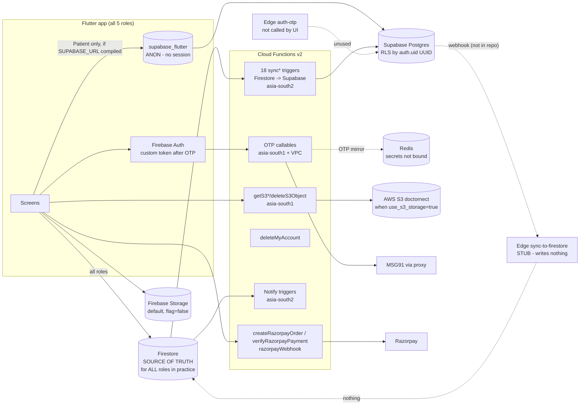

# DoctorNect — End-to-End Architecture Audit (READ-ONLY)

- **Date:** 2026-10-07
- **Commit audited:** `4885d33` + uncommitted working-tree changes listed in `git status` (`backend/functions/index.js`, `promoted_ads.js`, `promoted_ads_verification.test.js`, `frontend/lib/features/patient/patient_shell.dart`, new test `patient_shell_lazy_tabs_test.dart`)
- **Mode:** Read-only. The only file created is this report. No source/config file was modified. No command wrote to any remote/production system.
- **Secrets policy:** No secret value is reproduced. `secrets.txt` was deliberately **not opened** (see C-4).

Legend for evidence: `path:line` is relative to repo root `C:\Users\khije\Downloads\DoctorNect\doctor`.
Status vocabulary: **exists in code** / **wired in UI** / **deployed/live** (deployed state is always UNVERIFIED from code).

---

## 1. Executive summary

### Overall health score: **4 / 10**

Code quality signals are good (`flutter analyze` 0 issues, 402/402 Flutter tests, 219/226 functions tests pass with 7 emulator-only skips, strong Firestore/Storage rules, solid S3 authorization, Razorpay server-side pricing + HMAC + idempotency). But the **headline architecture — "Patient on Supabase with RLS, bridged bidirectionally to Firestore" — is not actually functioning as designed**:

1. The app never obtains a Supabase session, so every Patient Supabase call is anonymous and RLS cannot identify the user.
2. The Supabase → Firestore half of the "bidirectional" bridge is a stub that writes nothing.
3. The Patient module therefore works only because the client **dual-writes to Firestore**, and it breaks on the paths that write to Supabase only.

### Top 5 risks

| # | Risk | Evidence |
|---|------|----------|
| 1 | **Supabase identity gap**: no Supabase session is ever created (Supabase OTP sign-in is never called in the UI; Firebase third-party auth disabled). If `SUPABASE_URL`/`SUPABASE_ANON_KEY` are compiled in, patient booking **fails** (RPC rejects `auth.uid() IS NULL`) and patient list reads return **empty**. | `frontend/lib/core/supabase/supabase_bootstrap.dart:16-17`, `backend/supabase/config.toml:342-343`, `backend/supabase/migrations/20260930000001_fix_security_advisor_warnings.sql:302-305`, `frontend/lib/features/patient/booking/booking_flow_screen.dart:685-707` |
| 2 | **Supabase → Firestore sync does not exist** (edge function is a stub, no webhook/pg_net/outbox/reconciler in SQL). Patient cancellation goes **only** to Supabase, so doctors never see it. | `backend/supabase/functions/sync-to-firestore/index.ts:34-37`, `frontend/lib/core/data/shared_appointments_store.dart:814-832` |
| 3 | **`secrets.txt` is tracked in git** (contents not inspected). Treat as leaked until reviewed and rotated. | `git ls-files` → `secrets.txt` |
| 4 | **Firestore → Supabase sync overwrites real data with defaults** (`patient_age \|\| 30`, `token_number \|\| 1`, `slot_label '10:00 AM'`, etc.) and re-tags patient bookings as `doctor_firestore`. This risks silent divergence and corruption once Supabase is the source of truth. | `backend/functions/cross_role_sync.js:169-191,198-205` |
| 5 | **Account deletion leaves all Supabase (Postgres) data behind**, and Pharmacy/Lab/Ambulance have **no delete-account UI and no support tickets**. These are DPDP / Play Store account-deletion compliance gaps. | `backend/functions/delete_my_account.js` (no Supabase reference anywhere), `backend/firestore.rules:610-630` |

Also high: unauthenticated `list` on `doctors` (`backend/firestore.rules:463`), Redis secrets never bound to any function (`backend/functions/src/config/redis.js:21-24`), and promoted ads go live with **no admin approval** (`backend/functions/promoted_ads.js:338`).

### Go / No-Go: **NO-GO for production**

It becomes conditionally Go once Phase 1 (section 8) is done. Two shorter alternatives:

- Ship with Supabase **not compiled in** (omit `SUPABASE_URL`). Then every patient path falls back to Firestore, which works today. You must also rotate whatever is in `secrets.txt` and fix C-4, H-3, H-4 and H-8.
- Or finish the identity bridge (Firebase third-party auth in Supabase) **and** build real Supabase → Firestore sync before enabling Supabase writes.

---

## 2. Coverage list (what was scanned)

**Read in full or systematically grepped:**

| Area | Files / dirs |
|------|-------------|
| Root config | `firebase.json`, `.firebaserc`, `.gitignore`, `README.md`, `PLATFORMS.md` (presence), `.github/workflows/build-apk.yml`, `.github/workflows/flutter-ci.yml` (presence) |
| Cloud Functions (`backend/functions`, the deployed codebase per `firebase.json:10`) | `index.js` (all exports), `registration_otp.js` (OTP/Redis sections 1-250, 1700-2120 + grep), `cross_role_sync.js` (1-330 + full grep of every function/fetch), `s3_storage.js` (full), `abuse_rate_limit.js` (full), `src/config/redis.js` (full), `redis.js`, `promoted_ads.js` (grep + subagent), `delete_my_account.js` (grep), `appointment_slots.js`, `in_app_notifications.js`, `fcm_push.js`, `production_otp_guard.js`, `http_endpoint_security.js`, `msg91_email.js`, `validation_rules.js`, `seed_demo_accounts.js`, `.env.example`, `.secret.local.example`, `package.json`, `test/*` (35 files, run) |
| Other backend | `backend/gcp-msg91-proxy/*`, `backend/scripts/*` (13 files), `backend/tool/deploy-backend.ps1`, `backend/package.json`, `backend/database_schema.sql`, `backend/FIREBASE_SETUP.md` |
| Rules | `backend/firestore.rules` (1229 lines, full), `backend/storage.rules` (305 lines, full), `backend/firestore.indexes.json` (presence) |
| Supabase | `backend/supabase/config.toml`, all 19 `migrations/*.sql`, `functions/auth-otp`, `functions/razorpay-payments`, `functions/sync-to-firestore`, `functions/_shared/cors.ts`, `tests/rls_suite.sql`, `.temp/project-ref` |
| Flutter | `frontend/pubspec.yaml`, `frontend/lib/**` (578 Dart files; every `Supabase`, `.from(`, `.rpc(`, `.collection(`, `httpsCallable`, `FirebaseStorage`, `RemoteConfig`, `AppCheck`, `Razorpay`, `snapshots()` call site was enumerated), `frontend/test/**` (55 files, run), `frontend/scripts/*`, `frontend/tool/*`, `frontend/.env.example` |
| Docs | `docs/SUPABASE_MIGRATION_RUNBOOK.md`, `docs/PRE_CUTOVER_CHECKLIST.md`, existing audit docs (presence only) |

**Not read / out of scope:** `node_modules`, `build/`, `.dart_tool`, platform native folders except where noted, binary assets, and `secrets.txt`, `.env`, `.env.migration`, `backend/functions/.env`, `.secret.local`, `scripts/service-account.json` (deliberately not opened because they contain secret values).

**Duplicate / stray directories found:** a root `functions/` holds only `.env`, `.secret.local` and a debug log (not the deployed source). A root `supabase/` holds only `.temp/*`. Both are leftovers and are gitignored or untracked.

**Commands run (all local, read-only):**

- `flutter analyze --no-pub` → **No issues found** (222 s)
- `flutter test --no-pub` → **402 passed, 0 failed**
- `node --test "test/**/*.test.js"` in `backend/functions` → **226 tests: 219 pass, 0 fail, 7 skipped** (the skipped ones are Firestore/Storage rules tests that need the emulator: `firestore_reviews`, `firestore_s3_rules`, `profile_claims_rules`, `promoted_ads_verification` rules part, `storage_doctor_kyc`, `storage_provider_kyc`, `doctor_slots_emulator`)
- `git ls-files`, `git check-ignore` for secret coverage

---

## 3. Architecture as-built

**What each role really uses:**

| Role | Auth | Primary data store (actual) | Supabase usage | Files |
|------|------|-----------------------------|----------------|-------|
| Patient | Firebase Auth (OTP → custom token) | **Firestore** (dual-writes) | Reads/writes attempted as **anon** when Supabase is configured: profile, appointments, health records, prescriptions read | `frontend/lib/core/supabase/supabase_patient_repository.dart`, `frontend/lib/features/patient/profile/data/patient_profile_mock.dart:216,386`, `frontend/lib/core/data/shared_appointments_store.dart:249,814`, `frontend/lib/features/patient/records/add_record_screen.dart:209` |
| Doctor | Firebase Auth | Firestore | none in client; Firestore → Supabase sync triggers | `frontend/lib/features/doctor/**`, `backend/functions/index.js:1953-1987` |
| Pharmacy | Firebase Auth | Firestore | none in client | `frontend/lib/features/pharmacy/**` |
| Lab | Firebase Auth | Firestore | none in client | `frontend/lib/features/lab/**` |
| Ambulance | Firebase **anonymous** session + username/PIN or mobile OTP via callables | Firestore (`ambulances`, not `users/{uid}`) | none in client | `frontend/lib/core/firebase/ambulance_callable_client.dart`, `backend/firestore.rules:969-1060` |

---

## 4. Service verification (Part 1)

### 4.1 Firebase Auth

| Aspect | Finding | Evidence |
|--------|---------|----------|
| Client init | `FirebaseBootstrap.initialize()` in `main()` (run in parallel with Supabase init) | `frontend/lib/main.dart:38-50` |
| OTP flow | `sendUserRegistrationOtp` → `verifyUserRegistrationOtp` → `completeMobileOtpLogin` (returns a custom token) → `signInWithCustomToken` | `frontend/lib/core/auth/registration_otp_service.dart:95,171,237`, `frontend/lib/core/firebase/firebase_auth_service.dart:309` |
| MSG91 | Server-only. MSG91 v5 OTP API, either directly or via the Cloud Run proxy (`backend/gcp-msg91-proxy/server.js`, authenticated with an `x-proxy-key` header). DLT sender defaults to `DRNECT`. The client file `msg91_otp_service.dart` is a stub. | `backend/functions/registration_otp.js:826-828,975,1064-1115` |
| Token verification on backend | Callables use `request.auth` (verified by the Firebase SDK). The only HTTP endpoint is `verifyAmbulanceDriverLoginHttp`, which uses username/PIN plus an origin allow-list. | `backend/functions/index.js:1442-1496`, `backend/functions/http_endpoint_security.js:6-41` |
| Role resolution | Firestore `users/{uid}.role` + `profileId`. **No custom claims are read by the client or the rules.** `createCustomToken(uid,{role})` sets a token claim at login only; `setCustomUserClaims` exists only in the admin script. | `backend/functions/registration_otp.js:2350,3106-3107`, `backend/functions/scripts/create_super_admin.js:359`, `backend/firestore.rules:54-69` |
| One-mobile-one-role | Enforced server-side: registration rejects any mobile that already exists (`already-exists`); login requires the stored role to match the requested role; OTP challenge keys include the role. | `backend/functions/registration_otp.js:228-230,1554-1565,1631-1644,3070-3076` |
| Demo/test OTP guard | `assertProductionOtpSafety()` runs at module load and refuses to boot on `medibond-45fad` if `OTP_TEST_MODE` or `DEMO_PHONE_*` env vars are set. Stale demo challenges are rejected in production. | `backend/functions/index.js:112`, `backend/functions/production_otp_guard.js:98-116`, `backend/functions/registration_otp.js:2008-2015` |
| Logout | Firebase sign-out, FCM token unregister (Patient/Doctor/Ambulance), session stores cleared. **Supabase is not signed out and secure storage is not cleared on logout.** | `frontend/lib/core/firebase/firebase_auth_service.dart:787-801`, `frontend/lib/core/session/app_session.dart:82-111` |
| Delete account | `deleteMyAccount` callable deletes Firestore docs, Firebase Storage prefixes, versioned S3 prefixes and the Auth user. It **does not touch Supabase**. | `backend/functions/index.js:1865-1875`, `backend/functions/delete_my_account.js:305-383,640-728` |
| Release reachability | ✅ wired in UI for all 5 roles | |

### 4.2 Supabase PostgreSQL — **Broken/Inconsistent**

| Aspect | Finding | Evidence |
|--------|---------|----------|
| Client init | `Supabase.initialize` runs only when both `SUPABASE_URL` and `SUPABASE_ANON_KEY` dart-defines are set; otherwise it is a silent no-op (`isReady=false`). The source also contains placeholder URL/key literals (not real secrets). | `frontend/lib/core/supabase/supabase_bootstrap.dart:14-15,30-31,119-148` |
| Release build | `release_build.ps1` passes `SUPABASE_URL`/`SUPABASE_ANON_KEY` if they are present in the environment. It **never** passes `USE_SUPABASE_AUTH`. `release_build.sh` does not pass Supabase values at all, so the two scripts drift. | `frontend/scripts/release_build.ps1:73-80`, `frontend/scripts/release_build.sh:100-106` |
| **Identity mapping (critical)** | RLS identifies users via `auth.uid()` (Supabase UUID) → `public.users.id`. Firebase third-party auth is **disabled**. The only way to get a Supabase session is `SupabaseAuthService.verifyOtp` (edge function `auth-otp` + magic-link `token_hash`), and **nothing in `frontend/lib` calls `sendOtp`/`verifyOtp`/`resolvePath`** (grep). Firebase login actively signs Supabase out. **Result: every Supabase request from the app is the `anon` role.** | `backend/supabase/config.toml:342-343`, `backend/supabase/migrations/20260930000001_fix_security_advisor_warnings.sql:52-69`, `frontend/lib/core/supabase/supabase_auth_service.dart:198-296`, `frontend/lib/core/supabase/supabase_bootstrap.dart:66-93` |
| Effect: booking | `book_appointment_atomic` raises 42501 when `auth.uid() IS NULL`. The repository rethrows 42501 and `PatientWriteGuard` rethrows (unless maintenance is on), so the **booking aborts before the Firestore write**. | `backend/supabase/migrations/20260930000001_fix_security_advisor_warnings.sql:302-305`, `frontend/lib/core/supabase/supabase_patient_repository.dart:96-102`, `frontend/lib/core/supabase/patient_write_guard.dart:93-121`, `frontend/lib/features/patient/booking/booking_flow_screen.dart:685-710` |
| Effect: reads | Under RLS, `anon` sees zero rows **without an error**. The appointment refresh then calls `mergeFromFirestore([])` and **returns without the Firestore fallback**. Prescriptions do fall back when the result is empty. Profile falls back because `null` is returned. | `frontend/lib/core/data/shared_appointments_store.dart:249-259`, `frontend/lib/features/doctor/clinical/data/clinical_prescription_store.dart:260-272`, `frontend/lib/features/patient/profile/data/patient_profile_mock.dart:216-228` |
| Effect: writes | Profile upsert errors are not caught in `persistProfile` (it awaits the Supabase write before the Firestore write), so a failure there blocks the Firestore save as well. Health-record Supabase errors are swallowed (`catch (_) {}`). Cancel uses an UPDATE that matches 0 rows under RLS, which **returns success and persists nothing**. | `frontend/lib/features/patient/profile/data/patient_profile_mock.dart:386-420`, `frontend/lib/features/patient/records/add_record_screen.dart:209-236`, `frontend/lib/core/data/shared_appointments_store.dart:814-832` |
| Tables used in code vs migrations | Every table/column the Flutter repository uses exists in the migrations (`users.profile_id/role`, `system_config.config_key/config_value`, `appointments.*`, `prescriptions` + 3 child tables, `patients.*` including the S3 columns, `health_records.*` including `storage_key/storage_provider`, `reviews`). **No column mismatches found.** `backend/database_schema.sql` is stale: it mirrors only the first migration. | `frontend/lib/core/supabase/supabase_patient_repository.dart:69-342`; migrations `20260923000001`, `20260925000001:40-50,114-120`, `20260928000001-3` |
| RLS | Enabled on all public tables. FORCE RLS is not used (it is not needed for non-owner roles). Helpers are SECURITY DEFINER with a pinned `search_path` and EXECUTE revoked from anon. `private.admin_users` and `private.provisioning_errors` have RLS but no policies, which is intentional (service-only). Policies open to all roles: `review_public_select`, `promoted_ads_select` (no `TO` clause). | `backend/supabase/migrations/20260923000002_doctornect_rls.sql:668,765`, `20260930000001:52-113`, `20261002000001:14-27` |
| SECURITY DEFINER exposed to clients | Only `book_appointment_atomic` is exposed (authenticated + service_role, checks identity). `find_auth_user`, `consume_otp_attempt` and `check_and_increment_rate_limit` are restricted to service_role. | `20260930000001:270-433`, `20261001000002:188-260` |
| Indexes missing | `patient_doctor_links.doctor_id`, `support_tickets.doctor_id`, `referrals.appointment_id`, `prescription_referrals.to_doctor_id`, `ambulance_broadcasts.patient_id` (used in RLS), `admin_audit_logs.admin_uid`. `idx_users_active_mobile` is left commented out. | `20260930000004:403-405` |
| pg_cron | `expire-promoted-ads` (hourly; duplicates the CF `expirePromotedAds`), OTP cleanup, rate-limit cleanup | `20260923000003_doctornect_cron.sql:11-44` |
| Project ref | The linked ref starts with `rnlt` (`backend/supabase/.temp/project-ref`). The build validator still hard-blocks an older staging ref starting `irpk`. The sync code falls back to `STAGING_SUPABASE_URL`/`STAGING_SUPABASE_DB_URL`. **Whether `rnlt…` is DRNECT-DB is UNVERIFIED.** | `backend/scripts/verify_production_build_config.js:78`, `backend/functions/cross_role_sync.js:20,27` |

### 4.3 Redis — **Intentional but incomplete / Broken wiring**

| Aspect | Finding | Evidence |
|--------|---------|----------|
| Client | ioredis with lazy connect, `connectTimeout` 1500 ms, `maxRetriesPerRequest` 1, up to 10 reconnects, TLS on by default with `rejectUnauthorized:true`, CA from `redis_ca.pem`, an `error` listener so it cannot crash the process. The doc comment says "Google Cloud Memorystore" while the target is Redis Cloud (an endpoint example mentions `redis.io`), which is documentation drift. | `backend/functions/src/config/redis.js:3-12,138-185,203-214` |
| **Secret binding** | `REDIS_HOST`/`REDIS_PORT`/`REDIS_PASSWORD` are declared with `defineSecret`, but **no function lists `REDIS_SECRETS` in `secrets:`**. The only `secrets:` arrays in the codebase are AWS, Razorpay webhook and SYNC. At runtime `secretParam.value()` is empty, so the client falls back to `process.env.REDIS_HOST` and then **`127.0.0.1`**. | `backend/functions/src/config/redis.js:21-24,139`; grep `secrets:` → `backend/functions/index.js:1869`, `backend/functions/s3_storage.js:805`, `backend/functions/promoted_ads.js:664`, `backend/functions/index.js:1951` |
| `RATE_LIMIT_BACKEND` | Default `firestore` → Firestore transaction buckets (`abuse_rate_limits`). `redis` → Lua `INCR`+`PEXPIRE` with a 1.5 s timeout; any Redis error **falls back to Firestore** (fails safe), and a genuine 429 is rethrown. | `backend/functions/abuse_rate_limit.js:87-156` |
| `S3_URL_CACHE` | Default `off`. When `on`: authorization runs **before** the cache lookup; keys are `s3:dl:<sha256(objectKey)>` with `EX` = 2700 s; signed URLs last 3600 s; the cache is invalidated on upload-URL issue and on delete; all operations have a 1.5 s timeout and fail open. | `backend/functions/s3_storage.js:575-692` |
| OTP mirror (**not flagged**) | Always attempted (when the MSG91 key exists). Keys `otp:challenge[:role]:<HMAC(mobile)>`, `EX` = 600 s, value is the OTP **hash**. Firestore `otp_challenges` remains the source of truth (verification requires the Firestore doc). Writes use `.catch`; verify-path `get` calls have **no timeout wrapper**. | `backend/functions/registration_otp.js:233-241,1800-1826,1946-1966,1987-2025` |
| TTL on every key | ✅ `ratelimit:*` (PEXPIRE, with a TTL==-1 repair), `s3:dl:*` (EX), `otp:challenge:*` (EX) | as above |
| Business data only in Redis | ✅ none | |
| Redis down | Fails open/safe everywhere, but each OTP send/verify can wait for connect timeout plus a retry (roughly 1.5–3 s) when Redis is unreachable, which is the likely production state given the unbound secrets. | |

### 4.4 AWS S3 — **Intentional/transitional, correct core, incomplete edges**

| Aspect | Finding | Evidence |
|--------|---------|----------|
| Flag | Remote Config `use_s3_storage` defaults to `false` (dart-define override available). It gates profile photos, health records, lab reports and ad banners; with the flag off, Firebase Storage paths are used. | `frontend/lib/core/storage/storage_feature_flag.dart:14-64` |
| Callables | `getS3UploadUrl` (PUT, 300 s, content-type + content-length signed), `getS3DownloadUrl` (600 s, or 3600 s when cached), `getS3DownloadUrls` (≤20 keys, public-media only), `deleteS3Object`. All require auth, App Check (env-controlled) and an abuse limit, and bind the AWS secrets. | `backend/functions/s3_storage.js:246-417,803-835` |
| Validation | Content types limited to jpeg/png/webp/pdf; images ≤5 MB, documents ≤15 MB; object keys checked against traversal and a character allow-list. | `backend/functions/s3_storage.js:34-175` |
| Paths | `health_records/{patientId}/{recordId}/{uuid}`, `lab_reports/{patientId}/{bookingId}/{uuid}`, `patients/{id}/profile/{uuid}.jpg`, `doctor_profiles/{id}/profile/{uuid}.jpg`, `promoted_ads/{uid}/{adId}/{uuid}.jpg`. **No S3 path exists for pharmacy/lab/ambulance profile photos or KYC**; those stay on Firebase Storage. | `backend/functions/s3_storage.js:286-394` |
| Access control | Health records: owner patient, or a verified doctor on the care team or with an appointment, subject to the share flags. Lab reports: owner patient or the assigned lab. **Profile photos and ads are readable by any authenticated user** (including anonymous ambulance sessions). If the Firestore `health_records` doc is missing (e.g. a Supabase-only record), the doctor check **passes**. Doctors cannot read lab reports for orders they placed. | `backend/functions/s3_storage.js:423-517` |
| Bucket name | Defaults to `doctornect` in two places. `S3_BUCKET`/`AWS_REGION` are not in `.env.example`. IAM policy and bucket policy are not in the repo. | `backend/functions/s3_storage.js:21-22`, `backend/functions/delete_my_account.js:17` |
| Deletion cleanup | Versioned prefix delete per role, plus lab-specific report keys. ✅ | `backend/functions/delete_my_account.js:108-180,305-456` |
| CORS | **Not defined in the repo.** Browser PUT/GET to presigned URLs requires bucket CORS. UNVERIFIED. | — |
| Authorization source | All checks read **Firestore** (`users`, `patients`, `appointments`, `lab_bookings`). A patient who existed only in Supabase could not upload. | `backend/functions/s3_storage.js:204-210,445-477` |

### 4.5 Cloud Functions

- **Inventory:** about 70 exports. Callables/HTTP/schedule run in `asia-south1`; **all Firestore triggers (notifications + 18 sync functions) run in `asia-south2`** (`backend/functions/index.js:115`). There is no `setGlobalOptions` and no `minInstances` (cold starts on the OTP path).
- **Client ↔ server:** every client callable exists (no broken names). Exported but never called from the client: `bookAppointment` (the CF version; the client uses the Supabase RPC instead), `approveUserAccount`, `approvePatientAccount`, `backfillPatientCareTeams`, `sendMsg91EmailCallable`. `getValidationRulesHttp` is reached through a Hosting rewrite.
- **App Check:** most callables use `enforceAppCheck` driven by env (default true). **Absent on** `lookupMobileRegistration` (`backend/functions/index.js:993-1010`), `createRazorpayOrder` (`backend/functions/promoted_ads.js:119`) and `verifyRazorpayPayment` (`backend/functions/promoted_ads.js:374`).
- **Dead triggers:** `syncDoctorBlockedDatesToSupabase` listens on the top-level `doctor_blocked_dates/{docId}`, and `syncAmbulancePrivateSettingsToSupabase` listens on `ambulance_private_settings/{id}`. Neither collection is written anywhere in the app; the real path is `ambulances/{id}/private/settings` (`backend/firestore.rules:1057`). (`backend/functions/index.js:1996-2001,2066-2071`)
- **Sync PG fallback:** requires `pg`, which is not in `backend/functions/package.json`, and uses `ssl.rejectUnauthorized:false`. It is dead in deploy and insecure if ever enabled. (`backend/functions/cross_role_sync.js:26-41`)
- **Mail:** `sendMsg91Email` is a stub returning `{skipped:true, disabled:true}`, so email is **not functional**. (`backend/functions/msg91_email.js:18-19`)

### 4.6 MSG91 / Email / Razorpay / Remote Config / App Check

| Service | Status | Evidence |
|---------|--------|----------|
| MSG91 SMS | ✅ Server-only, Secret Manager / `.secret.local`, proxy with a shared key. No client secret. | `backend/functions/registration_otp.js:826-1115`, `backend/gcp-msg91-proxy/server.js:64-71` |
| Email | ❌ Stub (`msg91_email.js:18-19`); the `mail` queue trigger exists | `backend/functions/index.js:1809` |
| Razorpay | ✅ Amount comes from the server pricing table; order + payment HMAC with timing-safe compare; webhook HMAC; idempotent ledger `razorpayPayments/{paymentId}`. The key id comes from the callable response, never hard-coded. ⚠️ No App Check on the two callables. ⚠️ Ad set to **`active` immediately after payment, with no admin approval**. ⚠️ A duplicate implementation exists in the Supabase edge function `razorpay-payments` (unused by the app). | `backend/functions/promoted_ads.js:18-25,134-215,263-338,411-424,519-534`, `frontend/lib/features/promoted_ads/screens/create_promoted_ad_screen.dart:234-242` |
| Remote Config | ✅ One key only (`use_s3_storage`); `fetchAndActivate` | `frontend/lib/core/storage/storage_feature_flag.dart:29-42` |
| App Check | ✅ Play Integrity / DeviceCheck in release, reCAPTCHA v3 on web (skipped if the site key is missing). ⚠️ A release build compiled with `APP_CHECK_DEBUG_TOKEN` uses the debug provider. | `frontend/lib/core/firebase/firebase_bootstrap.dart:68-124` |

### 4.7 Other SDKs found

| SDK | Use | Notes |
|-----|-----|-------|
| `google_sign_in` | Doctor OAuth relink paths | `frontend/lib/core/firebase/firebase_auth_service.dart:602`; rules `backend/firestore.rules:42-52` |
| `geolocator`, `geocoding`, `http` → Nominatim (OpenStreetMap) | Ambulance / location | Third-party geocoding with no API key; check the OSM usage policy (rate limit / user-agent) |
| `encrypt`, `flutter_secure_storage` | Local file encryption | Not cleared on logout |
| `firebase_messaging`, `flutter_local_notifications` | Push | Not registered for Pharmacy/Lab |
| `pdf`, `printing`, `share_plus`, `screenshot`, `archive` | Prescription PDF / sharing | Local only |
| `sms_autofill`, `cached_network_image`, `url_launcher` | UX | — |
| Functions: `@aws-sdk/*`, `ioredis`, `firebase-admin`, `firebase-functions` | — | `pg` is used but missing from deps |
| `backend/package.json`: `@supabase/server` | Not referenced by `backend/functions` | Dead dependency |

---

## 5. Per-role matrix (Part 2)

Cells: ✅ Working (data path) · ⚠️ Partial · ❌ Broken/Missing · ➖ N/A. Unless noted, "FS" = Firestore and "SB" = Supabase.

Two numbers per Patient cell where relevant: **[A]** = build without Supabase defines (Firestore path) and **[B]** = build with `SUPABASE_URL`/`SUPABASE_ANON_KEY` compiled in.

| Feature | Patient | Doctor | Pharmacy | Lab | Ambulance |
|---------|---------|--------|----------|-----|-----------|
| Register → OTP → login | ✅ CF OTP → custom token (`registration_otp_service.dart:95-330`) | ✅ same | ✅ same | ✅ same | ✅ anonymous FA + OTP/PIN callables (`ambulance_callable_client.dart:29,51`) |
| Role resolution | ✅ FS `users/{uid}` (`user_repository.dart:19-74`) | ✅ | ✅ | ✅ | ⚠️ `ambulances.authUid`, no `users` doc (`role_session_guard.dart:51-73`) |
| One mobile one role | ✅ server (`registration_otp.js:1554-1565`) | ✅ | ✅ | ✅ | ✅ |
| profileCompleted gate | ➖ always true (`profile_completion_service.dart:27-30`) | ✅ (`doctor_shell.dart:173`) | ✅ (`medical_store_shell.dart:41`) | ✅ (`lab_shell.dart:45`) | ✅ (`ambulance_shell.dart:59`) |
| Admin verification gate | ➖ | ✅ UI + **rules** `isVerifiedDoctor()` on clinical data (`firestore.rules:89-93,545-563`) | ⚠️ UI only; rules don't gate store ops on `verified` (`firestore.rules:833-904`) | ⚠️ UI only; rules don't gate lab ops on `verified` (`firestore.rules:673-690,857-878`) | ⚠️ UI only (`firestore.rules:1045-1055`) |
| Profile read/update | [A] ✅ FS · [B] ⚠️ SB upsert as anon fails and blocks the FS write (`patient_profile_mock.dart:386-420`) | ✅ FS `doctors` | ✅ FS `medical_stores` | ✅ FS `labs` | ✅ FS `ambulances` |
| Photo upload | ✅ S3 `patients/` or Storage (`profile_photo_uploader.dart:48-118`) | ✅ S3 `doctor_profiles/` or Storage | ⚠️ no S3 purpose; Storage only / not traced | ⚠️ same | ⚠️ same |
| Core feature | Booking [A] ✅ FS · [B] ❌ RPC 42501 aborts (`booking_flow_screen.dart:685-710`); Appointments list [A] ✅ · [B] ❌ empty (`shared_appointments_store.dart:249-259`); Prescriptions ✅ FS (SB-empty fallback); Health records ✅ FS + S3/Storage (SB error swallowed); Lab booking ✅ FS `lab_bookings` | Appointments ✅ FS; write Rx ✅ FS `prescriptions`; patients ✅ derived; slots ✅ FS `doctor_availability` | Orders ✅ FS `pharmacy_deliveries` (`pharmacy_firestore_repository.dart:36-39`) | Bookings ✅ FS `lab_bookings`/`lab_orders`; report upload ✅ S3/Storage | Requests ✅ FS `ambulance_broadcasts`/`ambulance_requests`; rating ✅ CF `submitAmbulanceRating` |
| Cross-role: Patient books → Doctor sees | [A] ✅ FS→FS · [B] ❌ booking aborts before the FS write | ✅ reads FS only (`shared_appointments_store.dart:239`) | ➖ | ➖ | ➖ |
| Cross-role: Patient cancels → Doctor sees | [A] ✅ · [B] ❌ SB-only write, 0 rows under RLS, no SB→FS sync (`shared_appointments_store.dart:814-832`, `sync-to-firestore/index.ts:34-37`) | ❌ in [B] | ➖ | ➖ | ➖ |
| Cross-role: Doctor Rx → Patient | ✅ FS→FS; also FS→SB sync | ✅ | ✅ via `pharmacy_deliveries` | ➖ | ➖ |
| Cross-role: Lab report → Patient | ✅ FS booking doc + S3 `lab_reports/` (`s3_storage.js:486-511`) | ⚠️ doctor cannot read lab-order report files via S3 | ➖ | ✅ | ➖ |
| Promote / banner | ➖ correctly **absent** (create blocked by rules `!isPatient()` and by S3) (`firestore.rules:1174-1183`, `s3_storage.js:383-385`) | ⚠️ entry ✅ (`doctor_home_screen.dart:446`), Razorpay ✅, **no admin approval** (`promoted_ads.js:338`) | ⚠️ same (`store_profile_screen.dart:188`) | ⚠️ same (`lab_profile_screen.dart:200`) | ⚠️ same (`ambulance_profile_screen.dart:578`) |
| Push notifications | ✅ FCM (`patient_push_service.dart:94-113`) + in-app | ✅ FCM + in-app | ⚠️ in-app only, no FCM | ⚠️ in-app only, no FCM | ✅ FCM |
| Support tickets | ✅ FS `support_tickets` (`help_support_screen.dart:41`) | ⚠️ rules allow it (`firestore.rules:614-615`); no UI found | ❌ rules deny | ❌ rules deny | ❌ rules deny |
| Delete account | ✅ UI + CF, but **SB data not deleted** | ✅ UI (`doctor_profile_screen.dart:717`), SB not deleted | ❌ no UI (CF supports the role) | ❌ no UI | ❌ no UI |
| Logout | ⚠️ FA cleared; SB session and secure storage not cleared | ⚠️ | ⚠️ | ⚠️ | ✅ session + FCM cleared (`ambulance_shell.dart:86,142`) |

### Known-intentional items, classified

| Item | Classification | Exact current state |
|------|---------------|---------------------|
| Staged Firebase → Supabase migration (Patient first) | **Broken/Inconsistent** | Patient code dual-writes FS + SB, but SB has no identity (anon). FS → SB sync exists for 18 collections (doctor/pharmacy/lab/ambulance + appointments/prescriptions) but **not** for `patients`, `health_records`, `family_members` or `reviews`. SB → FS is a stub. DLQ exists (SB table + FS `_sync_dlq` fallback). **No reconciler** job or function exists. |
| Origin tagging | **Intentional but incomplete** | FS → SB writes `sync_origin:'doctor_firestore'` for *every* appointment, including patient-created ones (`cross_role_sync.js:189`). SB → FS loop check exists only inside the stub. Client FS writes carry no `syncedBy`, so every patient FS write is re-upserted into SB. |
| `use_s3_storage` + legacy Storage paths | **Intentional/transitional — correct** | Default off; both paths are implemented and tested (`health_record_file_store_routing_test.dart`, `lab_report_file_store_routing_test.dart`, `s3_*_test.dart`). S3 has no path for pharmacy/lab/ambulance media. |
| `RATE_LIMIT_BACKEND` | **Intentional but incomplete** | `firestore` (default) works; `redis` would silently fall back because the secrets are not bound. |
| `S3_URL_CACHE` | **Intentional but incomplete** | Design is correct (authorization before cache, TTL, invalidation); same secret-binding gap. |
| `PatientWriteGuard` | **Intentional — correct in isolation** | Kill-switch on SB `system_config.patient_module_status`, 30 s cache, fails open, 42501 treated as maintenance only when confirmed. It only guards SB writes; the FS writes are unguarded. |

---

## 6. Cross-cutting findings (Part 3)

### 6.1 Data consistency

- **Client dual-writes without the bridge:** booking (`booking_flow_screen.dart:685-730`), reschedule (`:557-588`), profile (`patient_profile_mock.dart:386-449`), health records (`add_record_screen.dart:209-268`). No transaction spans both stores, so a partial failure diverges them.
- **Read-one / write-other:** patient cancel writes SB only while the doctor reads FS only (`shared_appointments_store.dart:814-832` vs `:239`). Patient appointment list reads SB first while the booking also writes FS.
- **Sync clobbering:** the FS → SB payload fills missing fields with defaults and POSTs with `merge-duplicates`, overwriting SB values (`cross_role_sync.js:169-205`). The prescription sync uses `patient_id || 'pat-unknown'` (`:301`).
- **Duplicate schedulers:** promoted-ad expiry runs both as pg_cron (`20260923000003:11-21`) and as CF `expirePromotedAds` on separate stores.
- **Duplicate implementations:** SB edge `auth-otp` vs CF OTP; SB edge `razorpay-payments` vs CF Razorpay; CF `bookAppointment` vs SB RPC `book_appointment_atomic`. The client uses only one of each pair.

### 6.2 Security

| Item | Evidence |
|------|----------|
| `secrets.txt` tracked in git (not opened) | `git ls-files` |
| `doctors` **list is allowed without auth and without a verified filter** (`get` requires verified); doctor docs carry `mobile`/`phone`/`email` | `backend/firestore.rules:463-466,477` |
| `medical_stores` / `labs` list for any signed-in user (including anonymous ambulance sessions), unverified included | `backend/firestore.rules:785,810` |
| Appointments: patient may create directly (bypasses capacity/slot logic) and either party may update any field except the ids (status, time, fee) | `backend/firestore.rules:324-332,527-541` |
| `ambulance_broadcasts` / `ambulance_requests` updates have no field restriction for the booker/driver branches; a broadcast without `acceptedDriverId` can be taken over through the `request.resource` fallback | `backend/firestore.rules:1077-1081,1098-1102` |
| `promotedAds` create allowed for any signed-in non-patient, including users with no `users` doc; read is public including `razorpayOrderId` | `backend/firestore.rules:1167-1183` |
| Verification (`verified`) not enforced in rules for pharmacy/lab/ambulance operations (UI-only `ProfileActionGuard`) | `frontend/lib/core/auth/profile_action_guard.dart:28-77`; rules sections above |
| S3 public-media read for any authenticated caller; doctor health-record read allowed when the FS record doc is absent | `backend/functions/s3_storage.js:430-432,474-477` |
| Rules vs RLS parity: SB `doctor_can_access_patient` also accepts non-cancelled appointments and links; FS rules use care team / `doctor_links`; S3 accepts any appointment. Three different definitions of "care relationship". | `20260930000006:185-215`, `backend/firestore.rules:178-187`, `backend/functions/s3_storage.js:456-472` |
| Supabase edge functions: CORS `*`; `auth-otp` deployed `--no-verify-jwt` with a service-role client (public SMS endpoint parallel to the CF abuse controls) | `backend/supabase/functions/_shared/cors.ts:1-5`, `docs/SUPABASE_MIGRATION_RUNBOOK.md:74` |
| `lookupMobileRegistration` has no App Check, which enables enumeration of registered mobiles and roles (abuse limits still apply) | `backend/functions/index.js:993-1010` |
| Hardcoded admin email allow-lists (consistent, but in 4+ places) | `backend/firestore.rules:117`, `backend/storage.rules:23`, `backend/functions/s3_storage.js:31`, `20260930000002_admin_users_table.sql:43-45` |
| `.env.example` contains a concrete demo phone value | `backend/functions/.env.example:33` |
| Demo phones/OTP seeded in SQL and edge code | `20260923000001_doctornect_schema.sql:1083-1096`, `backend/supabase/functions/auth-otp/index.ts:7-13` |
| `ALLOW_LEGACY_UNSALTED_OTP_HASH = true` ("set false 1 day after deploy") | `backend/functions/registration_otp.js:244-245` |
| OTP verify falls back to *any* challenge for the same mobile (cross-role) | `backend/functions/registration_otp.js:1926-1940` |
| Storage rules accept `image/.*` (includes SVG) | `backend/storage.rules:173,182,265` |
| `.gitignore` coverage: `.env*`, `*.jks`, `service-account*.json`, `functions/.env`, `.secret.local` ✅ ignored. **`secrets.txt` not ignored and tracked.** `redis_ca.pem` tracked (a public CA cert, acceptable). | `.gitignore:56,60,78,81`, `backend/functions/.gitignore:2-3` |
| Root clutter that may contain sensitive logs: `audit_results*.txt`, `email_audit.txt`, `flutter-web-*.log`, `firestore-debug.log` | repo root — tracked status UNVERIFIED |

### 6.3 Performance

- **Unbounded queries:** `ambulance_repository.dart:393` (whole `ambulances` collection), `:583-585,952-953,1055-1057`; `ambulance_driver_home_screen.dart:73-76`; `family_member_repository.dart:17-19`; `super_admin_verification_service.dart:94` (entire `users` collection as a stream); `support_tickets_history_screen.dart:23-25`; `promoted_ads_service.dart:358-382`; Supabase `fetchAppointments` / `fetchPrescriptions` (with 3 nested joins) / `fetchHealthRecords` (`supabase_patient_repository.dart:146-149,186-194,281-284`).
- **Rules cost:** `doctorCanAccessPatient` and the ambulance helpers perform several `get()` calls per evaluation (the 10-call limit risk applies in lists) (`backend/firestore.rules:178-293`).
- **Startup:** `main()` awaits Firebase init (including App Check token fetch on web) and Supabase init. Remote Config and validation rules are non-blocking ✅ (`frontend/lib/main.dart:38-50`, `frontend/lib/core/firebase/firebase_bootstrap.dart:48-51`).
- **OTP latency:** Redis connect attempts against an unconfigured host on every send/verify, plus no `minInstances` (cold starts) on the OTP callables.
- **Missing caching where Redis was intended:** the URL cache is off and the rate limiter is on Firestore, so each callable does 1–3 Firestore transactions for abuse buckets (`backend/functions/abuse_rate_limit.js:58-85,183-218`).
- **Listener leak:** the Supabase `onAuthStateChange` subscription is never cancelled (app-lifetime singleton, minor) (`frontend/lib/core/supabase/supabase_auth_service.dart:92`).

### 6.4 Reliability

- Supabase failures in the profile save are unhandled, so the whole save fails (`patient_profile_mock.dart:386-420`).
- Silent `catch (_) {}` around the health-record Supabase write hides persistent failures (`add_record_screen.dart:236`).
- Sync triggers use `retry: true` and rethrow after 3 in-function retries plus a DLQ entry, so a permanently failing doc retries until event expiry, producing DLQ duplicates and cost (`cross_role_sync.js:256-271`, `backend/functions/index.js:1953-2092`).
- `PatientWriteGuard` fails open when `system_config` is unreadable (by design) (`patient_write_guard.dart:67-70`).
- The `pat-default` patientId fallback in booking can write a booking under a fake id (`booking_flow_screen.dart:562-565,690-692`).

### 6.5 Dead / unreachable code

| Item | Evidence |
|------|----------|
| `SupabaseAuthService.resolvePath/sendOtp/verifyOtp` (no callers) | `frontend/lib/core/supabase/supabase_auth_service.dart:163-296` |
| `SupabasePatientRepository.submitReview` (no callers) | `frontend/lib/core/supabase/supabase_patient_repository.dart:204-232` |
| CF `bookAppointment`, `approveUserAccount`, `approvePatientAccount`, `backfillPatientCareTeams`, `sendMsg91EmailCallable` (no client callers; may be admin tools) | `backend/functions/index.js:1252-1270,1730,1800,1877` |
| SB edge `razorpay-payments` (duplicate, unused); `sync-to-firestore` (stub) | `backend/supabase/functions/*` |
| Dead triggers `doctor_blocked_dates`, `ambulance_private_settings` | `backend/functions/index.js:1996-2001,2066-2071` |
| `pg` fallback path in sync | `backend/functions/cross_role_sync.js:26-41` |
| `pending_community_medicines` path constant | `frontend/lib/core/firebase/firestore_paths.dart:10` |
| `backend/package.json` `@supabase/server` | `backend/package.json:3` |
| Root `functions/`, root `supabase/` leftovers | repo root |
| `frontend/scripts/refactor/unused_dart_files.txt` lists 40 candidates (not re-verified) | `frontend/scripts/refactor/unused_dart_files.txt` |

### 6.6 Config drift

| Drift | Evidence |
|-------|----------|
| Triggers in `asia-south2`, callables in `asia-south1`, setup doc says Firestore in `asia-south1` | `backend/functions/index.js:115-116`, `backend/FIREBASE_SETUP.md:93` |
| About 38 env names used in code but missing from `.env.example` (e.g. `S3_BUCKET`, `AWS_REGION`, `S3_URL_CACHE`, `RATE_LIMIT_BACKEND`, `SUPABASE_URL`, `SUPABASE_SERVICE_ROLE_KEY`, `RAZORPAY_WEBHOOK_SECRET`, `MSG91_PROXY_URL`, `PROXY_SECRET`, `VPC_CONNECTOR`, `STAGING_SUPABASE_*`, `DEMO_PHONE_PHARMACY`) | `backend/functions/.env.example` vs code |
| `release_build.ps1` passes Supabase defines; `release_build.sh` does not | `frontend/scripts/release_build.ps1:73-80`, `frontend/scripts/release_build.sh:100-106` |
| Old staging Supabase ref `irpk…` still referenced; linked ref `rnlt…`; `config.toml` `project_id="doctor"` | `backend/scripts/verify_production_build_config.js:78`, `backend/supabase/config.toml:5` |
| Firebase project is `medibond-45fad` (legacy brand name) across `firebase.json`, `.firebaserc`, `firebase_options.dart`, `production_otp_guard.js:4` | consistent, informational |
| `database_schema.sql` stale vs 19 migrations | `backend/database_schema.sql` |
| Redis described as Memorystore in code vs Redis Cloud in the target | `backend/functions/src/config/redis.js:3-5` |

### 6.7 Tests / quality

- `flutter analyze`: **0 issues**. `flutter test`: **402/402 pass**. Functions: **219 pass / 0 fail / 7 skipped**.
- **Rules tests not executed** (they need the emulator and JDK 21): all `*.rules.test.js`, `firestore_s3_rules`, `profile_claims_rules`, and the promoted-ads rules part. **The Supabase RLS suite `backend/supabase/tests/rls_suite.sql` was not run** (it needs a database).
- **Zero or near-zero coverage:** `SupabasePatientRepository` (no test with an anon or real session), patient cancel path, `PatientProfileMock.persistProfile`, the Supabase → Firestore direction (none exists), `delete_my_account` Supabase cleanup (none exists), Razorpay client flow (`promoted_ads_service.dart`), ambulance driver repository/booking sync, pharmacy orders data layer, lab worklist store, support tickets, in-app/FCM notifications, `appointment_slots.js` CF (tested, but unused by the client).

---

## 7. Findings table

| ID | Sev | Area | Roles | Evidence (file:line) | Why it matters | Recommended fix | Effort |
|----|-----|------|-------|----------------------|----------------|-----------------|--------|
| C-1 | Critical | Supabase identity | Patient | `frontend/lib/core/supabase/supabase_bootstrap.dart:16-17,66-93`; `backend/supabase/config.toml:342-343`; `frontend/lib/core/supabase/supabase_auth_service.dart:198-296` (no callers) | No Supabase session, so RLS cannot identify the user; all patient SB I/O is `anon` | Enable Supabase third-party Firebase auth and pass `accessToken: () => FirebaseAuth.instance.currentUser?.getIdToken()`; map `auth.jwt()->>'sub'` to `users.firebase_uid` in helpers. Until then, gate SB paths on "has SB identity", not `isReady`. | L |
| C-2 | Critical | Booking | Patient, Doctor | `frontend/lib/features/patient/booking/booking_flow_screen.dart:685-710`; `20260930000001:302-305`; `frontend/lib/core/supabase/supabase_patient_repository.dart:96-102` | With SB configured, booking throws 42501 before the FS write, so patients cannot book | Same gate as C-1; never let the SB write block the FS write during transition | S |
| C-3 | Critical | Sync bridge | All | `backend/supabase/functions/sync-to-firestore/index.ts:34-37`; no webhook/pg_net in migrations | SB → FS half of the "bidirectional" bridge does nothing; SB-only writes never reach doctors | Implement the SB → FS writer (outbox table + trigger + worker using `synced_by='supabase_bridge'`) or remove SB-only writes | L |
| C-4 | Critical | Secrets | All | `secrets.txt` (tracked) | Possible credential exposure in git history | Review the file manually, rotate every credential in it, remove it from the index and history, add it to `.gitignore` | S |
| C-5 | Critical | Cancel | Patient, Doctor | `frontend/lib/core/data/shared_appointments_store.dart:814-832` | When SB is ready, cancel writes SB only (0 rows under anon, reports success); doctor never sees it | Always write FS; treat SB as secondary until C-1/C-3 are fixed | S |
| H-1 | High | Sync data integrity | Patient, Doctor | `backend/functions/cross_role_sync.js:169-205,301` | Defaults overwrite real values; origin mislabelled `doctor_firestore` | Send only present fields (PATCH semantics), preserve the original `sync_origin`, skip docs written by the patient client or tag client writes | M |
| H-2 | High | Patient reads | Patient | `frontend/lib/core/data/shared_appointments_store.dart:249-259` | An empty SB result returns early with no FS fallback, so the list is empty | Fall back to FS on empty result / no SB session | S |
| H-3 | High | Firestore rules | Doctor | `backend/firestore.rules:463-466` | Unauthenticated listing of all doctor docs including unverified ones and their contact fields | `allow list: if resource.data.verified == true && request.query.limit <= 100` (clients must filter `verified==true`); move contact fields to a private subdoc | S |
| H-4 | High | Delete account / DPDP | All | `backend/functions/delete_my_account.js` (no Supabase cleanup) | Health data persists in Postgres after deletion | Add SB service-role deletion/anonymisation per role in `deleteMyAccount` | M |
| H-5 | High | Delete account / support UI | Pharmacy, Lab, Ambulance | `backend/firestore.rules:610-630`; no UI found | Play Store requires in-app account deletion; no support channel for these roles | Add delete-account and support entries to those shells; extend rules | M |
| H-6 | High | Redis wiring | All | `backend/functions/src/config/redis.js:21-24,139`; `backend/functions/registration_otp.js:1801-1819,1946-1957` | Redis never reachable in prod (secrets not bound); OTP path pays connect timeouts | Bind `REDIS_SECRETS` on the OTP/S3/rate-limited callables **or** gate the OTP mirror behind a flag; wrap verify `get` in `withRedisTimeout` | S |
| H-7 | High | Promoted ads | Doctor, Pharmacy, Lab, Ambulance | `backend/functions/promoted_ads.js:338`; no admin UI | Paid ads go live without moderation (medical advertising compliance) | Set `pending_approval` after payment; admin approve/reject callable + UI | M |
| H-8 | High | Appointments rules | Patient, Doctor | `backend/firestore.rules:324-332,527-541` | Capacity bypass; status/time/fee tampering by either party | Restrict updates by role to explicit keys; route creation through the `bookAppointment` CF | M |
| H-9 | High | Region drift | All | `backend/functions/index.js:115`; `backend/FIREBASE_SETUP.md:93` | Firestore triggers must match the DB location; mismatch means deploy failure or no notifications/sync | Verify the DB location; set `FIRESTORE_TRIGGER_REGION` to match | S |
| M-1 | Medium | Ambulance rules | Patient, Ambulance | `backend/firestore.rules:1077-1081,1098-1102` | Field tampering / broadcast takeover | Restrict `affectedKeys()` per party; remove the `request.resource` fallback in `isDriverOwner(...)` | M |
| M-2 | Medium | Promoted ads rules | Providers | `backend/firestore.rules:1167-1183` | Users without a profile (incl. anonymous) can create ads; payment ids publicly readable | Require `userExists()` and a non-patient role; serve a public projection without payment fields | S |
| M-3 | Medium | S3 authz | Patient, Doctor | `backend/functions/s3_storage.js:430-432,474-477` | Profile photos visible to any signed-in user; missing record doc → allow | Require the record doc to exist; restrict profile photos to related parties | S |
| M-4 | Medium | Verification enforcement | Pharmacy, Lab, Ambulance | `frontend/lib/core/auth/profile_action_guard.dart:28-77` | Unverified providers can operate by calling Firestore directly | Add `verified==true` checks in rules for provider write paths | M |
| M-5 | Medium | App Check gaps | All | `backend/functions/index.js:993-1010`; `backend/functions/promoted_ads.js:119,374` | Enumeration / payment-endpoint abuse | Add `enforceAppCheck: ENFORCE_ABUSE_APP_CHECK` | S |
| M-6 | Medium | Edge functions | Patient | `backend/supabase/functions/_shared/cors.ts:1-5`; `docs/SUPABASE_MIGRATION_RUNBOOK.md:74` | Public SMS-sending endpoint, `*` CORS, unused by the app | Undeploy `auth-otp` / `razorpay-payments` until used; restrict CORS | S |
| M-7 | Medium | Dead triggers | Doctor, Ambulance | `backend/functions/index.js:1996-2001,2066-2071` | PIN/blocked-date changes never sync | Point at `ambulances/{id}/private/{doc}` and the real blocked-dates source, or delete | S |
| M-8 | Medium | Sync PG fallback | All | `backend/functions/cross_role_sync.js:26-41` | TLS verification disabled; dependency missing | Remove the fallback or add `pg` with proper CA | S |
| M-9 | Medium | Env drift | All | `backend/functions/.env.example` | Misconfigured deploys | Document every env/secret name used | S |
| M-10 | Medium | Unbounded queries | All | §6.3 list | Cost and latency growth | Add `limit` + pagination | M |
| M-11 | Medium | Push | Pharmacy, Lab | no FCM registration found | Missed orders/bookings | Add push services for those roles | M |
| M-12 | Medium | Logout | All | `frontend/lib/core/firebase/firebase_auth_service.dart:787-801` | SB session / secure storage persist on shared devices | Call `SupabaseAuthService.signOut()` and clear secure storage | S |
| M-13 | Medium | Email | All | `backend/functions/msg91_email.js:18-19` | Email service non-functional | Implement or remove the mail trigger | M |
| M-14 | Medium | Supabase indexes | Patient | §4.2 list | RLS / filter scans | Add indexes | S |
| L-1 | Low | OTP | All | `backend/functions/registration_otp.js:244-245` | Legacy unsalted hash still accepted | Set the flag `false` | S |
| L-2 | Low | OTP | All | `backend/functions/registration_otp.js:1926-1940` | Cross-role challenge fallback | Restrict fallback to the same role | S |
| L-3 | Low | Hygiene | — | `backend/functions/.env.example:33` | Real-looking phone number in the example file | Blank it | S |
| L-4 | Low | Storage rules | All | `backend/storage.rules:173,182,265` | SVG upload | Allow-list jpeg/png/webp | S |
| L-5 | Low | Drift | — | `backend/scripts/verify_production_build_config.js:78`; `backend/functions/cross_role_sync.js:20,27`; `backend/supabase/config.toml:5` | Old project references | Clean up `STAGING_*` fallbacks | S |
| L-6 | Low | Booking | Patient | `frontend/lib/features/patient/booking/booking_flow_screen.dart:562-565,690-692` | `pat-default` placeholder id | Fail fast if no patient id | S |
| L-7 | Low | Dead code | — | §6.5 | Maintenance burden | Remove | S |
| L-8 | Low | Docs drift | — | `backend/functions/src/config/redis.js:3-5`; `backend/database_schema.sql` | Misleading docs | Update | S |

**Counts:** Critical 5 · High 9 · Medium 14 · Low 8 (total 36)

---

## 8. Prioritized fix plan (ready-to-paste Cursor prompts)

### Phase 1 — must fix before production

**P1-1 (C-4)**
> Do NOT print file contents. In repo `doctor`, remove `secrets.txt` from git tracking (`git rm --cached secrets.txt`) and add `secrets.txt` to the root `.gitignore`. Change only `.gitignore`. Then list in chat the git commits that touched `secrets.txt` (hashes only) so I can rotate credentials and purge history myself.

**P1-2 (C-2, C-5, H-2) — transitional safety gate**
> Change only `frontend/lib/core/supabase/supabase_bootstrap.dart`, `frontend/lib/core/supabase/supabase_patient_repository.dart`, `frontend/lib/core/data/shared_appointments_store.dart`, `frontend/lib/features/patient/booking/booking_flow_screen.dart`, `frontend/lib/features/patient/profile/data/patient_profile_mock.dart`, `frontend/lib/features/patient/records/add_record_screen.dart`, and add tests under `frontend/test/core/supabase/`.
> 1) Add `static bool get hasPatientIdentity => isReady && Supabase.instance.client.auth.currentSession != null;` to `SupabaseBootstrap`.
> 2) Replace every `SupabaseBootstrap.isReady` guard on patient reads/writes with `hasPatientIdentity`.
> 3) In `cancelByPatient` always perform the Firestore update; only additionally write Supabase when `hasPatientIdentity`.
> 4) In `refreshForPatient` fall back to Firestore when the Supabase result is empty.
> 5) Make Supabase writes in booking/profile best-effort (log, don't block the Firestore write) while Firestore remains the source of truth.
> Add unit tests covering: no session → Firestore-only; session → both. Do not touch any other file.

**P1-3 (H-3, M-2) — rules hardening**
> Change only `backend/firestore.rules` and add emulator tests in `backend/functions/test/`. (a) `doctors`: `allow list: if request.query.limit <= 100 && resource.data.get('verified', false) == true;` (b) `medical_stores` and `labs` list: also require `resource.data.get('verified', false) == true || isSuperAdmin()`. (c) `promotedAds` create/update/delete: require `userExists()` and `role() in ['doctor','medicalStore','medical','lab','ambulance']` instead of `!isPatient()`. Grep `frontend/lib` for queries on these collections and report any query that lacks a `verified == true` filter (do not edit Dart).

**P1-4 (H-8) — appointment integrity**
> Change only `backend/firestore.rules` and tests. Restrict `appointments` update: patient may only change `patientStatus`, `cancellationReason`, `updatedAt` (and reschedule fields `dateTime`, `slotLabel`, `tokenNumber` only while `doctorStatus == 'pendingRequest'`); verified doctor may only change `doctorStatus`, `diagnosis`, `hasPrescription`, `consultationNotes`, `updatedAt`. Keep the existing patientId/doctorId immutability. Add emulator tests for allowed and denied keys.

**P1-5 (H-4, H-5) — account deletion compliance**
> Change only `backend/functions/delete_my_account.js`, `backend/functions/test/delete_my_account_s3.test.js` (or a new test file), and add delete-account + support entries to `frontend/lib/features/pharmacy/screens/store_profile_screen.dart`, `frontend/lib/features/lab/screens/lab_profile_screen.dart`, `frontend/lib/features/ambulance/ambulance_profile_screen.dart` reusing the existing `deleteMyAccount` call in `user_repository.dart:546`. In the CF, when `SUPABASE_URL`/`SUPABASE_SERVICE_ROLE_KEY` exist, delete or anonymise the user's rows (patients, appointments patient_status=cancelled + PII null, health_records, family_members, reviews, users) via PostgREST with the service role; bind `secrets: ['SUPABASE_URL','SUPABASE_SERVICE_ROLE_KEY']` on `deleteMyAccount` in `index.js:1866-1870` (the one allowed edit in `index.js`). Soft-fail and report failures in the response like the S3 cleanup does.

**P1-6 (H-7) — ad moderation**
> Change only `backend/functions/promoted_ads.js`, its test file, `backend/firestore.rules` (promotedAds section) and add an admin screen under `frontend/lib/features/admin/`. After a verified payment set `status: 'pending_approval'` instead of `'active'`; add callable `reviewPromotedAd({adId, decision, reason})` restricted to super admins (same check as `isSuperAdmin` in `s3_storage.js:87-93`) that sets `active` + `startTime/endTime` or `rejected` (+ refund note). The home carousel must keep querying only `status == 'active'`.

**P1-7 (H-9, H-6) — infra wiring**
> First, report the Firestore database location from `firebase firestore:databases:list` (read-only) — do not deploy. If it isn't `asia-south2`, change `FIRESTORE_TRIGGER_REGION` in `backend/functions/index.js:115` to the DB location. Then in `backend/functions/registration_otp.js` wrap the Redis `get` calls at ~1955-1956 with a 1500 ms timeout helper and gate the OTP Redis mirror behind `process.env.OTP_REDIS_MIRROR === 'on'`; bind `REDIS_SECRETS` (from `./redis`) on the OTP callables in `index.js` only when that flag is on. Change only these two files plus a unit test.

### Phase 2 — soon (before enabling Supabase writes)

**P2-1 (C-1) — real identity bridge**
> Plan only, no code yet: produce a design doc `docs/SUPABASE_IDENTITY_BRIDGE.md` for enabling Supabase third-party Firebase auth (`[auth.third_party.firebase] enabled=true, project_id='medibond-45fad'`), passing `accessToken` from `FirebaseAuth.currentUser.getIdToken()` in `supabase_bootstrap.dart`, and rewriting `private.current_user_role/current_profile_id/is_profile_completed` to resolve by `auth.jwt()->>'sub' = users.firebase_uid` (TEXT) instead of `auth.uid()` (UUID). List every policy and function in `backend/supabase/migrations` that compares `auth.uid()` to `users.id`, `owner_uid`, `auth_uid` or `recipient_uid` and needs a migration.

**P2-2 (C-3, H-1) — sync correctness**
> Change only `backend/functions/cross_role_sync.js` and its tests. (1) Build the PostgREST payload from present fields only (no `|| default` for existing rows; defaults only on insert via a separate `ensure*Exists`). (2) Preserve `sync_origin` if the Firestore doc carries `syncOrigin`; add `syncedBy: 'patient_client'` support so patient-originated Firestore writes are not relabelled. (3) Remove the `pg` pool fallback. Then separately design (doc only) a Supabase → Firestore outbox: table `sync_outbox`, AFTER trigger on appointments/patients/health_records/reviews, and a Cloud Function poller writing Firestore with `syncedBy: 'supabase_bridge'`.

**P2-3 (M-1, M-4)** — rules: per-party `affectedKeys()` for `ambulance_broadcasts` / `ambulance_requests`; `verified==true` for pharmacy/lab/ambulance writes. Change only `backend/firestore.rules` + tests.

**P2-4 (M-3, M-5, M-6, M-7)** — `s3_storage.js:474-477` require the record doc to exist; add `enforceAppCheck` to `lookupMobileRegistration`, `createRazorpayOrder`, `verifyRazorpayPayment`; fix or remove dead triggers at `index.js:1996-2001,2066-2071`; undeploy the unused edge functions. Change only those files.

**P2-5 (M-9, M-12, M-11)** — sync `.env.example` with all env names; Supabase sign-out + secure-storage clear in the logout path (`firebase_auth_service.dart`, `app_logout.dart`); FCM for pharmacy/lab.

### Phase 3 — nice to have

**P3-1 (M-10)** add `limit()`/pagination to the queries in §6.3. **P3-2 (M-14)** Supabase index migration. **P3-3 (L-1…L-8)** OTP legacy flag off, same-role challenge fallback, SVG block, `.env.example` phone blank, remove `pat-default`, delete dead code (§6.5), update stale docs, unify the "care relationship" definition across FS rules / RLS / S3. **P3-4** add `minInstances: 1` to the OTP callables. **P3-5** run `rls_suite.sql` and the emulator rules tests in CI (`.github/workflows/flutter-ci.yml`).

---

## 9. UNVERIFIED items — manual checklist

| # | Check | Where |
|---|-------|-------|
| 1 | Contents of `secrets.txt` and its git history; rotate anything inside | Local repo / `git log -- secrets.txt` |
| 2 | Firestore database location (must match `asia-south2` triggers) | Firebase Console → Firestore → Settings, or `firebase firestore:databases:list` |
| 3 | Which functions are actually deployed and their regions | `firebase functions:list` / GCP Console → Cloud Functions |
| 4 | Whether release builds were produced with `SUPABASE_URL` set (decides whether patient booking is currently broken) | CI/build machine env, `release_build.ps1` invocation logs; inspect APK with `strings` for `supabase.co` |
| 5 | Supabase project `rnlt…` is DRNECT-DB; old project (`irpk…`) decommissioned | Supabase Dashboard → Project Settings |
| 6 | Supabase Database Webhooks configured to `sync-to-firestore` (stub) | Supabase Dashboard → Database → Webhooks |
| 7 | Edge functions deployed (`auth-otp`, `razorpay-payments`, `sync-to-firestore`) and their JWT setting | Supabase Dashboard → Edge Functions |
| 8 | Default table grants to `anon` in the live DB | `SELECT grantee, table_name, privilege_type FROM information_schema.role_table_grants WHERE grantee='anon';` |
| 9 | Secret Manager contains `REDIS_*`, `AWS_*`, `SUPABASE_*`, `RAZORPAY_WEBHOOK_SECRET`, `MSG91_AUTHKEY`; whether `RAZORPAY_KEY_ID/SECRET` are env vars or secrets | GCP Console → Secret Manager; function env vars tab |
| 10 | Live values of `RATE_LIMIT_BACKEND`, `S3_URL_CACHE`, `ENFORCE_*_APP_CHECK`, `OTP_TEST_MODE` | GCP Console → each function → Variables |
| 11 | Redis Cloud endpoint reachability from the VPC connector; TLS CA matches | Redis Cloud console; VPC egress |
| 12 | S3 bucket `doctornect` exists in `ap-south-1`, Block Public Access ON, versioning ON, CORS for web origins, IAM policy least-privilege (Put/Get/Delete/ListBucketVersions on this bucket only) | AWS Console → S3 / IAM |
| 13 | App Check enforcement toggled ON for Firestore, Storage, Functions; Play Integrity + reCAPTCHA registered | Firebase Console → App Check |
| 14 | Remote Config live value of `use_s3_storage` | Firebase Console → Remote Config |
| 15 | MSG91 DLT header `DRNECT` + templates approved; proxy static IP whitelisted | MSG91 dashboard |
| 16 | Razorpay webhook URL points to `razorpayWebhook` (asia-south1) with the matching secret | Razorpay Dashboard → Webhooks |
| 17 | `app_config/demo_accounts` doc state in production Firestore (`demoLoginEnabled`) | Firestore console |
| 18 | Firestore indexes deployed match `backend/firestore.indexes.json` | Firebase Console → Indexes |
| 19 | Root logs/audit txt files tracked or not; scan them for PII | `git ls-files *.log *.txt` |
| 20 | Device tests: patient booking/cancel with and without Supabase defines; doctor sees booking/cancel; lab report visible to patient; ad purchase on each provider role; delete account on each role; logout on a shared device | Physical Android + iOS + web |
| 21 | Emulator rules tests and `rls_suite.sql` pass | `npm run test:firestore-rules` etc. (needs JDK 21); `psql -f backend/supabase/tests/rls_suite.sql` on a staging DB |

---

### Re-verification note
Every file:line cited in sections 1–7 was read directly during this audit or came from an exploration pass and was spot-checked. The highest-severity items (C-1…C-5, H-1, H-3, H-4, H-6, H-7, H-9) were each re-read at the cited lines before inclusion. Line numbers for very large files (`registration_otp.js`, `cross_role_sync.js`, `index.js`) come from the editor's line numbering of the current working tree, which includes the uncommitted changes.
