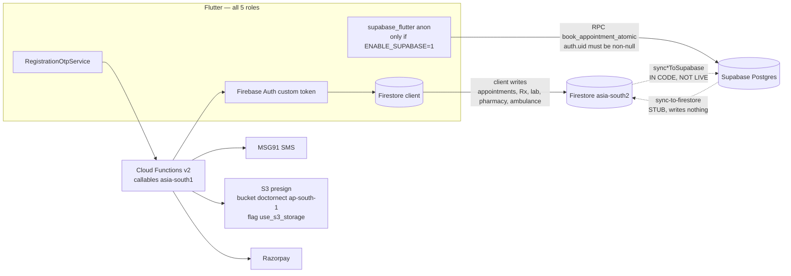

# DoctorNect — End-to-End Architecture Audit (READ-ONLY)

- **Date:** 2026-10-08
- **Commit audited:** `317af8d` (`Point Firestore triggers at live asia-south2.`) on `main`
- **Mode:** Read-only. The only file written is this report. No source or config file was modified by this audit. No command wrote to production.
- **Secrets policy:** No secret value is reproduced. Secret Manager was listed by **name only** (read-only CLI, same day).

Legend: `path:line` is relative to repo root. Status words: **exists in code** / **wired in UI** / **deployed/live**.

---

## 1. Executive summary

### Overall health score: **5 / 10**

The Firestore-native product (auth, doctor/pharmacy/lab/ambulance, rules, S3 presign, Razorpay server pricing) is largely real. The headline architecture — Patient on Supabase with RLS, identified by the logged-in user, bridged both ways to Firestore — is **not functioning**.

What is actually true today:

1. Login is Firebase custom tokens after MSG91 OTP in Cloud Functions. Firebase Phone Auth is not used. `USE_SUPABASE_AUTH` defaults off and the live OTP UI never creates a Supabase session.
2. Supabase initializes only when `SUPABASE_URL` and `SUPABASE_ANON_KEY` are compiled in (`ENABLE_SUPABASE=1`). There is no `signInWithIdToken`. `[auth.third_party.firebase] enabled = false`. RLS functions resolve `auth.uid()` against `public.users.id`. An anon client fails `book_appointment_atomic`.
3. Firestore → Supabase sync **exists in code** and is **not in the live functions list** (observed 2026-10-08). Supabase → Firestore edge function `sync-to-firestore` returns success and writes nothing.
4. A release build that does **not** set `ENABLE_SUPABASE=1` skips Supabase and patient booking/cancel stay on Firestore, which doctors read. A release that **does** set it calls Supabase first and breaks booking (no session) and, if a session were added without the reverse bridge, hides patient cancels from doctors.
5. Promoted ads are server-gated to `pending_approval`, but the app has no caller for `reviewPromotedAd`, and the client offers a 720-hour plan the server rejects.

### Top 5 risks

| # | Risk | Evidence |
|---|------|----------|
| 1 | **No Firebase → Supabase identity.** RLS cannot see the Firebase user. | `backend/supabase/config.toml:342-343`, `frontend/lib/core/supabase/supabase_bootstrap.dart:16-17`, `backend/supabase/migrations/20260930000001_fix_security_advisor_warnings.sql:58-68,302-305` |
| 2 | **Reverse sync is a stub.** Patient cancel with Supabase ready never updates Firestore. | `backend/supabase/functions/sync-to-firestore/index.ts:34-38`, `frontend/lib/core/data/shared_appointments_store.dart:814-832` |
| 3 | **Firestore → Supabase sync overwrites with defaults and retags origin** (`patient_age \|\| 30`, `token_number \|\| 1`, `slot_label \|\| '10:00 AM'`, `sync_origin: 'doctor_firestore'`). Not deployed yet; the next functions deploy would turn it on. | `backend/functions/cross_role_sync.js:169-190`, `backend/functions/index.js:1962-1967` |
| 4 | **Slot booking is a client Firestore create.** `bookAppointment` enforces capacity and is never called from Flutter. | `backend/firestore.rules:328-336,535`, `backend/functions/appointment_slots.js:648-655`, `frontend/lib/features/patient/booking/booking_flow_screen.dart:699-736` |
| 5 | **Promote cannot go live, and one plan cannot be paid.** No UI calls `reviewPromotedAd`. Client plan 720h is outside the server price table (max 168h). | `backend/functions/promoted_ads.js:35-41,148-152,730-747`, `frontend/lib/features/promoted_ads/screens/create_promoted_ad_screen.dart:128-130` |

### Go / No-Go: **NO-GO for the target architecture**

- **NO-GO** for any release with `ENABLE_SUPABASE=1` until identity (C-1) and reverse sync or single-store writes (C-2, C-3) are fixed.
- **Conditional GO** for a Firestore-only binary (`ENABLE_SUPABASE` unset, which `frontend/scripts/release_build.ps1:84-97` already does). Still ship knowing H-1 (client slot create) and H-2 (ads stuck in `pending_approval`, 30-day plan rejected). Do not deploy functions until C-3 is fixed or those sync exports are excluded — deploying current `index.js` would publish the default-overwrite sync.

---

## 2. Coverage list (what was scanned)

Scanned systematically (full read of the cited regions, plus repo-wide search). Not every generated/platform file was opened line by line.

| Area | What was covered |
|------|------------------|
| Root | `.firebaserc` (project `medibond-45fad`), `.gitignore` secrets entries, `firebase.json` presence via prior layout |
| Functions | `backend/functions/index.js` (exports, regions, App Check flags), `registration_otp.js` (OTP, one-role, Redis mirror, legacy hash), `cross_role_sync.js` (payload defaults, origin, DLQ), `promoted_ads.js` (pricing, review, webhook), `s3_storage.js` (bucket, purposes, authorize), `delete_my_account.js` (Supabase skip/cleanup), `abuse_rate_limit.js`, `appointment_slots.js`, `secure_config.js`, `src/config/redis.js`, `package.json`, `.env.example` |
| Rules / indexes | `backend/firestore.rules` (doctors, appointments, promotedAds, provider lists), `backend/storage.rules` (gaps vs S3), `backend/firestore.indexes.json` (composites) |
| Supabase | `config.toml` Firebase third-party flag, `functions/sync-to-firestore/index.ts` (full), `functions/auth-otp/index.ts` (parallel OTP, unused by live UI), migrations list through `20261002000001_is_super_admin_null_safe.sql`, `book_appointment_atomic` auth check, `private.current_profile_id` |
| Flutter | Auth (`registration_otp_service`, `unified_auth_flow_controller`, `firebase_auth_service`), `supabase_bootstrap`, `supabase_patient_repository`, `shared_appointments_store`, `booking_flow_screen`, `clinical_prescription_store`, profile/about/delete-account per role, promote screens, `release_build.ps1` / `.sh`, `pubspec.yaml` SDK list |
| Live (read-only, 2026-10-08) | `gcloud firestore databases describe` → location `asia-south2`. `firebase functions:list` → callables `asia-south1`, Firestore triggers `asia-south2`, `ssrmedibond45fad` in `us-central1`. `gcloud secrets list` names only |
| Tests this session | `flutter analyze` → no issues. `flutter test` → 408 passed. `node --test test/backend_audit_fixes.test.js` → 5 passed after `317af8d`. Full functions suite was **not** re-run after that one-line region change; last full run earlier the same day was 236 pass / 0 fail / 8 emulator skips |

**Not opened (deliberate):** `node_modules`, `build/`, `.dart_tool`, secret files (`.env`, `secrets.txt`, service-account JSON, `firebase_options.secrets.dart`). `backend/supabase/.temp/` is gitignored; the live Supabase project id was **not** read from disk.

**Intentional / transitional classification**

| Item | Class |
|------|--------|
| Patient-first Supabase cutover, other roles still on Firestore | **Intentional but incomplete** — identity and reverse sync are missing, so the staged design does not work when Supabase is compiled in |
| `use_s3_storage` default false; Firebase Storage still present | **Intentional/transitional — correct** |
| Redis behind `RATE_LIMIT_BACKEND` (default `firestore`), `S3_URL_CACHE` (default `off`), `OTP_REDIS_MIRROR` (default off) | **Intentional/transitional — correct** (fail-open). Incomplete only if production was assumed to be on Redis already |
| Firestore trigger region default `asia-south2`, callables `asia-south1` | **Intentional/transitional — correct** and matches the live database location observed today |
| Promoted ads require admin approval | **Intentional but incomplete** — server gate exists; no admin client |
| `sync-to-firestore` edge function | **Broken/Inconsistent** |
| Patient book dual-write + cancel Supabase-only | **Broken/Inconsistent** when `SupabaseBootstrap.isReady` |

---

## 3. Architecture as-built

| Role | What it actually uses when Supabase dart-defines are absent (current release scripts) |
|------|----------------------------------------------------------------------------------------|
| Patient | Firebase Auth + Firestore. Supabase client does not start |
| Doctor | Firebase Auth + Firestore. Verification is `doctors.verified` |
| Pharmacy | Firebase Auth + Firestore `pharmacy_deliveries` |
| Lab | Firebase Auth + Firestore `lab_bookings` / `lab_orders` |
| Ambulance | Firebase Auth + Firestore requests/broadcasts; extra callable `completeAmbulanceMobileOtpLogin` |

Redis is not on the hot path unless env flags are turned on. It is not a source of truth.

---

## 4. Service verification (Part 1)

### 4.1 Firebase Auth

| Check | Result |
|-------|--------|
| Client init | Firebase via `firebase_options.dart`, keys from gitignored `firebase_options.secrets.dart` |
| OTP | **Wired.** `sendUserRegistrationOtp` / `verifyUserRegistrationOtp` / `completeMobileOtpLogin` (`frontend/lib/core/auth/registration_otp_service.dart:94-96,170-172,237`). Server sends SMS via MSG91 (`registration_otp.js` `sendMsg91SmsOtp`). No `verifyPhoneNumber` in `frontend/` |
| Custom token | Login verify mints `{ role }` (`registration_otp.js` login path). Client `signInWithCustomToken` (`firebase_auth_service.dart` around the custom-token call) |
| One mobile, one role | Server: registration send rejects existing mobile; login send/verify/complete reject role mismatch (`registration_otp.js` `findUserByMobileDigits`, `resolveMobileLookupConflict`). Client: `lookupMobileRegistration`. Rules: `profile_claims` on user create (`firestore.rules:411-447`) |
| Role in rules | `role()` reads Firestore `users/{uid}.role`, not the JWT claim (`firestore.rules:66-68`) |
| Logout | `signOut` awaits `FileEncryptionService.clearOnLogout()` then Supabase sign-out if ready, then Firebase sign-out (`firebase_auth_service.dart:800-809`) |
| Delete account | UI on all 5 roles calls `deleteMyAccount`. Handler binds Supabase URL + service role and soft-fails per table (`delete_my_account.js` cleanup). If those secrets are missing, cleanup is skipped |
| Reachable in release | **Yes** for the Firebase path. Supabase auth mode is **not** reachable: `USE_SUPABASE_AUTH` is never passed by the release scripts |

**Gap (H-3):** if the role-scoped `otp_challenges` doc is missing, verify falls back to any challenge with the same `mobileDigits` (`registration_otp.js:1942-1950`). That can consume another role's challenge.

**Gap (H-4):** `ALLOW_LEGACY_UNSALTED_OTP_HASH = true` (`registration_otp.js:275`) still accepts unsalted SHA-256 OTP hashes.

### 4.2 Supabase PostgreSQL

| Check | Result |
|-------|--------|
| Client init | `SupabaseBootstrap.initialize` no-ops unless both dart-defines are non-empty (`supabase_bootstrap.dart:122-133`). `main.dart` calls it at startup. `isReady` then becomes true **without a user session** |
| Auth mode | `USE_SUPABASE_AUTH` default `false` (`supabase_bootstrap.dart:16-17`). `isSupabaseModeForRole` stays false. Live UI does not call `SupabaseAuthService` OTP |
| Identity | **Broken.** No `signInWithIdToken` in the repo. `config.toml:342-343` Firebase third-party auth **disabled**. `private.current_profile_id()` is `SELECT profile_id FROM public.users WHERE id = auth.uid()` (`20260930000001_fix_security_advisor_warnings.sql:62-68`). `firebase_uid` exists on `users` (`20260923000001_doctornect_schema.sql:63`) and is used by account deletion, not by RLS |
| Booking RPC | `book_appointment_atomic` raises `42501` when `auth.uid() IS NULL` (`20260930000001_fix_security_advisor_warnings.sql:302-305`). Client calls it whenever `isReady` (`booking_flow_screen.dart:701-720`, `supabase_patient_repository.dart:68-89`) **before** the Firestore write |
| RLS | Enabled on core tables in `20260923000001` / `20260923000002`, plus later hardening (`otp_challenges`, `abuse_rate_limits`, `sync_dead_letter_queue`, `private.admin_users`). Policies key off Supabase `auth.uid()`, so they do not apply to the Firebase session the app actually has |
| SECURITY DEFINER | `current_user_role`, `current_profile_id`, `is_super_admin`, `is_verified_doctor`, `book_appointment_atomic`. `is_super_admin` also allowlists specific emails in SQL (`20260930000001_fix_security_advisor_warnings.sql:78-86`) — **exists in code**; whether this migration is applied on DRNECT-DB is **UNVERIFIED** |
| Edge `auth-otp` | Separate MSG91 → Postgres OTP that returns a magic-link `token_hash`. **Not called** by the unified Flutter flow |
| Edge `sync-to-firestore` | Parses the webhook, skips Firestore-origin rows, then returns `{ success: true }` (`index.ts:34-38`). **Writes no Firestore document** |
| Migrations vs code | 19 SQL files from `20260923000001` through `20261002000001`. Applied-on-server state is **UNVERIFIED** |
| Release reachability | Off unless `ENABLE_SUPABASE=1` (`release_build.ps1:84-97`, same in `release_build.sh`) |

### 4.3 Redis

| Flag | Default in code | Effect |
|------|-----------------|--------|
| `RATE_LIMIT_BACKEND` | `firestore` (`abuse_rate_limit.js:87-88`) | Redis path uses `ratelimit:{category}:{hash}` with `PEXPIRE`. On Redis error, falls back to Firestore |
| `S3_URL_CACHE` | `off` (`s3_storage.js` around the flag read) | When `on`, caches presigns with TTL `expiresIn - 900`. Errors are swallowed |
| `OTP_REDIS_MIRROR` | not `on` (`index.js:120-123`, `registration_otp.js` mirror check) | `REDIS_SECRETS` bound only on send/verify OTP callables when `on`. Mirror keys have 600s TTL. Failures do not block Firestore OTP |

Connection: `defineSecret` `REDIS_HOST` / `REDIS_PORT` / `REDIS_PASSWORD` (`src/config/redis.js`). Those three names **exist** in Secret Manager (names only). They are not bound to functions unless the OTP mirror flag is on. Business records are not stored only in Redis. **Class: intentional / fail-open — correct.**

### 4.4 AWS S3

| Check | Result |
|-------|--------|
| Functions | `getS3UploadUrl`, `getS3DownloadUrl`, `getS3DownloadUrls`, `deleteS3Object` — callables, `asia-south1`, App Check via abuse flag. **Live** (in `functions:list`) and **called** from `s3_presign_api.dart` |
| Bucket / region | `S3_BUCKET` default `doctornect`, `AWS_REGION` default `ap-south-1` (`s3_storage.js:21-22`). IAM and the real bucket name are **UNVERIFIED** |
| Validation | jpeg/png/webp/pdf; images 5 MB; health/lab docs 15 MB |
| Paths | `health_records/`, `lab_reports/`, `patients/.../profile/`, `doctor_profiles/`, `promoted_ads/{uid}/{adId}/`. Unknown `purpose` rejected. No S3 purpose for pharmacy/lab/ambulance KYC |
| Read | Profile and promoted prefixes: any signed-in user. Health records and lab reports: owner plus care-team/appointment/lab checks |
| Flag | Remote Config `use_s3_storage`, default **false** (`storage_feature_flag.dart`). Off → Firebase Storage. **Console value UNVERIFIED** |
| Delete account | Prefix cleanup in `delete_my_account.js` when S3 secrets are bound. `AWS_ACCESS_KEY_ID` and `AWS_SECRET_ACCESS_KEY` names exist in Secret Manager |

### 4.5 Cloud Functions

**Code vs live (2026-10-08, project `medibond-45fad`):**

| Group | Code | Live |
|-------|------|------|
| Callables / HTTPS (OTP, S3, Razorpay create+verify, ambulance, validation, `deleteMyAccount`, `expirePromotedAds`) | `asia-south1` | **Deployed** `asia-south1` |
| Firestore triggers (notify*, rating, mail queue, `reconcileAppointmentSlot`) | `FIRESTORE_TRIGGER_REGION` default **`asia-south2`** (`index.js:115-116`). `appointment_slots.js:8` hardcodes `asia-south2` | **Deployed** `asia-south2` — matches database `locationId: asia-south2` |
| `reviewPromotedAd`, `razorpayWebhook` | Exported (`index.js:1806-1808`) | **Not in the live list** |
| `sync*ToSupabase` (16 triggers) | Exported (`index.js:1962-2096`) with secrets `SUPABASE_URL`, `SUPABASE_SERVICE_ROLE_KEY` | **Not in the live list** |
| `ssrmedibond45fad` | Not in this functions tree | **Live** `us-central1` HTTPS nodejs24 — do not delete; it is App Hosting SSR |
| `bookAppointment` | Exported, App Check, slot cap (`appointment_slots.js:648-655`) | Present as a callable. **No Flutter `httpsCallable('bookAppointment')`** |

App Check: `ENFORCE_OTP_APP_CHECK` and `ENFORCE_ABUSE_APP_CHECK` default on unless env is `false` (`index.js:134-144`). `razorpayWebhook` uses HMAC, not App Check. `getValidationRulesHttp` is public HTTP. Ambulance HTTP App Check is off unless `ENFORCE_AMBULANCE_HTTP_APP_CHECK=true`.

**Deployed/live region note:** an earlier default of `asia-south1` for triggers would have been wrong for this database. Current source matches `asia-south2`. Callables stay in `asia-south1`.

### 4.6 MSG91, email, Razorpay, Remote Config, App Check

| Service | Wiring | Secret in client? |
|---------|--------|-------------------|
| MSG91 | Auth key from env names `MSG91_AUTHKEY` / `MSG91_AUTH_KEY` / `AUTH_KEY` (`secure_config.js`). Sender default `DRNECT`. Client `Msg91OtpService` refuses direct sends | **No** MSG91 key in `frontend/` |
| Email | `sendMsg91EmailCallable` exists. Patient help UI is `mailto:` only (`about_screen.dart` Email Support row) | No |
| Razorpay | `createRazorpayOrder` / `verifyRazorpayPayment` called from `promoted_ads_service.dart:271,289`. Amount from server table only. Webhook HMAC in `promoted_ads.js` (~505-554) bound to `RAZORPAY_WEBHOOK_SECRET` | Key secret stays server-side. **`RAZORPAY_WEBHOOK_SECRET` is not in the Secret Manager name list observed today** — webhook deploy/runtime will fail closed |
| Remote Config | `use_s3_storage` only, default false | Site key for App Check web is a dart-define, not a server secret |
| App Check | `firebase_bootstrap.dart` Play Integrity / Device Check (debug provider in debug). Enforcement is the callable `enforceAppCheck` flag. Console enforcement mode is **UNVERIFIED** | — |

Patients cannot create ads: `isPromotedAdProvider` excludes `patient` (`firestore.rules:111-113`) and `assertCanPromote` denies patient. UI opens management only from doctor, pharmacy, lab, ambulance. Patient home only streams `status == active`.

### 4.7 Other SDKs

`frontend/pubspec.yaml`: `firebase_core`, `firebase_auth`, `cloud_firestore`, `cloud_functions`, `firebase_storage`, `firebase_messaging`, `firebase_app_check`, `firebase_remote_config`, `google_sign_in`, `supabase_flutter`, `razorpay_flutter`, plus device plugins (`file_picker`, `image_picker`, `geolocator`, `http`).

`backend/functions/package.json`: `@aws-sdk/client-s3`, `@aws-sdk/s3-request-presigner`, `firebase-admin`, `firebase-functions`, `ioredis`.

No extra payment or SMS SDK on the client beyond Razorpay and the MSG91 stubs.

---

## 5. Per-role matrix (Part 2)

Cells are **code reachability**, not a device pass. “Firestore-only binary” means `ENABLE_SUPABASE` unset so `isReady` stays false.

| Feature | Patient | Doctor | Pharmacy | Lab | Ambulance |
|---------|---------|--------|----------|-----|-----------|
| OTP → Firebase login | ✅ `registration_otp_service.dart:94` | ✅ same | ✅ same | ✅ same | ✅ OTP then `completeAmbulanceMobileOtpLogin` |
| `profileCompleted` gate | ➖ patients treated complete (`profile_completion_service.dart` ~27) | ✅ shell blocks (`doctor_shell.dart:179`) | ✅ `medical_store_shell.dart` ~60 | ✅ `lab_shell.dart` ~41 | ✅ `ambulance_shell.dart` ~69 |
| Admin verification | ➖ | ✅ `doctors.verified` (`doctor_verification_gate.dart:66`) | ⚠️ `ProfileActionGuard` only | ⚠️ same | ⚠️ same |
| Profile photo | ✅ S3 or Firebase Storage (`profile_photo_uploader.dart` ~48) | ✅ ~157 | ➖ no uploader found | ➖ | ➖ |
| Booking / appointments | ⚠️ Firestore-only binary: ✅ via `SharedAppointmentsStore`. With Supabase ready: ❌ RPC requires `auth.uid()` (`booking_flow_screen.dart:701`) | ✅ Firestore `appointment_repository` | ➖ | ➖ | ➖ |
| Cancel appointment | ⚠️ Supabase ready: writes `patient_status` only and returns (`shared_appointments_store.dart:814-832`) — doctor Firestore row unchanged. Firestore-only: ✅ | ✅ Firestore `cancelByDoctor` | ➖ | ➖ | ➖ |
| Prescriptions | ⚠️ Firestore fallback; if Supabase ready and returns rows, Firestore is skipped (`clinical_prescription_store.dart:259-271`) | ✅ write/read Firestore | ➖ | ➖ | ➖ |
| Health records | ⚠️ Supabase when ready, vaccination path still Firestore | ➖ reads via sharing | ➖ | ➖ | ➖ |
| Pharmacy orders | ⚠️ patient sees deliveries from Firestore | ➖ | ✅ `pharmacy_deliveries` | ➖ | ➖ |
| Lab book + report | ✅ Firestore `lab_bookings` | ➖ | ➖ | ✅ upload metadata on Firestore; file S3 or Storage | ➖ |
| Ambulance request | ✅ Firestore | ➖ | ➖ | ➖ | ✅ Firestore |
| Promote + pay | ➖ by design | ⚠️ UI + Razorpay, then stuck `pending_approval`; 720h plan rejected | ⚠️ same | ⚠️ same | ⚠️ same |
| See banners | ✅ active ads only | ➖ | ➖ | ➖ | ➖ |
| Notifications | ✅ in-app | ✅ | ✅ | ✅ | ✅ |
| Help contact | ✅ email only (`about_screen.dart` Email Support) | ✅ shared About | ✅ email row | ✅ email row | ✅ email row |
| Delete account | ✅ `deleteMyAccount` | ✅ | ✅ | ✅ | ✅ |
| Rx visible to patient | ✅ both sides Firestore `prescriptions` while Supabase is off | ✅ | ➖ | ➖ | ➖ |
| Lab report visible to patient | ✅ `lab_bookings` | ➖ | ➖ | ✅ | ➖ |
| Patient booking visible to doctor | ✅ Firestore-only binary. ❌ or stale if Supabase path is on (no reverse sync) | ✅ reads Firestore only (`shared_appointments_store.dart` doctor refresh ~239) | ➖ | ➖ | ➖ |

Cross-role while Supabase is **off**: doctor prescription → patient, lab report → patient, and patient booking → doctor all stay on Firestore and do not need the stub bridge.

Cross-role while Supabase is **on**: patient book hits an RPC that rejects anon; patient cancel never reaches the doctor; a later functions deploy of `syncAppointmentToSupabase` would copy Firestore rows back onto Postgres as `doctor_firestore` with default age/token/slot (`cross_role_sync.js:176-190`).

---

## 6. Cross-cutting findings (Part 3)

### Data consistency

- Patient book, when Supabase is ready, writes Postgres (`p_sync_origin: patient_supabase`) **and** Firestore with no `syncedBy` (`booking_flow_screen.dart:701-736`). The Cloud Function, if deployed, would skip only `syncedBy === 'supabase_bridge' | 'reconciler_bot'` and then upsert Postgres as `doctor_firestore`.
- Patient cancel does not call `_persist` when Supabase is ready (`shared_appointments_store.dart:832`).
- Doctor cancel always writes Firestore (`shared_appointments_store.dart:845`).
- A worker script `backend/scripts/supabase_to_firestore_worker.js` can push Supabase → Firestore. It is **not** the edge function and is **not** a deployed trigger. Treat as ops-only. **UNVERIFIED** whether anyone runs it.

### Security

- Doctors/stores/labs **list** is verified-only and `limit <= 100` (`firestore.rules:467-469`, stores ~835, labs ~862). **Get** of an unverified doctor requires owner or super admin (`470-472`).
- Appointment **update** keys are role-locked (`firestore.rules:546-589`). Appointment **create** is not: any patient can create a row with matching `patientId` and a timestamp (`328-336`, `535`). No slot capacity in rules.
- `promotedAds` `allow read: if true` (`1222-1224`) exposes drafts and `pending_payment` / `pending_approval`, not only `active`.
- Client cannot set `verified`, rating, or Razorpay ids on ads (rules + `promoted_ads.js`).
- App Check is on for OTP and abuse callables in code. Console attestation is **UNVERIFIED**.
- `.gitignore` covers `secrets.txt`, `secrets*.txt`, `firebase_options.secrets.dart`, `baseline_functions.json` (lines 65-66, 110-112). `secrets.txt` is **not** in the current index. It remains in git history from earlier commits. Operator stated credentials were rotated on 2026-10-08; completeness of that rotation is **UNVERIFIED**.
- Hardcoded admin emails in `private.is_super_admin()` (`20260930000001_fix_security_advisor_warnings.sql:80-86`). File and line only; addresses not repeated here.
- No MSG91/Razorpay/AWS secret literals were found in `frontend/lib`. Demo OTP and demo phone defaults exist in `registration_otp.js` (`DEV_TEST_OTP`, `DEFAULT_DEMO_CONFIG`) — confirm production rejects them via `assertProductionOtpSafety` before relying on that. **UNVERIFIED** against the deployed env.

### Performance

- Directory lists are capped at 100 (`firestore.rules` list clauses). Composite indexes exist for appointments, prescriptions, pharmacy, lab, promoted ads `status+endTime`, and `doctors` verified+rating / verified+`councilNumber` (`firestore.indexes.json`). Whether the new `councilNumber` index is **built** in production is **UNVERIFIED** (indexes were not deployed in this audit).
- Redis caching for S3 URLs and rate limits is implemented and **off** by default.
- One undisposed `TextEditingController` in a dialog: `frontend/lib/features/patient/profile/settings/notifications_settings_screen.dart:54`.

### Reliability

- Supabase init failure is a no-op, not a crash (`supabase_bootstrap.dart:125-133`).
- Redis and S3 URL cache fail open (see §4.3).
- `PatientWriteGuard` maps maintenance / `42501` for Supabase patient writes. It cannot help when the binary never initializes Supabase.
- OTP and booking callables have abuse limits. Client booking does not use the booking callable.

### Dead / unused (exists in code, not on the live UI path)

- Legacy registration screens (`patient_registration_screen.dart`, doctor/lab/store/ambulance equivalents) have no navigators from the unified flow.
- `SupabaseAuthService` OTP methods have no production caller.
- `reviewPromotedAd` has no Flutter caller.
- `backfillPatientCareTeams` has no Flutter caller (ops).
- `PromotedAdBannerCard` has no call site outside its file.
- `bookAppointment` callable is unused by the client.
- `PatientProfileMock.supportPhone` / `supportWhatsApp` (`patient_profile_mock.dart:623-624`) are unused; About shows email only.

### Config drift

| Item | Code now | Live / notes |
|------|----------|----------------|
| Firestore DB location | Triggers default `asia-south2` | **Confirmed** `locationId: asia-south2` |
| Callable region | `asia-south1` | Matches deployed callables |
| Firebase project | `.firebaserc` `medibond-45fad` | Matches the CLI project used for the read-only list |
| S3 bucket | default `doctornect` | **UNVERIFIED** in AWS |
| Supabase project | DRNECT-DB is the intended name. No `signIn` against it | Dashboard project ref and whether migrations are applied: **UNVERIFIED** |
| `RAZORPAY_WEBHOOK_SECRET` | `defineSecret` in `promoted_ads.js:26` | **Absent** from Secret Manager names listed today |
| `FIRESTORE_TRIGGER_REGION` in `.env.example` | `asia-south2` | Matches code |

### Tests / quality

| Command | Result | When |
|---------|--------|------|
| `flutter analyze` (frontend) | No issues | 2026-10-08, this session, Dart tree unchanged by `317af8d` |
| `flutter test` (frontend) | 408 passed | 2026-10-08, this session |
| `node --test test/backend_audit_fixes.test.js` | 5 passed | After `317af8d` |
| Full `node --test` in `backend/functions` | 236 pass, 8 skip, 0 fail | Earlier 2026-10-08, **before** the region-string commit. The only test that asserted the old region string was updated and re-run |

Modules with thin or no dedicated tests: super-admin UI, `reviewPromotedAd` client (there is none), Supabase RLS against a real Firebase session (unit tests cannot prove `auth.uid()`), live webhook signature against Secret Manager.

---

## 7. Findings table

| ID | Severity | Area | Roles | Evidence | Why it matters | Recommended fix | Effort |
|----|----------|------|-------|----------|----------------|-----------------|--------|
| C-1 | Critical | Identity | Patient (all Supabase RLS) | `config.toml:342-343`; `supabase_bootstrap.dart:16-17,122-133`; migration `20260930000001` lines 58-68 and 302-305; no `signInWithIdToken` in repo | With Supabase compiled in, the client is anon. Booking RPC rejects. RLS never sees the Firebase user | Mint a Supabase session from the Firebase ID token (third-party auth or a verified token exchange). Do not set `ENABLE_SUPABASE=1` until a session exists. Change only auth bootstrap, Supabase config, and the session exchange function | L |
| C-2 | Critical | Sync | Patient, Doctor | `sync-to-firestore/index.ts:34-38`; `shared_appointments_store.dart:814-832`; doctor refresh ~239 | Patient cancel (and any Supabase-only write) never appears on the doctor Firestore calendar | Either implement the edge write with `syncedBy: supabase_bridge`, or stop writing Supabase until that exists. Change only the edge function and the patient cancel/book paths | L |
| C-3 | Critical | Sync | All roles once triggers deploy | `cross_role_sync.js:169-190`; `index.js:1962-1967`. Live list has **no** `sync*ToSupabase` | Next `firebase deploy --only functions` would upsert Postgres with age 30, token 1, slot `10:00 AM`, and origin `doctor_firestore`, fighting patient rows | Do not deploy these exports until defaults are removed and patient-origin rows are not retagged. Change only `cross_role_sync.js` and its tests | M |
| H-1 | High | Booking | Patient, Doctor | `firestore.rules:328-336,535`; `appointment_slots.js:648-655`; no client `httpsCallable('bookAppointment')` | Two patients can take the same slot. Capacity lives only in an unused callable | Route create through `bookAppointment` and reject client creates, or enforce capacity in rules/transaction. Change `booking_flow_screen.dart`, `shared_appointments_store.dart`, `firestore.rules` | M |
| H-2 | High | Payments | Doctor, Pharmacy, Lab, Ambulance | `promoted_ads.js:35-41,148-152,730-747`; `create_promoted_ad_screen.dart:128-130`; no `reviewPromotedAd` in `frontend/` | Paid ads stay `pending_approval`. 30-day (720h) checkout is rejected server-side | Add an admin review screen that calls `reviewPromotedAd`, and drop 720h or add it to `AD_PRICING_TABLE`. Change promote screen + `promoted_ads.js` only | M |
| H-3 | High | Auth | All | `registration_otp.js:1942-1950` | A missing role-scoped challenge can consume another role's OTP doc for the same mobile | Delete the `mobileDigits` fallback or require the same `role` on the fallback query. Change only `registration_otp.js` and its tests | S |
| H-4 | High | Auth | All | `registration_otp.js:275` | Unsalted OTP hashes still verify | Set `ALLOW_LEGACY_UNSALTED_OTP_HASH` false after in-flight challenges expire. Change only that flag and tests that depend on it | S |
| H-5 | High | Rules | All | `firestore.rules:1222-1224` | Unpublished ads (draft, pending payment) are world-readable | `allow read` only when `status == 'active'` or the provider owns the doc. Change `firestore.rules` and rules tests | S |
| H-6 | High | Deploy | All, once Supabase is the goal | `index.js:1806-1808,1962-2096` vs live `functions:list` on 2026-10-08 | Approval callable, webhook, and the Firestore→Supabase bridge are source-only | Deploy only after C-3, H-2, and `RAZORPAY_WEBHOOK_SECRET` exist. Do not delete `ssrmedibond45fad` | M |
| M-1 | Medium | Redis | All | `index.js:120-123`; `abuse_rate_limit.js:87-88` | Redis is installed and secret-named, but rate limits and URL cache stay on Firestore / off | Turn flags on only after secrets are bound to those functions. No code change required to stay safe | S |
| M-2 | Medium | Storage | Pharmacy, Lab, Ambulance | `s3_storage.js` purpose switch (default throws); `storage_feature_flag.dart` default false | KYC files have Firebase Storage rules only. Flag off means clinical files stay on Firebase Storage | Keep the flag off until KYC purposes exist, or add purposes and rules together | M |
| M-3 | Medium | Rx read | Patient | `clinical_prescription_store.dart:259-271` | If Supabase returns any rows, Firestore prescriptions are hidden — including a partial/stale set | Read Firestore until reverse sync is proven, or merge by id. Change only that store | S |
| M-4 | Medium | Records | Patient | `add_record_screen.dart` Supabase path vs vaccination Firestore writes | One patient chart, two databases | Pick one store per record type until the bridge is real | M |
| M-5 | Medium | Payments | Providers | `promoted_ads.js:26` vs Secret Manager names (no `RAZORPAY_WEBHOOK_SECRET`) | Webhook returns 500; payment capture depends on the client verify callable only | Create the secret (value not in git) before deploying `razorpayWebhook` | S |
| M-6 | Medium | RLS | Admin | migration `20260930000001:78-86` | Super-admin is a hardcoded email list inside SQL, drift vs Firebase `isSuperAdmin` | Single source (custom claim or `private.admin_users` only). Change that migration forward, do not edit applied history in place | S |
| M-7 | Medium | Secrets | Ops | `.gitignore:111-112`; file removed from the index; history still has `secrets.txt` | Anyone with the old commit can still read the old file | Confirm every value in that history was rotated. History rewrite is optional and separate | S |
| M-8 | Medium | App Check | Ambulance, public HTTP | `getValidationRulesHttp` has no App Check; ambulance HTTP flag defaults false | Validation rules JSON and driver HTTP login are easier to call off-app | Enforce App Check on the HTTP driver login before production ambulance HTTP. Rules JSON is low sensitivity | S |
| M-9 | Low | UI leak | Patient | `notifications_settings_screen.dart:54` | Dialog controller is not disposed | `dispose` when the dialog closes. One file | S |
| L-1 | Low | Dead UI | Patient | `patient_profile_mock.dart:623-624` | Unused placeholder phone constants | Delete the constants when nothing references them | S |
| L-2 | Low | Dead screens | All | legacy `*_registration_screen.dart` unreferenced | Confuses the next change | Delete or keep behind a comment once routes are confirmed unused | S |
| L-3 | Low | Dead widget | Patient | `promoted_ad_banner_card.dart` no callers | Dead code | Remove or wire it. One file | S |
| L-4 | Low | Sync | All | `cross_role_sync.js` header comment vs no timestamp compare | Comment promises monotonic updates the code does not do | Implement compare-and-skip or delete the comment. Same file as C-3 | S |
| L-5 | Low | Hosting | Web | live `ssrmedibond45fad` `us-central1` | Not in this functions package. A deploy that deletes “missing” functions would take the web app down | Leave it. Never answer yes to delete-unlisted functions | S |

Counts: **Critical 3, High 6, Medium 8, Low 5.** Total 22.

---

## 8. Prioritized fix plan

Each prompt is scoped. Do not widen it.

### Phase 1 — before any Supabase-on release, and before `firebase deploy --only functions`

**P1-a Identity (C-1)**

> Change only `backend/supabase/config.toml`, a new or existing token-exchange function under `backend/functions/` or `backend/supabase/functions/`, and `frontend/lib/core/supabase/supabase_bootstrap.dart` plus `firebase_auth_service.dart` sign-in/sign-out. After Firebase custom-token login, establish a Supabase session whose `auth.uid()` matches `public.users.id` (or change RLS to trust a verified `firebase_uid` claim — pick one and use it in `private.current_profile_id`). Do not set `ENABLE_SUPABASE=1` in release scripts until a test proves `book_appointment_atomic` succeeds for that user and fails for anon. Do not print secrets.

**P1-b Stop the dangerous sync (C-2, C-3) before functions deploy**

> Change only `backend/functions/cross_role_sync.js` and `backend/supabase/functions/sync-to-firestore/index.ts`, plus their tests. Remove default `patient_age \|\| 30`, `token_number \|\| 1`, and `slot_label \|\| '10:00 AM'` (omit the field instead of inventing it). Do not set `sync_origin` to `doctor_firestore` when the Firestore doc was written by the patient client. Make `sync-to-firestore` actually write Firestore with `syncedBy: 'supabase_bridge'` or return 501 and do not register a webhook. Do not deploy functions as part of this change.

**P1-c Do not turn Supabase on**

> No code change. Release with `ENABLE_SUPABASE` unset. `release_build.ps1` already omits the dart-defines.

### Phase 2 — soon, including a Firestore-only ship

**P2-a Slot authority (H-1)**

> Change only `frontend/lib/features/patient/booking/booking_flow_screen.dart`, `frontend/lib/core/data/shared_appointments_store.dart`, and `backend/firestore.rules` (and rules tests). Patient creates must go through `bookAppointment` or an equivalent transaction. Client `allow create` on `appointments` must not remain a free write.

**P2-b Ads (H-2, H-5, M-5)**

> Change only `frontend/lib/features/promoted_ads/screens/create_promoted_ad_screen.dart`, an admin screen that calls `reviewPromotedAd`, `backend/functions/promoted_ads.js` if the 720h tier is added, and `backend/firestore.rules` promotedAds read. Create `RAZORPAY_WEBHOOK_SECRET` in Secret Manager out of band. Do not deploy until that secret exists.

**P2-c OTP (H-3, H-4)**

> Change only `backend/functions/registration_otp.js` and `backend/functions/test/*` that assert the legacy hash or the mobileDigits fallback. Remove the cross-role challenge fallback. Plan the unsalted-hash flag flip after a day of HMAC-only challenges.

### Phase 3 — later

- M-3 / M-4: single read source for prescriptions and health records.
- M-2: S3 purposes for provider KYC, then flip `use_s3_storage`.
- M-1: bind Redis only when `OTP_REDIS_MIRROR=on` or `RATE_LIMIT_BACKEND=redis` is an explicit ops change.
- M-6, M-8, M-9, L-1–L-4: cleanup. L-5: never delete `ssrmedibond45fad` from a functions deploy.

---

## 9. UNVERIFIED — manual checklist

| Check | Where |
|-------|--------|
| Supabase project is DRNECT-DB and these 19 migrations are applied | Supabase dashboard → Database → Migrations |
| Database webhooks are not pointed at the stub `sync-to-firestore` | Supabase dashboard → Webhooks |
| Firebase third-party auth still disabled in the hosted project (config.toml is source; hosted config can differ) | Supabase Auth → Third-party |
| `use_s3_storage` Remote Config value | Firebase console → Remote Config |
| App Check enforcement (monitor vs enforce) for Android/iOS/web | Firebase console → App Check |
| S3 bucket name, block-public-access, CORS, IAM for the function’s access key | AWS ap-south-1 |
| `RAZORPAY_WEBHOOK_SECRET` absent (confirmed by name list) and Razorpay live mode | Secret Manager + Razorpay dashboard |
| MSG91 DLT header `DRNECT` and template id match production env | MSG91 console |
| Redis Cloud host is the one in `REDIS_HOST` and is unused while flags are off | Memorystore / Redis Cloud; do not print the host |
| Every value that was in historical `secrets.txt` was rotated | Operator checklist, not the git file |
| `ssrmedibond45fad` is the web SSR service you intend to keep | Firebase App Hosting |
| New composite index `doctors` verified + `councilNumber` is READY | Firebase console → Firestore → Indexes (not deployed by this audit) |
| Device pass: patient book and cancel on a build **without** `ENABLE_SUPABASE`, doctor sees both | Physical device or emulator against the deployed project |

**Deployed/live facts already observed (read-only, 2026-10-08):** Firestore `(default)` is `asia-south2`. Callables are `asia-south1`. Existing Firestore triggers are `asia-south2`. `reviewPromotedAd`, `razorpayWebhook`, and every `sync*ToSupabase` export are **not** deployed. `ssrmedibond45fad` is deployed in `us-central1` and is outside this repo.
