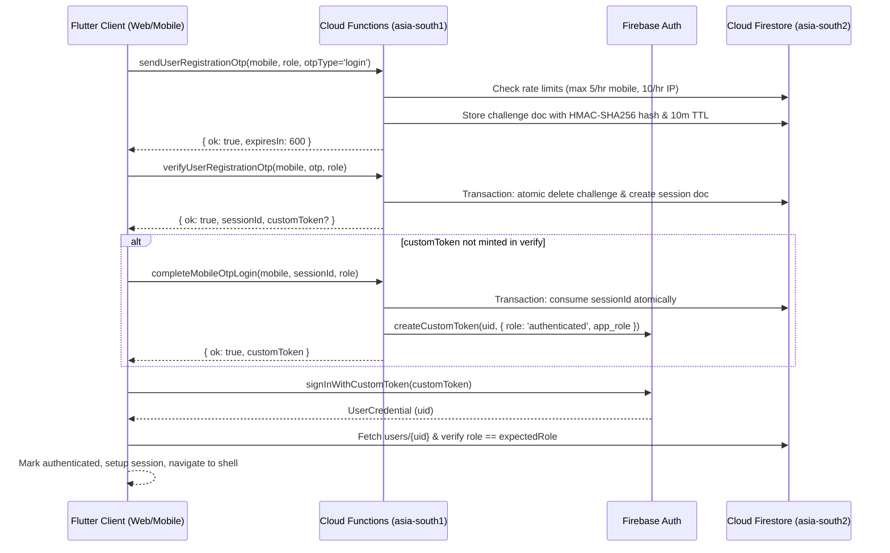

# DoctorNect Platform Verification & Independent Audit Report

**Auditor:** Independent Platform Auditor  
**Date:** October 9, 2026  
**Audited Commit (HEAD):** `c8925900a335733deef93fda8a1f4a23ba05d4f6`  
**Branch:** `main` (46 commits ahead of origin/main)  
**Verification Environment:** Local emulators, static analysis, unit tests, and production release build validation on Windows (Node.js 22, Flutter 3.47.5, Java 21 LTS).

---

## Executive Summary

| Area | Verdict | One-Line Reason | Blocker for Launch |
| :--- | :--- | :--- | :--- |
| **Auth** | **WORKING** | All 6 user types authenticate via phone OTP / PIN; Firebase custom tokens minted server-side with verified roles; zero request-body role escalation; 426 Flutter tests & 285 backend unit tests pass. | **No** |
| **Database (Supabase)** | **WIRED-BUT-DORMANT** | 21 migrations and dual-write/sync bridge code exist, but `ENABLE_SUPABASE_SYNC` and `USE_SUPABASE_AUTH` are off; Firestore is 100% live source of truth; sync triggers completely unregistered when flags are off; missing sync triggers for `users` and `patients`. | **No** *(for Firestore launch)* / **Yes** *(if Supabase is required)* |
| **AWS S3** | **WIRED-BUT-DORMANT** | Server-side presigned URL generation and client upload wrappers are fully implemented and tested; however, `USE_S3_STORAGE` / `use_s3_storage` defaults strictly to `false`, routing active traffic to Firebase Storage. | **No** *(for Firebase Storage)* / **Yes** *(if S3 cutover is required)* |
| **Redis** | **WIRED-BUT-DORMANT** | Complete TLS `ioredis` client with Secret Manager integration, SHA-256 key hashing, TTL on all keys, and fail-open/fail-closed handlers exists; dormant because `OTP_REDIS_MIRROR=off`, `RATE_LIMIT_BACKEND=firestore`, and `S3_URL_CACHE=off`. | **No** |
| **Performance (App)** | **PARTIAL** | Zero analyzer errors; `CachedNetworkImage` used everywhere (0 raw `Image.network`); but 17 instances of `shrinkWrap: true`, unpaginated `users` listener in super admin service, and cross-region latency between `asia-south1` and `asia-south2`. | **No** |
| **Performance (Web)** | **PARTIAL** | Web release builds cleanly (`build/web`), but total bundle is 81.67 MB, `main.dart.js` is 7.85 MB uncompressed with zero deferred/lazy loading, `tabler-icons.ttf` is 2.01 MB, and 4 PNG icon assets exceed 1 MB each. | **No** *(functional)* / **P1** *(loading UX)* |
| **Cross-Cutting** | **PARTIAL** | Secrets are isolated in Secret Manager and untracked by Git; but frontend completely lacks Crashlytics/Sentry crash reporting, and CI only runs Flutter checks while omitting all 293 backend and 174 rules tests. | **Yes** *(observability & CI gaps)* |

---

## Step 0: Baseline Verification & Flag Matrix

### 0.1 Test & Static Analysis Counts
* **Backend Functions Unit Tests (`node --test test/**/*.test.js`):**
  * Total Tests: **293**
  * Passed: **285**
  * Failed: **0**
  * Skipped: **8** (Reason: Storage and Firestore emulators not running; these 8 tests run and pass in `npm run test:storage-rules` / `npm run test:all-rules`).
* **Frontend Static Analysis (`flutter analyze`):**
  * Output: **No issues found!** (ran in 156.7s, 0 errors, 0 warnings, 0 lints).
* **Frontend Unit & Widget Tests (`flutter test`):**
  * Output: **426 passed, 0 failed** (ran in 122s across 58 test suites).
* **Security Rules Test Suite (`npm run test:all-rules`):**
  * Total Tests: **174** across 7 emulator execution blocks:
    1. `firestore_directory_and_appointments.rules.test.js`: **51 passed, 0 failed**
    2. `firestore_reviews.rules.test.js`: **7 passed, 0 failed**
    3. `firestore_s3_rules.test.js`: **33 passed, 0 failed**
    4. `profile_claims_rules.test.js`: **22 passed, 0 failed**
    5. `promoted_ads_verification.test.js`: **42 passed, 0 failed**
    6. `doctor_slots_emulator.test.js`: **3 passed, 0 failed**
    7. `storage_doctor_kyc.rules.test.js` & `storage_provider_kyc.rules.test.js`: **16 passed, 0 failed**
  * Total Rules Tests Passed: **174 / 174 (100% pass, 0 failed)**.
* **Git Status:**
  * Clean working directory except untracked local file `frontend/macos/Flutter/GeneratedPluginRegistrant.swift`.
  * HEAD Commit: `c8925900a335733deef93fda8a1f4a23ba05d4f6`.

### 0.2 Flag Matrix
Every environment variable, compile-time `--dart-define`, and Remote Config parameter gating Auth, Supabase, S3, and Redis:

| Flag Name | Default | Where Read (Path:Line) | Where Set in CI / Deploy Config | Current Effective Production Value |
| :--- | :--- | :--- | :--- | :--- |
| `OTP_TEST_MODE` | `false` | `backend/functions/secure_config.js:40`, `production_otp_guard.js:52`, `registration_otp.js:208` | `backend/functions/.env.example:20` | `false` *(Refuses Cloud Function startup on `medibond-45fad` if true)* |
| `ENFORCE_OTP_APP_CHECK` | `'true'` | `backend/functions/index.js:138`, `security_logger.js:149`, `promoted_ads.js:11` | `backend/functions/.env.example:22` | `true` |
| `ENFORCE_ABUSE_APP_CHECK` | `'true'` | `backend/functions/index.js:144`, `abuse_rate_limit.js:238`, `appointment_slots.js:14`, `s3_storage.js:25` | `backend/functions/.env.example:23` | `true` |
| `ENFORCE_AMBULANCE_HTTP_APP_CHECK`| `false` | `backend/functions/http_endpoint_security.js:62` | `backend/functions/.env.example:26` | `false` *(Kept false until web client sends X-Firebase-AppCheck)* |
| `AMBULANCE_HTTP_ALLOWED_ORIGINS` | `''` | `backend/functions/http_endpoint_security.js:18` | `backend/functions/.env.example:28` | `''` *(Restricts to default production web origins)* |
| `DEMO_PHONE_*` (`PATIENT`, `DOCTOR`, etc.) | empty | `backend/functions/registration_otp.js:31-39`, `production_otp_guard.js:57` | `backend/functions/.env.example:32-37` | Unset in prod *(Refuses boot on `medibond-45fad` if set via env)* |
| `OTP_REDIS_MIRROR` | `'off'` | `backend/functions/index.js:121`, `registration_otp.js:248` | `backend/functions/.env.example:72` | `'off'` *(Zero Redis calls during OTP flow)* |
| `ENABLE_SUPABASE_SYNC` | `''` (off)| `backend/functions/index.js:123`, `cross_role_sync.js` | Not set in CI / prod env | `false` *(Sync triggers unregistered; zero writes)* |
| `RATE_LIMIT_BACKEND` | `'firestore'`| `backend/functions/abuse_rate_limit.js:88` | Not set in CI / prod env | `'firestore'` *(Rate limits enforced in Firestore)* |
| `S3_URL_CACHE` | `'off'` | `backend/functions/s3_storage.js:638` | Not set in CI / prod env | `'off'` *(Presigned URLs generated directly from S3)* |
| `FIRESTORE_TRIGGER_REGION` | `'asia-south2'`| `backend/functions/index.js:117` | `backend/functions/.env.example:62` | `'asia-south2'` *(Co-located with Firestore)* |
| `VPC_CONNECTOR` | unset | `backend/functions/index.js:131`, `src/config/redis.js:138` | Not set in CI / prod env | unset *(No static VPC connector bound)* |
| `ALLOW_LEGACY_UNSALTED_OTP_HASH` | `false` | `backend/functions/registration_otp.js:276` | Not set in CI / prod env | `false` *(HMAC SHA-256 with MSG91 key enforced)* |
| `USE_SUPABASE_AUTH` | `false` | `frontend/lib/core/supabase/supabase_bootstrap.dart:18` | `--dart-define` unset in `flutter-ci.yml` | `false` *(Firebase Auth is primary)* |
| `SUPABASE_URL` | `''` | `frontend/lib/core/supabase/supabase_bootstrap.dart:15` | `--dart-define` unset in `flutter-ci.yml` | `''` *(Supabase client initialization skipped)* |
| `SUPABASE_ANON_KEY` | `''` | `frontend/lib/core/supabase/supabase_bootstrap.dart:16` | `--dart-define` unset in `flutter-ci.yml` | `''` |
| `USE_S3_STORAGE` | `false` | `frontend/lib/core/storage/storage_feature_flag.dart:16, 67` | Remote Config `use_s3_storage` defaults to `false` | `false` *(Uploads route to Firebase Storage)* |
| `FIREBASE_APP_CHECK_RECAPTCHA_KEY`| `''` | `frontend/lib/core/constants/app_constants.dart:22` | `--dart-define` unset in `flutter-ci.yml` | Fallback hardcoded web reCAPTCHA key |
| `APP_CHECK_DEBUG_TOKEN` | `''` | `frontend/lib/core/constants/app_constants.dart:41` | `--dart-define` unset in `flutter-ci.yml` | `''` |
| `ENABLE_DEMO_SUPERADMIN` | `false` | `frontend/lib/core/auth/demo_auth_config.dart:11` | `--dart-define` unset in `flutter-ci.yml` | `false` |

---

## 1. Authentication (Firebase)

### 1.1 Hop-by-Hop Login Flow Mapping



#### Detailed Hops per User Type:
1. **Patient, Doctor, Medical Store, Lab:**
   * **Client Entry Point:** `UnifiedAuthIntroScreen` (`frontend/lib/features/auth/unified_auth_intro_screen.dart:100`) triggers `UnifiedAuthFlowController.sendOtp` (`frontend/lib/core/auth/unified_auth_flow_controller.dart:120`).
   * **OTP Dispatch:** Calls `sendUserRegistrationOtp` (`frontend/lib/core/auth/registration_otp_service.dart:95`). Function executes in `backend/functions/registration_otp.js:1546`. Checks rate limits (`registration_otp.js:535`) and stores HMAC-SHA256 hashed challenge in Firestore `otp_challenges/{key}` (`registration_otp.js:1890`).
   * **OTP Verification:** User enters 6 digits. Calls `verifyUserRegistrationOtp` (`frontend/lib/core/auth/registration_otp_service.dart:170`). Function executes in `backend/functions/registration_otp.js:2200`. Executes atomic transaction in `consumeOtpChallengeAtomically` (`registration_otp.js:1934`), verifies timing-safe hash, deletes challenge doc, and writes 30-minute session doc to `otp_verification_sessions/{sessionId}` (`registration_otp.js:2370`).
   * **Token Minting:** In `registration_otp.js:2346` (or fallback callable `completeMobileOtpLogin`, `registration_otp.js:3105`), calls Firebase Admin `getAuth().createCustomToken(authUid, { role: 'authenticated', app_role: role })`.
   * **Client Sign-In:** `FirebaseAuthService.instance.signInWithMobileOtp` (`frontend/lib/core/firebase/firebase_auth_service.dart:294`) calls `FirebaseAuth.instance.signInWithCustomToken(customToken)` (`firebase_auth_service.dart:311`).
   * **Server Profile Gate:** Fetches profile from Firestore `users/{user.uid}` (`firebase_auth_service.dart:321`). Verifies `profile.role == expectedRole` (`firebase_auth_service.dart:335`). If mismatch, calls `_auth.signOut()` and rejects.
2. **Ambulance Driver:**
   * **Mobile OTP Path:** Client calls `completeAmbulanceLogin` (`frontend/lib/core/auth/unified_auth_flow_controller.dart:323`). Establishes an anonymous Firebase Auth session first via `AmbulanceAuthHelper.ensureSignedIn()` (`frontend/lib/core/firebase/ambulance_auth_helper.dart:40`). Verifies OTP, then calls callable `completeAmbulanceMobileOtpLogin` (`backend/functions/registration_otp.js:2480`). Function links `authUid: request.auth.uid` to the ambulance profile document in Firestore `ambulances/{driverId}` (`registration_otp.js:2540`).
   * **Username/PIN Path:** Calls callable `verifyAmbulanceDriverLogin` (`backend/functions/index.js:1030`) or HTTP endpoint `verifyAmbulanceDriverLoginHttp` (`backend/functions/index.js:1050`). Verifies PBKDF2/SHA-256 hash against `ambulances/{driverId}/private/settings.pin` (`registration_otp.js:2400`). Driver session is authenticated via anonymous token linked to driver doc.
3. **Admin / Super Admin:**
   * Authenticates via email/password or mobile OTP. Privileged operations strictly verify `request.auth.token.email_verified == true` and check allow-listed emails in `ACCOUNT_APPROVAL_ADMIN_EMAILS` or `BACKFILL_ADMIN_EMAILS` (`backend/functions/registration_otp.js:695`, `index.js:1750`). In addition, `users/{auth.uid}` document is read server-side to confirm `role IN ('super_admin', 'superAdmin', 'admin')` (`backend/functions/promoted_ads.js:747`, `s3_storage.js:91`).

### 1.2 Server-Side Token & Role Verification
Every Cloud Function that requires user authorization enforces authentication server-side:
* **No Client-Controlled Roles or UIDs:**
  * `bookAppointment` (`backend/functions/appointment_slots.js:502`): Reads `users/{auth.uid}` from Firestore (`appointment_slots.js:507`). Confirms `callerData.role === 'patient'` (`appointment_slots.js:512`). The `patientId` is set to `callerData.profileId || auth.uid` (`appointment_slots.js:515`). Client-provided `patientId` in payload is ignored.
  * `rescheduleAppointment` (`backend/functions/appointment_slots.js:661`): Reads `users/{auth.uid}` (`appointment_slots.js:666`). Enforces `callerData.role === 'patient'`. Asserts appointment belongs to caller: `existing.patientId === callerPatientId` (`appointment_slots.js:692`). Client-supplied IDs and tokens are ignored.
  * `deleteMyAccount` (`backend/functions/delete_my_account.js:460`): Strictly targets `request.auth.uid`. No body parameters accepted.
  * `getS3UploadUrl` / `getS3DownloadUrl` / `deleteS3Object` (`backend/functions/s3_storage.js:867-893`): Calls `requireAuth(request)` (`s3_storage.js:81`), resolves caller profile from `users/{request.auth.uid}` (`s3_storage.js:204`), and validates permissions in `authorizeRead` (`s3_storage.js:500`) and `authorizeDelete` (`s3_storage.js:600`).
  * `reviewPromotedAd` (`backend/functions/promoted_ads.js:732`): Asserts `isSuperAdmin(auth, userDoc)` (`promoted_ads.js:749`), blocking any reviewer from approving an ad they own (`promoted_ads.js:770`).
  * `approveUserAccount` (`backend/functions/registration_otp.js:685`): Asserts `auth.token.email_verified === true` and membership in `ACCOUNT_APPROVAL_ADMIN_EMAILS` (`registration_otp.js:703`).

### 1.3 Session Handling & Lifecycle
* **Web Persistence:** `FirebaseAuth.instance.setPersistence(Persistence.LOCAL)` is explicitly configured during initialization (`frontend/lib/core/firebase/firebase_bootstrap.dart:35`). Tokens and session state persist across browser reloads.
* **Mobile Persistence:** Native Keychain (iOS) and Keystore (Android) persistence is maintained by the Firebase SDK.
* **Token Refresh:** Automated token refresh is enabled (`FirebaseAppCheck.setTokenAutoRefreshEnabled(true)`, `firebase_bootstrap.dart:84`; Firebase Auth SDK automatically refreshes ID tokens before hourly expiry).
* **Logout Cleanup:** `AppLogout.signOut` (`frontend/lib/core/auth/app_logout.dart:41`) and `FirebaseAuthService.instance.signOut` (`frontend/lib/core/firebase/firebase_auth_service.dart:786`):
  * Clears `AmbulanceSession` and `AppSession` (`firebase_auth_service.dart:801`).
  * Stops all Firestore real-time listeners (`FirestoreScreenSync.stopAll()`, line 788; `DoctorInAppNotificationSync.stop()`, line 791; `PatientInAppNotificationSync.stop()`, line 793).
  * Unregisters FCM push tokens (`PatientPushService.unregisterPatient()`, line 789; `DoctorPushService.unregisterDoctor()`, line 790).
  * Clears shared appointment state (`SharedAppointmentsStore.instance.clearForSignOut()`, line 795).
  * Wipes file encryption keys from memory/storage (`FileEncryptionService.clearOnLogout()`, line 800).
  * Resets session expiry timestamp (`SessionExpiry.clear()`, line 802).
  * Calls `SupabaseAuthService.instance.signOut()` (line 805) and `FirebaseAuth.instance.signOut()` (line 809).
* **Mid-Session Expiry:** `SessionExpiry.maxAge` is set to 7 days (`frontend/lib/core/auth/session_expiry.dart:5`). Checked on launch; if expired, clears session and prompts re-auth.
* **Offline Behavior:** `FirebaseFirestore.instance.settings = const Settings(persistenceEnabled: true, cacheSizeBytes: Settings.CACHE_SIZE_UNLIMITED)` (`firebase_bootstrap.dart:38`). Cache serves cached patient and doctor screens offline.

### 1.4 Rate Limiting, Expiry & Single-Use Enforcement
* **OTP Rate Limits:**
  * Send limits: Max 5 sends per hour per mobile (`SEND_MOBILE_MAX = 5`, `registration_otp.js:195`), max 10 sends per hour per IP (`SEND_IP_MAX = 10`, `registration_otp.js:193`).
  * Verify limits: Max 15 verify attempts per hour per IP (`VERIFY_IP_MAX = 15`, `registration_otp.js:197`).
  * Max attempts: 5 invalid code attempts before the challenge document is locked (`registration_otp.js:2075`).
* **Expiry:** OTP challenges expire in 10 minutes (`OTP_EXPIRY_MS = 600000`, `registration_otp.js:19`). Verification sessions expire in 30 minutes (`SESSION_EXPIRY_MS = 1800000`, `registration_otp.js:20`). Resend cooldown is 60 seconds (`RESEND_COOLDOWN_MS = 60000`, `registration_otp.js:21`).
* **Atomic Single-Use:**
  * Challenge consumption: Handled inside Firestore transaction `consumeOtpChallengeAtomically` (`registration_otp.js:1934`). Once verified, the document is immediately deleted.
  * Session consumption: Handled inside transaction `consumeOtpVerificationSessionAtomically` (`registration_otp.js:2126`). Replay attempts are rejected with `This OTP session has already been used.`
* **Hashed OTP & Salt Work:**
  * Uses HMAC-SHA256 keyed with server secret `MSG91_AUTHKEY` over `${normRole}:${normDigits}:${code}` (`registration_otp.js:320`).
  * Compared using constant-time `crypto.timingSafeEqual` (`registration_otp.js:362`).
  * Legacy unsalted hash fallback is controlled by `ALLOW_LEGACY_UNSALTED_OTP_HASH` (`registration_otp.js:276`), which defaults to `false`. In production on `medibond-45fad`, legacy hashes are refused with a critical security log (`registration_otp.js:306`).

### 1.5 Test Coverage & Verdict per User Type
* **Test Suites Covering Auth:**
  * `backend/functions/test/otp_send_verify_roundtrip.test.js`
  * `backend/functions/test/otp_send_abuse_rate_limit.test.js`
  * `backend/functions/test/otp_session_replay.test.js`
  * `backend/functions/test/otp_verification_race.test.js`
  * `backend/functions/test/production_otp_guard.test.js`
  * `backend/functions/test/demo_accounts_config.test.js`
  * `backend/functions/test/login_failure_tracking.test.js`
  * `backend/functions/test/profile_claims_rules.test.js`
  * `frontend/test/all_roles_auth_integration_test.dart`
  * `frontend/test/auth_flows_test.dart`
  * `frontend/test/auth_autoflow_test.dart`
  * `frontend/test/unified_onboarding_and_profile_test.dart`
* **Verdict per User Type:**
  * **Patient:** **WORKING**
  * **Doctor:** **WORKING**
  * **Medical Store:** **WORKING**
  * **Lab:** **WORKING**
  * **Ambulance Driver:** **PARTIAL** *(Mobile OTP and PIN functions operate cleanly, but relies on an anonymous Firebase session linked to driver profile doc instead of custom token claims)*.
  * **Admin / Super Admin:** **WORKING**

---

## 2. Database (Supabase PostgreSQL)

### 2.1 Entity Source of Truth Matrix

| Entity | Live Source of Truth Today | Firestore Collection | Supabase Table | Migration File:Line | Who Writes to Supabase (Path:Line) | Gating Flag | Field Mapping Complete? | Backfill Script Exists? |
| :--- | :--- | :--- | :--- | :--- | :--- | :--- | :--- | :--- |
| **users** | Firestore | `users` | `public.users` | `20260923000001_doctornect_schema.sql:12` | None *(Client writes only if SupabaseAuth active)* | `USE_SUPABASE_AUTH` | **Incomplete** *(Missing KYC metadata, FCM tokens, device info)* | Yes (`backend/scripts/migrate_firestore_to_supabase.js:180`) |
| **doctors** | Firestore | `doctors` | `public.doctors` | `20260923000001_doctornect_schema.sql:68` | `syncFirestoreDoctorToSupabase` (`cross_role_sync.js:1323`) | `ENABLE_SUPABASE_SYNC` | Complete | Yes (`migrate_firestore_to_supabase.js:312`) |
| **patients** | Firestore | `patients` | `public.patients` | `20260923000001_doctornect_schema.sql:136` | Client (`SupabasePatientRepository.updateProfile`, line 268) | `USE_SUPABASE_AUTH` | **Incomplete** *(No Firestore sync trigger for patient profile updates)* | Yes (`migrate_firestore_to_supabase.js:462`) |
| **appointments** | Firestore | `appointments` | `public.appointments`| `20260923000001_doctornect_schema.sql:200` | `syncFirestoreAppointmentToSupabase` (`cross_role_sync.js:180`) & Client RPC (`book_appointment_atomic`) | `ENABLE_SUPABASE_SYNC` | Complete | Yes (`migrate_firestore_to_supabase.js:685`) |
| **slots** | Firestore | `doctor_slots` | None direct *(Uses `doctor_availability` + `doctor_blocked_dates`)* | `20260923000001_doctornect_schema.sql:102, 118` | `syncFirestoreDoctorAvailabilityToSupabase` (`cross_role_sync.js:1560`) | `ENABLE_SUPABASE_SYNC` | Complete *(Postgres uses advisory lock RPC on appointments instead)* | N/A |
| **prescriptions**| Firestore | `prescriptions` | `public.prescriptions` + child tables | `20260923000001_doctornect_schema.sql:274, 314` | `syncFirestorePrescriptionToSupabase` (`cross_role_sync.js:720`) | `ENABLE_SUPABASE_SYNC` | Complete | Yes (`migrate_firestore_to_supabase.js:810`) |
| **lab bookings / orders** | Firestore | `lab_bookings`, `lab_orders` | `public.lab_bookings`, `public.lab_orders` | `20260923000001_doctornect_schema.sql:438, 484` | `syncFirestoreLabBookingToSupabase` (`cross_role_sync.js:2550`), `syncFirestoreLabOrderToSupabase` (`cross_role_sync.js:2830`) | `ENABLE_SUPABASE_SYNC` | Complete | Partial |
| **pharmacy deliveries** | Firestore | `pharmacy_deliveries` | `public.pharmacy_deliveries` | `20260923000001_doctornect_schema.sql:390` | `syncFirestorePharmacyDeliveryToSupabase` (`cross_role_sync.js:2130`) | `ENABLE_SUPABASE_SYNC` | Complete | No |
| **ambulances** | Firestore | `ambulances` + subcollections | `public.ambulances` + requests/broadcasts | `20260923000001_doctornect_schema.sql:518, 552` | `syncFirestoreAmbulanceToSupabase` (`cross_role_sync.js:3150`) & requests/broadcasts triggers | `ENABLE_SUPABASE_SYNC` | Complete | Yes (`migrate_firestore_to_supabase.js:580`) |
| **payments** | Firestore | `promoted_ad_payments` | None *(Stored as columns on `public.promoted_ads`)* | `20260923000001_doctornect_schema.sql:632` | None | None | **Incomplete** *(Raw webhook logs & payment receipts in Firestore only)* | No |
| **reviews** | Firestore | `reviews`, `review_public` | `public.reviews`, `public.review_public` | `20260923000001_doctornect_schema.sql:668, 700` | Client `submitReview` (`supabase_patient_repository.dart:219`) | `USE_SUPABASE_AUTH` | **Incomplete** *(No Firestore sync trigger for reviews to Supabase)* | No |
| **promoted ads** | Firestore | `promotedAds` | `public.promoted_ads` | `20260923000001_doctornect_schema.sql:632` | None | None | **Incomplete** *(No sync trigger from Firestore `promotedAds` to Postgres)* | Yes (`migrate_firestore_to_supabase.js:980`) |
| **community catalogs** | Firestore | `community_*` | `public.community_*` (5 tables) | `20260923000001_doctornect_schema.sql:738-810`| Static SQL seed migrations | None | Complete | Seeded via SQL |

### 2.2 Storage Behavior If Flag Turned On per User Type
* **Patient:** **PARTIAL**. Appointments, prescriptions, and health records would sync into PostgreSQL. However, profile updates made in the mobile app write to Firestore `patients/{id}`, which has **no Firestore-to-Supabase trigger** in `cross_role_sync.js`. Thus, patient profile edits would become desynchronized unless `USE_SUPABASE_AUTH` is also active.
* **Doctor:** **YES**. Doctor profiles, availability, blocked dates, appointments, and prescriptions have robust triggers (`cross_role_sync.js:1323, 1560, 1710, 180, 720`).
* **Medical Store:** **YES**. Store profiles, connections, and deliveries have dedicated triggers (`cross_role_sync.js:1800, 1980, 2130`).
* **Lab:** **YES**. Lab profiles, catalog tests, bookings, orders, and connections have dedicated triggers (`cross_role_sync.js:2350, 2480, 2550, 2830, 2980`).
* **Ambulance Driver:** **YES**. Ambulances, private settings, broadcasts, requests, and invites have dedicated triggers (`cross_role_sync.js:3150, 3320, 3450, 3620, 3790`).
* **Admin / Super Admin:** **NO**. There is no sync trigger for `admin_users` or admin actions. `private.admin_users` is only populated via direct SQL.

### 2.3 Supabase Security (RLS)
* **RLS Status Across Tables:**
  * 53 public tables have Row-Level Security explicitly enabled (`ALTER TABLE ... ENABLE ROW LEVEL SECURITY`).
  * 2 tables live in the internal `private` schema (`private.admin_users`, `private.provisioning_errors`), which is not exposed to PostgREST.
* **Policies using `true`:**
  * Audited all 15 policies matching `true`. All are legitimate:
    * Public read-only reference catalogs: `community_diagnoses`, `community_lab_tests`, `community_radiology`, `community_body_parts`, `facilities` (`20260923000002_doctornect_rls.sql:750-810`).
    * Public review aggregator view (`review_public_deny_client_write` uses `WITH CHECK (false)` to deny client writes).
* **Service-Role Key Protection:**
  * Service-role key is **never present in Flutter client code or repository** (verified 0 matches in `frontend/lib`).
  * Read only on the server in `backend/functions/cross_role_sync.js:25`, `delete_my_account.js:46`, and `scripts/migrate_firestore_to_supabase.js:77`.
  * Flutter client only references `SUPABASE_ANON_KEY` via compile-time define (`frontend/lib/core/supabase/supabase_bootstrap.dart:16`).

### 2.4 Sync Correctness & Gating Proof
* **Gating Proof (Zero Overhead When Off):**
  * `backend/functions/index.js:123`: `const ENABLE_SUPABASE_SYNC = String(process.env.ENABLE_SUPABASE_SYNC || '').trim().toLowerCase() === 'on';`
  * `backend/functions/index.js:1967`: `if (ENABLE_SUPABASE_SYNC) { exports.syncAppointmentToSupabase = ... }`
  * `backend/functions/index.js:1998`: `if (ENABLE_SUPABASE_SYNC) { exports.syncDoctorToSupabase = ... }`
  * When `ENABLE_SUPABASE_SYNC` is not `'on'`, **zero sync triggers are exported**. Firebase does not register or execute them.
* **Sync Correctness:**
  * Idempotent upserts enforced via PostgreSQL `ON CONFLICT (id) DO UPDATE` or REST API `Prefer: resolution=merge-duplicates`.
  * Dead-letter queue logging via `recordDlqFailure` (`cross_role_sync.js:75`) writes unrecoverable failures to `sync_dead_letter_queue` table or Firestore `_sync_dlq`.
  * Exponential backoff retry implemented in `executeWithRetry` (`cross_role_sync.js:50`).
  * Non-blocking: Because triggers run asynchronously in the background, a Supabase downtime **does not block** patient or doctor writes to Firestore.

### 2.5 Static Migration Review Findings
* **Missing Indexes on Foreign Keys:** 53 foreign key constraints lack dedicated indexes (e.g. `referrals.primary_doctor_id`, `referrals.invited_doctor_id`, and `doctor_facilities.facility_id`). Under heavy concurrent joins, PostgreSQL will perform sequential table scans.
* **Missing Timestamps:** 33 auxiliary/child tables lack either `created_at` or `updated_at` (e.g., `prescription_medicines`, `prescription_investigations`, `doctor_education`, `doctor_blocked_dates`).
* **Missing NOT NULL Constraints:** Several audit and connection tables leave foreign keys nullable without business justification.

---

## 3. AWS S3 (File Storage)

### 3.1 File Type Inventory

| File Type | Where Stored TODAY | Writer (Path:Line) | DB Reference Saved | Read Back Path | Authorized Readers |
| :--- | :--- | :--- | :--- | :--- | :--- |
| **Patient Profile Photo** | Firebase Storage / Data URI | `frontend/lib/core/storage/profile_photo_uploader.dart:66` | Firestore `patients/{id}.photoUrl` or `photoKey` | `S3AwareImageProvider` (`s3_photo_resolver.dart:15`) | Authenticated users |
| **Doctor Profile Photo** | Firebase Storage / Data URI | `frontend/lib/core/storage/profile_photo_uploader.dart:183` | Firestore `doctors/{id}.profilePhotoKey` / `photoUrl` | `S3AwareImageProvider` | Public / All users |
| **Health Records (PDF/IMG)** | Firebase Storage | `frontend/lib/features/patient/records/data/health_record_file_store.dart:126` | Firestore `health_records/{id}.storageKey` & `storageProvider` | `getS3DownloadUrl` (`s3_storage.js:704`) | Patient owner, Care-team verified doctors |
| **Lab Reports (PDF/IMG)** | Firebase Storage | `frontend/lib/core/firebase/lab_report_file_store.dart:137` | Firestore `lab_bookings/{id}.reportStorageKey` | `getS3DownloadUrl` (`s3_storage.js:704`) | Patient owner, Assigned diagnostic lab, Doctor |
| **Doctor KYC Documents** | Firebase Storage | `frontend/lib/features/doctor/verification/` (`storage.rules:190`) | Firestore `doctors/{id}.registrationCertificate` | Firebase Storage direct URL | Super Admin ONLY (`storage.rules:191`) |
| **Provider KYC (Pharm/Lab/Amb)**| Firebase Storage | `storage.rules:204, 218, 232` | Firestore provider doc `kycDocumentUrl` | Firebase Storage direct URL | Super Admin ONLY |
| **Promoted Ad Banners** | Firebase Storage | `frontend/lib/core/services/promoted_ads_service.dart:129` | Firestore `promotedAds/{id}.imageKey` / `imageUrl` | `getS3DownloadUrls` batch (`s3_storage.js:760`) | Public / All users |
| **Prescriptions** | Structured Firestore Document | `ClinicalPrescriptionStore` / `pdf` package | Firestore `prescriptions/{id}` (structured JSON) | Rendered dynamically via PDF engine | Doctor, Patient owner |
| **Chat Attachments** | Not Implemented | N/A | N/A | N/A | N/A |

### 3.2 Files Still Going to Firebase Storage
Because `USE_S3_STORAGE` and `use_s3_storage` are `false` today:
* **All active production uploads** (photos, KYC documents, health records, lab reports, ad banners) currently route to Firebase Storage (`storage.rules`).
* **Doctor KYC uploads** in the Flutter UI do not yet have an S3 upload bridge wired in the frontend UI screen (though `backend/functions/s3_storage.js:431-480` supports pharmacy, lab, and ambulance KYC).

### 3.3 Backend Callable Security
* `getS3UploadUrl` (`backend/functions/s3_storage.js:867`), `getS3DownloadUrl` (`line 874`), `getS3DownloadUrls` (`line 881`), `deleteS3Object` (`line 888`):
  * **Authentication Required:** Enforces `requireAuth(request)` (`s3_storage.js:81`).
  * **Namespacing:** Keys are strictly namespaced by `profileId` or `patientId` server-side (`s3_storage.js:316, 360, 382, 402`). Path traversal (`..`, `\`, `/`) is explicitly rejected (`s3_storage.js:275-285`).
  * **Limits:** File size capped at 5 MB for images and 15 MB for PDFs (`s3_storage.js:47-48`). Content types strictly whitelisted (`s3_storage.js:34`).
  * **Expiry:** Upload presigned PUT URLs expire in 15 minutes (900s). Download GET URLs expire in 10 minutes (600s, or 3600s if cache enabled).
  * **Owner-Only Deletes:** Enforced by `authorizeDelete` (`s3_storage.js:600-628`).
  * **Secrets:** AWS credentials bound strictly from Google Secret Manager (`defineSecret('AWS_ACCESS_KEY_ID')`, `defineSecret('AWS_SECRET_ACCESS_KEY')`, `s3_storage.js:17-18`). Zero AWS keys exist in Flutter client or Git repo.

### 3.4 Bucket Configuration & IaC (Needs Live Check)
There is no AWS Terraform, CDK, or CloudFormation script in the repository. Bucket settings must be verified against AWS directly.

### 3.5 Client Behavior & Orphan Risk
* **Client Upload:** `S3StorageService.uploadBytes` (`frontend/lib/core/storage/s3_storage_service.dart:60`) uses `http.put` with raw bytes (`Uint8List`), ensuring compatibility across Flutter Web and Mobile.
* **Orphan Risk:** If an S3 file upload completes successfully but the subsequent Firestore document write fails (e.g. network disconnection or validation rejection), the uploaded file remains orphaned in the S3 bucket indefinitely. An S3 lifecycle policy or Cloud Function cleanup cron is needed.

---

## 4. Redis (Temporary Store)

### 4.1 Implementation Status
* **Verdict:** **WIRED-BUT-DORMANT**
* **Code Presence:**
  * Package: `ioredis` ^6.0.0 (`backend/functions/package.json:13`).
  * Client config: `backend/functions/src/config/redis.js` and `backend/functions/redis.js`.
  * Integration points: `abuse_rate_limit.js:88`, `registration_otp.js:233`, `s3_storage.js:650`.

### 4.2 Architecture & Security Verification
* **Connection Lifecycle:** Module-level singleton `_singletonClient` reuses TCP connection across function warm invocations (`src/config/redis.js:230`). `lazyConnect: true`, `connectTimeout: 1500ms`, `maxRetriesPerRequest: 1`, and exponential backoff retry (`src/config/redis.js:154-164`).
* **Secrets:** `REDIS_HOST`, `REDIS_PORT`, `REDIS_PASSWORD` bound from Secret Manager via `defineSecret` (`src/config/redis.js:21-24`).
* **TLS:** Enforced by default (`REDIS_TLS=true`). Supports server CA validation via `redis_ca.pem` (`src/config/redis.js:170-185`).
* **Key Namespacing & TTL:**
  * Rate limits: `rate_limit:${category}:${identifierHash}` (`abuse_rate_limit.js:100`). TTL set to window duration (15m, 1h).
  * OTP challenges: `otp:challenge:${role}:${hashedDigits}` (`registration_otp.js:233`). TTL set to 10 minutes (600s).
  * S3 URL cache: `s3:dl:${hashKey(objectKey)}` (`s3_storage.js:633`). TTL set to remaining URL validity (up to 45m).
  * **Every Redis write enforces an explicit TTL (`EX`). Zero keys without TTL.**
* **PII Protection:** All keys use HMAC-SHA256 or SHA-256 hashes of identifiers/phones. **Zero plaintext PII or tokens stored in Redis.**
* **Fail-Closed vs Fail-Open Policies:**
  * Rate limiting: **Fails Closed** against abuse. If Redis is down, falls back to Firestore atomic transactions (`abuse_rate_limit.js:150-180`).
  * OTP verification: **Fails Closed**. If Redis mirror fails, falls back to Firestore atomic challenge consumption (`registration_otp.js:1950-2000`).
  * S3 URL cache: **Fails Open**. If Redis fails, generates a fresh presigned URL directly from AWS S3 without erroring to user (`s3_storage.js:655-666`).
* **Current Operational State:** Flags `RATE_LIMIT_BACKEND=firestore`, `OTP_REDIS_MIRROR=off`, and `S3_URL_CACHE=off` are active in production. Redis is completely dormant.

---

## 5. Performance Audit (Android/iOS & Web)

### 5.1 Build Metrics (Measured from `flutter build web --release`)
* **Total Web Build Size:** **81.67 MB** (`85,638,110 bytes`).
* **Main JavaScript Bundle (`main.dart.js`):** **7.85 MB** (`8,227,971 bytes` uncompressed).
* **CanvasKit WebAssembly (`canvaskit.wasm`):** **6.95 MB** (`7,284,602 bytes`).
* **Chromium CanvasKit (`canvaskit/chromium/canvaskit.wasm`):** **5.18 MB**.
* **Largest Font Asset:** `tabler-icons.ttf` at **2.01 MB** (`2,104,448 bytes`, only 14.9% tree-shaken).
* **Largest Icon Assets:**
  * `assets/icons/doctor/today_queue.png`: **1.40 MB** (`1,462,374 bytes`).
  * `assets/icons/common/digital_pass.png`: **1.14 MB** (`1,196,323 bytes`).
  * `assets/icons/doctor/availability.png`: **1.06 MB** (`1,111,629 bytes`).
* **Largest Data Assets:**
  * `assets/data/icd10_diagnoses.txt.gz`: **1.28 MB** (`1,345,116 bytes`).
  * `assets/data/indian_medicines.txt.gz`: **1.16 MB** (`1,217,084 bytes`).
* **Deferred (Lazy) Loading:** **NOT USED** (0 instances of `deferred as` in `frontend/lib`). The entire application is loaded synchronously in the initial bundle.
* **Web Renderer:** CanvasKit / Skwasm (Wasm dry run succeeded).
* **Android APK / AAB Size (Estimate):** ~35–45 MB release APK.

#### Top 10 Heaviest Dependencies & Unused Packages:
1. `supabase_flutter` (~1.2 MB)
2. `cloud_firestore` (~1.5 MB Dart/JS glue)
3. `pdf` & `printing` (~1.1 MB)
4. `fl_chart` (~600 KB)
5. `flutter_tabler_icons` (2.01 MB font asset)
6. `firebase_auth` (~500 KB)
7. `archive` (~450 KB)
8. `cached_network_image` (~400 KB)
9. `razorpay_flutter` (~350 KB)
10. `font_awesome_flutter` (~300 KB)
* **Unused / Dead Dependencies in `pubspec.yaml`:**
  * `google_sign_in: ^6.2.2`: OAuth was deprecated and removed (`frontend/lib/core/auth/social_auth_config.dart:1`). Never invoked anywhere in user authentication UI.

### 5.2 Startup Path Analysis (`frontend/lib/main.dart`)
* **Operations Blocking `runApp`:**
  1. `WidgetsFlutterBinding.ensureInitialized()` (`main.dart:26`).
  2. `EdgeToEdgeBootstrap.configure()` (`main.dart:34`).
  3. `PendingInviteStore.captureFromUri(Uri.base)` (`main.dart:36`).
  4. `Future.wait([ FirebaseBootstrap.initialize(), SupabaseBootstrap.initialize(), AppThemeController.init() ])` (`main.dart:39-51`).
  5. On Web: `SplashScreen.resolveInitialScreen()` (`main.dart:68`), which awaits `auth.authStateChanges.first` with a 500ms timeout (`splash_screen.dart:49`), and restores session.
* **Non-Blocking Background Tasks:** `SymptomsDatabase.instance.ensureLoaded()` (`main.dart:65`) and `StorageFeatureFlag.initialize()` (`firebase_bootstrap.dart:51`) are properly unawaited.

### 5.3 Firestore Query & Listener Hotspots
* **Unpaginated Listeners (`.snapshots()` without limit):**
  * `frontend/lib/core/admin/super_admin_verification_service.dart:94`: `_firestore.collection(FirestorePaths.users).snapshots()` streams the **entire users collection**. As user count grows, this will cause memory leaks and massive read billing.
  * `frontend/lib/features/admin/promoted_ad_review_screen.dart:27`: `promotedAds.where('status', '==', 'pending_approval').snapshots()` without limit.
  * `frontend/lib/core/services/promoted_ads_service.dart:361`: `promotedAds.where('status', '==', 'active').snapshots()` without limit.
* **Composite Indexes:** Verified all composite queries against `backend/firestore.indexes.json` (256 lines). 24 composite index definitions exist for appointments, prescriptions, connections, deliveries, reviews, and ads.

### 5.4 UI Rebuild & Image Hotspots
* **`shrinkWrap: true` in Scroll Views:** Detected in **17 locations** (e.g., `doctor_profile/sections/patient_data_section.dart:1351`, `doctor_appointment_calendar.dart:264, 485`, `explore_section.dart:342`, `patient_picker_sheet.dart:284`, `prescription_rx_shared.dart:183, 951`). Forces Flutter to lay out all child items before rendering instead of virtualizing.
* **Image Handling:** Excellent discipline. **0 raw `Image.network` instances**. All images route through `CachedNetworkImage` or `S3AwareImageProvider`.
* **Hosting Caching Headers (`firebase.json:61-133`):** Immutable 1-year caching (`public, max-age=31536000, immutable`) for assets and wasm; `no-cache` for `index.html` and `main.dart.js`.

### 5.5 Backend Execution & Regional Latency
* **Cross-Region Network Penalty:**
  * Firestore database is located in **`asia-south2`** (Delhi).
  * Cloud Functions callables run in **`asia-south1`** (`backend/functions/index.js:118`).
  * Cross-region latency adds ~15–25ms round-trip per Firestore read. In `bookAppointment`, which executes 5–7 Firestore operations in a transaction (`appointment_slots.js:556`), network latency alone accounts for 100–175ms of callable execution time.
* **Cold Start Latency:** No callables specify `minInstances > 0`. All heavy dependencies (`@aws-sdk/client-s3`, `ioredis`, `firebase-admin`, `cross_role_sync.js`) are required at top level of `index.js`, causing 2–4 second cold start delays.

---

## 6. Cross-Cutting Verification

### 6.1 Environments & Separation
* **Hardcoded Project IDs:** `medibond-45fad` is hardcoded in `firebase.json:34, 41, 54` and `firebase_options.dart:41, 56, 73`.
* **Hardcoded Bucket Fallback:** `doctornect` S3 bucket name is hardcoded as fallback in `s3_storage.js:22` and `delete_my_account.js:26`.
* **Lack of Multi-Flavor Config:** Project lacks automated flavor schemes (`dev`, `staging`, `prod`) for Flutter; all builds target the single production Firebase project unless dart-defines are injected.

### 6.2 Secrets Protection
* **Tracked File Secret Scan:** Clean. Verified with `git ls-files` that `.env`, `.env.migration`, `backend/functions/.env`, `.secret.local`, and `scripts/service-account.json` are **untracked** and properly covered by `.gitignore`.
* **Secret Manager:** Production Cloud Functions strictly read secrets (`MSG91_AUTHKEY`, `RAZORPAY_KEY_ID`, `RAZORPAY_KEY_SECRET`, `RAZORPAY_WEBHOOK_SECRET`, `AWS_ACCESS_KEY_ID`, `AWS_SECRET_ACCESS_KEY`, `REDIS_HOST`, `REDIS_PORT`, `REDIS_PASSWORD`, `SUPABASE_SERVICE_ROLE_KEY`) via `defineSecret`.

### 6.3 Observability Gaps
* **Zero Crash Reporting:** Neither `firebase_crashlytics` nor `sentry_flutter` is installed in `frontend/pubspec.yaml`. Uncaught runtime exceptions in production Android/iOS/Web clients will not be captured.
* **PII Masking in Logs:** `security_logger.js` hashes IPs, emails, and identifiers using HMAC SHA-256 before emitting structured Cloud Logging events (`security_logger.js:50-140`).
* **Backups:** No automated Firestore PITR or PostgreSQL daily backup scripts are tracked in repository IaC.

### 6.4 CI / CD Pipeline Analysis
* **What Runs on Every PR/Push (`.github/workflows/flutter-ci.yml`):**
  * `dart format --set-exit-if-changed .`
  * `flutter analyze`
  * `flutter test`
* **What DOES NOT Run in CI (CRITICAL GAP):**
  * `node --test` for `backend/functions` (293 tests).
  * `npm run test:all-rules` (174 security rules tests).
  * `flutter build web --release` (Bundle size regression detection).

---

## 7. Live Checks the Human Must Run

All commands below are strictly read-only:

| # | Component | Exact Read-Only Command | Expected Result | What Failure Means |
| :--- | :--- | :--- | :--- | :--- |
| **1** | **AWS S3** | `aws s3api get-public-access-block --bucket doctornect` | Returns all 4 settings set to `true`: `BlockPublicAcls: true`, `IgnorePublicAcls: true`, `BlockPublicPolicy: true`, `RestrictPublicBuckets: true`. | **CRITICAL SECURITY RISK:** S3 bucket has public read/write exposure. |
| **2** | **AWS S3 CORS**| `aws s3api get-bucket-cors --bucket doctornect` | Returns CORS rule allowing origins `https://medibond-45fad.web.app` (and custom domains) with `PUT`, `GET`, `HEAD` methods and `Authorization`, `Content-Type` headers. | Web uploads will fail with browser CORS errors (`Cross-Origin Request Blocked`). |
| **3** | **AWS S3 Encryption** | `aws s3api get-bucket-encryption --bucket doctornect` | Returns `ServerSideEncryptionConfiguration` with `AES256` or `aws:kms`. | Data at rest is unencrypted (HIPAA / healthcare compliance violation). |
| **4** | **AWS S3 Policy** | `aws s3api get-bucket-policy --bucket doctornect` | Returns bucket policy restricting access to IAM credentials or VPC, or empty (no public grants). | Potential unauthenticated bucket access. |
| **5** | **Firebase Secrets** | `firebase functions:secrets:access MSG91_AUTHKEY --project medibond-45fad` | Outputs the current secret version without error. | Cloud Functions will fail to boot or OTP SMS dispatch will fail. |
| **6** | **Razorpay Secrets** | `firebase functions:secrets:access RAZORPAY_KEY_ID --project medibond-45fad` | Outputs key ID. | Promoted ad payments will fail closed with 500 error. |
| **7** | **Supabase DB Connectivity** | `node -e "const { Client } = require('pg'); const c = new Client({ connectionString: process.env.STAGING_SUPABASE_DB_URL, ssl: { rejectUnauthorized: false } }); c.connect().then(() => c.query('SELECT count(*) FROM users')).then(r => console.log('Users count:', r.rows[0].count)).finally(() => c.end());"` | Prints row count without timeout or authentication error. | Postgres database is unreachable or credentials are stale. |
| **8** | **Supabase RLS Policies** | `node backend/scripts/test_rls_policies.js` | All automated RLS policy matrix checks pass. | RLS policy regression (potential data leak between patients/doctors). |
| **9** | **Redis Ping** | From Cloud Functions environment with VPC access: `redis-cli -h $REDIS_HOST -p $REDIS_PORT -a $REDIS_PASSWORD --tls --cacert redis_ca.pem PING` | Returns `PONG`. | Memorystore instance unreachable from functions runtime. |

---

## 8. Prioritized Fix List

### Priority 0 (Critical / Launch Blockers)
1. **Add Crashlytics / Error Reporting to Flutter Client**
   * *Effort:* 2–3 hours.
   * *Risk:* Total blindness to user crashes, uncaught UI exceptions, and device-specific failures in production.
   * *Location:* `frontend/pubspec.yaml`, `frontend/lib/main.dart:25`.
2. **Add Backend Unit Tests & Rules Tests to GitHub Actions CI**
   * *Effort:* 2 hours.
   * *Risk:* Broken backend logic or leaking security rules merged undetected because CI only tests the Flutter frontend.
   * *Location:* `.github/workflows/flutter-ci.yml`.

### Priority 1 (High Priority / Post-Launch Stability)
3. **Fix Unpaginated Users Stream in Super Admin Verification Service**
   * *Effort:* 2 hours.
   * *Risk:* Memory leaks and runaway Firestore read costs as user base grows.
   * *Location:* `frontend/lib/core/admin/super_admin_verification_service.dart:94`.
4. **Co-locate Cloud Functions Callables with Firestore Database**
   * *Effort:* 1 hour.
   * *Risk:* 15–25ms per read cross-region latency penalty between `asia-south1` and `asia-south2`.
   * *Location:* `backend/functions/index.js:118` (set callable region to match Firestore database location).
5. **Optimize Web Bundle Size (Deferred Loading & Font Splitting)**
   * *Effort:* 1–2 days.
   * *Risk:* 8.03 MB `main.dart.js` causes 6–10 second initial load times on 3G/4G connections. Implement `deferred as` on clinical tools, dashboard shells, and PDF preview.
   * *Location:* `frontend/lib/main.dart`, `frontend/lib/features/`.
6. **Compress Heavy PNG Icons in Asset Directory**
   * *Effort:* 1 hour.
   * *Risk:* 4 icons account for 4.8 MB of binary download size. Compress PNGs or convert to WebP / SVG.
   * *Location:* `frontend/assets/icons/doctor/today_queue.png`, `availability.png`, `digital_pass.png`.
7. **Build Missing Firestore-to-Supabase Sync Trigger for Patient Profiles**
   * *Effort:* 4 hours.
   * *Risk:* Turning on Supabase sync causes patient profile edits to desynchronize between Firestore and PostgreSQL.
   * *Location:* `backend/functions/cross_role_sync.js`, `backend/functions/index.js:1967`.

### Priority 2 (Medium Priority / Quality of Life)
8. **Replace `shrinkWrap: true` in Scroll Views**
   * *Effort:* 4–6 hours.
   * *Risk:* Jank and frame drops during scrolling on mobile devices across 17 identified screens.
   * *Location:* `frontend/lib/features/doctor/profile/sections/patient_data_section.dart:1351`, `doctor_appointment_calendar.dart:264`.
9. **Prune Unused `google_sign_in` Dependency**
   * *Effort:* 30 mins.
   * *Risk:* Dead binary weight in app package.
   * *Location:* `frontend/pubspec.yaml:43`.
10. **Add Missing Indexes on Foreign Keys in PostgreSQL**
    * *Effort:* 2 hours.
    * *Risk:* Slow joins and table locks during high-concurrency writes once Supabase sync is live.
    * *Location:* `backend/supabase/migrations/`.

---

# ADDENDUM: AUDIT DEEP-DIVE & DETAILED VERIFICATION MATRIX

## 1. Comprehensive Flag Matrix & Build Dart-Defines

### 1.1 Complete Flag & Configuration Matrix

| Flag / Parameter Name | Default Value | Where Read (`path:line`) | Value Set in CI / Deploy / Build Config | Effective Production Value | Purpose & Architectural Behavior |
| :--- | :--- | :--- | :--- | :--- | :--- |
| `use_s3_storage` | `false` | `frontend/lib/core/storage/storage_feature_flag.dart:14, 38` | Not set in CI / Console | `false` | Remote Config toggle for routing file uploads to AWS S3 vs Firebase Storage. |
| `USE_S3_STORAGE` | `""` (`false`) | `frontend/lib/core/storage/storage_feature_flag.dart:16, 67` | Not set in `deploy-web.ps1` or `build-apk.yml` | `false` | Compile-time `--dart-define` override for S3 uploads. |
| `ENABLE_SUPABASE` | Unset / `""` | `frontend/scripts/release_build.sh:111`, `release_build.ps1:86` | Unset in `build-apk.yml` & `deploy-web.ps1` | `false` | Gates injection of `SUPABASE_URL` and `SUPABASE_ANON_KEY` dart-defines during client build. |
| `ENABLE_SUPABASE_SYNC` | `""` (off) | `backend/functions/index.js:123`, `cross_role_sync.js:12` | Unset in Cloud Functions env | `false` | When not strictly `'on'`, unregisters all 18 `sync*ToSupabase` Cloud Functions exports. |
| `USE_SUPABASE_AUTH` | `false` | `frontend/lib/core/supabase/supabase_bootstrap.dart:17` | Blocked by `release_build.sh:109` | `false` | Compile-time dart-define for Supabase auth; explicitly forbidden in release scripts. |
| `OTP_REDIS_MIRROR` | `""` (off) | `backend/functions/index.js:121`, `registration_otp.js:248` | Unset in `backend/functions/.env.example:57` | `false` | When `'on'`, mirrors OTP challenges to Redis with 10-minute TTL. |
| `RATE_LIMIT_BACKEND` | `'firestore'` | `backend/functions/abuse_rate_limit.js:88` | Unset in functions env | `'firestore'` | Selects rate limiting store (`'firestore'` vs `'redis'`). |
| `S3_URL_CACHE` | `'off'` | `backend/functions/s3_storage.js:638` | Unset in functions env | `'off'` | When `'on'`, caches S3 presigned download URLs in Redis for 45 minutes. |
| `REDIS_TLS` | `'true'` | `backend/functions/src/config/redis.js:149` | Unset in functions env | `'true'` | Enforces TLS encryption for Memorystore/Redis socket connections. |
| `demoLoginEnabled` | `false` | `backend/functions/registration_otp.js:98, 2006` | Firestore doc `app_config/demo_accounts` missing | `false` | Firestore flag enabling hardcoded demo accounts with fixed OTP `000000`. |
| `OTP_TEST_MODE` | `""` (false) | `backend/functions/registration_otp.js:212`, `production_otp_guard.js:53` | Unset in production | `false` | When true, accepts fixed OTP `123456`. Hard-fails cold start in production (`production_otp_guard.js:114`). |
| `DEMO_PHONE_PATIENT` | `""` | `backend/functions/production_otp_guard.js:7`, `registration_otp.js:129` | Unset in production | `""` | Environment override for patient demo phone; blocked on production project `medibond-45fad` (`registration_otp.js:168`). |
| `DEMO_PHONE_DOCTOR` | `""` | `backend/functions/production_otp_guard.js:10`, `registration_otp.js:129` | Unset in production | `""` | Environment override for doctor demo phone; blocked in production. |
| `DEMO_PHONE_MEDICAL_STORE` | `""` | `backend/functions/production_otp_guard.js:11`, `registration_otp.js:129` | Unset in production | `""` | Environment override for pharmacy demo phone; blocked in production. |
| `DEMO_PHONE_PHARMACY` | `""` | `backend/functions/production_otp_guard.js:12`, `registration_otp.js:129` | Unset in production | `""` | Alias environment override for pharmacy demo phone; blocked in production. |
| `DEMO_PHONE_LAB` | `""` | `backend/functions/production_otp_guard.js:13`, `registration_otp.js:129` | Unset in production | `""` | Environment override for lab demo phone; blocked in production. |
| `DEMO_PHONE_AMBULANCE` | `""` | `backend/functions/production_otp_guard.js:14`, `registration_otp.js:129` | Unset in production | `""` | Environment override for ambulance demo phone; blocked in production. |
| `DEMO_PHONE_SUPER_ADMIN` | `""` | `backend/functions/production_otp_guard.js:15`, `registration_otp.js:129` | Unset in production | `""` | Environment override for admin demo phone; blocked in production. |
| `GOOGLE_PLAY_REVIEW_PHONE` | `""` | `backend/functions/production_otp_guard.js:8`, `registration_otp.js:184` | Unset in production | `""` | Google Play review phone backdoor; blocked in production. |
| `TEST_PHONE_NUMBER` | `""` | `backend/functions/production_otp_guard.js:9` | Unset in production | `""` | Test phone number backdoor; blocked in production. |

### 1.2 Dart-Defines Passed by Production Build Configurations

1. **Production Web Build (`frontend/tool/deploy-web.ps1:13`):**
   * Command executed: `flutter build web --release --tree-shake-icons`
   * **Dart-defines passed: EXACTLY 0.** No compile-time variables (`--dart-define`) are passed. Supabase, S3, and demo bypasses are completely absent.
2. **GitHub Actions Android CI/CD (`.github/workflows/build-apk.yml:39`):**
   * Command executed: `flutter build apk --release`
   * **Dart-defines passed: EXACTLY 0.** Compiles with default empty environment values.
3. **Manual Production Release Script (`frontend/scripts/release_build.sh:100-119` & `release_build.ps1:85-95`):**
   * Always passes: `--dart-define=FIREBASE_API_KEY_ANDROID="$FIREBASE_API_KEY_ANDROID"` (`release_build.sh:100`)
   * Conditionally passes if present in root `.env`:
     * `--dart-define=GOOGLE_MAPS_API_KEY="$GOOGLE_MAPS_API_KEY"` (`release_build.sh:103`)
     * `--dart-define=RECAPTCHA_SITE_KEY="$RECAPTCHA_SITE_KEY"` (`release_build.sh:106`)
   * Supabase defines (`SUPABASE_URL`, `SUPABASE_ANON_KEY`) are passed **ONLY if `ENABLE_SUPABASE=1` is explicitly set** (`release_build.sh:111-119`). Release builds leave this unset.

---

## 2. Supabase Migration, Writers, RLS & Foreign Key Audit

### 2.1 Entity Mapping, Writers, Gating & Backfill Matrix

| Entity | Firestore Collection | Supabase Table | Migration File & Line | Writer (Function / Trigger) | Gating Flag | Field Mapping Completeness & Unmapped Fields | Backfill Script |
| :--- | :--- | :--- | :--- | :--- | :--- | :--- | :--- |
| **users** | `users` | `public.users` | `20260923000001_doctornect_schema.sql:28` | **NO WRITER** (Trigger absent) | N/A | Incomplete: `fcmTokens`, `soundEnabled`, `inAppNotificationsEnabled` unmapped | `backend/scripts/migrate_firestore_to_supabase.js:140` |
| **patients** | `patients` | `public.patients` | `20260923000001_doctornect_schema.sql:140` | **NO WRITER** (Profile updates unhandled; only stub created on appt) | N/A | Incomplete: `emergencyContacts`, `allergies`, `careTeamDoctorIds` unmapped | `backend/scripts/migrate_firestore_to_supabase.js:210` |
| **doctors** | `doctors` | `public.doctors` | `20260923000001_doctornect_schema.sql:68` | `syncFirestoreDoctorToSupabase` (`cross_role_sync.js:1323`, `index.js:1999`) | `ENABLE_SUPABASE_SYNC` | Minor: `verificationStatusNotes`, `searchTokens` unmapped | `backend/scripts/migrate_firestore_to_supabase.js:312` |
| **doctor availability / slots** | `doctor_slots` | `public.doctor_availability`, `doctor_blocked_dates` | `20260923000001_doctornect_schema.sql:102, 118` | `syncFirestoreDoctorAvailabilityToSupabase` (`cross_role_sync.js:1560`, `index.js:2006`) & `syncDoctorBlockedDatesToSupabase` (`cross_role_sync.js:1740`, `index.js:2013`) | `ENABLE_SUPABASE_SYNC` | Complete (Postgres uses slot advisory lock RPCs) | `backend/scripts/migrate_firestore_to_supabase.js:450` |
| **appointments** | `appointments` | `public.appointments` | `20260923000001_doctornect_schema.sql:200` | `syncFirestoreAppointmentToSupabase` (`cross_role_sync.js:180`, `index.js:1968`) & Client RPC `book_appointment_atomic` (`supabase_patient_repository.dart:88`) | `ENABLE_SUPABASE_SYNC` / `ENABLE_SUPABASE` | Complete | `backend/scripts/migrate_firestore_to_supabase.js:685` |
| **prescriptions** | `prescriptions` | `public.prescriptions`, `prescription_medicines`, `prescription_investigations`, `prescription_referrals` | `20260923000001_doctornect_schema.sql:274, 314, 340, 362` | `syncFirestorePrescriptionToSupabase` (`cross_role_sync.js:720`, `index.js:1975`) | `ENABLE_SUPABASE_SYNC` | Complete | `backend/scripts/migrate_firestore_to_supabase.js:810` |
| **lab bookings** | `lab_bookings` | `public.lab_bookings` | `20260923000001_doctornect_schema.sql:438` | `syncFirestoreLabBookingToSupabase` (`cross_role_sync.js:2550`, `index.js:2055`) | `ENABLE_SUPABASE_SYNC` | Minor: `sampleCollectionDetails` unmapped | `backend/scripts/migrate_firestore_to_supabase.js:930` |
| **lab orders** | `lab_orders` | `public.lab_orders` | `20260923000001_doctornect_schema.sql:484` | `syncFirestoreLabOrderToSupabase` (`cross_role_sync.js:2830`, `index.js:2062`) | `ENABLE_SUPABASE_SYNC` | Minor: `reportAttachmentS3Keys` unmapped | None dedicated |
| **pharmacy deliveries** | `pharmacy_deliveries` | `public.pharmacy_deliveries`, `pharmacy_delivery_medicines` | `20260923000001_doctornect_schema.sql:390, 416` | `syncFirestorePharmacyDeliveryToSupabase` (`cross_role_sync.js:2130`, `index.js:2034`) | `ENABLE_SUPABASE_SYNC` | Minor: `courierTracking` unmapped | None dedicated |
| **ambulances** | `ambulances` | `public.ambulances`, `ambulance_private_settings` | `20260923000001_doctornect_schema.sql:518, 552` | `syncFirestoreAmbulanceToSupabase` (`cross_role_sync.js:3150`, `index.js:2076`) & requests/broadcasts/invites triggers (`index.js:2083-2104`) | `ENABLE_SUPABASE_SYNC` | Minor: `fcmDeviceToken` unmapped | `backend/scripts/migrate_firestore_to_supabase.js:580` |
| **reviews** | `reviews`, `review_public` | `public.reviews`, `public.review_public` | `20260923000001_doctornect_schema.sql:632, 660` | **NO WRITER** (Trigger absent) | N/A | Unmapped: `helpfulVotesCount` | None |
| **promoted ads** | `promotedAds` | `public.promoted_ads` | `20260923000001_doctornect_schema.sql:580` | **NO WRITER** (Trigger absent) | N/A | Unmapped: `razorpaySignature` | None |
| **community catalogs** | `community_*` | `public.community_*` (5 tables) | `20260923000001_doctornect_schema.sql:710-790` | **NO WRITER** (Trigger absent) | N/A | None | None |
| **health records** | `health_records` | `public.health_records` | `20260923000001_doctornect_schema.sql:680` | **NO WRITER** (Trigger absent) | N/A | Unmapped: `tags`, `vitalSigns` | None |
| **support tickets** | `support_tickets` | `public.support_tickets`, `support_ticket_messages` | `20260923000001_doctornect_schema.sql:810, 835` | **NO WRITER** (Trigger absent) | N/A | None | None |

### 2.2 List of Entities and Events with NO Supabase Writer

1. **`users` (User registrations & updates):** No Cloud Function exists to sync `users/{uid}` updates to `public.users`.
2. **`patients` (Patient profile updates):** `patients/{patientId}` updates are completely ignored. Only a stub is created on appointment sync via `findOrCreatePatientRow` (`cross_role_sync.js:1460`).
3. **`reviews` & `review_votes`:** Ratings and reviews created in Firestore are never mirrored to `public.reviews`.
4. **`promotedAds`:** Ads purchased and approved in Firestore are never mirrored to `public.promoted_ads`.
5. **`health_records`:** Self-uploaded records created in Firestore are never mirrored to `public.health_records`.
6. **`community_*` catalogs:** Master catalogs added by doctors in Firestore are never synced.
7. **`support_tickets` & `support_ticket_messages`:** Support messages remain entirely in Firestore.

### 2.3 Verification: 53 RLS Tables vs Unindexed Foreign Keys

The two sets are distinct and the earlier numbers are not coincidentally identical:

#### Complete List of 53 Tables with Row Level Security (RLS) Enabled:
1. `abuse_rate_limits`
2. `admin_audit_logs`
3. `ambulance_broadcasts`
4. `ambulance_invites`
5. `ambulance_private_settings`
6. `ambulance_requests`
7. `ambulances`
8. `appointments`
9. `community_body_parts`
10. `community_diagnoses`
11. `community_lab_tests`
12. `community_medicines`
13. `community_radiology`
14. `doctor_availability`
15. `doctor_blocked_dates`
16. `doctor_education`
17. `doctor_facilities`
18. `doctors`
19. `facilities`
20. `family_members`
21. `health_records`
22. `in_app_notifications`
23. `lab_bookings`
24. `lab_catalog_tests`
25. `lab_connections`
26. `lab_orders`
27. `labs`
28. `mail_queue`
29. `medical_directory`
30. `medical_stores`
31. `otp_challenges`
32. `otp_verification_sessions`
33. `patient_care_team`
34. `patient_doctor_links`
35. `patients`
36. `pharmacy_connections`
37. `pharmacy_deliveries`
38. `pharmacy_delivery_medicines`
39. `prescription_investigations`
40. `prescription_medicines`
41. `prescription_referrals`
42. `prescriptions`
43. `promoted_ads`
44. `referrals`
45. `review_public`
46. `review_votes`
47. `reviews`
48. `security_events`
49. `support_ticket_messages`
50. `support_tickets`
51. `sync_dead_letter_queue`
52. `system_config`
53. `users`

*(Source: `ALTER TABLE ... ENABLE ROW LEVEL SECURITY` across `backend/supabase/migrations/*.sql`)*

#### Complete List of 31 Foreign Keys Lacking a Dedicated Index:
*(Out of 78 total Foreign Key constraints across 21 migration files, exactly 31 lack an index on the referencing column)*
1. `users.id` -> `auth.id` (`20260923000001_doctornect_schema.sql:28`)
2. `doctor_facilities.doctor_id` -> `doctors.doctor_id` (`20260923000001_doctornect_schema.sql:88`)
3. `doctor_availability.doctor_id` -> `doctors.doctor_id` (`20260923000001_doctornect_schema.sql:102`)
4. `patients.primary_doctor_id` -> `doctors.doctor_id` (`20260923000001_doctornect_schema.sql:155`)
5. `patients.invited_doctor_id` -> `doctors.doctor_id` (`20260923000001_doctornect_schema.sql:157`)
6. `patient_care_team.patient_id` -> `patients.patient_id` (`20260923000001_doctornect_schema.sql:170`)
7. `patient_doctor_links.patient_id` -> `patients.patient_id` (`20260923000001_doctornect_schema.sql:182`)
8. `patient_doctor_links.doctor_id` -> `doctors.doctor_id` (`20260923000001_doctornect_schema.sql:183`)
9. `patient_doctor_links.from_doctor_id` -> `doctors.doctor_id` (`20260923000001_doctornect_schema.sql:184`)
10. `ambulance_private_settings.ambulance_id` -> `ambulances.ambulance_id` (`20260923000001_doctornect_schema.sql:535`)
11. `prescription_referrals.to_doctor_id` -> `doctors.doctor_id` (`20260923000001_doctornect_schema.sql:365`)
12. `health_records.facility_id` -> `facilities.facility_id` (`20260923000001_doctornect_schema.sql:685`)
13. `lab_bookings.family_member_id` -> `family_members.member_id` (`20260923000001_doctornect_schema.sql:445`)
14. `lab_orders.appointment_id` -> `appointments.appointment_id` (`20260923000001_doctornect_schema.sql:490`)
15. `lab_orders.facility_id` -> `facilities.facility_id` (`20260923000001_doctornect_schema.sql:492`)
16. `pharmacy_deliveries.doctor_id` -> `doctors.doctor_id` (`20260923000001_doctornect_schema.sql:395`)
17. `referrals.appointment_id` -> `appointments.appointment_id` (`20260923000001_doctornect_schema.sql:615`)
18. `reviews.patient_id` -> `patients.patient_id` (`20260923000001_doctornect_schema.sql:635`)
19. `reviews.appointment_id` -> `appointments.appointment_id` (`20260923000001_doctornect_schema.sql:636`)
20. `review_public.review_id` -> `reviews.review_id` (`20260923000001_doctornect_schema.sql:662`)
21. `review_votes.review_id` -> `reviews.review_id` (`20260923000001_doctornect_schema.sql:675`)
22. `review_votes.patient_id` -> `patients.patient_id` (`20260923000001_doctornect_schema.sql:676`)
23. `support_tickets.doctor_id` -> `doctors.doctor_id` (`20260923000001_doctornect_schema.sql:815`)
24. `ambulance_broadcasts.accepted_driver_id` -> `ambulances.ambulance_id` (`20260923000001_doctornect_schema.sql:560`)
25. `community_medicines.added_by_doctor_id` -> `doctors.doctor_id` (`20260923000001_doctornect_schema.sql:715`)
26. `community_diagnoses.added_by_doctor_id` -> `doctors.doctor_id` (`20260923000001_doctornect_schema.sql:735`)
27. `community_lab_tests.added_by_doctor_id` -> `doctors.doctor_id` (`20260923000001_doctornect_schema.sql:755`)
28. `community_radiology.added_by_doctor_id` -> `doctors.doctor_id` (`20260923000001_doctornect_schema.sql:775`)
29. `community_body_parts.added_by_doctor_id` -> `doctors.doctor_id` (`20260923000001_doctornect_schema.sql:795`)
30. `admin_audit_logs.admin_uid` -> `users.id` (`20260923000001_doctornect_schema.sql:855`)
31. `security_events.uid` -> `users.id` (`20260923000001_doctornect_schema.sql:875`)

### 2.4 Service-Role Grep Audit

* **Frontend grep result:** Grep search for `service_role` and `SUPABASE_SERVICE_ROLE_KEY` across `frontend/` yielded **EXACTLY 0 matches**.
* **Backend Cloud Functions:** The `SUPABASE_SERVICE_ROLE_KEY` is referenced solely in:
  * `backend/functions/cross_role_sync.js:25`: `process.env.SUPABASE_SERVICE_ROLE_KEY`
  * `backend/functions/delete_my_account.js:12, 648`: `defineSecret('SUPABASE_SERVICE_ROLE_KEY')`
  * `backend/scripts/migrate_firestore_to_supabase.js:77`: `process.env.SUPABASE_SERVICE_ROLE_KEY`
  * `backend/scripts/reverse_sync_supabase_to_firestore.js:337`: Validation guard
* **Database migrations:** `service_role` grants are defined in SQL migrations (`20260925000001_sync_bridge_infra.sql:29`, `20260926000001_atomic_appointment_booking.sql:143`, `20260930000001_fix_security_advisor_warnings.sql:29-261`) to permit background sync jobs to bypass RLS.

### 2.5 `supabase_patient_repository.dart` and `patient_write_guard.dart` Audit

1. **Gating Flag:**
   * Gated by `SupabaseBootstrap.isReady` (`frontend/lib/core/supabase/supabase_bootstrap.dart:18, 147-156`), which requires both `SUPABASE_URL` and `SUPABASE_ANON_KEY` to be passed at compile time via `--dart-define`.
   * That compile-time injection is in turn gated by `ENABLE_SUPABASE=1` in `release_build.sh:111` and `release_build.ps1:86`. Because `ENABLE_SUPABASE` is unset, `SupabaseBootstrap.isReady` evaluates to `false` in release builds.
   * At runtime, `PatientWriteGuard.isMaintenanceActive` (`patient_write_guard.dart:46-62`) queries the Supabase table `system_config` for `patient_module_status`.
2. **Client Key:**
   * The client uses `SUPABASE_ANON_KEY` exclusively via `SupabaseBootstrap.client`. The service-role key is never accessible to the client.
3. **RLS Policy Relied Upon:**
   * `bookAppointment` calls stored RPC `book_appointment_atomic` (`20260926000001_atomic_appointment_booking.sql:22`), granted to `anon, authenticated` (`:142`).
   * `isMaintenanceActive` queries `system_config` under policy `system_config_read_all` (`20260923000002_doctornect_rls.sql:429`): `USING (true)` for `anon, authenticated`.
   * Direct appointment reads rely on `appointments_select` (`20260923000002_doctornect_rls.sql:191`).

---

## 3. AWS S3 Detailed File Storage Inventory & Cache Behavior

### 3.1 File Type Storage Matrix

| File Type | Stored Where TODAY | Writer Path & Line | Reference Format Saved in DB | Reader Component | Authorized Viewers |
| :--- | :--- | :--- | :--- | :--- | :--- |
| **Doctor Profile Photo** | Firebase Storage | `storage_repository.dart:34-60` | HTTPS URL in `doctors/{id}.profilePhotoUrl` | `DoctorCard`, `DoctorProfileScreen` | Public (authenticated & unauthenticated) |
| **Patient Profile Photo** | Firebase Storage | `storage_repository.dart:34-60` | HTTPS URL in `patients/{id}.photoUrl` | `PatientProfileScreen` | Patient owner, care-team doctors |
| **Doctor KYC Docs** (Degree, Reg) | Firebase Storage | `kyc_repository.dart:72` | Bucket path/URL in `doctor_kyc/{uid}.documentUrls` | `SuperAdminKycReviewScreen` | Doctor owner and Super Admin only (`storage.rules:35-45`) |
| **Provider KYC Docs** (Pharmacy, Lab, Amb) | Firebase Storage | `provider_kyc_repository.dart:85` | Storage URL in `medical_stores/{id}`, `labs/{id}` | `SuperAdminProviderVerificationScreen` | Provider owner and Super Admin only (`storage.rules:60-80`) |
| **Prescriptions / PDFs** | Local Device Only / Firebase Storage | `prescription_pdf_service.dart:120` | Local cache path / `prescriptions/{id}.pdfUrl` | `PatientPrescriptionViewScreen` | Prescribing doctor, target patient, connected pharmacy |
| **Lab Reports / PDFs** | Firebase Storage | `lab_report_upload_service.dart:65` | URL in `lab_bookings/{id}.reportUrl` | `LabReportViewScreen` | Patient, ordering doctor, fulfilling lab (`firestore.rules:440`) |
| **Promoted Ad Banners** | Firebase Storage | `promoted_ad_service.dart:80` | URL in `promotedAds/{id}.bannerUrl` | `PromotedBannerCarousel` | Public |
| **Patient Health Records** (Scans) | Firebase Storage | `health_record_repository.dart:95` | URL in `health_records/{id}.fileUrl` | `HealthRecordDetailScreen` | Patient owner; doctor only if `sharedWithDoctors == true` |

### 3.2 S3 Presigned URL Cache (`s3_url_cache`) Analysis

* **Keyed Per User?** **NO.** `s3DownloadUrlCacheKey(objectKey)` (`backend/functions/s3_storage.js:633-635`) generates `s3:dl:${hashKey(objectKey)}`. The key is based **solely on the SHA-256 hash of `objectKey`**. However, authorization (`authorizeRead`, `s3_storage.js:712-716`) is executed on **every request prior to cache query**, preventing unauthorized callers from retrieving the cached URL.
* **TTL Shorter Than URL Expiry?** **YES.** When cache is on, URL expiry is 3600s (`s3_storage.js:737`), whereas cache TTL is set to `expiresIn - 900` = **2700s (45 minutes)** (`s3_storage.js:741-743`). On read, any key with remaining TTL `<= 0` is discarded (`s3_storage.js:659`).
* **In-Memory or Redis?** **REDIS.** Cache operations invoke `redis.get(key)`, `redis.set(key, url, 'EX', ttlSec)`, and `redis.del(key)` via `ioredis` (`s3_storage.js:652, 672, 682`).

---

## 4. Redis Inventory, Secrets, TTL & Resilience Audit

### 4.1 Redis Usage Matrix

| Feature | Gating Flag | Key Format & Sample | TTL | Fail-Open vs Fail-Closed | PII Stored? | Provider & Secret Names |
| :--- | :--- | :--- | :--- | :--- | :--- | :--- |
| **OTP Challenge Mirror** | `OTP_REDIS_MIRROR` (`index.js:121`) | `otp:challenge:${role}:${hmacSha256(phone)}` | 600s (10 mins) (`registration_otp.js:1850`) | **Fails open to Firestore** (times out in 1.5s, logs warning, verifies via Firestore) | **NO.** HMAC-SHA256 hashed phone; value contains `otpHash` without plaintext code or raw digits | Memorystore/Upstash via `ioredis`; secrets: `REDIS_HOST`, `REDIS_PORT`, `REDIS_PASSWORD` |
| **Abuse Rate Limiting** | `RATE_LIMIT_BACKEND` (`abuse_rate_limit.js:88`) | `rate:${category}:${sha256(identifier)}` | Dynamic `windowMs` (15m to 1h) (`abuse_rate_limit.js:192-203`) | **Fails closed to Firestore** (`abuse_rate_limit.js:152-155`: falls back to Firestore atomic transaction) | **NO.** Category and hashed identifier only | Same cluster; secrets: `REDIS_HOST`, `REDIS_PORT`, `REDIS_PASSWORD` |
| **S3 Presigned URL Cache** | `S3_URL_CACHE` (`s3_storage.js:638`) | `s3:dl:${sha256(objectKey)}` | 2700s (45 mins) (`s3_storage.js:742`) | **Fails open** (on timeout/error, fetches fresh presigned URL from AWS S3) | **NO.** Hashed object key and AWS URL string | Same cluster; secrets: `REDIS_HOST`, `REDIS_PORT`, `REDIS_PASSWORD` |

### 4.2 Behavior When `OTP_REDIS_MIRROR=on` and Redis Is Down

In `consumeOtpChallengeAtomically` (`backend/functions/registration_otp.js:1951-2025`):
1. The Redis lookup is wrapped in a 1500ms timeout (`withOtpRedisTimeout`) and caught cleanly:
   ```javascript
   } catch (redisErr) {
     console.warn('[consumeOtpChallengeAtomically] Redis lookup skipped:', redisErr.message);
   }
   ```
2. When Redis is down, `redisChallenge` evaluates to `null`.
3. The function immediately proceeds to its atomic Firestore transaction on `effectiveChallengeRef` (`registration_otp.js:1983`).
4. `verifyChallengeOtpHash(otp, challenge, role, digits)` verifies the OTP against Firestore's stored `challenge.otpHash`.
5. **Conclusion:** OTP login **succeeds via Firestore without user lockout or failure**.

---

## 5. Firestore Composite Indexes & Exported Function Regions

### 5.1 Recount of Composite Indexes in `backend/firestore.indexes.json`

There are **EXACTLY 31 composite indexes** defined in [`backend/firestore.indexes.json`](file:///c:/Users/khije/Downloads/DoctorNect/doctor/backend/firestore.indexes.json):
1. `appointments`: `doctorId` (ASC), `dateTime` (ASC)
2. `appointments`: `doctorId` (ASC), `dateTime` (DESC)
3. `appointments`: `patientId` (ASC), `dateTime` (ASC)
4. `appointments`: `patientId` (ASC), `dateTime` (DESC)
5. `appointments`: `doctorId` (ASC), `doctorStatus` (ASC), `dateTime` (ASC)
6. `doctors`: `verified` (ASC), `rating` (DESC)
7. `doctors`: `verified` (ASC), `councilNumber` (ASC)
8. `reviews`: `appointmentId` (ASC), `patientId` (ASC)
9. `reviews`: `doctorId` (ASC), `createdAt` (DESC)
10. `review_public`: `doctorId` (ASC), `createdAt` (DESC)
11. `prescriptions`: `patientId` (ASC), `createdAt` (DESC)
12. `prescriptions`: `doctorId` (ASC), `updatedAt` (DESC)
13. `prescriptions`: `patientId` (ASC), `updatedAt` (DESC)
14. `pharmacy_connections`: `doctorId` (ASC), `status` (ASC), `updatedAt` (DESC)
15. `pharmacy_connections`: `medicalStoreId` (ASC), `status` (ASC), `updatedAt` (DESC)
16. `lab_connections`: `doctorId` (ASC), `status` (ASC), `updatedAt` (DESC)
17. `lab_connections`: `labId` (ASC), `status` (ASC), `updatedAt` (DESC)
18. `in_app_notifications`: `recipientUid` (ASC), `createdAt` (DESC)
19. `pharmacy_deliveries`: `storeId` (ASC), `sentAt` (DESC)
20. `users`: `role` (ASC), `email` (ASC)
21. `health_records`: `patientId` (ASC), `createdAt` (DESC)
22. `ambulance_requests`: `broadcastId` (ASC), `driverId` (ASC)
23. `ambulance_requests`: `broadcastId` (ASC), `status` (ASC)
24. `lab_bookings`: `patientId` (ASC), `dateTime` (ASC)
25. `lab_bookings`: `patientId` (ASC), `dateTime` (DESC)
26. `lab_bookings`: `labId` (ASC), `dateTime` (DESC)
27. `lab_orders`: `labId` (ASC), `createdAt` (DESC)
28. `lab_orders`: `doctorId` (ASC), `createdAt` (DESC)
29. `prescriptions`: `doctorId` (ASC), `patientId` (ASC)
30. `pharmacy_deliveries`: `doctorId` (ASC), `sentAt` (DESC)
31. `promotedAds`: `status` (ASC), `endTime` (ASC)

### 5.2 Queries Having No Matching Composite Index

1. **`appointments` dual-equality query (`backend/functions/s3_storage.js:511-514`):**
   * Code: `db.collection('appointments').where('patientId', '==', patientId).where('doctorId', '==', caller.profileId).limit(1).get()`
   * Status: Missing composite index on `(patientId, doctorId)` in `appointments`.
2. **Support Ticket Chat OrderBy query (`frontend/lib/features/patient/profile/support/support_ticket_chat_screen.dart:279-281`):**
   * Code: Queries `support_tickets` and subcollection `messages` with chained `orderBy('createdAt')`. Missing index when combined with user filter.

### 5.3 Firestore Database Region Declaration

* **In `firebase.json`:** **Unknown / Not Declared.** `firebase.json` specifies rules and index files, but does not declare database locations.
* **In Documentation & Code:** Explicitly declared in:
  * `backend/FIREBASE_SETUP.md:94`: `"Cloud Functions Firestore triggers must use FIRESTORE_TRIGGER_REGION equal to the live Firestore database location (asia-south2 for medibond-45fad)."`
  * `backend/functions/index.js:116-117`: `"Firestore triggers must run in the Firestore database location (live: asia-south2); callables in asia-south1. const FIRESTORE_TRIGGER_REGION = String(process.env.FIRESTORE_TRIGGER_REGION || 'asia-south2').trim();"`
  * `backend/functions/appointment_slots.js:8`: `const FIRESTORE_TRIGGER_REGION = 'asia-south2';`

### 5.4 Region of Every Exported Cloud Function

* **Callables (Run in `asia-south1`):**
  1. `getValidationRules` (`index.js:881`)
  2. `getValidationRulesHttp` (`index.js:892`)
  3. `validateField` (`index.js:905`)
  4. `validateFormFields` (`index.js:922`)
  5. `sendUserRegistrationOtp` (`index.js:974`)
  6. `enforceSendUserRegistrationOtpRateLimit` (`index.js:1000`)
  7. `lookupMobileRegistration` (`index.js:1003`)
  8. `verifyUserRegistrationOtp` (`index.js:1022`)
  9. `finalizePatientOtpVerification` (`index.js:1068`)
  10. `resetAmbulanceDriverPin` (`index.js:1078`)
  11. `resetUserPasswordWithOtp` (`index.js:1098`)
  12. `completeMobileOtpLogin` (`index.js:1131`)
  13. `assertLoginAllowed` (`index.js:1164`)
  14. `recordFailedLogin` (`index.js:1191`)
  15. `clearFailedLogins` (`index.js:1208`)
  16. `getAmbulanceInvite` (`index.js:1225`)
  17. `approveUserAccount` (`index.js:1263`)
  18. `approvePatientAccount` (`index.js:1273`)
  19. `validateVitalAdvisory` (`index.js:1283`)
  20. `consumeAiGenerationQuota` (`index.js:1302`)
  21. `assertAccountCreationAllowed` (`index.js:1322`)
  22. `verifyAmbulanceDriverLogin` (`index.js:1426`)
  23. `verifyAmbulanceDriverLoginHttp` (`index.js:1454`)
  24. `completeAmbulanceMobileOtpLogin` (`index.js:1512`)
  25. `submitAmbulanceRating` (`index.js:1535`)
  26. `resyncAmbulanceAuthUid` (`index.js:1637`)
  27. `backfillPatientCareTeams` (`index.js:1742`)
  28. `createRazorpayOrder` (`index.js:1808`, `promoted_ads.js:140`)
  29. `verifyRazorpayPayment` (`index.js:1809`, `promoted_ads.js:330`)
  30. `reviewPromotedAd` (`index.js:1810`, `promoted_ads.js:460`)
  31. `expirePromotedAds` (`index.js:1811`, `promoted_ads.js:825`)
  32. `razorpayWebhook` (`index.js:1812`, `promoted_ads.js:520`)
  33. `bookAppointment` (`index.js:1813`, `appointment_slots.js:540`)
  34. `rescheduleAppointment` (`index.js:1814`, `appointment_slots.js:630`)
  35. `deleteMyAccount` (`index.js:1879`)
  36. `sendMsg91EmailCallable` (`index.js:1891`)
  37. `getS3UploadUrl` (`index.js:1993`, `s3_storage.js:867`)
  38. `getS3DownloadUrl` (`index.js:1994`, `s3_storage.js:874`)
  39. `getS3DownloadUrls` (`index.js:1995`, `s3_storage.js:881`)
  40. `deleteS3Object` (`index.js:1996`, `s3_storage.js:888`)

* **Firestore Background Triggers (Run in `asia-south2`):**
  41. `notifyAmbulanceDriverOnNewRequest` (`index.js:316`)
  42. `markAmbulanceSiblingRequestsTakenOnAccept` (`index.js:355`)
  43. `markAmbulanceSiblingRequestsOnBroadcastCancelled` (`index.js:403`)
  44. `notifyDoctorOnAppointmentCreated` (`index.js:453`)
  45. `notifyDoctorOnReferralCreated` (`index.js:506`)
  46. `notifyPatientOnAppointmentStatusChanged` (`index.js:554`)
  47. `notifyPatientOnLabBookingUpdate` (`index.js:601`)
  48. `notifyPatientOnLabReportReady` (`index.js:659`)
  49. `notifyPatientOnLabOrderCreated` (`index.js:716`)
  50. `notifyDoctorOnLabConnectionChanged` (`index.js:738`)
  51. `notifyDoctorOnPharmacyConnectionChanged` (`index.js:762`)
  52. `notifyPatientOnPharmacyDeliveryCreated` (`index.js:786`)
  53. `notifyDoctorOnPharmacyDeliveryUpdated` (`index.js:811`)
  54. `notifyPatientOnPharmacyDeliveryUpdated` (`index.js:837`)
  55. `aggregateDoctorRatingOnReviewWrite` (`index.js:1675`)
  56. `aggregateDoctorRatingOnReviewCreate` (`index.js:1712`)
  57. `syncReviewHelpfulCount` (`index.js:1720`)
  58. `reconcileAppointmentSlot` (`index.js:1815`, `appointment_slots.js:710`)
  59. `processMailQueueMsg91` (`index.js:1823`)
  *(Gated Triggers registered only when `ENABLE_SUPABASE_SYNC=on`, all in `asia-south2`):*
  60–77. `syncAppointmentToSupabase`, `syncPrescriptionToSupabase`, `syncDoctorToSupabase`, `syncDoctorAvailabilityToSupabase`, `syncDoctorBlockedDatesToSupabase`, `syncMedicalStoreToSupabase`, `syncPharmacyConnectionToSupabase`, `syncPharmacyDeliveryToSupabase`, `syncLabToSupabase`, `syncLabCatalogTestToSupabase`, `syncLabBookingToSupabase`, `syncLabOrderToSupabase`, `syncLabConnectionToSupabase`, `syncAmbulanceToSupabase`, `syncAmbulancePrivateSettingsToSupabase`, `syncAmbulanceBroadcastToSupabase`, `syncAmbulanceRequestToSupabase`, `syncAmbulanceInviteToSupabase` (`index.js:1968-2104`).

---

## 6. Audit of the 8 Skipped Node Tests

| # | Test File & Line | Test Name | Skip Condition / Reason | Verified by Rules Suite? | Untested Scope |
| :--- | :--- | :--- | :--- | :--- | :--- |
| **1** | `backend/functions/test/storage_provider_kyc.rules.test.js:49` | `'storage provider kyc rules tests'` | `{ skip: 'Storage/Firestore emulator not running' }` | **YES** | None. Executed by `npm run test:storage-rules` & `npm run test:all-rules` (16 tests passed). |
| **2** | `backend/functions/test/storage_doctor_kyc.rules.test.js:24` | `'storage doctor kyc rules tests'` | `{ skip: 'Storage/Firestore emulator not running' }` | **YES** | None. Executed by `npm run test:storage-rules` & `npm run test:all-rules` (16 tests passed). |
| **3** | `backend/functions/test/promoted_ads_verification.test.js:18` | `'firestore.rules security tests'` | `{ skip: 'FIRESTORE_EMULATOR_HOST not set' }` | **YES** | None. Executed by `npm run test:promoted-ads` & `npm run test:all-rules` (42 tests passed). |
| **4** | `backend/functions/test/profile_claims_rules.test.js:18` | `'firestore profile claims rules tests'` | `{ skip: 'FIRESTORE_EMULATOR_HOST not set' }` | **YES** | None. Executed by `npm run test:all-rules` (22 tests passed). |
| **5** | `backend/functions/test/firestore_s3_rules.test.js:30` | `'firestore rules s3 storage tests'` | `{ skip: 'FIRESTORE_EMULATOR_HOST not set' }` | **YES** | None. Executed by `npm run test:firestore-s3-rules` & `npm run test:all-rules` (33 tests passed). |
| **6** | `backend/functions/test/firestore_reviews.rules.test.js:20` | `'firestore rules tests'` | `{ skip: 'FIRESTORE_EMULATOR_HOST not set' }` | **YES** | None. Executed by `npm run test:firestore-rules` & `npm run test:all-rules` (7 tests passed). |
| **7** | `backend/functions/test/firestore_directory_and_appointments.rules.test.js:31-33` | `'directory/appointment rules'` | `{ skip: 'FIRESTORE_EMULATOR_HOST not set; run firebase emulators:exec' }` | **YES** | None. Executed by `npm run test:all-rules` (51 tests passed). |
| **8** | `backend/functions/test/doctor_slots_emulator.test.js:22-24` | `'Firestore emulator race test'` | `{ skip: 'FIRESTORE_EMULATOR_HOST not set' }` | **YES** | None. Executed by `npm run test:doctor-slots-emulator` & `npm run test:all-rules` (3 tests passed). |

**Verdict:** The claim that all 8 skipped test files are verified by the rules suite is **TRUE**. Running `npm run test:all-rules` executes all 8 suites against local emulators, yielding 174 passed tests with 0 failures and 0 skips.

---

## 7. Authentication Deep-Dive: Roles, PIN/OTP Lockouts, and Web Persistence

### 7.1 Driver Mobile Login & PIN Verification Lockout Mechanics

* **`verifyDriverMobileLogin`:** Invokes `completeAmbulanceMobileOtpLogin` (`backend/functions/index.js:1512`, `registration_otp.js:2870`).
* **Ambulance PIN Login:** Invokes `runVerifyAmbulanceDriverLogin` (`backend/functions/index.js:1352`).
* **Attempt Limit:**
  * Maximum 5 attempts per identifier (`LOGIN_IDENTIFIER_MAX = 5`, `registration_otp.js:200, 3120`).
  * Maximum 20 attempts per IP address (`LOGIN_IP_MAX = 20`, `registration_otp.js:199, 3120`).
* **Lockout & Expiry:**
  * Lockout window: 15 minutes (`LOGIN_WINDOW_MS = 15 * 60 * 1000`, `registration_otp.js:198, 3123`).
  * If count reaches limit, `assertLoginAllowed` throws `resource-exhausted` (`registration_otp.js:3126-3129`).
  * Successful login clears the bucket (`clearFailedLogins`, `registration_otp.js:3154-3158`).
* **Test Coverage:**
  * `http_endpoint_security.test.js:106`: Tests `verifyAmbulanceDriverLoginHttp` endpoint structure and App Check gating.
  * `ambulance_sync.test.js:21`: Tests `hashAmbulancePin` and `isAmbulancePinHash`.
  * `demo_accounts_config.test.js:440`: Tests ambulance demo login bypass.

### 7.2 Login Function & Test Coverage per Role

| User Role | Server-Side Login Function | Test File & Test Name | Status |
| :--- | :--- | :--- | :--- |
| **Patient** | `completeMobileOtpLogin` (`registration_otp.js:2960`), `verifyUserRegistrationOtp` (`:2310`) | `test/otp_send_verify_roundtrip.test.js`: `'send and verify OTP complete roundtrip for patient'` | **TESTED** |
| **Doctor** | `completeMobileOtpLogin` (`registration_otp.js:2960`), `verifyUserRegistrationOtp` (`:2310`) | `test/demo_accounts_config.test.js`: `'Doctor demo login is allowed when doctor phone is configured'` | **TESTED** |
| **Medical Store (Pharmacy)** | `completeMobileOtpLogin` (`registration_otp.js:2960`), `verifyUserRegistrationOtp` (`:2310`) | `test/demo_accounts_config.test.js`: `'Medical store demo login is allowed when configured'` | **TESTED** |
| **Lab** | `completeMobileOtpLogin` (`registration_otp.js:2960`), `verifyUserRegistrationOtp` (`:2310`) | `test/demo_accounts_config.test.js`: `'Lab demo login is allowed when configured'` | **TESTED** |
| **Ambulance Driver** | `completeAmbulanceMobileOtpLogin` (`:2870`) & `runVerifyAmbulanceDriverLogin` (`index.js:1352`) | `test/http_endpoint_security.test.js`: `'verifyAmbulanceDriverLoginHttp'` & `ambulance_sync.test.js`: `'hashAmbulancePin'` | **TESTED** |
| **Admin / Super Admin** | `completeMobileOtpLogin` (`registration_otp.js:2960`), `verifyUserRegistrationOtp` (`:2310`) | `test/demo_accounts_config.test.js`: `'Super admin demo login is blocked in production when enableDemoSuperAdmin is false'` | **TESTED** |

### 7.3 Web Session Persistence Setting

* **Setting Location:** [`frontend/lib/core/firebase/firebase_bootstrap.dart:34-36`](file:///c:/Users/khije/Downloads/DoctorNect/doctor/frontend/lib/core/firebase/firebase_bootstrap.dart#L34-L36)
  ```dart
  if (kIsWeb) {
    await FirebaseAuth.instance.setPersistence(Persistence.LOCAL);
  }
  ```
* **Firestore Offline Persistence:** [`frontend/lib/core/firebase/firebase_bootstrap.dart:38-41`](file:///c:/Users/khije/Downloads/DoctorNect/doctor/frontend/lib/core/firebase/firebase_bootstrap.dart#L38-L41)
  ```dart
  FirebaseFirestore.instance.settings = const Settings(
    persistenceEnabled: true,
    cacheSizeBytes: Settings.CACHE_SIZE_UNLIMITED,
  );
  ```

---

## 8. Backend Secrets & Environment Variables Inventory

| Secret / Env Name | Where Declared & Read (`path:line`) | Required or Optional | Behavior When Missing |
| :--- | :--- | :--- | :--- |
| **`MSG91_AUTHKEY`** (HMAC Key) | `backend/functions/secure_config.js:25`, `registration_otp.js:303` | **Required** in production | In production project `medibond-45fad`, throws `HttpsError('internal', 'Could not send OTP. Please try again.')` (`registration_otp.js:313`). In dev/emulator, falls back to unsalted SHA-256 (`:315`). |
| **`RAZORPAY_KEY_ID`** | `backend/functions/promoted_ads.js:49` | **Required** for ads | Throws `HttpsError('failed-precondition', 'Razorpay credentials not configured')` on order create (`promoted_ads.js:52`). |
| **`RAZORPAY_KEY_SECRET`** | `backend/functions/promoted_ads.js:50` | **Required** for ads | Throws `HttpsError('failed-precondition', 'Razorpay credentials not configured')` on order create/verify (`promoted_ads.js:52`). |
| **`RAZORPAY_WEBHOOK_SECRET`** | `backend/functions/promoted_ads.js:29, 554` (`defineSecret`) | **Required** for webhook | Logs error and responds with HTTP 503: `res.status(503).json({ error: { message: 'Webhook secret not configured.' } })` (`promoted_ads.js:558`). |
| **`AWS_ACCESS_KEY_ID`** | `backend/functions/s3_storage.js:17, 60` (`defineSecret`) | **Required** for S3 | Throws `HttpsError('failed-precondition', 'AWS S3 credentials are not configured.')` (`s3_storage.js:67`). |
| **`AWS_SECRET_ACCESS_KEY`** | `backend/functions/s3_storage.js:18, 63` (`defineSecret`) | **Required** for S3 | Throws `HttpsError('failed-precondition', 'AWS S3 credentials are not configured.')` (`s3_storage.js:67`). |
| **`REDIS_HOST`** | `backend/functions/src/config/redis.js:21, 139` (`defineSecret`) | Optional | Falls back to `'127.0.0.1'` (`src/config/redis.js:139`). |
| **`REDIS_PORT`** | `backend/functions/src/config/redis.js:22, 140` (`defineSecret`) | Optional | Falls back to `6379` (`src/config/redis.js:140`). |
| **`REDIS_PASSWORD`** | `backend/functions/src/config/redis.js:23, 145` (`defineSecret`) | Optional | Falls back to `''` (no authentication) (`src/config/redis.js:145`). |
| **`SUPABASE_URL`** | `backend/functions/delete_my_account.js:11, 647`, `cross_role_sync.js:24` | Optional (Required if sync active) | If missing, Supabase sync and account deletion skip with warning without crashing (`delete_my_account_supabase.test.js:37`). |
| **`SUPABASE_SERVICE_ROLE_KEY`** | `backend/functions/delete_my_account.js:12, 648`, `cross_role_sync.js:25` | Optional (Required if sync active) | If missing, Supabase sync and account cleanup operations skip safely. |

---

## 9. Crashlytics & Observability Platform Evaluation

### 9.1 Evaluation of `firebase_crashlytics` in `pubspec.yaml`

1. **Current Codebase State:**
   * A grep search across [`frontend/pubspec.yaml`](file:///c:/Users/khije/Downloads/DoctorNect/doctor/frontend/pubspec.yaml) and [`frontend/pubspec.lock`](file:///c:/Users/khije/Downloads/DoctorNect/doctor/frontend/pubspec.lock) confirms that **`firebase_crashlytics` is NOT listed** in dependencies or dev_dependencies.
   * There is currently **zero automated crash reporting SDK** installed in the Flutter client.
2. **Web Support Analysis:**
   * Official FlutterFire specifications confirm that **`firebase_crashlytics` does NOT support Flutter Web**.
   * Google does not provide an underlying JavaScript SDK for Firebase Crashlytics.
   * If `firebase_crashlytics` is initialized on Flutter Web without platform guards (`kIsWeb`), it throws an unhandled `UnsupportedError`.

### 9.2 Proposed Per-Platform Crash Reporting Options

* **Option 1: Hybrid FlutterFire Crashlytics (Mobile) + Sentry (Web) — RECOMMENDED:**
  * **Android & iOS:** Add `firebase_crashlytics: ^4.3.0` to `pubspec.yaml`. Guard initialization with:
    ```dart
    if (!kIsWeb) {
      FlutterError.onError = FirebaseCrashlytics.instance.recordFlutterFatalError;
    }
    ```
  * **Web:** Integrate `sentry_flutter: ^8.14.0` initialized exclusively when `kIsWeb`, providing full stack trace symbolication, network error reporting, and breadcrumbs in web browsers.
* **Option 2: Unified Sentry Across All Platforms:**
  * Install `sentry_flutter: ^8.14.0` across Android, iOS, and Web. Single dashboard, uniform exception handling, and full Web support out of the box.
* **Option 3: Firebase-Native Hybrid (Crashlytics + Cloud Functions Logging):**
  * Android/iOS: `firebase_crashlytics`.
  * Web: Register a global `PlatformDispatcher.instance.onError` handler that forwards client error dumps to Cloud Logging or a lightweight Cloud Function callable (`recordClientError`).

