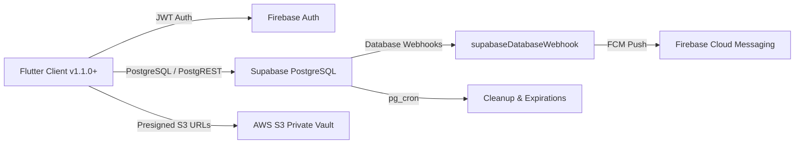
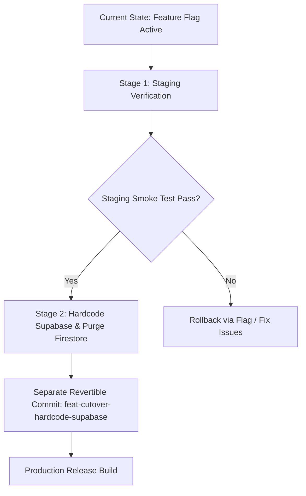

# DoctorNect: Pre-Launch Clean Cutover Plan

**Document Version:** 2.1.0 (Pre-Launch Hardening Complete)  
**Target Architecture:** Firebase Auth + Supabase PostgreSQL ONLY + AWS S3 + Redis  
**Scope:** Core 5 Modules (Doctor, Patient, Pharmacy, Lab, Ambulance) + Auth, Support, Payments, Storage  
**Status:** Pre-Launch Preparation (Staging Verified $\rightarrow$ Direct Production Cutover)

---

## 1. Context Update & Architectural Simplification

### Zero Real Users & Test-Data-Only Baseline
- There are **no real users** on the DoctorNect platform today; all existing records in Firestore and Supabase are synthetic test accounts or developer fixtures.
- The **current Supabase project will directly become the production database** upon launch.
- **No data migration** from Firestore to Supabase is required (`migrate_firestore_to_supabase.js` remains optional/test-data only).
- **No temporary dual-write sync bridges** or dead-letter queues (DLQs) are required after cutover.

### Clean Target Architecture
- **Authentication:** Firebase Authentication (JWT bearer tokens verified directly by Supabase via third-party auth, using `auth.jwt()->>'sub'`).
- **Primary Database:** Supabase PostgreSQL ONLY. Cloud Firestore is completely retired for all 5 core modules.
- **Object Storage:** AWS S3 (private bucket, presigned URLs for medical vault records, lab reports, profile photos, doctor KYC).
- **In-Memory Cache / Rate Limiting:** Redis ONLY (TTL-based OTP challenges, attempts, abuse limits; fails closed without Firestore fallback).
- **Push Notifications:** Supabase Database Webhooks $\rightarrow$ Cloud Functions `supabaseDatabaseWebhook` $\rightarrow$ Firebase Cloud Messaging (FCM).
- **Support Tickets & Realtime:** Supabase PostgreSQL `support_tickets` and `support_ticket_messages` tables with change signal + refetch watcher state machine.
- **Payments:** Razorpay webhook handler writing to `razorpay_orders`, `razorpay_payments`, and `razorpay_webhook_events` with raw body HMAC verification and idempotent transaction execution.

---

## 2. Hardening & Security Milestones Completed

### 2.1 Firestore-Forbidden Test Mode (`FIRESTORE_FORBIDDEN=1`)
- Implemented `backend/functions/firestore_forbidden_guard.js` and `frontend/lib/core/config/firestore_forbidden_guard.dart`.
- When set, any attempted Firestore read or write throws immediately, proving zero covert Firestore dependencies in the Supabase-primary path.

### 2.2 Pure Redis OTP & Abuse Rate Limits
- Under cutover flag ON or `RATE_LIMIT_BACKEND=redis`, `sendUserRegistrationOtp`, `consumeOtpChallengeAtomically`, and `assertOtpRateLimit` rely strictly on Redis TTL keys.
- Eliminates Firestore fallback; fails closed (`HttpsError('unavailable')`) if Redis is unreachable.
- Enforces 5 failed attempts lockout and atomic challenge consumption.

### 2.3 Server-Driven Firebase Custom Claims
- `finalizePatientOtpVerification` and `approveUserAccount` write directly to Firebase Auth custom claims (`role=authenticated`, `app_role`) and PostgreSQL `users` table with zero dependency on Firestore `profile_claims` documents or triggers.
- Client invokes `getIdToken(true)` upon login or registration approval to force instant token refresh.

### 2.4 Razorpay & Promoted Ads in PostgreSQL
- Fully implemented PostgreSQL path in `promoted_ads.js`:
  - `razorpay_orders` stores order metadata and `user_uid`.
  - `razorpay_payments` stores confirmed transaction records with UNIQUE `payment_id`.
  - `razorpay_webhook_events` enforces idempotent processing with UNIQUE `event_id`.
  - Ad activation only succeeds after verified amount, currency, and ownership checks.
  - Verified by 11 Webhook Security tests + Docker PostgreSQL integration test.

### 2.5 Support Tickets Dual-Mode & Realtime Watcher
- `help_support_screen.dart`, `support_tickets_history_screen.dart`, and `support_ticket_chat_screen.dart` delegate to `SupportTicketSupabaseRepository` when the cutover flag is enabled.
- Realtime updates use change-signal + refetch pattern via `SupabaseWatcherStateMachine`.
- Verified by unit and watcher state machine tests.

### 2.6 Full Dependency-Ordered Account Deletion
- `delete_my_account.js` executes strict deletion ordering against PostgreSQL foreign key constraints:
  1. `pharmacy_delivery_medicines` & `pharmacy_deliveries`
  2. `lab_orders`, `lab_bookings`, `lab_connections`
  3. `pharmacy_connections`
  4. `referrals`
  5. `prescription_medicines`, `prescription_investigations`, `prescription_referrals`, `prescriptions`
  6. `health_records`, `family_members`, `review_votes`, `reviews`, `patient_doctor_links`, `patient_care_team`, `appointments`, `ambulance_requests`, `ambulance_broadcasts`, `patient_safe`, `patients`
  7. `doctor_private`, `doctor_availability`, `doctor_facilities`, `doctor_education`, `doctor_directory`, `doctor_blocked_dates`, `doctors`
  8. `medical_stores`, `labs`, `ambulances`, `ambulance_private_settings`, `ambulance_invites`, `ambulance_locations`
  9. `support_ticket_messages`, `support_tickets`, `user_devices`, `in_app_notifications`
  10. Anonymize `razorpay_orders` (`user_uid = null`)
  11. Delete `users` row
  12. S3 user prefix & report deletion
  13. Redis key cleanup
  14. Firebase Auth user deletion (`getAuth().deleteUser(uid)`) last.
- Verified by schema reflection against `information_schema.columns` and Docker PostgreSQL integration tests.

### 2.7 Supabase Auth Leftovers & Dashboard Steps
- `auth-otp` Edge function deleted from repository.
- `backend/supabase/scratch/` deleted.
- `seed_demo_accounts.js` guarded with a strict production environment blocker.
- Dashboard configuration steps documented in `docs/archive/verification/SUPABASE_AUTH_AUDIT.md`.

---

## 3. Two-Step Cutover & Separate Commit Sequence

### Stage 1: Verification with Temporary Flag
- The cutover flag (`DoctorPatientCutoverFlag`) remains active **only** while testing against the live Staging Supabase project.
- The app can toggle between repositories or test with `--dart-define=USE_SUPABASE_DB_DOCTOR_PATIENT=true`.
- Complete verification across Doctor, Patient, Pharmacy, Lab, and Ambulance modules.

### Stage 2: Hardcode Supabase & Delete Firestore Paths (Separate Commit)
- Once Staging is verified and approved:
  1. Make Supabase the hardcoded, direct default in all stores and screens.
  2. Delete `doctor_patient_cutover_flag.dart` and its callsites.
  3. Delete all Firestore repository files for the 5 modules.
  4. Commit this change in a single, isolated, easily reviewable and revertible git commit:  
     `refactor(cutover): hardcode Supabase repositories and deprecate legacy Firestore paths`

---

## 4. Comprehensive File Inventory (Deletions & Modifications)

### 4.1 Files To Be Deleted in Stage 2

| # | File Path | Purpose / Reason for Deletion |
|---|---|---|
| 1 | `backend/supabase/functions/sync-to-firestore/index.ts` | Supabase $\rightarrow$ Firestore reverse sync Edge Function |
| 2 | `backend/supabase/functions/sync-to-firestore/deno.json` | Deno configuration for reverse sync Edge Function |
| 3 | `backend/scripts/supabase_to_firestore_worker.js` | Standalone Node.js worker for reverse sync polling |
| 4 | `backend/functions/cross_role_sync.js` | Firestore $\rightarrow$ Supabase document transformation library |
| 5 | `backend/functions/test/cross_role_sync.test.js` | Tests for deprecated cross-role sync |
| 6 | `backend/functions/test/sync_to_firestore.test.js` | Tests for deprecated reverse sync |
| 7 | `backend/functions/test/sync_to_firestore_emulator.test.js` | Emulator tests for reverse sync |
| 8 | `frontend/lib/core/config/doctor_patient_cutover_flag.dart` | Temporary cutover feature flag |
| 9 | `frontend/lib/core/firebase/repositories/appointment_repository.dart` | Legacy Firestore appointment repository |
| 10 | `frontend/lib/core/firebase/repositories/doctor_account_repository.dart` | Legacy Firestore doctor account repository |
| 11 | `frontend/lib/core/firebase/repositories/doctor_availability_repository.dart` | Legacy Firestore doctor availability repository |
| 12 | `frontend/lib/core/firebase/repositories/doctor_directory_repository.dart` | Legacy Firestore doctor directory repository |
| 13 | `frontend/lib/core/firebase/repositories/doctor_profile_detail_repository.dart` | Legacy Firestore doctor profile detail repository |
| 14 | `frontend/lib/core/firebase/repositories/doctor_profile_repository.dart` | Legacy Firestore doctor profile repository |
| 15 | `frontend/lib/core/firebase/repositories/doctor_verification_repository.dart` | Legacy Firestore doctor verification repository |
| 16 | `frontend/lib/core/firebase/repositories/family_member_repository.dart` | Legacy Firestore family member repository |
| 17 | `frontend/lib/core/firebase/repositories/patient_account_repository.dart` | Legacy Firestore patient account repository |
| 18 | `frontend/lib/core/firebase/repositories/patient_profile_repository.dart` | Legacy Firestore patient profile repository |
| 19 | `frontend/lib/core/firebase/repositories/prescription_repository.dart` | Legacy Firestore prescription repository |
| 20 | `frontend/lib/core/firebase/repositories/referral_repository.dart` | Legacy Firestore referral repository |
| 21 | `frontend/lib/core/firebase/repositories/review_repository.dart` | Legacy Firestore review repository |
| 22 | `frontend/lib/core/firebase/repositories/medical_store_repository.dart` | Legacy Firestore medical store repository |
| 23 | `frontend/lib/core/firebase/repositories/pharmacy_firestore_repository.dart` | Legacy Firestore pharmacy deliveries repository |
| 24 | `frontend/lib/core/firebase/repositories/medical_directory_repository.dart` | Legacy Firestore medical directory repository |
| 25 | `frontend/lib/core/firebase/repositories/medicine_suggestion_repository.dart` | Legacy Firestore medicine suggestions repository |
| 26 | `frontend/lib/core/firebase/repositories/lab_repository.dart` | Legacy Firestore lab profiles repository |
| 27 | `frontend/lib/core/firebase/repositories/lab_booking_repository.dart` | Legacy Firestore lab bookings repository |
| 28 | `frontend/lib/core/firebase/repositories/lab_catalog_repository.dart` | Legacy Firestore lab catalog tests repository |
| 29 | `frontend/lib/core/firebase/repositories/lab_connection_repository.dart` | Legacy Firestore lab connections repository |
| 30 | `frontend/lib/core/firebase/repositories/lab_order_repository.dart` | Legacy Firestore lab orders repository |
| 31 | `frontend/lib/core/firebase/repositories/ambulance_repository.dart` | Legacy Firestore ambulance repository |

### 4.2 Files To Be Modified in Stage 2

| # | File Path | Description of Changes |
|---|---|---|
| 1 | `backend/functions/index.js` | Remove 19 `exports.sync*ToSupabase` functions; remove deprecated Firestore notification triggers (`notifyDoctorOnAppointmentCreated`, `notifyDoctorOnReferralCreated`, `notifyPatientOnAppointmentStatusChanged`) and helper `isDoctorPatientSupabasePrimary()`. Keep `supabaseDatabaseWebhook` as the single notification dispatcher. |
| 2 | `frontend/lib/core/firebase/firestore_service.dart` | Deprecate or remove 5-module Firestore getters; point to Supabase equivalents or remove obsolete delegations. |
| 3 | `frontend/lib/core/supabase/patient_write_guard.dart` | Remove `sync_origin` tagging from write payloads. |
| 4 | `frontend/lib/core/supabase/supabase_patient_repository.dart` | Remove `sync_origin` parameter injection. |
| 5 | `frontend/lib/features/doctor/profile/data/doctor_profile_store.dart` | Remove `DoctorPatientCutoverFlag.isEnabled` check; use `SupabaseDoctorRepository` directly. |
| 6 | `frontend/lib/features/patient/profile/data/patient_profile_mock.dart` | Remove cutover flag check; use `SupabasePatientRepository` directly. |
| 7 | `frontend/lib/features/patient/records/add_record_screen.dart` | Remove cutover flag check; call `SupabasePatientRepository.instance.addHealthRecord` directly. |
| 8 | `frontend/lib/core/notifications/patient_notification_prefs_sync.dart` | Remove cutover flag branching; sync preferences directly to Supabase `patients.notification_preferences`. |
| 9 | `backend/firestore.rules` | Lock down all 5 module collections: `match /{document=**} { allow read, write: if false; }`. |

---

## 5. Verification Checklist for Stage 2 Commit

- [ ] All 31 deleted files have zero dangling imports in `frontend/lib/` or `backend/`.
- [ ] `flutter analyze` runs with zero warnings or errors.
- [ ] `flutter test` passes 100% of test suites.
- [ ] Backend functions build cleanly (`npm run build`).
- [ ] Git commit created on branch with explicit diff reviewable via `git show <commit_hash>`.
